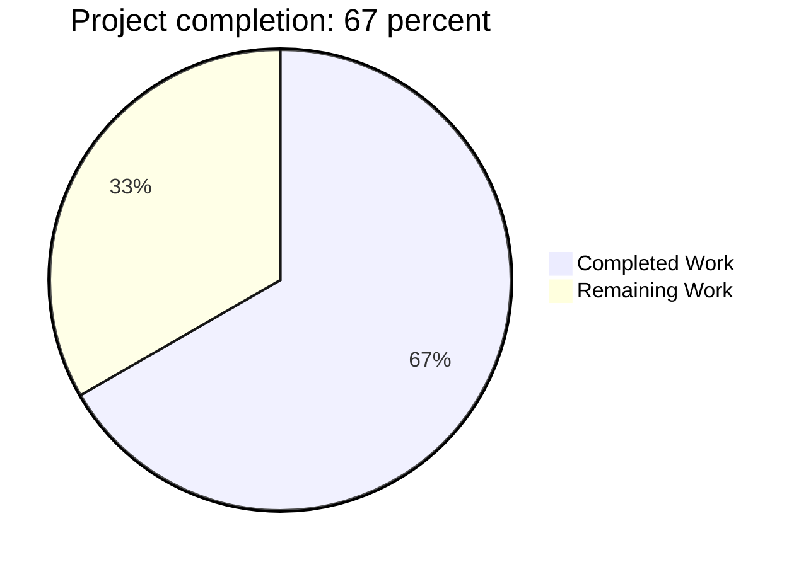
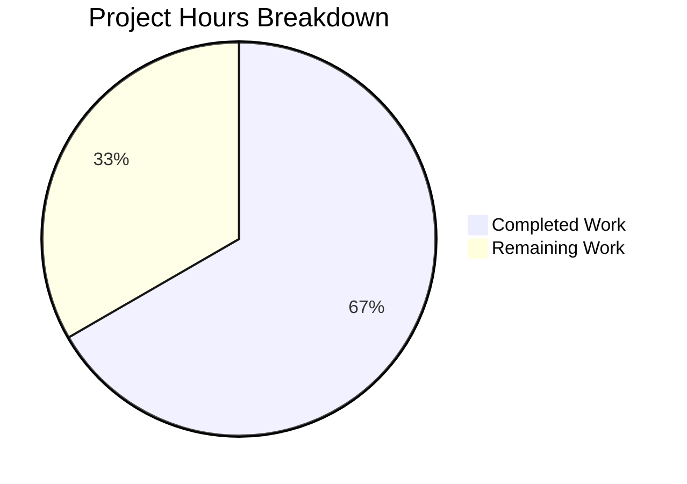

# 1. Executive Summary

Where the project stands, what has been verified, and what a human still has to settle.

## 1.1 Project Overview

This project moves the repository's Node.js HTTP server to Python 3 with Flask. The delivered application, `app.py` at the repository root, reproduces four observable behaviours of the server it replaces and nothing else: the body `Hello, World!` with its trailing newline, HTTP 200 for every path and each of the nine standard methods, a listener on TCP port 3000, and the startup line `Server running at http://127.0.0.1:3000/` printed once per process start. Consumers are any client that previously reached port 3000.

## 1.2 Completion Status

**67% complete** — 32 hours delivered of a 48-hour scope (AAP-scoped work and the path to production).



Completed work is dark blue (#5B39F3); remaining work is white (#FFFFFF).

| Metric | Hours |
| --- | --- |
| Total project hours | 48 |
| Completed hours (AI + manual) | 32 |
| Remaining hours | 16 |
| **Completion** | **67%** (32 ÷ 48) |

## 1.3 Key Accomplishments

- [x] Body `Hello, World!\n` byte-for-byte — 14 bytes including the trailing newline — on every body-carrying method, and HEAD framed without a body (`app.py:11`)
- [x] HTTP 200 on any path and each of the nine methods, driven individually over raw sockets (`app.py:5`, `app.py:8-9`)
- [x] A listener on TCP port 3000 as an inline literal, immovable by any environment value (`app.py:16`)
- [x] The startup line printed exactly once per process start (`app.py:14-15`)
- [x] One flat 16-line file as the whole deliverable, with no manifest, lockfile, suite, configuration, CI, comment or placeholder
- [x] The legacy `server (1).js` left byte-identical and never started; its unused `lodash` require has no counterpart in the port

## 1.4 Critical Unresolved Issues

11 of the 29 scoped requirements carry an accepted caveat or need human follow-up; none blocks the port's four stated behaviours.

| Issue | Impact | Owner | ETA |
| --- | --- | --- | --- |
| Port-3000 ownership is undecided: the legacy JavaScript server and `app.py` both target port 3000 and nothing sequences them; on this host a second bind can succeed silently | Two servers can contend for the port, and a start that cannot serve still looks successful | Operator | 3 hours |
| Reachability is loopback-only, where the legacy server's `listen(3000)` bound every interface | Consumers that reached port 3000 from another host can no longer connect | Human developer / product owner | 3 hours |
| The startup line is emitted before the bind | A process that starts and then fails still announces readiness | Operator | Covered by the port-ownership work |
| An operator-set `FLASK_DEBUG` (or a `.env`/`.flaskenv` in the launch directory) would print the startup line twice and activate the framework's interactive debugger | The exactly-once property breaks and a code-execution surface opens | Operator | 1.5 hours |
| The delivered constructor line adds `static_folder=None` where the plan's illustration shows `Flask(__name__)` | Plan text and code disagree, so a reader cannot tell the keyword is deliberate | Human developer | 2 hours (shared with the two rows below) |
| The plan's four-point agreement clause overstates the legacy file for CONNECT | Documentation misdescribes the reference server on one verb | Human developer | Shared with the row above |
| The superseded payload baseline `Welcome to Blitzy` still sits in `build_prompt (5).md` | A stale document can be mistaken for an unmet requirement | Human developer | Shared with the row above |
| The process of record is the framework's development server: no TLS, no hardening headers, no keep-alive, no request-size or rate limit | Unsuitable for exposure beyond the local host; every request costs a new connection | Human developer / operator | Only if remote exposure is required |
| No dependency pin and no automated regression gate exist | Rebuilds can drift, and future changes are assured only by hand | Human developer | 6 hours (shared with the row below) |
| The plan's assumed interpreter (Python 3.12.3) is not the installed one (3.13.13) | Verification that pins the interpreter would disagree with the plan | Human developer | Shared with the row above |
| The scoping request names `server.js` while the repository holds `server (1).js` | The reference server is ambiguous to a new reader | Human developer | 0.5 hour |

## 1.5 Access Issues

No access issues identified. The application needs no credential, API key, database or broker account: it opens no outbound connection and holds only a loopback listening socket.

## 1.6 Recommended Next Steps

1. [High] Own port 3000: start one server, confirm the socket owner rather than the console line.
2. [High] Keep `FLASK_DEBUG` unset and the launch directory free of dotenv files.
3. [High] Decide whether off-host access is needed, and restore parity with the legacy bind if it is.
4. [Medium] Pin the runtime and add an automated byte-exact smoke gate.
5. [Medium] Reconcile the plan text and the superseded payload document with the delivered code.

# 2. Project Hours Breakdown

Hours are AAP-scoped and hours-based: 32 delivered of 48 total, with the remainder being the path from this verified port to a running, maintainable deployment. Section 2.1 itemises what is delivered; Section 2.2 itemises what is left; Section 2.3 shows the arithmetic.

## 2.1 Completed Work Detail

| Component | Hours | Description |
| --- | --- | --- |
| Flask port implementation (`app.py`) | 6 | The module-level app object, the one-line nine-verb `METHODS` constant named by both rules, the two catch-all rules, the input-free view returning the constant, the `__main__` guard, and the keyword that suppresses the framework's own static-file rule so `/static/*` answers with the constant rather than a 404 (`app.py:3`, `5`, `8-11`, `14-16`) |
| Four-point parity analysis against the framework documentation | 4 | The documented basis each point rests on: UTF-8 encoding of a returned string, the 200 status and content type of that conversion, the explicit method list a rule needs, the runner's port and host defaults, and the reloader being off by default |
| Runtime verification of the four points | 6 | Byte-exact nine-method × path matrix, HEAD framing, byte capture through an independent client, startup-line counting across repeated starts, restart determinism, and port-ownership checks |
| Constraint and artifact compliance | 4 | One file only; no comments or docstrings; no second artifact; no added capability or hardening; the legacy file byte-identical; and the exclusion walk over 19 candidate artifact paths |
| Legacy behaviour analysis and discrepancy reporting | 3 | The four carried behaviours; the unused `lodash` require with no counterpart in the port; the file-name and payload-baseline discrepancies; and the CONNECT difference between the two servers |
| Security and exposure assessment | 4 | Input-surface and injection/reflection sweep, debugger and traceback reachability, secret sweep, CORS absence, and bind confinement |
| Observability assessment | 2 | Stream attribution for the startup line, sensitive-data sweep over both streams and every response, and the logging/health/metrics non-applicability |
| Dependency and environment verification | 1 | Flask 3.1.3 with Werkzeug 3.1.9 present in the environment, with nothing added to the checkout |
| Delivery integrity and commit verification | 2 | One commit adding one file, byte-identical hashes before and after every check, and a clean working tree |
| **Total** | **32** | |

## 2.2 Remaining Work Detail

| Category | Hours | Priority |
| --- | --- | --- |
| Port-3000 ownership: sequence the two servers, confirm the socket owner before accepting readiness, and retire or annotate the legacy record (path to production) | 3 | High |
| Reachability: confirm whether off-host access is needed, and restore parity with the legacy all-interface bind if it is (path to production) | 3 | High |
| Deployment-environment guard: keep `FLASK_DEBUG` unset and no `.env`/`.flaskenv` present in the launch directory, then re-verify the exactly-once startup line (path to production) | 1.5 | High |
| Reproducible dependency pin plus an automated regression gate that re-runs the nine-method byte-exact smoke matrix per change (path to production) | 6 | Medium |
| Plan and documentation reconciliation: the illustrative constructor line, the legacy CONNECT parity clause, and the superseded payload document (plan text) | 2 | Medium |
| Legacy reference confirmation: establish that the file the scoping request names and `server (1).js` are the same artifact (plan text) | 0.5 | Low |
| **Total** | **16** | |

## 2.3 Hours Calculation

- Completed hours: 6 + 4 + 6 + 4 + 3 + 4 + 2 + 1 + 2 = **32 hours** (Section 2.1)
- Remaining hours: 3 + 3 + 1.5 + 6 + 2 + 0.5 = **16 hours** (Section 2.2)
- Total project hours: 32 + 16 = **48 hours**
- Completion: 32 ÷ (32 + 16) × 100 = 66.7%, reported as **67%**

Each completed hour traces to a scoped requirement or to the verification of one, and each remaining hour traces to the path from the verified port to a running deployment or to reconciling the plan text with the delivered code.

# 3. Test Results

This project carries no automated test suite — the scope forbids adding one — so the record below is the runtime gate that was executed by hand against the running application, grouped by what it proves. Coverage is not measured anywhere because no coverage tooling exists in the project.

| Area / Category | Framework | Tests | Passed | Failed | Coverage | What This Proves |
| --- | --- | --- | --- | --- | --- | --- |
| Nine methods × root and nested path | Raw-socket probe against the running app | 18 | 18 | 0 | Not measured | Every one of the nine methods answers both targets with HTTP 200 and exactly 14 bytes, and HEAD is framed with `Content-Length: 14` and no body |
| Path coverage beyond the root | Raw-socket probe | 8 | 8 | 0 | Not measured | Nested, query-bearing, static-looking, unknown, health-probe and empty-segment targets all answer with the constant rather than a 404 |
| Unregistered verb behaviour | Raw-socket probe | 1 | 1 | 0 | Not measured | A verb outside the nine is refused with 405 and an `Allow` list of the supported methods |
| Byte-exact response over an independent client | `curl.exe -o` plus a byte read of the saved body | 2 | 2 | 0 | Not measured | The wire body is exactly 14 bytes `b'Hello, World!\n'`, and HEAD advertises 14 with no body |
| Startup output | stdout/stderr capture with exact-string counting | 3 | 3 | 0 | Not measured | The startup line appears exactly once per start on stdout and never on stderr, alongside the framework's own banner |
| Process lifecycle and port ownership | TCP listener query at start and after stop | 4 | 4 | 0 | Not measured | Each start binds `127.0.0.1:3000` under the pid that was launched and releases the port on stop |
| Browser consumption | Headless Chrome: two navigations, an in-page fetch and a static-looking path | 5 | 5 | 0 | Not measured | A real browser receives and renders the 14-byte body on both URLs, with 0 console errors and 0 of 8 requests failed |
| Delivered-source integrity | AST parse, comment/docstring census, placeholder scan, git inspection | 6 | 6 | 0 | Not measured | The 16-line module parses, holds no comment, docstring, placeholder or stub, and is the single committed file with the legacy server byte-identical |

**Not Covered**

- Nothing in the delivered module is left unexercised: all four stated behaviours, both route rules, all nine methods and the refusal of unlisted verbs were driven at runtime.
- No automated, repeatable suite exists — by scope decision — so none of these checks re-runs itself. A human should execute the nine-method, byte-exact smoke matrix against the target environment as an acceptance gate.
- The legacy JavaScript server is never executed: its behaviour is the fixed contract the port was written against, not a measured baseline, and its own file needs an environment variable to start at all.
- The framework's protocol-level surface is covered only by spot checks: malformed request lines, HTTP/0.9, chunked-encoding edges, `Expect: 100-continue`, header-count and URI-length limits, and signal handling were not swept.
- Off-loopback reachability is untested: the listener is loopback-only, so no client on another host was exercised.
- No production runtime was exercised: the application was run only as a script on the framework's development server, never behind a WSGI server or reverse proxy, and never with `FLASK_DEBUG` present in the environment.

# 4. Runtime Validation & UI Verification

- ✅ **Application startup** — `python app.py` from the repository root prints the startup line once and binds `127.0.0.1:3000` under the process that was launched
- ✅ **Response body and HEAD framing** — 14 bytes including the trailing newline on every body-carrying method; HEAD answers with `Content-Length: 14` and no body
- ✅ **Nine methods on root and nested paths** — GET, HEAD, POST, PUT, DELETE, CONNECT, OPTIONS, TRACE and PATCH each answered 200 in an 18-request raw-socket matrix
- ✅ **Path coverage** — nested, query-bearing, static-looking, unknown, health-probe and empty-segment targets all return the constant instead of a 404
- ✅ **Unregistered verbs** — a verb outside the nine returns 405 with an `Allow` list rather than an answer, as the scope intends
- ✅ **Independent client byte check** — a saved `curl.exe` body read back as exactly 14 bytes, `b'Hello, World!\n'`
- ✅ **Browser consumption** — headless Chrome rendered the constant text on both the root and a nested URL, with no console error and no failed request
- ✅ **Shutdown and port release** — every process stopped by the pid it was started with left no listener behind
- ✅ **Legacy server continuity** — `server (1).js` was never started and remains byte-identical
- ⚠️ **Never exercised at runtime** — off-host reachability (the listener is loopback-only), any production WSGI or reverse-proxy deployment, the application under a reloader, and any environment with `FLASK_DEBUG` present

# 5. Compliance & Quality Review

Compliance is measured against what the delivered code does now, not against how it got there. Section 5.1 maps each deliverable to the benchmark it meets; Section 5.2 records every place the delivery departed from the Agent Action Plan or from the rules the work was held to, with the reason and what a human must decide.

## 5.1 Compliance Matrix

| Deliverable | Benchmark | Status | Progress | Evidence |
| --- | --- | --- | --- | --- |
| Constant response body | Byte-exactness and encoding correctness | ✅ Pass | 100% | 14 bytes `Hello, World!\n` on every body-carrying method; HEAD framed with `Content-Length: 14` and no body (`app.py:11`) |
| Any-path, nine-method 200 | Route coverage and status semantics | ✅ Pass | 100% | 18/18 matrix cells plus eight further path shapes, all 200 (`app.py:5`, `app.py:8-9`) |
| Port 3000 as an inline literal | No hidden configuration surface | ✅ Pass | 100% | Listener observed on `127.0.0.1:3000`; no environment, argument or configuration read (`app.py:16`) |
| Startup line exactly once | Observability correctness | ✅ Pass with caveat | 95% | One stdout occurrence per start, none on stderr; an externally set `FLASK_DEBUG` would double it |
| Single-file deliverable | Scope containment | ✅ Pass | 100% | One tracked file added; no manifest, lockfile, suite, configuration module or CI file exists |
| Legacy server untouched | Non-regression of the existing system | ✅ Pass | 100% | Byte-identical blob and hash, empty diff, never started |
| Comment-free delivered file | Explicit style directive | ✅ Pass | 100% | 0 comment tokens, 0 docstrings, 0 `#` characters in the file |
| No added capability or hardening | Behaviour bounded to the stated points | ✅ Pass | 100% | No handler, middleware, environment configuration, logging or shutdown handling |
| Dependency record | Prerequisite verified, nothing vendored | ✅ Pass | 100% | Flask 3.1.3 with Werkzeug 3.1.9 confirmed in the environment; the checkout is unchanged |
| Input and exposure surface | Secure by construction | ✅ Pass | 100% | No request value is read; no debugger, secret, CORS header or off-loopback listener exists |
| Code hygiene | No dead code, no unused dependency, no placeholder | ✅ Pass | 100% | Both rules reachable, the single import used, placeholder scan empty |
| Deployment readiness | Operability beyond the development server | ⚠️ Partial | 67% | Development-server runner, loopback-only bind and no dependency pin remain (Section 2.2) |

## 5.2 AAP & Rule Divergences and Gaps

Seven divergences were identified: one where the delivered code departs from the plan's illustration to satisfy the plan's own stated behaviour, one where a flagged assumption narrowed behaviour, one where the plan's exclusions override engineering practice, and four discrepancies of plan text, documentation or naming.

| What the AAP / Rule Required | What Was Delivered Instead | Why It Diverged | Impact | Remediation |
| --- | --- | --- | --- | --- |
| The illustrative skeleton writes `app = Flask(__name__)` | `app = Flask(__name__, static_folder=None)` at `app.py:3` | Intra-plan conflict: the framework's default `/static/<path:filename>` rule outranks the catch-all, so two of the plan's own stated behaviours failed for `/static/*` | Plan text and code disagree; behaviour is correct and verified | Amend the plan's illustrative line (2 hours) |
| The runner is called with the port only, binding the documented loopback default (flagged assumption) | Loopback-only bind delivered at `app.py:16` | The plan flagged rather than settled the interface and forbade adding any configuration surface; the required startup message itself names `127.0.0.1` | A consumer that reached port 3000 from another host can no longer connect | Decide reachability and restore parity if needed (3 hours) |
| Enterprise practice as the plan's Rules section states it: no dead code, no unused dependency, no comment noise | No dependency manifest or lockfile and no automated regression gate exists anywhere in the project | Explicit exclusion: the scope forbids a manifest, lockfile, test file and CI configuration | Rebuilds can drift; future changes are verified only by hand | Pin the runtime and add the gate outside the checkout (6 hours) |
| The plan assumes Python 3.12.3 as the interpreter present in the environment | The deliverable runs and was verified on Python 3.13.13 | The plan fixes no version and forbids reading pins out of the repository; 3.12.x is not installed on the host | Verification that pins the interpreter would disagree with the plan; no behaviour depends on the minor version | Record the operative interpreter with the deployment pin |
| The plan states the legacy file "sets no status so Node supplies 200" for the nine methods | The legacy file sends no HTTP response at all for CONNECT; the port answers it with 200 (`app.py:5`, `app.py:16`) | The legacy file is the immutable record and the scoping request demands 200 for all nine methods, so no in-scope settlement exists | Documentation misdescribes the reference server on one verb | Correct the clause (part of the 2-hour reconciliation) |
| The repository's requirement baseline document specifies the payload `Welcome to Blitzy` | The delivered body is `Hello, World!\n` at `app.py:11` — **Sanctioned** | The scoping request fixes its own literal as the source of truth for behaviour and the plan records the older baseline as superseded | The stale document remains in the tree and can be mistaken for an unmet requirement | Annotate or retire the document (part of the 2-hour reconciliation) |
| The scoping request names `server.js` | The repository holds `server (1).js`, and `app.py` references neither name | Reported, not reconciled: the plan declares neither version authoritative | The reference server is ambiguous to a new reader | Confirm both names denote one artifact (0.5 hour) |

**1. Constructor keyword.** The one place the delivered code departs from the plan's illustration is the application object at `app.py:3`. The skeleton shows `Flask(__name__)`; with that literal the framework registers its own `/static/<path:filename>` rule, and because that rule is more specific than the catch-all it wins: GET and HEAD on `/static/*` returned 404 and OPTIONS returned an empty body, breaking two of the four behaviours the plan itself states. The keyword `static_folder=None` removes that framework default route and adds nothing — no route, handler, file or configuration — so the scope exclusions still hold. Amend the plan's illustrative line so plan and code agree.

**2. Reachability.** The plan flagged rather than settled the interface the application binds, and the delivered code leaves it at the framework's loopback default: `app.run(port=3000)` passes no host, so the listener is reachable only from the local machine. The legacy server's `listen(3000)` passed no host either, but Node binds every interface, so a consumer that reached port 3000 from another host will now find nothing there. The plan forbids adding a configuration surface, and the required startup message itself names `127.0.0.1`. Decide whether any such consumer exists; if one does, restore parity deliberately rather than by accident.

**3. Dependency pin and regression gate.** The plan's Rules section applies enterprise practice — no dead code, no unused dependency, no comment noise — and the delivered module honours that. What does not exist, and cannot while the scope stands, is infrastructure: no dependency manifest or lockfile records Flask 3.1.3 with Werkzeug 3.1.9, and no automated gate re-runs the nine-method byte-exact matrix. The scope forbids every one of those artifacts, so their absence is compliance rather than oversight. The cost is operational: a rebuild on another machine can drift, and a future change to `app.py` is verified only by hand. Pin the runtime and add the gate outside the checkout.

**4. Interpreter assumption.** The plan's assumption section names Python 3.12.3 as the interpreter "present in the environment for this work". It is not: the host carries Python 3.13.13 and no 3.12.x. Nothing was pinned or read out of the repository, because the scope forbids it, and no behaviour depends on the interpreter minor version — Flask 3.1.3 requires 3.9 or later, all four behaviours were exercised end to end on 3.13.13, and the module reads no version attribute. Record the operative interpreter wherever the deployment is pinned, so later verification does not disagree with the plan text.

**5. Legacy CONNECT clause.** The plan's record of the legacy server's behaviour states that it "sets no status so Node supplies 200" for the nine methods. For eight of them that is accurate. For CONNECT it is not: Node emits a `connect` event rather than a `request` event, and with no listener attached the connection is simply closed, so the legacy file sends no HTTP response at all. The port answers CONNECT with 200 and the constant body, which is what the scoping request demands and what the delivered code does (`app.py:5`, `app.py:16`). Correct the clause when the plan is next revised; the code is the compliant side of the difference.

**6. Superseded payload baseline.** The repository carries a requirement baseline document whose first line specifies the payload `Welcome to Blitzy`. The delivered body is `Hello, World!\n`, and no tracked source implements the other text. This divergence is sanctioned: the request that scoped the port quotes its own server snippet, designates that snippet as the only source of truth for behaviour, and fixes the body byte for byte, so the newer instruction supersedes the older baseline. The plan records the conflict rather than resolving it. The residual risk is documentary — a reader who opens `build_prompt (5).md` may treat it as an unmet requirement, so annotate or retire it.

**7. Reference file name.** The scoping request names `server.js`. No file of that name exists in the repository; the JavaScript server present is `server (1).js`, which the plan read, quoted verbatim and declared neither newer nor authoritative than the snippet. The delivered module references neither name and depends on neither, so nothing in the code is affected. The practical consequence is a human one: a reader cannot tell from the request alone which file is the reference, and the legacy file's own quirks — an unused `lodash` require and no HTTP response for CONNECT — matter to anyone using it as the yardstick. Confirm both names denote the same artifact and record the outcome.

# 6. Risk Assessment

| Risk | Category | Severity | Probability | Mitigation | Status |
| --- | --- | --- | --- | --- | --- |
| Two processes target port 3000 and nothing sequences them; on this platform a second bind can succeed silently, so contention does not announce itself | Operational | High | High | Start exactly one server, confirm which process owns the listening socket before accepting readiness, and retire or annotate the legacy record | Open |
| The process of record is the framework's development server: no TLS, no hardening headers, no keep-alive, no request-size or rate limit, and its own production warning at startup | Technical | Medium | High | Run behind a production WSGI server and a reverse proxy before any exposure beyond the local host | Accepted by scope; decision open |
| The listener is loopback-only, narrowing reachability against the legacy server's all-interface bind | Integration | Medium | High | Confirm whether any consumer needs off-host access, and restore parity deliberately if one does | Open decision |
| An operator-set `FLASK_DEBUG` or a `.env`/`.flaskenv` in the launch directory would print the startup line twice and activate the interactive debugger | Security | High | Low | Keep the variable unset and the launch directory free of dotenv files, and re-check the exactly-once property in the target environment | Open (environmental) |
| An unconsumed request body stays on the connection after the response, with no size or rate limit to bound it | Security | Low | Medium | Keep access loopback-only, or apply size and rate limits at a reverse proxy | Accepted by scope |
| No dependency pin and no automated regression gate exist | Technical | Medium | Medium | Pin the runtime outside the checkout and re-run the nine-method byte-exact matrix on every change | Open |
| The response advertises framework and interpreter versions in its `Server` header, and the plain-text body is served as `text/html`, so browsers render it in quirks mode | Security | Low | High | Strip or override the header at a proxy if exposure matters; the body carries no markup or input, so no injection surface exists | Accepted by scope |
| The startup line is printed before the bind, so a process that cannot serve still announces readiness | Operational | Medium | Medium | Verify the listening socket after start instead of trusting stdout | Accepted by design |

# 7. Visual Project Status

Project hours split 32 completed to 16 remaining. Completed work is dark blue (#5B39F3); remaining work is white (#FFFFFF).



| Remaining work by category | Hours |
| --- | --- |
| Port-3000 ownership and disposition of the legacy record | 3 |
| Reachability decision and parity | 3 |
| Deployment-environment guard for the exactly-once startup line | 1.5 |
| Reproducible dependency pin and automated regression gate | 6 |
| Plan and documentation reconciliation | 2 |
| Legacy reference confirmation | 0.5 |
| **Total remaining** | **16** |

# 8. Summary & Recommendations

The project is 67% complete: 32 hours of AAP-scoped delivery and verification against a 48-hour total, measured on hours. What exists and works is a single 16-line module, `app.py` at the repository root, that reproduces the four behaviours the port was scoped to carry — the 14-byte body `Hello, World!\n`, HTTP 200 on any path and each of the nine methods, a listener on TCP port 3000, and the startup line printed exactly once per process start. Every one of those points was exercised at runtime, on the wire and through a real browser, with the byte-exact body confirmed by three independent consumers; all 29 scoped requirements are met, the legacy JavaScript server is byte-identical and untouched, and the checkout contains no manifest, test suite, configuration module or build artifact.

What remains is the path from a verified port to a running deployment: 16 hours across six items. Three are decisions a human must take — which process owns port 3000 in each environment, whether any consumer still needs access from another host, and confirmation that the target environment cannot flip the exactly-once startup property. Two are engineering hygiene the current scope forbids inside the repository: pinning Flask 3.1.3 with Werkzeug 3.1.9 and Python 3.13.13 outside the checkout, and an automated gate that re-runs the nine-method byte-exact matrix on every change. The last is documentary reconciliation of the plan text and a superseded payload baseline with the code that shipped.

The critical path to production is short and operational rather than structural. First, sequence the servers so exactly one binds port 3000 and confirm the socket owner rather than the console line; the startup message is printed before the bind, so a message alone is not proof of readiness. Second, settle reachability: the current listener answers only on the loopback interface, which is a deliberate narrowing from the legacy server, and any consumer that used to arrive from another host must either be retired or have parity restored. Third, keep `FLASK_DEBUG` out of the deployment environment, since it would both break the exactly-once property and expose the framework's interactive debugger. Only after those three does the optional hardening path — a production WSGI server behind a reverse proxy — become relevant.

Success metrics for the delivered scope are unambiguous and all currently met: the body is exactly 14 bytes including its trailing newline on every body-carrying method; the status is 200 for all nine methods on the root and on nested paths, with no 404 anywhere; the listener is on port 3000 and immovable by environment values; the startup line appears once per start; and the file carries no comment, docstring, placeholder or second artifact. The remaining metric to establish is regression assurance, which today rests on a hand-run gate rather than an automated one.

Production readiness: the port is complete and correct for its stated purpose and is ready to be accepted as the replacement server on a single host. It is not hardened for exposure — it runs the framework's development server on loopback, with no TLS, no authentication (a public constant-response endpoint by design), no rate or size limit and no keep-alive. That posture follows the scope as written, not a defect in the code; deploying it beyond the local host should be preceded by the three decisions above and, where exposure is required, a production WSGI server with a reverse proxy in front.

# 9. Development Guide

Commands are shown for Windows PowerShell 5.1 and were executed from the repository root before being written here. Every command below was run and its output is quoted as observed.

### 9.1 System Prerequisites

| Requirement | Version present | Notes |
| --- | --- | --- |
| Python | 3.13.13 | On `PATH` as both `python` and `python3`. Flask 3.1.3 requires Python 3.9 or later |
| Flask | 3.1.3 | Installed in the shared site-packages; no per-project install needed |
| Werkzeug | 3.1.9 | Pulled in by Flask and supplies the development server and the response encoding |
| Node.js | 22.23.3 | Needed only to run the legacy `server (1).js`, which is not part of the delivered application |
| curl | Present on the host | Used only for the byte-exact response check |

### 9.2 Environment Setup

There is nothing to configure. The application reads no environment variable, no argument and no configuration file; it has no `.env`, no `.flaskenv`, no `requirements.txt` and no virtual environment requirement. Confirm the prerequisites instead of installing anything:

```powershell
python -c "import importlib.metadata as m; print('flask', m.version('flask'), '/ werkzeug', m.version('werkzeug'))"
```

Observed output: `flask 3.1.3 / werkzeug 3.1.9`.

If you prefer an isolated interpreter, create a virtual environment outside the checkout and install the same version there — never commit it:

```powershell
python -m venv .venv
.\.venv\Scripts\python.exe -m pip install flask==3.1.3
```

### 9.3 Syntax Gate

Run this before every change. It parses the file without writing bytecode, so it leaves no artifact behind:

```powershell
python -c "import ast; ast.parse(open('app.py', encoding='utf-8').read()); print('app.py parses cleanly')"
```

Observed output: `app.py parses cleanly`.

### 9.4 Starting the Application

The file is the entry point: it must be executed as a script so that its `__main__` guard prints the startup line and starts the server. Start it detached, capture the process id and keep both output streams so the startup line and the request log can be inspected later:

```powershell
$p = Start-Process python -ArgumentList 'app.py' -WorkingDirectory (Get-Location).Path `
     -PassThru -NoNewWindow -RedirectStandardOutput out.log -RedirectStandardError err.log
$p.Id | Tee-Object -FilePath app.pid
```

Observed stdout on a healthy start:

```
Server running at http://127.0.0.1:3000/
 * Serving Flask app 'app'
 * Debug mode: off
```

The application binds TCP port 3000 on the loopback interface only. If port 3000 is already taken, the startup line is still printed — it is emitted before the bind — so confirm the listener instead of trusting the message:

```powershell
Get-NetTCPConnection -LocalPort 3000 -State Listen -ErrorAction SilentlyContinue |
    Select-Object LocalAddress, LocalPort, OwningProcess
```

Observed output: `127.0.0.1  3000  <pid of the process you started>`.

### 9.5 Verification Steps

Response status and byte length in one call:

```powershell
curl.exe -sS -o body.bin -w 'http_code=%{http_code} size=%{size_download} type=%{content_type}' http://127.0.0.1:3000/
```

Observed output: `http_code=200 size=14 type=text/html; charset=utf-8`.

Confirm the body is exactly the constant, including the trailing newline:

```powershell
python -c "b=open('body.bin','rb').read(); print('bytes:', len(b), 'repr:', repr(b))"
```

Observed output: `bytes: 14 repr: b'Hello, World!\n'`.

HEAD framing: the response advertises 14 bytes and sends no body.

```powershell
curl.exe -sSI http://127.0.0.1:3000/ | Select-String -Pattern 'HTTP/|Content-Length:|Content-Type:'
```

Observed output: `HTTP/1.1 200 OK`, `Content-Type: text/html; charset=utf-8`, `Content-Length: 14`.

Stopping the server — always by the pid you captured, never by image name:

```powershell
Stop-Process -Id (Get-Content app.pid)
```

After stopping, `Get-NetTCPConnection -LocalPort 3000 -State Listen` returns nothing.

### 9.6 Example Usage

Every path and each of the nine methods returns the same constant. A few representative calls:

```powershell
curl.exe -sS http://127.0.0.1:3000/            # -> Hello, World!
curl.exe -sS http://127.0.0.1:3000/a/b/c       # -> Hello, World!  (nested paths are covered by the catch-all)
curl.exe -sS http://127.0.0.1:3000/does-not-exist
curl.exe -sS -X PUT   http://127.0.0.1:3000/anything
curl.exe -sS -X PATCH http://127.0.0.1:3000/
curl.exe -sS -X OPTIONS http://127.0.0.1:3000/
curl.exe -sS -X TRACE http://127.0.0.1:3000/
```

`CONNECT` is answered with the same 200 and the same body; a client such as a browser may refuse to issue it, so use a raw socket client if you need to check that verb. A verb outside the nine (for example `PROPFIND`) returns `405 Method Not Allowed` with an `Allow` header listing the supported methods.

### 9.7 Running on a Machine Where Port 3000 Is Taken

The bind port is an inline literal, so the supported way to run an isolated instance is to copy the file into a working directory that is not the checkout, change only the copy's literal, and leave the repository file alone:

```powershell
$work = '<a working directory outside the checkout>'
Copy-Item app.py "$work\app_iso.py"
(Get-Content "$work\app_iso.py" -Raw).Replace('port=3000', 'port=3081') |
    Set-Content "$work\app_iso.py" -NoNewline
$q = Start-Process python -ArgumentList "$work\app_iso.py" -WorkingDirectory $work `
     -PassThru -NoNewWindow -RedirectStandardOutput "$work\iso_out.log" -RedirectStandardError "$work\iso_err.log"
curl.exe -sS -o "$work\iso_body.bin" -w 'iso http_code=%{http_code} size=%{size_download}' http://127.0.0.1:3081/
Stop-Process -Id $q.Id
```

Observed behaviour with the copy: `iso http_code=200 size=14`, a listener on `127.0.0.1:3081` owned by the process that was started, and no listener left afterwards. The startup line in that copy deliberately still reads `3000`, since only the bind literal is changed. Never commit the copy or any file the check produces.

### 9.8 Troubleshooting

| Symptom | Cause | Resolution |
| --- | --- | --- |
| The startup line prints and the process then exits | The bind failed — port 3000 is already held, and the message is printed before the bind | Check which process owns the port with `Get-NetTCPConnection -LocalPort 3000 -State Listen`, stop only a process you started, and restart |
| The startup line prints twice and a child process appears | `FLASK_DEBUG` is set in the environment, or a `.env`/`.flaskenv` file sits in the launch directory; this also activates the interactive debugger | Unset `FLASK_DEBUG` and remove any dotenv file from the launch directory, then restart |
| `ModuleNotFoundError: No module named 'flask'` | Running under an interpreter other than the one carrying Flask | Confirm with the version probe in 9.2, or install Flask 3.1.3 into the interpreter you are using |
| Nothing answers on port 3000 from another machine | The listener is loopback-only by design | Connect from the local host, or decide reachability as described in Sections 5.2 and 6 |
| Starting with `python -m flask run` prints no startup line | The `__main__` guard only executes when the file is run as a script | Start it as `python app.py` |
| A client that expects to reuse a connection stalls | The development server sends `Connection: close` and offers no keep-alive | Open a new connection per request, or front the app with a server that supports keep-alive |
| The browser logs a Quirks Mode notice | The constant plain-text body is served with the framework's documented `text/html` content type and carries no doctype | Informational only; the body contains no markup and no input is reflected |
| A `405` appears for a verb you expected to be answered | Only the nine standard methods are registered | Use one of GET, HEAD, POST, PUT, DELETE, CONNECT, OPTIONS, TRACE, PATCH |

### 9.9 Housekeeping

The application writes nothing to disk: no log file, no data file and no cache. Bytecode caches appear only if the module is imported rather than run as a script, so keep `__pycache__`, any captured `body.bin`/`out.log`/`err.log` files and any isolated copy out of the repository. The legacy `server (1).js` is not required to run the application; if you do start it for reference, it needs `NODE_PATH` set to the global npm modules directory because of an unused `lodash` require, and it binds the same port, so only one of the two can run at a time.

# 10. Appendices

Supporting references for operating and maintaining the ported server. Every command listed here was executed before being recorded.

### A. Command Reference

| Purpose | Command |
| --- | --- |
| Verify the installed framework versions | `python -c "import importlib.metadata as m; print(m.version('flask'), m.version('werkzeug'))"` |
| Parse the module without writing bytecode | `python -c "import ast; ast.parse(open('app.py', encoding='utf-8').read())"` |
| Start detached and capture the process id | `$p = Start-Process python -ArgumentList 'app.py' -PassThru -NoNewWindow -RedirectStandardOutput out.log -RedirectStandardError err.log; $p.Id` |
| Confirm who owns the port | `Get-NetTCPConnection -LocalPort 3000 -State Listen \| Select-Object LocalAddress, LocalPort, OwningProcess` |
| Byte-exact response check | `curl.exe -sS -o body.bin -w '%{http_code} %{size_download}' http://127.0.0.1:3000/` |
| Read back the saved body | `python -c "print(repr(open('body.bin','rb').read()))"` |
| Stop the server | `Stop-Process -Id <the pid you captured>` |
| Inspect the delivered file's hash | `Get-FileHash app.py -Algorithm SHA256` |
| Confirm the legacy server is untouched | `git diff HEAD -- "server (1).js"` |

### B. Port Reference

| Port | Bound by | Reachability | Notes |
| --- | --- | --- | --- |
| 3000 | `app.py` (`app.run(port=3000)`, `app.py:16`) | Loopback only (`127.0.0.1`) | Fixed by the scope as an inline literal; no environment variable, argument or configuration file can move it |
| 3000 | `server (1).js` (`listen(3000)`) | Every interface in the legacy process | Cannot run at the same time as `app.py`; the legacy file is retained unchanged as the record |
| 5000 | Nothing | — | The framework's documented default runner port, overridden by the literal 3000; no listener appears on it |

### C. Key File Locations

| Path | Role |
| --- | --- |
| `app.py` | The delivered application — 16 lines: the app object, the nine-method constant, both route rules, the view, and the `__main__` guard |
| `server (1).js` | The legacy Node server, kept byte-identical as the behavioural record; not required to run the port |
| `README.md` | One-line repository heading |
| `build_prompt (5).md` | The repository's earlier requirement baseline; its payload text is superseded by the delivered body (Section 5.2) |

### D. Technology Versions

| Component | Version | Notes |
| --- | --- | --- |
| Python | 3.13.13 | The interpreter the port was verified on; no version is pinned anywhere in the repository |
| Flask | 3.1.3 | Supplies the application object, the route decorator and the runner |
| Werkzeug | 3.1.9 | Supplies the development server and the UTF-8 encoding of a returned string |
| Jinja2 | 3.1.6 | Present transitively; no template is used |
| itsdangerous | 2.2.0 | Present transitively; no session is used |
| blinker | 1.9.0 | Present transitively |
| MarkupSafe | 3.0.4 | Present transitively |
| Node.js | 22.23.3 | Needed only for the legacy file |

### E. Environment Variable Reference

The application reads no environment variable. The table records what was checked and why, so a deployment does not rely on configuration that does not exist.

| Variable | Effect on the application | Action |
| --- | --- | --- |
| `FLASK_DEBUG` | None in the delivered code, but the framework reads it: setting it enables the reloader (the startup line prints twice, with a child process) and the interactive debugger | Leave it unset in the deployment environment |
| `PORT`, `FLASK_RUN_PORT`, `SERVER_NAME` | None — the bind port is an inline literal | No action; setting them changes nothing |
| `NODE_PATH` | Not used by `app.py`; required only to start the legacy `server (1).js`, which has an unused `lodash` require | Set it only if you run the legacy file |

### F. Developer Tools Guide

| Need | What to use | Note |
| --- | --- | --- |
| Syntax check | `python -c "import ast; ast.parse(...)"` | Leaves no `__pycache__` behind, unlike `py_compile` |
| HTTP client | `curl.exe` | PowerShell's `>` redirection is not byte-faithful for a 14-byte body; write to a file with `-o` and read it back with Python |
| Raw protocol checks | Any socket client (Python's `socket` module) | The only way to drive `CONNECT` and to read an exact status line and header set |
| Browser check | A headless Chrome session | Confirms the page a real client renders; expect one informational Quirks Mode notice and no console errors |
| Git hygiene | `git status --porcelain`, `git diff --stat` | Keep `__pycache__`, captured bodies, logs and any isolated copy out of the repository |
| Legacy reference | `NODE_PATH` plus `node "server (1).js"` | Only if you need the old behaviour; it binds the same port, so the two servers cannot run together |

### G. Glossary

| Term | Meaning in this project |
| --- | --- |
| Agent Action Plan (AAP) | The written scope this work was delivered against: one new file, four behaviours, and an explicit list of artifacts that must not be created |
| Catch-all route | The rule that answers every path, including nested ones, through the `<path:path>` converter, plus an explicit rule for the root URL |
| Byte-exact body | The response is the 14 bytes `Hello, World!` followed by a newline, with no trimming, re-encoding or templating |
| HEAD framing | A HEAD request returns the same status and headers as GET, including `Content-Length: 14`, but sends no body |
| Loopback bind | The listener accepts connections only on `127.0.0.1`, not on the host's other addresses |
| Exact-once startup line | The message `Server running at http://127.0.0.1:3000/` appears once per process start and never per request |
| Reloader | The framework feature that re-executes the module when the debug flag is set; it would print the startup line a second time |
| Development server | The built-in server the application runs on; it is convenient but not intended for production and prints its own warning |
| Static folder suppression | The `static_folder=None` keyword that stops the framework registering its own `/static/<path:filename>` rule, so no path is answered with a 404 |
| Exotic verb | A method such as `PROPFIND` that Node's parser accepted; it is outside the nine supported methods and is refused with 405 |
