# Technical Specification

# 1. Introduction

## 1.1 Executive Summary

The system specified by this document is a five-line, self-contained Node.js HTTP listener, `server (1).js`, which answers every inbound request with the constant body `Hello, World!\n`. It is delivered as a three-file, 2,034-byte checkout whose remaining members are the repository's only written requirements, `build_prompt (5).md` (1,831 bytes, 32 lines), and a title-only `README.md` (18 bytes, one line: `# 14Oct2026_3Files`). The repository holds no dependency manifest, no runtime pin, no build script, no test and no CI configuration; each of those was probed and is absent. What is being documented is therefore a minimal, dated dataset snapshot — published to `lakshya-blitzy/14Oct2026_3Files` in two web-UI commits on 2026-10-14 — whose executable content is a single fixed HTTP response, not a product.

| File | Size | Role in the system |
| --- | --- | --- |
| `server (1).js` | 185 bytes / 5 lines | The only executable artifact: a CommonJS Node.js HTTP server bound to port 3000 with a hard-coded response body |
| `build_prompt (5).md` | 1,831 bytes / 32 lines | The only written requirement source: one objective plus roughly thirty constraint clauses that fix the change's scope |
| `README.md` | 18 bytes / 1 line | Repository label and dataset identifier (`14Oct2026_3Files`); carries no description, install or run instructions |

**Project Overview**

`server (1).js` is a single chained expression statement built on the Node.js standard-library `http` module: `require('http').createServer(<listener>).listen(3000, <callback>)`. The listener ignores the request entirely and terminates every response with the literal `'Hello, World!\n'`; the listen callback writes one startup line to stdout. The module exports nothing, reads no environment variable, and declares no configuration surface of any kind — port, body and log text are inline literals. Executed against Node.js v22.23.3 supplied by the host, the server returns `HTTP/1.1 200 OK` with `Content-Length: 14` for `GET /` and identically for `POST /anything?x=1`, confirming there is no routing, method discrimination, header inspection or body parsing. The `build_prompt (5).md` file is not an artifact of the running system; it is the instruction set that governs how the system's source file may be edited, and it is treated here as the specification's requirement baseline.

**Core Business Problem**

The repository records no business problem statement, market analysis, customer requirement or defect log; the only requirement text in existence is `build_prompt (5).md`. That document states one objective on its first line — create code that prints `"Welcome to Blitzy"` without any format, using as few lines as possible and minimising token usage — and then constrains how it may be achieved. Two consequences follow directly from the evidence:

- **Objective-versus-behavior delta.** `build_prompt (5).md` line 1 names the target output `Welcome to Blitzy`, while `server (1).js` line 4 emits `Hello, World!\n`. The repository records the intended output change but the current artifact still emits the older literal; this section documents the artifact as it exists, and the delta is the pending work the constraint document defines.
- **The artifact cannot start as checked out.** Line 1 of `server (1).js` is `const _ = require('lodash');`. The binding `_` is never referenced again anywhere in the file, the package is not installed (`npm ls lodash` reports an empty tree), and no manifest declares it. Loading the module therefore aborts at startup with `Error: Cannot find module 'lodash'`, code `MODULE_NOT_FOUND`, at `server (1).js:1:11`; the file passes `node --check` (it is syntactically valid) and starts only when lodash is supplied externally. The single technical problem the system actually exhibits is that a dead, undeclared, unpinned import gates a five-line server that has no use for it.

The engineering problem the system addresses is thus narrow and precisely bounded: expose a working HTTP responder with the smallest possible footprint while resisting every conventional addition — dependency, configuration, error handling, test, documentation and structure — that a normal project would attract.

**Key Stakeholders and Users**

| Stakeholder / user | Evidence | Interest in the system |
| --- | --- | --- |
| Repository publisher (`lakshya-blitzy`) | Sole author of both commits, 2026-10-14: `2ee3243` "Initial commit", `bc65fd0` "Add files via upload" | Provisioned the three files; the dataset snapshot is theirs to version |
| Implementing agent or engineer | Addressed imperatively throughout `build_prompt (5).md` ("Do not create any other file…", "Make the smallest possible diff…") | Bound by the constraint set; consumes the file as an executable work order |
| Human reader of the change record | `build_prompt (5).md` lines 18-19 and 25-26 require a concise plan stating the file diff plainly | Reviews the plan rather than a test result, since lines 27-30 forbid test-style acceptance criteria |
| Arbitrary HTTP client | Port 3000 listens on all interfaces and answers unauthenticated; a request to the host's external address returned `http_code=200` | Any reachable client receives the same fixed body; no client is identified, authenticated or distinguished |

No end-user documentation, persona, service-level agreement, support model, licensing statement or contributor guide exists in the repository, so no customer-facing or commercial stakeholder can be evidenced. The users of the system are, provably, only the publishers, the instruction-following implementer and unauthenticated network clients.

**Expected Business Impact and Value Proposition**

The repository states no business impact, revenue, cost, adoption or market-positioning objective, and defines no KPI or service-level target; `build_prompt (5).md` lines 27-30 go further and explicitly prohibit a verification, coverage or quality-criteria section, making the exact file contents themselves the acceptance criterion. Quantified business impact therefore cannot be reported from evidence, and this specification does not assert any. What the artifact demonstrably delivers is operational, and it is unusual: 

- **Smallest viable HTTP responder.** 185 bytes of source, one hard-coded port, zero configuration, no build step, and no runtime dependency that the code genuinely needs — runnable on stock Node.js and portable by copy alone.
- **An explicit anti-scope-creep contract.** Roughly thirty clauses in `build_prompt (5).md` pin the change to a minimal diff with no unrelated refactoring, reformatting or renaming; no new file whatsoever (including `CONTRIBUTING.md`, `CHANGELOG.md`, `LICENSE`, a `docs/` folder, architecture diagrams or badges); a single-line JSDoc summary with no `@param`, `@returns` or examples; `README.md` under five lines; no test suite, test file, lockfile or new dependency; and no unrequested hardening such as a 404 handler, error handler or environment-variable configuration.
- **A reproducible fixture.** The entire system is three blobs, two commits and two trees — seven Git objects in total — with no branch or dangling object carrying anything further, so any reader can reproduce the documented state exactly.

The value proposition is consequently that of a reference fixture and a constraint-fidelity test, not a commercial service. Its fidelity is what a reviewer must judge, and the constraint document — not a metric — is the yardstick.

## 1.2 System Overview

The system described by this specification is the process that `server (1).js` becomes when a Node.js runtime loads it. There is no deployable unit beyond that one 185-byte file: no manifest declares it, no container or process definition supervises it, and no build step produces it. The two accompanying files, `build_prompt (5).md` and `README.md`, are documents — the first is the requirement baseline that governs edits to the source, the second is a dataset label — and neither participates in runtime behavior. Throughout this document, "the system" therefore means the listening HTTP process plus the host-provided Node.js runtime it depends on, and "the artifact" means `server (1).js` alone.

### 1.2.1 Project Context

#### Business Context and Market Positioning

No file in the repository states a business context, target market, customer segment, competitor, price or positioning claim. The context that can be evidenced is provenance and naming only. `README.md` carries a single line, `# 14Oct2026_3Files`, which names the checkout after a date and a file count. Both commits were authored by `lakshya-blitzy` on 2026-10-14 forty-five seconds apart, the second titled "Add files via upload", into the upstream repository `lakshya-blitzy/14Oct2026_3Files`. The two working files retain web-upload duplicate suffixes — `server (1).js`, `build_prompt (5).md` — and the "(5)" on the prompt suggests a numbered series rather than a unique document. The brand term "Blitzy" appears in exactly one place, as the literal target output on line 1 of `build_prompt (5).md`.

From that evidence the artifact reads as an internal, dated evaluation or demonstration fixture, not a distributed offering: it publishes no package, declares no version, carries no license file, tags no release, and ships no user-facing documentation. The repository contains no statement of positioning, so no market position is asserted here; the reading above is an inference grounded in the naming and commit evidence, and the absence of a stated purpose is itself a documented gap.

#### Current System Limitations

The system does not replace or upgrade a predecessor. History comprises two commits and three blobs with no dangling object, so there is no legacy path, migration note or deprecated artifact to account for. The limitations below are those of the current implementation measured against its own recorded objective and against ordinary operational expectations; each was established by executing the artifact rather than by reading documentation.

| # | Limitation | Evidence | Consequence |
| --- | --- | --- | --- |
| 1 | Startup is blocked by an unused, undeclared dependency | `server (1).js:1` binds `require('lodash')` to `_`, never referenced again; loading the file throws `Cannot find module 'lodash'` at `1:11`; `npm ls lodash` is empty and no manifest declares it | The artifact cannot start from a fresh checkout; every run depends on lodash being injected externally |
| 2 | The recorded objective is not yet implemented | `build_prompt (5).md:1` names the target output `Welcome to Blitzy`; `server (1).js:4` emits `Hello, World!\n` | The requirement is documented but the artifact still produces the older literal |
| 3 | No startup error handling | A second instance dies with an unhandled `Error: listen EADDRINUSE`; there is no error callback on `listen` | Port conflicts terminate the process silently rather than reporting or retrying |
| 4 | The startup log misstates the bind address | `listen(3000)` passes no host, so the socket binds `:::3000`; a request to the host address `10.11.0.13:3000` returned `200`, while the log line says `127.0.0.1` | Operators may believe the service is loopback-only when it is exposed on every interface |
| 5 | No authentication or authorization | The same non-loopback request returned `HTTP/1.1 200 OK` with the fixed body | Any reachable client receives the response; no client is identified or rejected |
| 6 | No shutdown path | No `SIGTERM`/`SIGINT` handling and no `server.close()` anywhere in the file | Termination is abrupt, with no drain or cleanup |
| 7 | No configuration surface | Zero `process.env` occurrences; port 3000, the body and the log text are inline literals | The port cannot be changed without editing source |
| 8 | No test, no CI, no runtime pin | Test files, `.github`, `.circleci`, `.gitlab-ci.yml`, `.nvmrc` and `.node-version` are all absent | Behavior is verified only by manual execution against whatever Node.js the host provides (v22.23.3 was observed) |
| 9 | No run documentation | `README.md` is 18 bytes and holds only a title | A newcomer learns neither the port nor the lodash prerequisite from the repository |
| 10 | The filename is awkward for tooling | `server (1).js` contains a space and parentheses; it appears as such in `git ls-files` | Invocation requires quoting — `node "server (1).js"` — and the path is not importable as a bare `require('./server')` |

#### Integration with the Existing Enterprise Landscape

No enterprise integration exists, and none is declared. The artifact makes no outbound network call, opens no database or cache connection, publishes or consumes no message, contacts no identity provider, and writes to no log aggregator or telemetry endpoint. There is no container or process-supervision definition (`Dockerfile`, `Procfile` and `docker-compose.yml` are all absent), no CI pipeline to run it, and no registry publication that would distribute it. The single integration surface is inbound: a TCP listener on port 3000 that accepts unauthenticated HTTP from any interface. Deployment consequently requires no enterprise system, and no enterprise system is aware of the service — an operator must discover the running port from the source or from the process itself.

### 1.2.2 High-Level Description

#### Primary System Capabilities

The complete capability set is short and fully reachable from five lines of source.

| Capability | Mechanism | Verified behavior |
| --- | --- | --- |
| Accept inbound HTTP on a fixed port | `listen(3000)` with no host argument, so the socket binds every interface | Reachable at `10.11.0.13:3000`, returned `http_code=200` |
| Return a constant success response | The request listener ignores `req` and calls `res.end('Hello, World!\n')` | `HTTP/1.1 200 OK`, `Content-Length: 14`, byte-identical for `GET /` and `POST /anything?x=1` |
| Announce readiness once | The second inline callback logs on bind | `Server running at http://127.0.0.1:3000/` written to stdout |
| Start on module load | Top-level chained expression; nothing is exported | Requiring the file starts the listener; the module's export object remains empty |

Everything the system does is in that table. There is no path routing, no method or header inspection, no request-body parsing, no response header control, no content negotiation, no static file serving, no session or cookie handling, no metrics endpoint and no administrative interface.

#### Major System Components

| Component | Type | Responsibility |
| --- | --- | --- |
| `server (1).js` | Single-file CommonJS module, 185 bytes | The entire application; starts the listener as a load-time side effect and exports nothing |
| `node:http` | Node.js standard-library module | Supplies `createServer` and the HTTP request parsing and response machinery |
| Request listener | Anonymous arrow function `(req, res) => …` defined inline | Discards the request and writes the fixed body to every response |
| Listen callback | Anonymous arrow function `() => …` defined inline | Writes the single startup notice to stdout after the port is bound |
| `lodash` | Third-party npm package, undeclared and unused | Loaded on line 1 and bound to `_`, then never referenced; because the load is unconditional, its absence aborts startup |
| Node.js runtime | Host process (v22.23.3 observed) | Resolves CommonJS imports, runs the event loop, owns the socket and stdout |
| `build_prompt (5).md`, `README.md` | Non-executable documents | Requirement baseline and dataset label; not loaded at runtime |

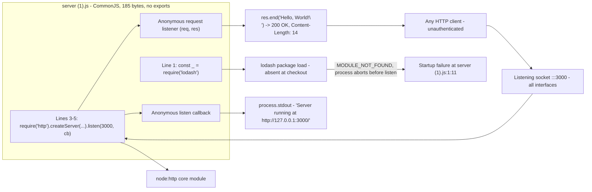

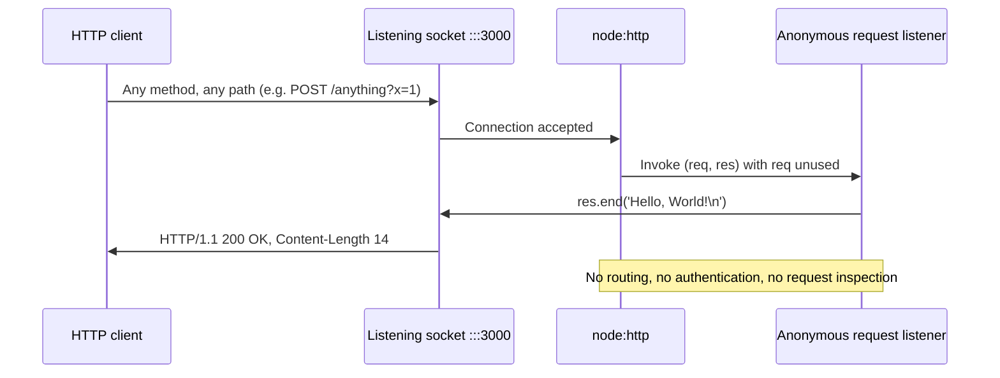

#### Core Technical Approach

- **Single file, single expression.** The application is one chained statement, `require('http').createServer(<listener>).listen(3000, <callback>)`, and it has no internal modules, classes or named functions.
- **Startup as a load side effect.** The module exports nothing, so importing it is equivalent to running it; there is no `main`, no bootstrap function and no lifecycle API a host could call.
- **Literals over configuration.** Port, response body and log text are inline constants; no environment variable, argument or config file is read.
- **Zero abstraction and no framework.** Only two modules are involved, the `http` core module that is used and the `lodash` package that is loaded and unused; there is no routing layer, middleware, template engine or dependency-injection seam.
- **Idiomatic CommonJS callbacks.** Both behaviors are anonymous arrow callbacks registered with Node's standard APIs, so control remains with the Node event loop throughout.
- **Externally managed lifetime.** The process runs for as long as the socket is bound and exits only when the host terminates it; no in-process shutdown path exists.
- **Verification is external.** Because the repository ships no test, the only way to confirm behavior is to execute the file — under a runtime that can resolve `lodash`, unless the unused import is removed.

### 1.2.3 Success Criteria

#### Measurable Objectives

The repository defines no objectives of its own; every objective below is drawn from `build_prompt (5).md`, which also declares how it is to be measured — lines 27-30 state that "the exact file contents given in the plan are the acceptance criterion" and forbid test-style criteria, digest checks and command tables. Verification is therefore by textual inspection of file contents, not by execution.

| Objective | Measure | Record |
| --- | --- | --- |
| Emit the text `Welcome to Blitzy` with no formatting, in as few lines as possible and with minimal token usage | Identity of the resulting file contents with those stated in the plan | `build_prompt (5).md:1`, lines 27-30 |
| Preserve the response the running service returns while the change is applied | `HTTP/1.1 200 OK` with `Content-Length: 14` for any request | Observed behavior of `server (1).js:3-5`, measured during this investigation |
| Keep the change minimal | Smallest possible diff; no unrelated refactoring, reformatting or renaming | Lines 3-5 |
| Introduce no file | Tracked file list remains exactly three files | Lines 6-7, 11-13 |
| Add no dependency, lockfile or test | None present before; none added | Lines 14-15 |
| Keep documentation minimal | JSDoc confined to one `/** … */` line; `README.md` under five lines total | Lines 8-13 |
| Keep the plan concise | File diff stated plainly; no rejected alternatives, no unrelated edge cases, no verification or coverage section, file list stated once | Lines 18-19, 25-26, 27-30, 31-32 |

#### Critical Success Factors

- **Constraint fidelity outranks functional ambition.** The document devotes roughly thirty clauses to restraint and one to behavior, so compliance with the prohibitions is the dominant success factor.
- **The artifact must remain startable on stock Node.js.** The unresolved `require('lodash')` on line 1 is the only structural obstacle to that outcome, and it is the one prerequisite a new operator cannot infer from the repository.
- **The functional change is a single string.** Everything else in the required change is the discipline of not adding capability.
- **Review happens by inspection.** Because lines 27-30 forbid test-style acceptance criteria and line 14 forbids test files, the reviewer's instrument is the file's contents.
- **The change lands in existing files only.** No new file may be created, so any documentation or structure requirement must be satisfied inside `README.md` or the source file as it stands.
- **The one recorded conflict must be resolved knowingly.** Lines 14-15 assert that "The file has none today, and this change adds none" with respect to dependencies, yet `server (1).js:1` performs a load of the `lodash` package. The two statements cannot both be read as descriptions of the current file; the repository nowhere reconciles them.

#### Key Performance Indicators

No KPI, service-level objective, latency or throughput target, availability target, error budget or cost target appears in any of the three files. `build_prompt (5).md` lines 27-30 explicitly prohibit a verification, coverage or quality-criteria section, and line 14 prohibits test files, so the repository records no success metric and this specification reports none.

The nearest countable constraints the repository does state are structural rather than performance-based: the tracked file count must stay at three; the JSDoc comment must occupy one line; `README.md` must stay under five lines; and the change must use "as few lines as possible". The quantities observed during this investigation — a `200 OK` response with `Content-Length: 14`, a bind on `:::3000`, and exactly one startup log line — are descriptive measurements of current behavior for the benefit of readers of this document, not targets the repository sets.

## 1.3 Scope

The boundaries below are drawn from two evidence sources only: the behavior `server (1).js` exhibits when executed, and the prohibitions `build_prompt (5).md` states explicitly. Nothing is in scope merely because a comparable system would include it, and nothing is declared out of scope on assumption — every exclusion is either a verified absence in the repository or a clause of the constraint document. Where a capability is named as required by the objective on line 1 of that document but is not yet present in the artifact, it is marked as required-and-pending rather than as delivered.

### 1.3.1 Core Features and Functionalities

| Capability | Where it lives | Status |
| --- | --- | --- |
| Fixed-body HTTP responder | `server (1).js:3-5` — `listen(3000)` with a listener that ignores `req` | Delivered and verified: `HTTP/1.1 200 OK`, `Content-Length: 14`, body `Hello, World!\n` for `GET /` and `POST /anything?x=1` |
| Single readiness notice on stdout | `server (1).js:5` — second inline callback | Delivered and verified: one line, `Server running at http://127.0.0.1:3000/` |
| Startup as a module load side effect | `server (1).js:1-5` — top-level chained expression, no `module.exports` | Delivered: loading the file starts the listener; its export object is empty |
| Printed output `Welcome to Blitzy`, unformatted, in minimal lines | Named on `build_prompt (5).md:1`; the artifact at `server (1).js:4` still emits `Hello, World!\n` | Required and pending |

**Primary user workflows.** Exactly one workflow is reachable. The operator starts the process with `node "server (1).js"` from the repository root — quoting is required because the filename contains a space and parentheses — after ensuring the `lodash` package can be resolved, since line 1 aborts startup otherwise. The process binds `:::3000` on every interface and writes one readiness line to stdout. A client then sends any HTTP request, by any method and to any path, and receives a `200 OK` with the constant 14-byte body. The process continues until the host terminates it; no in-process path to a clean stop exists.

**Essential integrations.** Inbound HTTP on TCP port 3000 is the only integration. It is unauthenticated and unencrypted; no request attribute influences the response.

**Key technical requirements.**

- A Node.js runtime with CommonJS resolution. v22.23.3 was the version observed during this investigation; the repository pins no version.
- The `lodash` package resolvable at load time, or the unused import on line 1 removed. Today neither condition holds, so a fresh checkout does not start.
- Port 3000 free on the host. A second instance exits with an unhandled `EADDRINUSE`; there is no fallback port or retry.
- A stdout stream for the readiness line, and network reachability if the service is to be called by anything other than the host itself.
- No other capability, resource or credential is required.

### 1.3.2 Implementation Boundaries

| Boundary | Definition and evidence |
| --- | --- |
| System boundary | One file, one process, one listening socket. `server (1).js` is the complete application; the two documents are inert |
| Runtime boundary | The host's Node.js CommonJS resolver plus the `node:http` core module. No bundler, transpiler, package manager manifest or build step exists |
| Network boundary | TCP port 3000 bound on all interfaces (`:::3000`), HTTP/1.1, unauthenticated and unencrypted; the `127.0.0.1` in the startup log describes nothing |
| Code boundary | Five lines, 185 bytes, one module, two anonymous callbacks, no internal modules, and an empty export object |
| Change boundary | Per `build_prompt (5).md` lines 3-17: the smallest diff that satisfies the objective, confined to existing files, with no refactoring, reformatting, renaming, new file, new dependency, lockfile, test or unrequested hardening |
| User groups covered | The publisher of the dataset, the implementer the constraint document addresses, and any unauthenticated HTTP client that can reach port 3000. No other group is documented or served |
| Geographic and market coverage | None stated. No locale handling, market, region or deployment geography appears in any file |
| Data domains included | None. The system stores nothing, reads nothing, parses no request body and handles no personal or business data; its only payload is the constant response literal |

### 1.3.3 Explicitly Excluded Features and Capabilities

The exclusions below are stated by `build_prompt (5).md` as prohibitions on the change, and the first group is additionally verified as absent from the repository today.

| Excluded | Source | Detail |
| --- | --- | --- |
| Any additional file | Lines 6-7 | No `CONTRIBUTING.md`, `CHANGELOG.md`, `LICENSE`, `docs/` folder, architecture diagram or badge; none of these exists in the repository |
| Rich documentation | Lines 8-13 | JSDoc limited to one `/** … */` summary with no `@param`, `@returns`, multi-paragraph description or usage example; `README.md` kept under five lines with no contributing, license, testing, deployment, architecture or table-of-contents section |
| Tests, lockfiles and dependencies | Lines 14-15 | No test suite, test files, lockfile or dependency may be added. The clause also asserts the file has no dependency today, conflicting with the `lodash` load on `server (1).js:1`; the repository never reconciles the two |
| Unrequested hardening | Lines 16-17 | No 404 handler, no error handler, no environment-variable configuration, and no hardening not explicitly requested |
| Verification apparatus in the plan | Lines 27-30 | No verification, coverage or quality-criteria section; no digest checks, no command tables, no test-style acceptance criteria — the stated file contents are the acceptance criterion |
| Elaboration beyond the diff | Lines 18-19, 25-26, 31-32 | No enumeration of unrelated edge cases, no alternatives considered and rejected, no repetition of the file list across sections |

Beyond those clauses, the following are absent from the code and therefore outside the system's scope: request routing, authentication and authorization, TLS, request parsing, response header, status or content-type control, static asset serving, persistence of any kind, logging beyond the single startup line, metrics or health endpoints, graceful shutdown, configuration files, and container or process-supervision definitions.

### 1.3.4 Future Phase Considerations

The repository records no roadmap, milestone, backlog, version plan or release history — the commit log ends at `bc65fd0` "Add files via upload". Two forward-looking items are visible in the evidence, and both are recorded here as observations, not commitments:

- **Complete the change the constraint document names.** `build_prompt (5).md:1` requires code that prints `Welcome to Blitzy` with no formatting in minimal lines; the artifact still emits `Hello, World!\n`. This is the only functional delta the repository itself records.
- **Resolve the import that blocks startup.** `server (1).js:1` loads `lodash` and never uses it, and the package is neither installed nor declared. Because the constraint document forbids new files and new dependencies (lines 6-7 and 14-15) and forbids hardening not explicitly requested (lines 16-17), the only resolution consistent with those clauses is deletion of the unused `require`; declaring the dependency in a manifest and vendoring a lockfile would breach two prohibitions at once.

No further phase is authorized by anything in the repository, and no owner, date or acceptance gate for either item is recorded.

### 1.3.5 Integration Points Not Covered

| Integration | Coverage |
| --- | --- |
| Outbound HTTP/S calls to other services, APIs or webhooks | Not present; no outbound request exists anywhere in the source |
| Databases, caches, message brokers or queues | No client, connection string or reference of any kind |
| Identity providers, SSO, API gateways or authorization services | None; the service answers unauthenticated requests identically |
| CI/CD pipelines, artifact registries, process supervisors or container platforms | No `.github`, `.circleci`, `.gitlab-ci.yml`, `Dockerfile`, `Procfile` or `docker-compose.yml` |
| Package registry publication, versioning, changelog or licensing | No manifest, no version, no CHANGELOG, no LICENSE |
| Observability sinks — log aggregation, metrics, tracing, alerting | One stdout line at startup and nothing else; no client or endpoint is configured |
| Enterprise systems (portals, monitoring platforms, service catalogs) | No mention in any file, and no registration or discovery artifact |

The only network consideration the code does raise is a misstatement rather than an integration: it binds every interface while its log claims loopback, so any consumer that trusts the log line will misjudge the service's exposure.

### 1.3.6 Unsupported Use Cases

The following uses are unsupported, and the reason is structural rather than incidental to configuration:

- **Path-specific or method-specific behavior.** Every request receives the same body under the same `200 OK`; `GET /` and `POST /anything?x=1` were observed to return identical responses.
- **Request consumption.** The request parameter is never read, so bodies, query strings, headers, cookies and uploads are discarded without inspection.
- **Authentication, authorization, rate limiting and CORS.** No credential is checked and no request is ever rejected.
- **Customized responses.** Status code, headers, content type and streaming are fixed by `res.end` and Node's defaults; the body cannot vary per client.
- **Operational deployment.** No TLS termination, no health or readiness probe, no clustering or horizontal scaling, no graceful restart and no port reconfiguration.
- **Production hardening.** No startup error handling, no dependency pinning and no monitoring; a port conflict terminates the process.
- **Environments without a resolvable `lodash`.** The service cannot start at all in such an environment, which is the state of the repository as committed.
- **Two instances on one host.** The second process crashes on `EADDRINUSE` with no fallback, so no side-by-side instance is possible without editing the source.

## 1.4 References

Every factual claim in this section rests on the repository artifacts and Git metadata listed below. No external source was consulted; the repository contains no third-party documentation and cites none.

- `server (1).js` — the system's only executable artifact (5 lines, 185 bytes). Establishes the unused `lodash` load on line 1, the inline `node:http` server on lines 3-5, the hard-coded port 3000, the constant response body `Hello, World!\n`, the startup log line, the empty CommonJS export surface, and the absence of configuration, error handling and shutdown logic. Its executed behavior established the `MODULE_NOT_FOUND` startup failure, the `200 OK` response with `Content-Length: 14` for both `GET /` and `POST /anything?x=1`, the `:::3000` bind reachable from an external host address, and the unhandled `EADDRINUSE` crash of a second instance.
- `build_prompt (5).md` — the only written requirement source (32 lines, 1,831 bytes). Establishes the objective to print `Welcome to Blitzy` unformatted in minimal lines (line 1), the minimal-diff rule (lines 3-5), the prohibition on new files (lines 6-7), the single-line JSDoc rule (lines 8-10), the `README.md` length and section limits (lines 11-13), the prohibition on tests, lockfiles and dependencies (lines 14-15), the prohibition on unrequested hardening (lines 16-17), the plan-concision rules (lines 18-19, 25-26, 31-32), and the textual-identity acceptance criterion that forbids verification and coverage sections (lines 27-30).
- `README.md` — the repository's dataset label (18 bytes, one line: `# 14Oct2026_3Files`). Establishes the checkout's name and confirms the absence of description, install or run instructions, and of license, testing, deployment and architecture content.
- Repository root (`""`) — contains exactly the three files above and no sub-folder. Establishes the absence of any dependency manifest, lockfile, runtime pin or version file, TypeScript, lint or format configuration, `Dockerfile`, `Procfile` or compose definition, `.gitignore`, CI configuration, `LICENSE`, `CHANGELOG.md`, `CONTRIBUTING.md` or `docs/` directory.
- Git metadata in `.git/` — establishes provenance (upstream `lakshya-blitzy/14Oct2026_3Files`; commits `2ee3243` "Initial commit" and `bc65fd0` "Add files via upload", both by `lakshya-blitzy` on 2026-10-14 +0530), the identical three-file tree on all four refs with an empty `main`-to-`1410_01` diff, and the total object count of seven with no dangling artifact.

Runtime observations cited above were produced by executing the artifact with Node.js v22.23.3, the version present on the investigating host. The repository pins no runtime version, so these are properties of that environment and of the artifact's unconditional imports, not of a declared supported platform.

# 2. Product Requirements

## 2.1 Feature Catalog

The catalog below contains every feature that the repository's own evidence supports, and nothing else. Five features exist. Three are delivered behaviors of the only executable artifact, `server (1).js`: a fixed-body HTTP responder, a single readiness notification, and startup as a side effect of module load. One is required and pending: the unformatted `Welcome to Blitzy` output named on line 1 of `build_prompt (5).md`, which the artifact does not yet produce. One is a delivery-governance feature: the constraint set of `build_prompt (5).md` lines 2-32, which is a requirement on the change rather than on runtime behavior, and which this specification treats as the product's binding scope contract.

No feature is listed for routing, authentication, configuration, persistence, testing, observability or deployment, because each of those is either absent from the code or explicitly prohibited by that constraint set. The unused `require('lodash')` on `server (1).js:1` is likewise not a feature; it is a defect that gates startup, and it is recorded under the dependencies of F-001 and F-003 and as a constraint in Section 2.4.

| ID | Feature name | Category | Status |
| --- | --- | --- | --- |
| F-001 | Fixed-Body HTTP Responder | HTTP Service | Completed |
| F-002 | Startup Readiness Notification | Operational Visibility | Completed |
| F-003 | Load-Time Process Startup | Process Lifecycle | Completed |
| F-004 | Unformatted `Welcome to Blitzy` Output | Output Contract | Approved |
| F-005 | Minimal-Footprint Change Discipline | Delivery Governance | Approved |

### 2.1.1 F-001 — Fixed-Body HTTP Responder

| Field | Value |
| --- | --- |
| Unique ID | F-001 |
| Feature name | Fixed-Body HTTP Responder |
| Feature category | HTTP Service |
| Priority level | Critical |
| Status | Completed |

**Overview.** One listening HTTP endpoint answers every request with the same constant body. It is the single chained expression at `server (1).js:3-5` — `require('http').createServer(<listener>).listen(3000, <callback>)` — where the listener is an anonymous arrow function that never dereferences its `req` parameter and terminates the response with `res.end('Hello, World!\n')` (`server (1).js:4`). The port is the inline literal `3000`, passed to `listen` with no host argument.

**Business Value.** No commercial value statement exists anywhere in the repository: there is no customer, market, price, revenue or cost figure in any of the three files, and `build_prompt (5).md` lines 27-30 forbid verification and quality-criteria sections. The value the artifact demonstrably carries is as a minimal, self-contained HTTP fixture: 185 bytes of source, no manifest, no build step, no configuration, no framework and no genuine runtime dependency. That makes it copy-portable and executable on host-provided Node.js (v22.23.3 was observed), which is the property that makes it usable as a demonstration or evaluation target.

**User Benefits.** The users the repository evidences are the publisher (`lakshya-blitzy`, sole author of both commits), the implementer the constraint document addresses, and any unauthenticated HTTP client that can reach port 3000. For each of them the benefit is the same and it is operational: a reachable endpoint with a predictable status and a byte-stable body, startable with one quoted command and confirmable with one request. Measured behavior supports this — `GET /`, `GET /deep/path`, `GET /%%%?a=1&b=2` and `POST /anything?x=1` all return `HTTP/1.1 200 OK` with a body byte-identical to `Hello, World!\n` (14 bytes, verified with `cmp`). No user-facing documentation, persona or support model exists, so no broader benefit can be evidenced.

**Technical Context.** The feature uses two modules: the `node:http` core module for `createServer` and the response machinery, and — on line 1, before the listener is created — the third-party `lodash` package, whose binding `_` is never referenced again. There is no routing layer, middleware, template engine, content negotiation or dependency-injection seam. Response headers are entirely Node's defaults: the observed header set is `Date`, `Connection: keep-alive`, `Keep-Alive: timeout=5` and `Content-Length: 14`, with no `Content-Type` emitted. Because `listen(3000)` receives no host argument, the socket binds every interface (`::`), and a request to the host address 10.11.0.13:3000 returned `200` — a fact the startup log contradicts by naming `127.0.0.1`.

**Dependencies.**

- **Prerequisite features.** F-003 — the listener exists only because loading the module creates it; there is no exported start function to call.
- **System dependencies.** Node.js with CommonJS resolution (v22.23.3 observed; the repository pins no version); the `node:http` core module; TCP port 3000 free on the host. No database, cache, filesystem path, credential or external service is involved.
- **External dependencies.** Functionally none. Operationally, one: line 1 loads `lodash` unconditionally, so the package must be resolvable for the process to reach the `listen` call. It is undeclared (`npm ls lodash` reports an empty tree, no `package.json` exists) and unpinned, and its absence aborts the process with `Cannot find module 'lodash'` at `1:11`.
- **Integration Requirements.** Inbound HTTP/1.1 on TCP port 3000 only, unauthenticated and cleartext. No outbound call, no message publication, no identity provider, no log aggregator and no telemetry sink. A second process on the same host cannot bind the port: it fails with an unhandled `error` event, `Error: listen EADDRINUSE: address already in use :::3000` (errno -98, syscall `listen`, address `::`, port 3000), raised at `server (1).js:5:4` with no error callback, fallback port or retry.

### 2.1.2 F-002 — Startup Readiness Notification

| Field | Value |
| --- | --- |
| Unique ID | F-002 |
| Feature name | Startup Readiness Notification |
| Feature category | Operational Visibility |
| Priority level | Low |
| Status | Completed |

**Overview.** After the port is bound, the process writes exactly one line to stdout: `Server running at http://127.0.0.1:3000/`. The mechanism is the second anonymous arrow callback, the `listen` callback on `server (1).js:5`, `() => console.log('Server running at http://127.0.0.1:3000/')`. The observed output was a single 42-byte line ending in `\n`, with 0 bytes on stderr; the line count remained 1 after all subsequent request traffic.

**Business Value.** None is recorded. The operational value is that an operator or supervising process can tell from stdout that the port bound successfully, which is the only readiness signal the system produces — there is no health or readiness endpoint, no metrics endpoint and no log sink configured.

**User Benefits.** The implementing agent or operator gets one unambiguous confirmation line; without it the only way to distinguish "listening" from "hung" would be to issue a request. The line is also the artifact's only runtime diagnostics, so it is the sole evidence available after the fact unless the process is probed live.

**Technical Context.** The notification is delivered through `console.log`, i.e. a single write to the inherited stdout stream, invoked from the `listen` callback rather than from a logging library, framework or configuration. Its text is a hard-coded literal that duplicates the same `3000` that appears in the `listen` call, so the port value exists in two places in the file that must be kept in step by hand. The literal also asserts `127.0.0.1`, whereas the socket binds `::`; the sentence therefore describes an address the process does not restrict itself to.

**Dependencies.**

- **Prerequisite features.** F-001 and F-003 — the callback fires only on a successful bind, which in turn exists only because the module was loaded.
- **System dependencies.** A writable stdout stream and the Node.js event loop. If stdout is closed or discarded the feature's effect is simply unobservable; nothing in the code depends on the write succeeding.
- **External dependencies.** None. No logging package, aggregation agent or transport is referenced.
- **Integration Requirements.** None beyond an operator or supervisor that reads the process's stdout. No log level, no structured format, no correlation identifier and no timestamp is produced, so no log pipeline can be configured from the repository.

### 2.1.3 F-003 — Load-Time Process Startup

| Field | Value |
| --- | --- |
| Unique ID | F-003 |
| Feature name | Load-Time Process Startup |
| Feature category | Process Lifecycle |
| Priority level | High |
| Status | Completed |

**Overview.** Starting the service is a side effect of loading the module. `server (1).js` executes its chained expression at top level (`server (1).js:3-5`) and assigns nothing to `module.exports` or `exports`; after `require('./server (1).js')` the listener is bound and `Object.keys(module.exports)` is `[]`. Invocation is `node "server (1).js"` from the repository root, where quoting is required because the filename contains a space and parentheses.

**Business Value.** None is recorded; the value is structural. Because there is no bootstrap function, no configuration file and no manifest, the artifact is runnable by path alone, and its behavior is identical whether it is started directly or required by another module. That identity is what makes the file self-contained and what makes any change to it verifiable by inspection of five lines.

**User Benefits.** For the operator: one command with no build, install or configuration step. For the implementing agent addressed by `build_prompt (5).md`: a change surface of exactly one file, with no build graph, entry-point declaration or export contract to keep consistent. The cost to the same users is that the process cannot be imported without binding a port, and cannot be started through any host that expects an exported lifecycle API.

**Technical Context.** Two things happen strictly in order at load: line 1 loads `lodash` and binds it to `_`, then lines 3-5 create the server and bind the socket. The first is unconditional and unused (`grep -c 'req\.'` is 0 and `_` never appears after line 1), so the order matters: a missing `lodash` prevents the `createServer` call from ever executing. The process has no lifecycle API and no shutdown path — zero matches for `process.env`, `process.argv`, `SIGTERM`, `SIGINT` or `.close(` in the file — so its lifetime is entirely owned by the host, and termination is by signal with no drain or cleanup.

**Dependencies.**

- **Prerequisite features.** None. F-003 is the root of the feature graph and the prerequisite of F-001 and F-002.
- **System dependencies.** The Node.js CommonJS loader and a host that supplies the process and its working directory. No process manager, container definition or service unit is provided by the repository (`Dockerfile`, `Procfile`, `docker-compose.yml` and CI definitions are all absent).
- **External dependencies.** The `lodash` package at load time, identical to F-001: it is executed on line 1 before the listener is created, and the repository declares it nowhere.
- **Integration Requirements.** None outbound. Inbound, the only requirement is that the operator issue a command naming the file, and that the filename's space and parentheses be quoted for the shell. No environment variable, argument or configuration file is read, so no integration can parameterize the startup.

### 2.1.4 F-004 — Unformatted `Welcome to Blitzy` Output

| Field | Value |
| --- | --- |
| Unique ID | F-004 |
| Feature name | Unformatted `Welcome to Blitzy` Output |
| Feature category | Output Contract |
| Priority level | Critical |
| Status | Approved |

**Overview.** `build_prompt (5).md` line 1 is the repository's only functional objective: create code that prints `Welcome to Blitzy` without any format, in as few lines as possible and with minimal token usage. The artifact does not yet satisfy it — `server (1).js:4` still emits `Hello, World!\n`, and `git grep` across every tracked revision shows the string `Welcome to Blitzy` appearing only on line 1 of the prompt document, never in the source. The feature is therefore the pending delta between the recorded requirement and the delivered behavior.

**Business Value.** None is recorded beyond the objective itself. The document names no customer, no KPI and no release, and lines 27-30 make the exact file contents the acceptance criterion instead of a measurable outcome, so the feature's value is the fidelity of the resulting edit rather than any operational gain.

**User Benefits.** A reviewer of the change gets a single, unambiguous, text-comparable delivery: the payload literal becomes the brand string the prompt names. A client of the service receives the branded body instead of the generic greeting. Both benefits are narrow by construction, because every clause surrounding the objective is a prohibition on adding anything else.

**Technical Context.** The change is a single string literal. Its emission point is `res.end('Hello, World!\n')` at `server (1).js:4`, inside the anonymous request listener created at line 3; Node derives `Content-Length` from the literal, so the current 14-byte body would become 17 bytes if the trailing `\n` is preserved. Nothing else in the file needs to move for the payload to change, which is what keeps the change inside the "smallest possible diff" clause on lines 3-5.

**Dependencies.**

- **Prerequisite features.** F-001 supplies the emission point, and F-003 supplies the process that reaches it. F-005 governs how the change must be made.
- **System dependencies.** Identical to F-001: Node.js CommonJS runtime, `node:http`, TCP port 3000. The payload literal itself has no dependency beyond the file.
- **External dependencies.** Identical to F-001, and load-bearing for verification: the changed behavior cannot be observed by executing the artifact in a fresh checkout, because line 1 aborts the process unless `lodash` resolves or that unused import is removed. `build_prompt (5).md` lines 14-15 assert the file has no dependency today, which contradicts the require on line 1; the repository never reconciles the two statements.
- **Integration Requirements.** None. No declared consumer depends on the payload, and no interface contract, schema or test asserts it. The only consumption path is an unauthenticated HTTP client reading whatever bytes the listener writes.

### 2.1.5 F-005 — Minimal-Footprint Change Discipline

| Field | Value |
| --- | --- |
| Unique ID | F-005 |
| Feature name | Minimal-Footprint Change Discipline |
| Feature category | Delivery Governance |
| Priority level | High |
| Status | Approved |

**Overview.** Lines 2-32 of `build_prompt (5).md` are a binding constraint set on how F-004 may be delivered: the smallest possible diff with no unrelated refactoring, reformatting or renaming (lines 3-5); no file of any kind created (lines 6-7); JSDoc and `README.md` bounded to one line and under five lines respectively (lines 8-13); no test suite, test file, lockfile or dependency (lines 14-15); no 404 handler, error handler, environment-variable configuration or other unrequested hardening (lines 16-17); a plan that states the diff plainly without rejected alternatives or unrelated edge cases (lines 18-19, 25-26); research confined to what accurate install and run instructions require, reading only the file the change touches (lines 20-24); no verification, coverage or quality-criteria section, with the stated file contents as the acceptance criterion (lines 27-30); and the file list and scope boundary stated once (lines 31-32). This is the feature that dominates the document numerically: roughly thirty clauses of restraint govern one clause of behavior.

**Business Value.** The value is scope control on an evaluation fixture. The constraint set prevents a one-string change from attracting the conventional accretion — new files, manifests, dependencies, tests, documentation and hardening — that would obscure the behavior under review. Because lines 27-30 replace metrics and test-style criteria with textual identity of the file, the constraint set is also what makes the change reviewable without any harness to run.

**User Benefits.** The implementing agent is given an unambiguous, self-contained work order whose completion condition is visible in the file itself. The human reviewer is spared a multi-file diff: the review instrument is the contents of one file plus a short plan. The publisher keeps the dataset reproducible at three tracked files, two commits and two trees, with no unreachable objects.

**Technical Context.** The constraint set is not executable code, so the technical context is the shape of the verification it implies. Each prohibition maps to a checkable property of the repository rather than to a runtime behavior: the tracked file list (`git ls-files` — three paths today), the diff size, the line counts of `README.md` (18 bytes, one line, no trailing newline) and of the file itself (5 lines), the presence or absence of a manifest, lockfile or test file, and the presence of constructs such as `process.env`, a 404 branch or an error callback. Lines 14-15 also carry an internal conflict: they assert that the file has no dependency and that the change adds none, while `server (1).js:1` performs a load of the `lodash` package. Both statements are recorded here, and this specification treats the discrepancy as a documented constraint the change must resolve knowingly rather than as an error in either clause.

**Dependencies.**

- **Prerequisite features.** F-004 — F-005 exists to govern the change that delivers the recorded objective, so it has no effect until that change is made.
- **System dependencies.** Version control as the instrument of proof: `git ls-files` establishes that no file was added, and the commit history establishes that the delivered baseline is a single revision (`bc65fd0`) of the source plus the prompt document. Nothing in the constraint set requires a build tool, package manager or test runner; lines 14-15 forbid the last two as additions.
- **External dependencies.** None. The constraint set names no tool, registry or service.
- **Integration Requirements.** None machine-to-machine. The integration is procedural and human: the implementing agent must act on the document, and the reviewer must accept the plan's stated contents as the acceptance criterion, since lines 27-30 prohibit digests, command tables and test-style criteria.


## 2.2 Functional Requirements

Requirements use the identifier form `F-XXX-RQ-YYY`, where `F-XXX` is the parent feature from Section 2.1. Priorities are stated as Must-Have, Should-Have or Could-Have; complexity as High, Medium or Low. Acceptance criteria are listed per requirement ID beneath each requirements table, because the table's four-column limit does not accommodate both the requirement and its criteria.

Two properties of the repository shape every criterion below. First, the repository's own document declares its acceptance instrument: `build_prompt (5).md` lines 27-30 forbid verification, coverage and quality-criteria sections, digest checks, command tables and test-style acceptance criteria, and state that "the exact file contents given in the plan are the acceptance criterion". The criteria here are therefore stated by this specification so that each requirement is testable, and every one of them is satisfiable by inspecting file contents or by a single direct request — none of them requires a test harness, which lines 14-15 prohibit. Second, no requirement below is invented: each traces to either a clause of `build_prompt (5).md` or a behavior verified in `server (1).js`, as recorded in the traceability matrix in Section 2.3.5.

### 2.2.1 F-001 — Fixed-Body HTTP Responder

| Requirement ID | Requirement | Priority | Complexity |
| --- | --- | --- | --- |
| F-001-RQ-001 | Accept inbound HTTP/1.1 connections on TCP port 3000, on every host interface | Must-Have | Low |
| F-001-RQ-002 | Return the constant body `Hello, World!` followed by a newline for every request, regardless of method, path or query string | Must-Have | Low |
| F-001-RQ-003 | Ignore the request entirely: inspect no path, method, header, cookie, query or body | Must-Have | Low |
| F-001-RQ-004 | Continue serving until the host terminates the process, exposing no in-process shutdown path | Should-Have | Low |
| F-001-RQ-005 | Run on stock Node.js with no build, transpile, bundling or install step | Must-Have | Low |

**Acceptance criteria.**

- **F-001-RQ-001.** `node "server (1).js"`, run with `lodash` resolvable, binds the socket on all interfaces; `GET http://127.0.0.1:3000/` returns `HTTP/1.1 200 OK`, and a request to the host's non-loopback address (10.11.0.13:3000 measured) also returns `200`. A second process on the same port fails with an unhandled `Error: listen EADDRINUSE: address already in use :::3000` (errno -98, syscall `listen`, address `::`, port 3000, raised at `server (1).js:5:4`) and no fallback port or retry.
- **F-001-RQ-002.** Responses to `GET /`, `GET /deep/path`, `GET /%%%?a=1&b=2`, `POST /anything?x=1` (with header `X-Test: 1` and body `payload=1`) and `POST /upload` (200,000-byte body) are byte-identical: 14 bytes, `Hello, World!` plus `\n`, with `Content-Length: 14` (verified with `cmp` and `od -c`); no `Content-Type` header is present; `HEAD /` returns `200 OK` with no `Content-Length`.
- **F-001-RQ-003.** `grep -c 'req\.' "server (1).js"` is 0 — the listener parameter is never dereferenced; a 200,000-byte request body is answered with the same 14-byte response and no error.
- **F-001-RQ-004.** The process still answers after repeated traffic (20 concurrent requests each returned `200`); the source contains no `SIGTERM`, `SIGINT` or `.close(` occurrence, so termination is by signal and the port is released when the process exits (port closed immediately after `SIGTERM` was observed).
- **F-001-RQ-005.** `node --check "server (1).js"` exits 0; no `package.json`, lockfile, bundler configuration or build script exists in the repository (three tracked files only); the file is executed directly by the runtime.

**Technical specifications.**

| Aspect | Specification |
| --- | --- |
| Input parameters | None. The HTTP request line, headers, query string and body are parsed by Node's HTTP parser and delivered to the listener, which never reads them |
| Output / response | `HTTP/1.1 200 OK` with headers `Date`, `Connection: keep-alive`, `Keep-Alive: timeout=5`, `Content-Length: 14`; body exactly `Hello, World!` + `\n`; Node's defaults supply the status and headers, so no header value is set by the code |
| Performance criteria | None recorded in any file. Descriptive measurements: five sequential loopback `GET /` responses completed in 0.000534–0.000695 s each; 20 concurrent requests all returned `200`. No latency, throughput or availability target exists |
| Data requirements | None. Nothing is read, written, cached or persisted; the only payload is the constant response literal; no file, database, volume or schema is touched |

**Validation rules.**

| Rule class | Rule |
| --- | --- |
| Business rules | Every request is a success by design — no branch can reject one, and the body cannot vary per client. No user input is validated because none is consumed |
| Data validation | Not applicable. No input is parsed and no data model exists; the payload is a compile-time literal |
| Security requirements | None implemented. The listener is unauthenticated and cleartext; `listen(3000)` binds all interfaces while the readiness log claims `127.0.0.1`; response headers are uncontrolled (no `Content-Type`); line 1 executes an undeclared, unpinned package at startup. No TLS, rate limiting, CORS or header filtering exists |
| Compliance requirements | None stated in any file. No licence, privacy notice, retention rule or regulatory statement exists, and no personal or business data is processed, so no obligation can be evidenced |

### 2.2.2 F-002 — Startup Readiness Notification

| Requirement ID | Requirement | Priority | Complexity |
| --- | --- | --- | --- |
| F-002-RQ-001 | Emit exactly one readiness line on stdout after a successful bind | Must-Have | Low |
| F-002-RQ-002 | Emit no readiness line before the bind and no log line when the bind fails | Must-Have | Low |
| F-002-RQ-003 | Keep the readiness text a fixed literal, independent of the actual bind address | Should-Have | Low |

**Acceptance criteria.**

- **F-002-RQ-001.** With `lodash` resolvable, stdout carries exactly one line and 42 bytes, `Server running at http://127.0.0.1:3000/` plus `\n` (measured with `od -c`); stderr carries 0 bytes; the line count remains 1 after further request traffic.
- **F-002-RQ-002.** The write occurs only from the `listen` callback, so nothing reaches stdout before the port binds. On `EADDRINUSE` the failure appears only as an unhandled `error` event on the server instance (Node stack on stderr) and stdout receives no readiness line.
- **F-002-RQ-003.** The text appears once, as a literal on `server (1).js:5`, and the `listen` call passes no host argument, so the string is not derived from the socket. In this revision it names `127.0.0.1` while the socket binds `::`.

**Technical specifications.**

| Aspect | Specification |
| --- | --- |
| Input parameters | The completion of the bind — Node's `listening` event routes to the callback registered as `listen`'s second argument. No value is passed into the callback |
| Output / response | One `console.log` write to the process's stdout stream: 42 bytes, one line, no level, format, timestamp or correlation identifier |
| Performance criteria | One write per process lifetime, emitted once at startup; no target is recorded. The write is not awaited and its result is not checked |
| Data requirements | None. The text is an inline literal that duplicates the port literal `3000` from the same line, so the port value is maintained in two places by hand |

**Validation rules.**

| Rule class | Rule |
| --- | --- |
| Business rules | The line is the system's sole readiness signal: no health or readiness endpoint, metrics endpoint or log sink exists, so the operator must read stdout to confirm startup |
| Data validation | Not applicable. The text is an unformatted, unvalidated literal |
| Security requirements | The literal overstates privacy: it names `127.0.0.1` while the socket binds every interface, so an operator who trusts it will misjudge the service's exposure. No sensitive value is logged |
| Compliance requirements | None. No log retention, audit or regulatory format is stated |

### 2.2.3 F-003 — Load-Time Process Startup

| Requirement ID | Requirement | Priority | Complexity |
| --- | --- | --- | --- |
| F-003-RQ-001 | Start the listener as a side effect of loading the module, exporting nothing | Must-Have | Low |
| F-003-RQ-002 | Provide no lifecycle API — no exported start, stop or close | Must-Have | Low |
| F-003-RQ-003 | Provide no configuration surface: no environment variable, CLI argument or config file | Must-Have | Low |

**Acceptance criteria.**

- **F-003-RQ-001.** After `require('./server (1).js')` with `lodash` resolvable, port 3000 answers and `Object.keys(module.exports)` is `[]`; the file contains no `module.exports` or `exports.` assignment.
- **F-003-RQ-002.** No exported function and no `server.close()` call exists anywhere in the file; the process ends only on a signal or host termination.
- **F-003-RQ-003.** `process.env` and `process.argv` produce zero matches in the file; `listen(3000, …)` uses an inline literal; port, payload and log text are all literals, so no external value can parameterize startup.

**Technical specifications.**

| Aspect | Specification |
| --- | --- |
| Input parameters | The operator's invocation, `node "server (1).js"` from the repository root (quoting is required because the filename contains a space and parentheses), and the module loader's resolution of `lodash` at line 1 followed by `http` at line 3 |
| Output / response | A bound socket on `:::3000`, one stdout line, and an empty CommonJS export object |
| Performance criteria | No startup target is recorded. The observable startup artifact is the readiness line; startup succeeds only when `lodash` resolves, otherwise it aborts before the port is bound |
| Data requirements | None. There is no config file, environment schema, argument definition or default-value mechanism |

**Validation rules.**

| Rule class | Rule |
| --- | --- |
| Business rules | Start is inseparable from import: requiring the file as a library binds a port, so the artifact cannot be loaded by a host that expects an exported API |
| Data validation | Not applicable. Neither arguments nor environment are read, so there is nothing to validate and nothing to reject |
| Security requirements | Loading the file executes third-party code — `lodash` on line 1, undeclared and unpinned — before the service exists; its absence aborts startup with `Cannot find module 'lodash'` (MODULE_NOT_FOUND, exit code 1). A shell that receives the unquoted filename fails before Node starts |
| Compliance requirements | None. No dependency licence, provenance record or attribution is present anywhere in the repository |

### 2.2.4 F-004 — Unformatted `Welcome to Blitzy` Output

| Requirement ID | Requirement | Priority | Complexity |
| --- | --- | --- | --- |
| F-004-RQ-001 | Emit the exact unformatted text `Welcome to Blitzy` | Must-Have | Low |
| F-004-RQ-002 | Add no line and change nothing beyond the payload literal | Must-Have | Low |
| F-004-RQ-003 | Preserve the F-001, F-002 and F-003 behaviors unchanged | Must-Have | Low |

**Acceptance criteria.**

- **F-004-RQ-001.** The emitted payload is `Welcome to Blitzy` as its complete content — no ANSI escapes, markup, padding, quotation or JSON wrapping; with the existing trailing `\n` preserved the body is 17 bytes and `Content-Length` matches the emitted byte count.
- **F-004-RQ-002.** `server (1).js` remains 5 lines; the diff touches only the literal on line 4; the filename is unchanged.
- **F-004-RQ-003.** After the edit, a request to port 3000 by any method and any path still returns `HTTP/1.1 200 OK`; stdout still carries exactly one line; the export object remains empty; `node --check "server (1).js"` still exits 0.

**Technical specifications.**

| Aspect | Specification |
| --- | --- |
| Input parameters | None. The payload is a constant with no interpolation, placeholder or computed part |
| Output / response | The same response shape as F-001 with the substituted body; Node derives `Content-Length` from the literal, so the current 14-byte body becomes the length of the new literal plus the newline terminator if that terminator is retained |
| Performance criteria | None recorded. The change is a literal substitution with no computational effect, and no measurement instrument is defined by the requirement source |
| Data requirements | The literal string alone. The requirement text specifies no encoding, character set, newline policy or maximum length |

**Validation rules.**

| Rule class | Rule |
| --- | --- |
| Business rules | The text must be literally `Welcome to Blitzy` with no formatting applied, and must be produced in as few lines as possible with minimal token usage (`build_prompt (5).md:1`). No additional output may accompany it |
| Data validation | Not applicable at runtime — the payload is a fixed literal, so correctness is established by comparing the file's contents and the response bytes against the requirement text |
| Security requirements | None added. The change must introduce no import, template evaluation, encoding path or dependency, and must not be used as an occasion to alter the unauthenticated listener |
| Compliance requirements | None stated. `Blitzy` appears in exactly one place in the repository — the literal target on `build_prompt (5).md:1` — and no branding, attribution or licence obligation is recorded for it |

### 2.2.5 F-005 — Minimal-Footprint Change Discipline

| Requirement ID | Requirement | Priority | Complexity |
| --- | --- | --- | --- |
| F-005-RQ-001 | Create no new file of any kind | Must-Have | Low |
| F-005-RQ-002 | Make the smallest possible diff, with no unrelated refactoring, reformatting or renaming | Must-Have | Low |
| F-005-RQ-003 | Confine documentation to one JSDoc summary line and keep `README.md` under five lines | Must-Have | Low |
| F-005-RQ-004 | Add no dependency, lockfile or test file | Must-Have | Medium |
| F-005-RQ-005 | Add no unrequested hardening: no 404 handler, no error handler, no environment-variable configuration | Must-Have | Low |
| F-005-RQ-006 | Keep the plan artifact concise: state the diff plainly, with no rejected alternatives, no unrelated edge cases and no verification or coverage section | Should-Have | Low |
| F-005-RQ-007 | Scope research to what accurate install and run instructions require, reading only the file the change touches | Should-Have | Low |

**Acceptance criteria.**

- **F-005-RQ-001.** `git ls-files` still lists exactly three paths — `README.md`, `build_prompt (5).md`, `server (1).js` — and no untracked file appears in `git status`.
- **F-005-RQ-002.** The diff is confined to the payload literal on `server (1).js:4`; the file remains 5 lines and 185 bytes at baseline; the filename `server (1).js` and the line ordering are unchanged.
- **F-005-RQ-003.** `README.md` remains under five lines (18 bytes, one line, no trailing newline at baseline); any JSDoc added is a single `/** … */` summary with no `@param`, no `@returns`, no multi-paragraph description and no usage example.
- **F-005-RQ-004.** No `package.json`, `package-lock.json`, `node_modules/` entry, test file or test suite is added; the repository's dependency set — nothing declared plus the undeclared `lodash` load on line 1 — is unchanged by the edit.
- **F-005-RQ-005.** No 404 branch, no error callback registered on the server, no `process.env` reference and no other hardening clause appears in the file after the change (`process.env` matches remain 0; `listen` still carries the single callback).
- **F-005-RQ-006.** The plan states the file diff plainly, enumerates no alternatives considered and rejected, enumerates no unrelated edge cases, contains no verification, coverage or quality-criteria section, contains no digest check or command table, and states the file list and scope boundary once.
- **F-005-RQ-007.** The implementer reads only the file the change touches; no exhaustive repository scan or existence-probing is performed; any install or run instruction given is accurate for the repository as it exists today.

**Technical specifications.**

| Aspect | Specification |
| --- | --- |
| Input parameters | The constraint document `build_prompt (5).md` (1,831 bytes, 31 newline-terminated lines, clauses on lines 3-17, 18-24, 25-26, 27-30 and 31-32) and the current contents of the three-file repository |
| Output / response | A minimal diff to `server (1).js`, plus a short plan whose stated file contents are themselves the acceptance criterion (lines 27-30) |
| Performance criteria | Not applicable — the feature has no runtime effect. Its measurable quantities are structural: tracked file count (3), file line count (5), `README.md` length (under 5 lines), and the count of prohibited constructs (0) |
| Data requirements | The clause set and the tracked-file list. Verification uses `git ls-files`, `git status`, line counts and content inspection; no test framework, dependency or manifest is required or permitted |

**Validation rules.**

| Rule class | Rule |
| --- | --- |
| Business rules | The clause set is binding and dominates the one behavioral clause; where lines 14-15 assert that the file "has none today" regarding dependencies while `server (1).js:1` loads `lodash`, the conflict must be resolved knowingly. The only resolution consistent with the prohibitions on new files (lines 6-7) and on new dependencies and lockfiles (lines 14-15) is deletion of the unused import |
| Data validation | Constraint-consistency check across the document and the source: the objective on line 1 must be met by an edit that leaves the tracked-file list, the line count and the documented prohibitions intact |
| Security requirements | No dependency, lockfile or hardening may be added, so the unpinned third-party load on line 1 cannot be remedied by declaring or vendoring it; the constraints leave removal of the unused import as the compliant remedy |
| Compliance requirements | No `LICENSE`, `CONTRIBUTING.md`, `CHANGELOG.md`, `docs/` folder, badge or architecture diagram may be added, so any attribution, versioning or governance need must be satisfied within the existing files or not at all. No licence is present today |


## 2.3 Feature Relationships

Every relationship recorded below is one the repository exhibits, and the section is short for that reason: with a single five-line file, three delivered features that all live in the same module, one pending output change and one constraint set, there is no module graph, no service mesh and no shared-utility layer to describe. Relationships that a comparable system would have — between a router and handlers, a configuration service and its consumers, a data layer and its callers — do not exist here, and none is asserted.

### 2.3.1 Feature Dependency Map

The graph has one root. F-003 (load-time startup) is the prerequisite of every other delivered behavior, because the listener and its readiness callback exist only as consequences of loading `server (1).js`. F-001 sits beneath it as the only endpoint; F-002 hangs off F-001 as the callback that fires when F-001's bind succeeds. F-004 is the pending output change and depends on both F-003 (the process must reach the emission point) and F-001 (the emission point is that listener's `res.end` call). F-005 depends on F-004 in order to have any subject matter, and constrains the delivery of F-004 while protecting the existing behavior of F-001, F-002 and F-003 from incidental change.

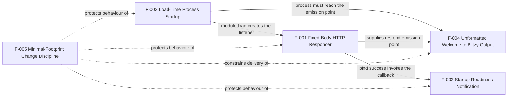

Two properties of the map are worth stating because they shape the requirements. First, there is no fan-out beyond one level from the root: a failure in F-003 — an unresolvable `lodash` on line 1 — removes F-001, F-002 and F-004 at once, which is why the dependency is recorded at the root and not as a detail of the request handler. Second, F-005's edges are constraints rather than data or control flows; it adds no node to the runtime graph and changes no behavior.

### 2.3.2 Integration Points

| Integration point | Direction | Mechanism | Constraint |
| --- | --- | --- | --- |
| HTTP listener | Inbound | TCP port 3000 bound on every interface; HTTP/1.1; unauthenticated and cleartext | Any client that can reach the host is served; a second process on the port fails with `EADDRINUSE` and no retry |
| Standard output | Outbound to host | One `console.log` write of 42 bytes from the `listen` callback | Single line per process lifetime; no level, timestamp, sink or retention; nothing consumes it within the repository |
| CommonJS module resolution | Load-time, inbound | `require('lodash')` at line 1, then `require('http')` at line 3 | `http` resolves from the runtime; `lodash` is undeclared and unpinned, and its absence aborts startup before the port binds |
| Process control | Inbound from host | Host signals and process exit; no handler, no drain, no `server.close()` | Lifetime is owned externally; termination is abrupt and releases port 3000 |
| Version control | Repository-level | Two commits (`2ee3243`, `bc65fd0`), one tree, three tracked files, no unreachable objects | The tracked-file list is the instrument that proves F-005-RQ-001 |

No outbound integration exists in any direction: the source makes no outbound network call, opens no socket as a client, connects to no database, cache, broker, identity provider, log aggregator or telemetry endpoint, and reads no configuration source. There is likewise no CI pipeline, container definition or process supervisor in the repository to integrate with.

### 2.3.3 Shared Components

The components below are shared because the file, not a module boundary, is the unit of organization: one `require`-time expression supplies all three delivered features, so they necessarily share the loader, the module and the callbacks that carry them.

| Shared component | Features sharing it | Repository location | Nature of the sharing |
| --- | --- | --- | --- |
| `server (1).js` | F-001, F-002, F-003, F-004 | Repository root, 185 bytes, 5 lines | The single artifact implementing every runtime feature; F-004 is delivered by editing a literal inside it |
| Payload literal | F-001 (current value), F-004 (required value) | `server (1).js:4` | The one coupling point between the delivered behavior and the pending change: `res.end('Hello, World!\n')` must become the `Welcome to Blitzy` payload |
| Port literal `3000` | F-001, F-002 | `server (1).js:5`, twice on the same line — once as `listen`'s argument, once inside the readiness string | Duplicated by hand; changing the port requires editing two literal occurrences and nothing detects a mismatch |
| Anonymous request listener | F-001, F-004 | `server (1).js:3-4` | The response body and the constant-success behavior are both defined inside this one callback |
| Anonymous `listen` callback | F-002 | `server (1).js:5` | The readiness line's only emission site; the readiness text and the port it reports are written in the same expression |
| `node:http` core module | F-001, F-003 | `server (1).js:3` | Supplies `createServer`, the HTTP parser and the socket the loader binds |
| CommonJS loader | F-003, F-001, F-004 | Runtime-provided | Resolves line 1 before line 3, which is why the unused `lodash` load gates everything |
| `_` binding from `lodash` | None — dead | `server (1).js:1` | Bound at load and never referenced; it is a shared cost of startup, not a shared capability |

### 2.3.4 Common Services

None. The repository contains no service layer, no middleware chain, no configuration service, no logging library, no error-handling facility, no connection pool or client cache, no authentication service and no scheduling or retry mechanism. The nearest thing to a shared facility is what the runtime provides for free: the Node.js event loop that dispatches the request callbacks, and the standard-library modules named above. Nothing in the code is factored for reuse, because nothing is factored at all — the artifact is one chained expression with two inline arrow callbacks.

The consequence for the requirements is that no cross-cutting concern can be satisfied centrally. There is no place to add a header to every response, a log line to every request, an error path to every failure or a setting to every literal; each of those would have to be written into the same five lines, which is precisely what F-005's prohibitions forbid for this change.

### 2.3.5 Traceability Matrix

Requirement versions: the repository holds exactly one revision of the artifact and one revision of the requirement document, both introduced by commit `bc65fd0`; the current branch `1410_01` and `main` share the tree hash `5d078237f4c08a935b4e363e6e713a2b044b4ca8`, and no unreachable object exists. Every requirement below is therefore at version 1, and its version identifier is commit `bc65fd0`. No requirement has been revised, superseded or withdrawn, and no version numbering scheme is recorded in the repository.

| Feature | Requirement IDs | Primary evidence | Related specification section |
| --- | --- | --- | --- |
| F-001 Fixed-Body HTTP Responder | F-001-RQ-001 … F-001-RQ-005 | `server (1).js:3-5`; measured 200/14-byte responses for `GET /`, `GET /deep/path`, `GET /%%%?a=1&b=2`, `POST /anything?x=1`, `POST /upload`, `HEAD /`; reachability at 10.11.0.13:3000; `EADDRINUSE` at `:5:4` | 1.2.2 Primary System Capabilities; 1.3.1 Core Features and Functionalities; flowcharts in 2.3.1 and 2.3.3 |
| F-002 Startup Readiness Notification | F-002-RQ-001 … F-002-RQ-003 | `server (1).js:5`; measured 42-byte stdout line, 0-byte stderr, line count 1 after traffic | 1.2.2 Major System Components; 1.3.1 Single readiness notice on stdout |
| F-003 Load-Time Process Startup | F-003-RQ-001 … F-003-RQ-003 | `server (1).js:1-5`; `Object.keys(module.exports)` is `[]` after `require`; zero `process.env`/`process.argv` matches; `node --check` exits 0 | 1.2.2 Core Technical Approach; 1.3.1 Startup as a module load side effect |
| F-004 Unformatted `Welcome to Blitzy` Output | F-004-RQ-001 … F-004-RQ-003 | `build_prompt (5).md:1`; `server (1).js:4` still emits `Hello, World!\n`; `git grep` finds the string only in the prompt document | 1.1 Objective-versus-behavior delta; 1.2.3 Measurable Objectives; 1.3.4 Future Phase Considerations |
| F-005 Minimal-Footprint Change Discipline | F-005-RQ-001 … F-005-RQ-007 | `build_prompt (5).md:3-32`; `git ls-files` returns three paths; `README.md` is 18 bytes and one line; no manifest, lockfile or test exists | 1.2.3 Critical Success Factors; 1.3.2 Implementation Boundaries; 1.3.3 Explicitly Excluded Features |

| Requirement source | Derived requirements | Feature governed |
| --- | --- | --- |
| `build_prompt (5).md:1` | F-004-RQ-001, F-004-RQ-002 | F-004 |
| `build_prompt (5).md:3-5` | F-005-RQ-002 | F-005 |
| `build_prompt (5).md:6-7` | F-005-RQ-001 | F-005 |
| `build_prompt (5).md:8-13` | F-005-RQ-003 | F-005 |
| `build_prompt (5).md:14-15` | F-005-RQ-004 | F-005 |
| `build_prompt (5).md:16-17` | F-005-RQ-005 | F-005 |
| `build_prompt (5).md:18-19, 25-26, 31-32` | F-005-RQ-006 | F-005 |
| `build_prompt (5).md:20-24` | F-005-RQ-007 | F-005 |
| `build_prompt (5).md:27-30` | F-005-RQ-006, and the acceptance instrument for all requirements | F-005 |
| Measured behavior of `server (1).js` (no written source) | F-001-RQ-001 … F-001-RQ-005, F-002-RQ-001 … F-002-RQ-003, F-003-RQ-001 … F-003-RQ-003, F-004-RQ-003 | F-001, F-002, F-003, F-004 |

The second table is the repository's traceability gap stated plainly: every requirement of F-001, F-002 and F-003 is traceable to observed behavior but to no written source, because the only requirement document in existence addresses the pending output change and its constraints. The delivered behavior of the artifact is therefore the sole specification of the delivered features, which is why each criterion in Section 2.2 is expressed as a measurement of that behavior rather than as a reference to a stated intent.


## 2.4 Implementation Considerations

The considerations below are properties of the artifact as it exists at commit `bc65fd0`, measured by execution on the host-provided Node.js v22.23.3 and read from the two documents. Where a consideration has no counterpart in the repository — performance targets, load characteristics, compliance regimes — that absence is stated rather than filled with a plausible figure. The diagrams referenced from Section 2.3 and the process flowcharts in Section 1.2.2 describe the flows these considerations attach to.

### 2.4.1 F-001 — Fixed-Body HTTP Responder

**Technical constraints.**

- One file, one process, one socket. The listener is created by the chained expression at `server (1).js:3-5`; there is no module boundary, router, middleware or handler registry to place code in, so any capability would have to be written into those five lines.
- The port is the literal `3000` passed to `listen` with no host argument, and the response body is the literal on line 4. Neither is parameterizable: `process.env` and `process.argv` produce zero matches.
- The implementation depends on Node's HTTP defaults for everything except the body. Status, `Date`, `Connection`, `Keep-Alive` and `Content-Length` are all supplied by the runtime.
- Line 1 executes before line 3, so an unresolvable `lodash` prevents the listener from ever being created.

**Performance requirements.** The repository states none: no latency, throughput, concurrency or availability target appears in any file, and `build_prompt (5).md` lines 27-30 forbid a coverage or quality-criteria section. What was measured is descriptive only — five sequential loopback `GET /` responses completed in 0.000534–0.000695 s each, and 20 concurrent requests each returned `200`. Because the response is a constant with no computation, no I/O and no per-request allocation beyond Node's own, the feature's cost is dominated by the HTTP parser and the socket write, not by anything in the artifact.

**Scalability considerations.** Scale-out is not supported and cannot be added within the current constraints. The process is a single non-clustered Node instance; no `cluster`, `worker_threads` or child-process use exists; the port literal cannot be overridden, so two instances cannot coexist on one host — the second exits with an unhandled `EADDRINUSE` and no retry or fallback port. There is no graceful drain or `server.close()` path, so terminating an instance under load drops in-flight connections rather than completing them. The service is stateless, which would make replication trivial in principle, but the fixed port and absent configuration surface make it impractical without editing source — a change the constraint set does not authorize.

**Security implications.**

- **Exposure.** The socket binds every interface (`::`), and a request to the host's non-loopback address returned `200`; the readiness line claims `127.0.0.1`, so an operator trusting the log will understate the exposure.
- **No access control.** Every request is served identically; there is no authentication, authorization, rate limiting, origin check or request rejection path of any kind.
- **Cleartext transport.** No TLS termination exists in the artifact or in the repository (no proxy or container definition either), so traffic is plain HTTP.
- **Unauthenticated surface and attack-surface trade-off.** Nothing is parsed from the request, so paths, query strings, headers, cookies and bodies are never interpreted: there is no file serving (hence no traversal), no deserialization, no template evaluation and no injection sink. The same design, however, leaves the service with no means to reject malformed or hostile requests beyond Node's parser.
- **Supply chain and startup integrity.** Line 1 `require`s `lodash`, which is undeclared, unpinned and unused. Whatever package resolves at that specifier executes at startup before any listener exists, so the process's integrity depends on a package the repository does not name or version.

**Maintenance requirements.** Behavior can only be verified by executing the file, because the repository ships no test, no CI and no runtime pin: the observed baseline is Node v22.23.3, and a different host runtime can alter header details (`Keep-Alive: timeout=5` was observed) or startup behavior without any source change. The filename `server (1).js` contains a space and parentheses, so every tool that touches it must quote the path — `node "server (1).js"` — and it cannot be imported as a bare `./server`. The five-line file has no internal structure to preserve, so maintenance is entirely about preserving behavior while changing a literal.

### 2.4.2 F-002 — Startup Readiness Notification

**Technical constraints.** The notification is one `console.log` call inside the `listen` callback on `server (1).js:5`; it is emitted once, after a successful bind, and never again. Adding a logging library, a level, a format or an additional line is prohibited by `build_prompt (5).md` lines 14-17 and by F-005-RQ-004 and F-005-RQ-005. The text is a literal that embeds the same `3000` that appears as the `listen` argument on the same line, so the port is represented twice in one expression.

**Performance requirements.** None. The write happens once per process lifetime and sits outside the request path, so it has no bearing on response latency or throughput.

**Scalability considerations.** There is nothing to scale in this feature, but its shape is relevant to any future replication: the line carries no instance identifier, no port derived from the environment and no timestamp, so N replicas would emit N indistinguishable lines. An operator attempting to run multiple instances would be unable to attribute a readiness line to a particular process, on top of being unable to bind a second port at all.

**Security implications.** The line is informational and contains no sensitive value, but it misrepresents the service's exposure by naming `127.0.0.1` while the socket binds every interface — a documentation-grade security issue that could lead an operator to leave the port reachable on a shared network believing it to be loopback-only. Its content also becomes durable wherever stdout is captured, which is the only residual record the system produces.

**Maintenance requirements.** The readiness string must be edited in lockstep with the `listen` argument; nothing detects a mismatch, and there is no test to fail if the text goes stale. Because the repository ships no other diagnostics, the accuracy of this one line is load-bearing for operators, and the correct remedy — deriving the address from the actual socket — is the kind of hardening lines 16-17 prohibit for this change.

### 2.4.3 F-003 — Load-Time Process Startup

**Technical constraints.** Startup is a side effect of module evaluation: the file executes its chained expression at top level and assigns nothing to `module.exports`, so `Object.keys(module.exports)` is `[]` after `require`. Statement order is part of the contract — line 1 loads `lodash` before line 3 creates the server — and there is no bootstrap function, no argument parsing, no environment lookup and no config file. The process cannot be started in a way that does not bind a socket, and it exposes no lifecycle API to the host.

**Performance requirements.** None recorded. The only observable startup artifact is the readiness line; cold start is bounded by CommonJS resolution of `lodash` and `http` plus the bind, and the measured startup produced its single stdout line within the first second of execution on the host.

**Scalability considerations.** The process lifetime is owned entirely by the host: no `SIGTERM` or `SIGINT` handler, no `server.close()`, no drain, no readiness-gated rollout hook. Any orchestrator would therefore see abrupt termination and would have to absorb dropped in-flight requests itself. Combined with the fixed port, the artifact supports one instance per host and no in-process scale-out; the only available growth path is a separately edited copy per instance, which the constraint set does not authorize for this change.

**Security implications.** Three concerns attach to startup rather than to requests. First, loading the file executes third-party code from an undeclared, unpinned package; the process's integrity at boot is therefore inherited from whatever resolves as `lodash`. Second, nothing pins the runtime: `.nvmrc`, `.node-version` and any manifest are absent, so the execution environment drifts with the host. Third, any code in the same process that requires this module binds port 3000 as an unavoidable side effect — there is no guard, flag or exported function separating "load" from "listen".

**Maintenance requirements.** Startup cannot be exercised without binding port 3000, so any check is inherently stateful, and a fresh checkout cannot start at all until `lodash` resolves or the unused import is removed. The removal of line 1 is both the smallest possible diff and the only remedy consistent with the constraint set, which forbids adding a manifest, a lockfile or a dependency (lines 6-7 and 14-15) while also asserting that the file has no dependency today. Shell quoting of the filename is required before Node is even invoked, so an unquoted command fails with a shell error rather than a Node error.

### 2.4.4 F-004 — Unformatted `Welcome to Blitzy` Output

**Technical constraints.** The change is confined to the string literal on `server (1).js:4` by `build_prompt (5).md:3-5`: no added import, no encoding helper, no formatting library, no new line and no refactoring around it. The acceptance instrument is textual — lines 27-30 state that the contents given in the plan are the criterion and forbid test-style criteria, digests and command tables — so the deliverable is judged by reading the file, not by running a suite. The repository also offers no mechanism for the implementer to observe the result on a fresh checkout, because startup requires a resolvable `lodash` while lines 14-15 forbid adding one.

**Performance requirements.** None. Substituting a literal changes the number of bytes written and nothing else; `Content-Length` is derived by Node from the literal, so no header edit is needed to keep the response well-formed.

**Scalability considerations.** Not applicable. The payload is a constant, so no replication, caching or load characteristic follows from this feature.

**Security implications.** The feature is inert from a security standpoint: the string contains no data from any request or environment, and the change must not be used as an occasion to alter the listener's auth-less, cleartext design — lines 16-17 prohibit any such hardening. The one security-relevant interaction is indirect: if the implementer instead resolved the startup blocker by declaring or vendoring `lodash`, the change would add a supply-chain artefact that `build_prompt (5).md` forbids twice over.

**Maintenance requirements.** The literal is the only editable surface, and the trailing-newline question must be settled deliberately: the current literal ends with `\n`, the repository states no newline policy, and the choice determines whether the delivered body is 16 or 17 bytes. Retaining the terminator preserves the current "one printed line" shape; dropping it would also remove the only whitespace the current response carries. Because no test exists to detect a regression, the minimal-diff requirement is the sole protection for the surrounding behavior, and the requirement text itself is the only statement of intent to compare against.

### 2.4.5 F-005 — Minimal-Footprint Change Discipline

**Technical constraints.** The constraint set is the governing scope statement and it is largely prohibitive: no new file (lines 6-7), no test or lockfile or dependency (lines 14-15), no unrequested hardening (lines 16-17), bounded documentation (lines 8-13), a concise plan (lines 18-19, 25-26, 31-32) and no verification apparatus (lines 27-30). It therefore removes every conventional remedy for the repository's actual defect: declaring `lodash` in a manifest is forbidden, adding a lockfile is forbidden, adding a test that would catch the startup failure is forbidden, and pinning the runtime via a new file is forbidden. The only compliant resolution of line 1 is its deletion, which is simultaneously the smallest diff, the removal of the undeclared dependency and the restoration of startup on stock Node.js.

**Performance requirements.** None, in the runtime sense. The measurable quantities the constraint set does impose are structural and countable: the tracked-file list must remain three paths, the source must remain 5 lines, `README.md` must stay under five lines (18 bytes, one line at baseline), any JSDoc must occupy a single line, and the prohibited constructs — a 404 branch, an error callback, a `process.env` reference, a manifest, a lockfile, a test file — must all remain absent.

**Scalability considerations.** The discipline is intentionally non-extensible: the repository has no room to grow in the conventional way, because growth would require a new file, a manifest or a dependency, each of which is forbidden. Any future capability must be accommodated inside `server (1).js` or `README.md` as they stand, and any requirement that genuinely needs a manifest, a test or a licence file cannot be satisfied without a change to the constraint set itself — a change `build_prompt (5).md` does not contemplate or authorize.

**Security implications.** The prohibitions cut both ways. They prevent new supply-chain surface, secrets in environment-variable configuration and premature hardening; they equally prevent declaring or pinning the dependency that already executes at startup, and they leave the service unauthenticated, cleartext and bound to every interface if it is ever run on a shared host. Line 15's assertion that the file has no dependency today, read against `server (1).js:1`, is the one clause whose literal reading cannot be satisfied by the file as committed; a plan that claims compliance without addressing the load would be inaccurate.

**Maintenance requirements.** Review is by inspection: no harness, digest or command table may be used (lines 27-30), so the reviewer's instrument is the file's contents and the plan's description of them. No regression net exists — there is no test, no CI and no runtime pin — so diff minimality is the only structural guarantee that delivered behavior survives the edit. Requirement versions are limited to the commit identity `bc65fd0`; the repository provides no scheme for numbering or superseding a requirement, and the suffixes in `build_prompt (5).md` and `server (1).js` are upload-deduplication artifacts, not versions.

### 2.4.6 Assumptions, Constraints and Open Ambiguities

| Ref | Type | Statement | Effect on the requirements |
| --- | --- | --- | --- |
| A-001 | Assumption | `build_prompt (5).md:1` says "print", and the repository does not say whether the target is stdout or the HTTP response body. This specification follows the reading already recorded in Section 1.1, that the target is the served payload at `server (1).js:4` | F-004's emission point is the response literal. If "print" instead meant stdout, the emission point would be a line written at `server (1).js:5` and the HTTP payload would fall outside the change |
| A-002 | Assumption | The trailing `\n` of the current literal is preserved; the requirement text states no newline policy, and "without any format" is read as no markup, padding or escape sequences rather than as forbidding a line terminator | The delivered body is 17 bytes rather than 16, and `Content-Length` follows the literal |
| A-003 | Assumption | Execution-based verification is performed only with `lodash` supplied from outside the repository, because lines 14-15 forbid adding it in any form | Every executed check recorded in Section 2.2 is environment-dependent and cannot be reproduced from a fresh checkout alone |
| A-004 | Assumption | Feature priorities and statuses in Section 2.1, and requirement priorities and complexity ratings in Section 2.2, are assigned by this specification from the evidence; the repository states no priority, status, schedule or KPI | They express the constraint set's emphasis — restraint over capability — and are not attributable to a repository statement |
| A-005 | Conflicting evidence | `build_prompt (5).md:14-15` states the file has no dependency and that the change adds none, while `server (1).js:1` loads the `lodash` package. Both statements are recorded as found; the repository nowhere reconciles them | The compliant remedy is deletion of the unused import (F-001, F-003, F-005-RQ-004) |
| A-006 | Constraint | One fixed port with no configuration surface, no fallback port, no retry and no graceful shutdown | Two instances cannot coexist on a host; no side-by-side or rolling deployment is possible without editing source |
| A-007 | Ambiguity | No owner, date, acceptance gate, release or roadmap for the pending change exists; the change record ends at commit `bc65fd0` | F-004 and F-005 are recorded as Approved on the strength of the documents that state them, with no schedule or approver identifiable in the repository |
| A-008 | Ambiguity | Requirement versioning has no scheme: the only identity available is the commit hash, and the "(5)" and "(1)" suffixes are upload-deduplication artifacts | Traceability in Section 2.3.5 is expressed against commit `bc65fd0` and the file line numbers as they exist there |
| A-009 | Constraint | Acceptance is by inspection of file contents (lines 27-30), while Section 2.2 states acceptance criteria for testability | The two instruments are compatible — every criterion in Section 2.2 is observable without a test harness — but the repository's stated criterion remains the identity of the file contents |


## 2.5 References

Every claim in this section rests on one of the sources below. No external source was consulted: the repository is self-contained at three files, and no web resource was needed to establish any requirement, dependency or constraint stated here.

**Repository files.**

- `server (1).js` — the only executable artifact and the subject of features F-001, F-002, F-003 and F-004: line 1 `const _ = require('lodash');`, lines 3-5 the chained `require('http').createServer(<listener>).listen(3000, <callback>)` expression, line 4 the constant payload literal `'Hello, World!\n'`, line 5 the `listen` argument `3000` and the readiness literal `Server running at http://127.0.0.1:3000/`. It established the entire delivered behavior set, the absence of routing, request inspection, configuration, error handling and shutdown, and the empty export object.
- `build_prompt (5).md` — the repository's only requirement source, 1,831 bytes across 31 newline-terminated lines: line 1 the objective (F-004), lines 3-5 the minimal-diff clause, lines 6-7 the no-new-file clause, lines 8-13 the documentation limits, lines 14-15 the no-dependency/no-lockfile/no-test clause and its conflict with `server (1).js:1`, lines 16-17 the no-hardening clause, lines 18-19, 25-26 and 31-32 the plan-concision clauses, lines 20-24 the research-scope clause, and lines 27-30 the acceptance instrument (F-005).
- `README.md` — 18 bytes, one line, no trailing newline, content `# 14Oct2026_3Files`; established the dataset label, the `README.md` length baseline for F-005-RQ-003, and the absence of install, run or architecture documentation.

**Folders.**

- Repository root (`""`, checkout `/tmp/blitzy/14Oct2026_3Files/1410_01_69f48a`) — established the flat three-file inventory with no sub-folders, no manifest, no lockfile, no test file, no CI configuration and no build script, which is the evidence behind the exclusions in Sections 2.1 and 2.2 and behind F-001-RQ-005 and F-005-RQ-001.

**Repository metadata and measured behavior.**

- Git history and refs — commits `2ee3243` ("Initial commit", README only) and `bc65fd0` ("Add files via upload", prompt and server), tree hash `5d078237f4c08a935b4e363e6e713a2b044b4ca8` shared by `1410_01` and `main`, `git ls-files` returning exactly three paths, and no unreachable object; established the requirement version (commit `bc65fd0`) in Section 2.3.5 and the file-count criterion in F-005-RQ-001.
- Execution of `server (1).js` on Node.js v22.23.3 (npm 11.21.0), with `lodash` supplied externally — established `MODULE_NOT_FOUND` and exit code 1 without it; stdout of exactly 42 bytes (`Server running at http://127.0.0.1:3000/\n`) and 0-byte stderr with it; `HTTP/1.1 200 OK` with `Date`, `Connection: keep-alive`, `Keep-Alive: timeout=5`, `Content-Length: 14` and no `Content-Type`; byte-identical 14-byte bodies for `GET /`, `GET /deep/path`, `GET /%%%?a=1&b=2`, `POST /anything?x=1` and `POST /upload` (200,000-byte body); `HEAD /` returning `200 OK` without `Content-Length`; five sequential loopback latencies of 0.000534–0.000695 s; 20 concurrent requests all returning `200`; reachability at 10.11.0.13:3000; the unhandled `Error: listen EADDRINUSE: address already in use :::3000` at `server (1).js:5:4`; empty `module.exports`; zero matches for `process.env`, `process.argv`, `SIGTERM`, `SIGINT`, `.close(` and `req.`; and `node --check` exiting 0. These measurements are the primary evidence for the acceptance criteria in Section 2.2.

**Technical specification cross-references.**

- Section 1.1 Executive Summary — the objective-versus-behavior delta, the startup blocker and the constraint set's role as the requirement baseline, cited for F-004 and F-005.
- Section 1.2 System Overview — the component inventory, primary system capabilities, core technical approach and process flowcharts referenced from Sections 2.3 and 2.4.
- Section 1.3 Scope — the delivered-versus-pending capability status, implementation boundaries, explicit exclusions and future-phase observations cited for F-005 and the exclusions in Sections 2.1 and 2.2.

**Web sources.** None used.


# 3. Technology Stack

## 3.1 Programming Languages

One programming language is in executable use in this repository: **JavaScript**, written as a **CommonJS** module and executed by the host's **Node.js** runtime. `server (1).js` (185 bytes, five lines) is the only file any runtime ever loads; the two remaining files are documents that no program reads. There is no compiled language, no type-checked superset, no browser-side language and no mobile or native language in the tree or in any reachable revision.

### 3.1.1 Language Inventory by Component

| Language / form | Component or platform | File | Role | Version evidence |
| --- | --- | --- | --- | --- |
| JavaScript — ECMAScript, CommonJS dialect | Host-provided Node.js runtime | `server (1).js` (185 bytes, 5 lines) | The entire application: HTTP server creation, request listener, port bind, one readiness log line | Executed on Node.js v22.23.3 (observed); runtime ABI `modules: 127`; no version is pinned anywhere in the repository |
| Markdown / plain text | Human readers and external tooling; not a runtime | `build_prompt (5).md` (1,831 bytes), `README.md` (18 bytes) | Requirement baseline and dataset label; never loaded by any process | Not applicable — no runtime interprets them |

The JavaScript in the artifact has exactly one shape, visible in full:

```javascript
const _ = require('lodash');              // line 1 - loaded, never referenced
require('http').createServer((req, res) => { res.end('Hello, World!\n'); }).listen(3000);
```

### 3.1.2 Selection Criteria and Justification

- **A standard-library HTTP server is sufficient.** `node:http` supplies request parsing and the server lifecycle — the module's observed exports include `createServer`, `Server`, `IncomingMessage`, `ServerResponse`, `STATUS_CODES` and `METHODS` — so no language-level binding to a C library, no external runtime and no web framework is needed to answer a request.
- **The objective rewards the smallest possible expression.** `build_prompt (5).md:1` requires output produced in "as less lines as possible" with optimised token usage. JavaScript expresses the whole system as one top-level chained expression (`server (1).js:3-5`), which is why the language is used at statement level rather than in functions or classes.
- **No build step is permitted, and none exists.** The constraint set forbids creating any file (`build_prompt (5).md:6-7`) and forbids adding a lockfile or dependency (`:14-15`). An interpreted language executed directly by the runtime is the only option that keeps the tracked file count at three and adds no compilation artifact.
- **CommonJS is the operative module system, not ESM.** `server (1).js` calls `require` twice (`:1`, `:3`) and never uses `import`; no manifest declares `"type": "module"`, and no manifest exists at all, so Node's default CommonJS resolution for a `.js` file applies.
- **CommonJS keeps module resolution late-bound.** A specifier is resolved at run time, which is precisely the property that turns the unused `lodash` binding on line 1 into a hard startup failure — the trade-off the language choice carries into this system (Section 2.4.3).

### 3.1.3 Language Features Actually Used

| Present | Absent |
| --- | --- |
| `const` binding, one occurrence (`:1`) | `let`/`var`, `class`, `async`/`await`, generators |
| Two anonymous arrow-function callbacks (`:3`, `:5`) | Named functions, modules, exported members |
| Static string literal with an escape sequence, `'Hello, World!\n'` (`:4`) | Template literals, string interpolation, formatting or encoding helpers |
| One chained member-call expression spanning three lines (`:3-5`) | `try`/`catch`, error callbacks, `process.env` (zero occurrences), `process.argv` |
| A single `console.log` call (`:5`) | Any logging library, log level or structured output |

### 3.1.4 Language Constraints and Dependencies

| Constraint | Evidence | Effect on the stack |
| --- | --- | --- |
| A Node.js runtime must be present | `node "server (1).js"` is the only way to run the artifact; no shebang, no script entry, no wrapper | Node.js is a host prerequisite, not a vendored one; the repository ships no runtime |
| The runtime must resolve CommonJS specifiers | `server (1).js:1`, `:3` | An ESM-only loader would not execute this file as written |
| The runtime version is unpinned | `package.json`, `.nvmrc` and `.node-version` are all absent; no `engines` field exists | Language semantics and Node-supplied response headers drift with the host; `Keep-Alive: timeout=5` and the observed v22.23.3 baseline are properties of the runtime, not of the artifact |
| `lodash` must resolve at load time, or line 1 must be deleted | Executed run aborts with `Error: Cannot find module 'lodash'`, code `MODULE_NOT_FOUND`, at `server (1).js:1:11`, before line 3 creates the server | The language's late-bound `require` makes an unused binding a startup prerequisite for the entire process |
| The filename is not a valid bare module specifier | `server (1).js` contains a space and parentheses and appears as such in `git ls-files` | Every invocation must quote the path (`node "server (1).js"`), and the file cannot be imported as `./server` |
| No type system is in place | no `tsconfig.json`, no `.ts`/`.tsx` file; a search of every reachable revision returns zero matches for TypeScript | Nothing static detects the unused import or the missing package; `node --check` passes because the file is syntactically valid, so the defect surfaces only at execution |
| No defensive language constructs are used | no `try`/`catch`, no `listen` error callback, zero `process.env` references | Both failure modes observed — `MODULE_NOT_FOUND` at startup and `EADDRINUSE` on a port conflict — terminate the process rather than being reported or handled |

### 3.1.5 Platform Coverage Not Present

The stack covers exactly one platform tier: a server-side process on the host's Node.js runtime. No client-side, mobile, native or desktop language appears in any file or in any reachable revision. Searches across every revision for Python, Flask, Swift, Kotlin, Objective-C, Electron, React, React-Native and TypeScript returned zero matches, and no build configuration for any of them exists; the full applicability assessment is recorded in Section 3.6.5. Because JavaScript is the only language used, there is also no cross-language interface — no FFI binding, no native addon (`napi 10` is present in the runtime but no addon is built or shipped) and no serialization boundary between components.


## 3.2 Frameworks & Libraries

No framework is declared, and no library bundle is shipped. Exactly two module specifiers appear in the entire artifact: `lodash`, a third-party package reference that is used for nothing, and `http`, a Node.js core module that lives inside the runtime rather than in the repository.

### 3.2.1 Core Framework: None — the `node:http` Core Module Instead

| Layer | Component | Version source | Where it lives | Function in this system |
| --- | --- | --- | --- | --- |
| HTTP framework | `node:http` (Node.js built-in core module) | Ships inside the runtime, so it has no independent version. Observed runtime: Node.js **v22.23.3**, V8 12.4.254.21-node.57, ABI `modules: 127`, `napi: 10`, HTTP parser llhttp 9.4.3, OpenSSL 3.5.8, undici 6.28.1 (bundled but unused) | The host's Node.js installation, not the repository | `createServer` builds the listener; the runtime parses HTTP/1.1 and generates every response header except the body |
| Application framework | None | — | — | Routing, dispatch, serialization and error handling have no framework home; the single listener at `server (1).js:3-4` performs none of them |
| UI, CSS, AI, ORM frameworks | None | — | — | Not referenced in any file or any reachable revision (Section 3.6.5) |

The capabilities a framework would normally provide are all absent, and the absence is measurable rather than assumed:

| Framework-provided capability | Status in this system | Evidence |
| --- | --- | --- |
| Routing and path matching | Absent — every path behaves identically | `GET /` and `POST /anything?x=1` both returned `HTTP/1.1 200 OK`, `Content-Length: 14` |
| Middleware pipeline | Absent — one listener, no continuation function | `server (1).js:3-4` |
| Templating, views, serialization | Absent — the body is a literal | `server (1).js:4` |
| Request parsing helpers | Absent — `req` is never read | `server (1).js:3` |
| Configuration and environment handling | Absent — port, body and log text are literals; zero `process.env` references | `server (1).js:3-5` |
| Lifecycle hooks, DI container, bootstrap | Absent — the module exports nothing (`module.exports` never assigned), so startup is a load side effect | `server (1).js:1-5` |

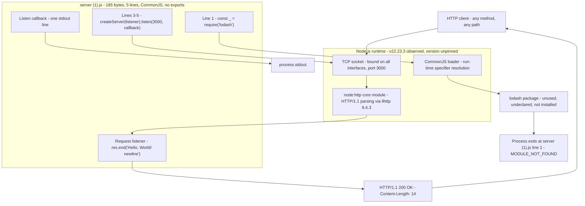

### 3.2.2 Supporting Libraries

| Library | Type | Reference in source | Status | Version |
| --- | --- | --- | --- | --- |
| `lodash` | Third-party npm package | `server (1).js:1` — `const _ = require('lodash')` | Bound to `_` and **never referenced again**; not installed (`npm ls lodash` reports an empty tree); not resolvable (`require.resolve('lodash')` throws `Cannot find module 'lodash'`); not declared in any manifest, because no manifest exists | No version is declared anywhere in the repository. The npm registry (`https://registry.npmjs.org/`) currently publishes `latest` as **4.18.1** (observed with `npm view lodash version`); whatever satisfies the bare specifier at load time is what would execute |
| `node:http` | Node.js standard-library module | `server (1).js:3` — `require('http')` | Present in every Node.js installation; used for `createServer` | Coupled to the runtime version (Node.js v22.23.3 observed) |

There is no `node_modules` directory, no `dependencies` or `devDependencies` block, no vendored package and no bundled file. The only library reference in the artifact contributes nothing to behavior and blocks startup, so the compliant remedy is its deletion — which removes the library dependency entirely and yields the smallest possible diff, exactly as `build_prompt (5).md:14-15` requires.

### 3.2.3 Compatibility Requirements

| Requirement | Detail | Evidence |
| --- | --- | --- |
| A Node.js runtime exposing the stable `http` server API and CommonJS resolution | The code calls `require('http').createServer(...)` and `listen(port, callback)` — the oldest and most stable part of Node's API surface | `server (1).js:1-5`; executed successfully on Node.js v22.23.3 |
| No declared version range | `engines`, `.nvmrc`, `.node-version` and any manifest are absent, so compatibility is "whatever Node.js the host supplies" | Probed and absent |
| No native-addon or ABI constraint | Nothing is compiled: no `node_modules`, no binding configuration, no install step. The runtime's `napi: 10` and ABI `modules: 127` are unused | Probed and absent |
| Response headers are runtime-provided, so the wire format depends on the runtime | The body is the only part the artifact controls; `Date`, `Connection`, `Keep-Alive` (observed as `timeout=5`) and `Content-Length` come from Node | `curl -i` against the running process |
| No operating-system dependency | No file, path, shell or process API is touched; the program is network and stdout only | `server (1).js:1-5` |
| Port 3000 must be free on the host | `listen(3000)` passes no error callback, so a second instance terminates with an unhandled `EADDRINUSE` | Section 2.4.1 |

### 3.2.4 Justification for Choosing No Framework

- **Every framework needs the artifacts the constraint set forbids.** A framework brings a manifest, a dependency and normally a lockfile; `build_prompt (5).md:6-7` forbids creating any file and `:14-15` forbids adding a dependency, a lockfile or a test. Framework names — `express`, `flask`, `react`, `tailwind`, `langchain`, `electron` — return zero matches across every reachable revision.
- **The framework's value proposition is out of scope.** Routing, middleware, templating and configuration management are the features frameworks sell; the objective on `build_prompt (5).md:1` requests a single unformatted string, and `:16-17` explicitly prohibits configuration and request-handling hardening.
- **The core module costs nothing and covers the requirement.** `node:http` answers the one required behavior with zero dependencies, zero files and zero build steps, which is why the stack's HTTP layer is a standard-library module rather than a framework.
- **The trade-off is explicit, not accidental.** With no framework there is also no seam: no place to register a route, no error callback for a bind failure, no configuration layer for the port. Any routing or hardening would have to be written into the same five lines, and `:16-17` forbids doing so for this change (Section 2.4.1).


## 3.3 Open Source Dependencies

Exactly one third-party dependency is referenced, and the repository declares none. `lodash` is required at `server (1).js:1` and referenced nowhere else; there is no manifest, no lockfile and no installed tree, so no dependency in this system is declared, pinned or reproducible.

### 3.3.1 Third-Party Dependency Inventory

| Dependency | Registry | Declared range | Reference site | Used? | Installed? | Resolved version |
| --- | --- | --- | --- | --- | --- | --- |
| `lodash` | npm — `https://registry.npmjs.org/` (the registry npm is configured with in the observed environment) | **None** — no `package.json` exists to declare one | `server (1).js:1` — `const _ = require('lodash')` | **No** — the binding `_` is never referenced again in the file | **No** — `npm ls lodash` reports `(empty)`; there is no `node_modules` directory | **None in this checkout**: resolving the specifier throws `Error: Cannot find module 'lodash'`. The registry's published `latest` was observed as **4.18.1** |

That single entry is the complete third-party inventory. The only other module specifier in the artifact, `http`, is a Node.js standard-library module and therefore not an open-source package dependency of the repository at all — it ships inside whichever Node.js runtime the host provides.

### 3.3.2 Package Manifests, Lockfiles and Registries

Nothing in the repository participates in dependency resolution. Every artifact below was probed in the checkout and is absent:

| Probed artefact | Purpose if present | Status |
| --- | --- | --- |
| `package.json` | Declares dependencies, scripts and the module type | Absent |
| `package-lock.json`, `yarn.lock`, `npm-shrinkwrap.json`, `pnpm-lock.yaml`, `bun.lockb` | Pins a resolved dependency graph | All absent |
| `node_modules/` | Materialises installed packages | Absent |
| `.npmrc`, `.yarnrc`, `.yarnrc.yml` | Configures a registry, scope or auth token | All absent |
| `deno.json`, `requirements.txt`, `Pipfile`, `pyproject.toml`, `Gemfile`, `go.mod`, `pom.xml`, `build.gradle`, `Cargo.toml`, `composer.json` | Manifests for a second ecosystem | All absent |

Consequently the resolution mechanics are Node's defaults alone: the CommonJS loader walks up parent directories looking for `node_modules`, then honours `NODE_PATH` if the host sets it. In this checkout that walk finds nothing and the process aborts before the listener is created, which is the startup failure recorded in Sections 1.1 and 2.4.3. Because no manifest declares `lodash`, the repository cannot install, update or audit that package: an install command has nothing to act on, and the "dependency" exists only as a specifier string in the source.

### 3.3.3 Open-Source Components Embedded in the Runtime

The open-source code that actually executes is the Node.js runtime distribution itself, supplied by the host. Its composition, read from `process.versions` on the observed runtime (Node.js v22.23.3), is:

| Component | Role | Observed version | Relevance to this system |
| --- | --- | --- | --- |
| Node.js | JavaScript runtime and standard library, including `node:http` | 22.23.3 | Provides the only framework layer the system has |
| V8 | JavaScript and WebAssembly engine | 12.4.254.21-node.57 | Executes `server (1).js` |
| llhttp | HTTP/1.1 parser | 9.4.3 | Parses every inbound request; the only code touching untrusted input |
| OpenSSL | Cryptographic and TLS primitives | 3.5.8 | Present in the runtime; the artifact terminates no TLS |
| libuv | Event loop and asynchronous I/O | 1.51.0 | Owns the socket and the event loop that keeps the process alive |
| c-ares | Asynchronous DNS resolver | 1.34.8 | Unused — the system resolves no hostname |
| nghttp2 | HTTP/2 support | 1.69.0 | Unused — the service speaks HTTP/1.1 |
| undici | HTTP client | 6.28.1 | Bundled, never imported; the system makes no outbound request |
| zlib, Brotli, Zstandard | Compression codecs | 1.3.1-e00f703, 1.1.0, 1.5.7 | Unused — no content negotiation or compression occurs |
| ICU and CLDR | Unicode and locale data | 78.3, 48.0; tz 2026c | Unused — the response body is a fixed ASCII literal |
| SQLite | Embedded database engine | 3.51.3 | Present in the runtime, never opened (Section 3.5) |
| Others reported by the runtime | `acorn` 8.16.0, `amaro` 1.1.8, `ada` 2.9.2, `cjs_module_lexer` 2.2.0, `simdjson` 4.5.0, `simdutf` 6.4.2, `ncrypto` 0.0.1, `nbytes` 0.1.3, `uvwasi` 0.0.23, `unicode` 17.0, `napi` 10, `modules` (ABI) 127 | — | Present in the runtime build; not reachable from five lines that only call `createServer`, `listen`, `res.end` and `console.log` |

No licence file of any kind ships with the repository: `LICENSE`, `LICENSE.md`, `COPYING` and `NOTICE` were each probed and are absent, and `build_prompt (5).md:6-7` forbids creating one. Licensing of the runtime is therefore inherited from the host's Node.js installation rather than recorded here, and the repository states no attribution, version or licence obligation for the `lodash` package it references.

### 3.3.4 Security and Supply-Chain Implications

- **Third-party code executes before the service exists.** Line 1 runs before line 3, so whatever satisfies the `lodash` specifier at load time executes in the process before any socket is bound. The boot-time integrity of the service is therefore inherited from a package the repository neither names nor versions (Section 2.4.3).
- **Unpinned and unreproducible by construction.** With no declared range and no lockfile, resolution would take whatever the registry served at install time — `latest` was observed as 4.18.1 — rather than a reviewed or audited version. The repository records no hash, no integrity field and no audit result.
- **The dependency is gratuitous, which is itself the risk.** The package is never referenced, so the supply-chain surface it creates buys nothing. Deleting line 1 removes the third-party dependency, restores startup on a stock Node.js runtime and yields the smallest possible diff — the only remedy consistent with `build_prompt (5).md:6-7` and `:14-15`, which forbid adding either the manifest that would declare the package or the lockfile that would pin it.
- **A recorded conflict remains.** `build_prompt (5).md:14-15` states that the file has no dependency today and that the change adds none, while `server (1).js:1` performs a load of the `lodash` package. Both statements are recorded as found; the repository reconciles them nowhere (Section 2.4.6, A-005).
- **What remains after the dependency is the runtime.** The residual third-party surface is the host's Node.js distribution, which is unpinned (no `.nvmrc`, `.node-version` or `engines`) and whose HTTP parser — llhttp 9.4.3 in the observed build — is the component that handles every inbound request. The runtime version is part of the stack's behavior, not an implementation detail of it: it determines the default response headers observed on the wire.
- **Installed transitive dependency count today: zero.** `npm ls --all` reports an empty tree, so the system's declared-and-resolved dependency graph is empty and the artifact as committed cannot start at all.


## 3.4 Third-Party Services

The system integrates with no third-party service. Its only network interaction is inbound: a TCP listener on port 3000 created at `server (1).js:3`. The artifact contains no outbound call of any kind — the sole URL in the file, `http://127.0.0.1:3000/`, sits inside a log string on line 5 and is text, never a request.

### 3.4.1 External APIs, Integrations and Cloud Services — All Absent

| Service category | Referenced in the repository? | Evidence |
| --- | --- | --- |
| Outbound HTTP/S calls, webhooks, vendor SDKs | No | No `request`/`get` call on the `http` module, no `fetch`, no client library; the runtime's bundled HTTP client (undici 6.28.1) is never imported. A keyword search across every reachable revision returns zero matches for `axios`, `jquery`, `openai` and `aws` |
| Authentication and identity services (Auth0, OAuth, SSO, API gateway) | No | Zero matches for `auth0`; no credential, token or key is read anywhere; an observed request from the host's non-loopback address returned `HTTP/1.1 200 OK` with no client identification |
| Monitoring, APM, tracing, log aggregation | No | The system's entire observability is one `console.log` at `server (1).js:5`; there is no client, agent, endpoint or DSN in any file |
| Cloud services and infrastructure platforms (AWS and equivalents) | No | Zero matches for `aws`, `boto3` or `terraform` across every reachable revision; no cloud endpoint, region, IAM artefact or instance metadata call exists |
| Message brokers, queues, schedulers, streaming platforms | No | No client import, connection string or topic name; nothing is published or consumed |
| Email, SMS, payment, analytics, CDN or DNS services | No | No such reference in any file, and no outbound call in which one could occur |
| TLS termination or reverse proxy | No | No proxy, gateway or container definition exists (`Dockerfile`, `docker-compose.yml`, `.github` are absent), and the artifact itself calls no TLS API |

The published Node.js runtime does bundle a set of standard-library facilities that would normally front such services — an HTTP client, an HTTP/2 stack, a DNS resolver and TLS primitives (Section 3.3.3) — but none of them is reachable from code that only calls `createServer`, `listen`, `res.end` and `console.log`.

### 3.4.2 The Inbound Integration Surface That Replaces Them

| Attribute | Value | Evidence |
| --- | --- | --- |
| Direction | Inbound only | `server (1).js:3-5` |
| Protocol and port | HTTP/1.1 over TCP on port 3000, bound on all interfaces (`:::3000`) | `listen(3000)` passes no host argument |
| Authentication | None — no client is identified, challenged or rejected | Every request observed returned `200 OK` |
| Encryption | None — cleartext; no TLS in the artifact or in the repository | Absence of any TLS configuration or terminator |
| Contract offered to a consumer | `HTTP/1.1 200 OK`, `Content-Length: 14`, body `Hello, World!\n`, identical for any method and any path | Verified with `curl` against `GET /` and `POST /anything?x=1` |
| Address a consumer is told to use | The readiness line claims `http://127.0.0.1:3000/`, while the socket listens on every interface | Section 2.4.2 — the log understates the exposure |

### 3.4.3 Integration Requirements

- **Nothing to provision.** The system needs no credential, token, API key, endpoint, tenant, region or subscription. No file in the repository names a third party, so no account or contract can be inferred from it.
- **What a consumer does require.** Only network reachability to port 3000 on the host, a process that has started — which presupposes a resolvable `lodash` or the removal of `server (1).js:1` — and, if the readiness notice matters operationally, a captured stdout stream.
- **No egress requirement.** Because nothing leaves the process, the stack raises no firewall, proxy or allowlist work; conversely, any future third-party integration would introduce a dependency, and `build_prompt (5).md:14-17` forbids adding one as well as any configuration surface.
- **No service-side requirement.** Nothing monitors, scales or load-balances the service: there is no CI/CD pipeline, no process supervisor and no container platform definition in the repository (Section 3.6).

### 3.4.4 Security Implications

- **Unauthenticated, unencrypted, all-interface exposure.** Any client that can reach the host receives the same response; the artifact cannot distinguish, throttle or reject one. This is the stack's largest third-party-facing risk and it is structural, not configurable.
- **No secrets exist, and none can be misconfigured.** With no service credential and no `process.env` reference, there is no secret to leak or rotate — but equally, no identity to enforce.
- **No external observability means no external safety net.** Neither the `MODULE_NOT_FOUND` startup failure nor a port conflict (`EADDRINUSE`) is reported anywhere but the process's own stderr; no monitoring service is configured to notice either (Section 2.4.1).
- **No outbound trust is extended.** Because the process initiates no connection, it cannot be used as a client-side pivot; the only trust it places outside the repository is the load-time resolution of the `lodash` specifier (Section 3.3.4).


## 3.5 Databases & Storage

The system has no data tier. No primary or secondary database, cache or storage service is referenced, configured or required: the process holds one listening socket and one string constant, and it persists nothing.

### 3.5.1 Primary and Secondary Databases — None

| Aspect | Finding | Evidence |
| --- | --- | --- |
| Database engines referenced | None | Zero matches across every reachable revision for `mongodb`, `postgres`, `redis`, `mysql` and `sqlite`; no client module is imported and no connection string, host, port or credential appears in any file |
| Schema, models or ORM | None | No model definition, migration, query builder or data-access layer exists; the artifact's only statements are a `require`, a `createServer` chain and a `console.log` |
| Embedded engines available but unused | SQLite **3.51.3** is compiled into the observed Node.js runtime (`process.versions.sqlite`) | `server (1).js` never opens it, and `node:sqlite` is never imported — it is a runtime facility the stack does not use |
| Secondary or replica databases | None | Nothing to replicate: there is no data store of any kind |

### 3.5.2 Data Persistence Strategy — None

- **No writes and no reads.** The artifact imports only `lodash` (`:1`) and `http` (`:3`); it never touches `fs`, so no file is created, read or appended.
- **All state is a socket plus a constant.** The complete runtime state is the bound socket and the string literal on `server (1).js:4`. There is no session, no cookie, no cache of request data and no temporary file.
- **Request data is discarded, not stored.** The listener never reads `req` (`:3`), so headers, query strings, bodies and cookies are parsed by Node and then dropped; the system holds no data at rest and processes no personal or business data (Section 1.3.2).
- **The only durable output is one stdout line.** `console.log` at `:5` emits the readiness notice once per process lifetime; wherever the host captures stdout, that capture is the system's sole residual record (Section 2.4.2).
- **No persistence strategy is stated or needed.** The repository records no retention rule, backup, schema-versioning or data-lifecycle requirement, and none can be inferred from a service that writes nowhere.

### 3.5.3 Caching — None

No cache client, in-memory cache, memoisation layer or cache library is present, and the artifact sets no cache-related response header: the response is produced by a bare `res.end(` `'Hello, World!\n'` `)` (`:4`), leaving `Date`, `Connection`, `Keep-Alive` and `Content-Length` to the runtime. A constant response would make caching semantically pointless, but the stack provides no caching mechanism either way. The runtime's bundled codec and compression libraries (zlib, Brotli, Zstandard — Section 3.3.3) are equally unused, since no content negotiation or compression occurs.

### 3.5.4 Storage Services — None

There is no object-storage client, blob store, volume mount, network share or static-asset directory. Nothing is read from or written to disk, and no container or process definition exists that could declare a mounted volume (`Dockerfile`, `docker-compose.yml` and `Procfile` are all absent). The stack's only outputs are the network response and the startup log line.

### 3.5.5 Implications of an Empty Data Tier

- **The service is genuinely stateless, but the stack cannot exploit that.** Replication would be trivial in principle because no replica would need to agree on shared state; in practice a second instance cannot start, since `listen(3000)` uses a literal port with no configuration surface, no fallback and no `EADDRINUSE` handling, and there is no graceful-shutdown path for a rolling replacement (Section 2.4.1).
- **No backup, retention or data-protection obligations arise.** With nothing persisted, the storage risk surface is empty — the only data the system emits is a 14-byte constant (Sections 1.3.2 and 2.4.1).
- **The empty tier follows from the constraint set, not from omission.** Adding any database would require a manifest and a dependency — a new file and a new package — both forbidden by `build_prompt (5).md:6-7` and `:14-15`; a connection string would require the environment-variable configuration forbidden by `:16-17`. The absence of a data tier is therefore a consequence of the stack's governing constraints, and any future persistence on this artifact would first require those constraints to change.


## 3.6 Development & Deployment

The repository contains no development tooling, no build system, no container definition and no pipeline. The tracked source file *is* the deliverable: it is executed directly by the host's Node.js runtime, with nothing transforming it in between. Each toolchain component below was probed in the checkout and is absent.

### 3.6.1 Development Tools

| Tool class | Expected artefact | Status | Consequence |
| --- | --- | --- | --- |
| Package manager manifest | `package.json` | Absent | No scripts, no metadata, no dependency block; the repository cannot install, run or publish anything |
| Runtime pin | `.nvmrc`, `.node-version`, `engines` field | All absent | The runtime is whatever the host supplies; the observed baseline is Node.js **v22.23.3** (host package `nodejs 22.23.3-1nodesource1`; `process.release.name` is `node` with LTS codename `Jod`) |
| Linter / formatter | `.eslintrc`, `.eslintrc.json`, `.prettierrc`, `.editorconfig` | All absent | No style gate exists; the only style signals are the conventions of the five lines themselves |
| Test runner | `jest.config.js` or any test file or directory | Absent | Behavior is verifiable only by execution; `build_prompt (5).md:14-15` additionally forbids adding a test suite or test file |
| Type checker | `tsconfig.json` | Absent | No static analysis runs against the source (Section 3.1.4) |
| Task runner | `Makefile`, `Procfile` | Both absent | Commands are typed by hand; nothing records the run command |
| Repository housekeeping | `.gitignore`, `.gitattributes` | Both absent | Nothing is ignored, and nothing is generated — the tracked file list is the whole checkout |
| Version control | `.git/` | **Present** — the only tooling artefact in the checkout | Two commits (`2ee3243` "Initial commit", `bc65fd0` "Add files via upload"), two trees and three blobs: seven objects in total |

The tools actually used against this repository in the observed environment are therefore just `node` v22.23.3, `npm` 11.21.0 and `git`. There is no code generation step, no `dist/` output, no minified or vendored asset and no lockfile — the reviewed source and the running code are byte-for-byte the same file (185 bytes, SHA-256 `7f27a666…6ea203`).

### 3.6.2 Build System — None

- **No build target exists.** With no `package.json` there is no `npm run` script, no task definition and no CI-invoked build command; nothing in the repository describes how the artifact is produced, because it requires no production step.
- **No compiler, bundler, transpiler or minifier.** Zero matches across every reachable revision for `webpack` or `babel`; there is no `dist/`, `build/` or `vendor/` directory, and no transformation configuration of any kind.
- **The artifact is the source.** `server (1).js` is loaded as written by the CommonJS loader; the only pre-execution check available is Node's syntax check, which the file passes, and that check is wired into nothing.
- **The only ordering constraint is statement order inside the file.** `require('lodash')` at `:1` precedes `createServer` at `:3`, so load-time resolution of line 1 gates the existence of the server — the closest thing this stack has to a build-order rule (Section 2.4.3).

### 3.6.3 Containerization — None

`Dockerfile`, `docker-compose.yml` and `Procfile` were each probed and are absent, and a search across every reachable revision returns zero matches for `docker` or `kubernetes`. There is consequently no image, no base image, no registry artefact, no orchestration manifest, no declared volume, no health check and no resource limit. Every substrate assumption therefore falls on the host: it must supply a Node.js runtime able to resolve CommonJS specifiers, it must make `lodash` resolvable (or the unused import must be deleted), and port 3000 must be free. Packaging the system into a container today would require creating a new file, which `build_prompt (5).md:6-7` forbids.

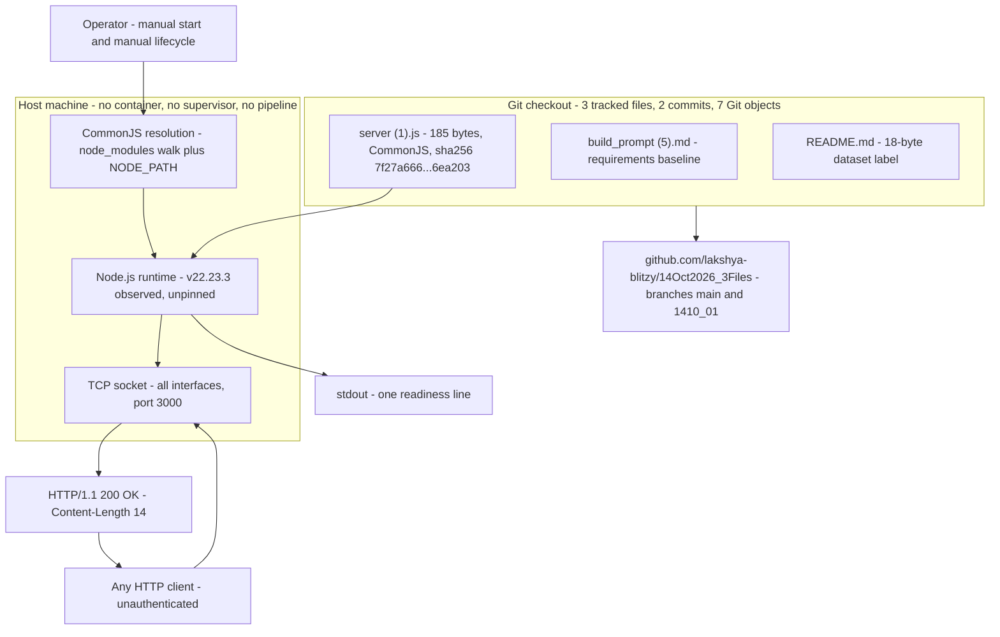

### 3.6.4 CI/CD Requirements — None

| Pipeline element | Status | Evidence |
| --- | --- | --- |
| CI platform configuration | Absent | `.github/`, `.circleci/` and `.gitlab-ci.yml` were probed and do not exist; no workflow, runner or job definition is present |
| Automated build, test or lint job | Absent | There is no pipeline to hold one, no test framework, and `build_prompt (5).md:14-15` forbids adding tests |
| Artefact publication, versioning, release tags | Absent | No manifest, no version, no tag, no `CHANGELOG.md`, no `LICENSE`; the only identity is the commit hash `bc65fd0` |
| Automated deployment | Absent | Deployment is a human starting a process on a host |
| Distribution mechanism actually used | Git only | Remote `https://github.com/lakshya-blitzy/14Oct2026_3Files.git`; two commits uploaded through the web UI by `lakshya-blitzy` on 2026-10-14 (12:23:07 and 12:23:52 +0530); branches `main` and `1410_01` both point at `bc65fd0` |

The consequence for this stack is deliberate and stated in the repository itself: with no pipeline, no test and no runtime pin, the acceptance instrument is human inspection of file contents — `build_prompt (5).md:27-30` forbids test-style criteria, digest checks and command tables, and names the stated file contents as the criterion. Any CI would need a new file, which `:6-7` prohibits.

### 3.6.5 Applicability of the Reference Technology Template

The technology template offered for this specification lists a full cloud-native stack. Each of its items was checked against every file and every reachable revision in this repository (two branches, seven Git objects, three blobs) before being classified:

| Template item | Applicability | Basis |
| --- | --- | --- |
| Python (backend language) | **Not applicable** | Zero `python` matches in any revision; no `.py` file exists; the only executable file is JavaScript |
| Flask (backend framework) | **Not applicable** | Zero `flask` matches; the HTTP layer is the Node.js core module `node:http` (Section 3.2.1) |
| Auth0 (authentication service) | **Not applicable** | Zero `auth0` matches; no identity check exists and every request is served unauthenticated (Sections 3.4.1, 3.4.4) |
| MongoDB (database) | **Not applicable** | Zero `mongodb` matches; no client, connection string or schema; the system persists nothing (Section 3.5) |
| Langchain (AI framework) | **Not applicable** | Zero `langchain` matches; no model call, prompt or inference exists |
| React with TypeScript (web frontend) | **Not applicable** | Zero `react`/`typescript` matches; no `.ts`/`.tsx` file, no `tsconfig.json`, no front-end entry point and no asset served |
| TailwindCSS (CSS framework) | **Not applicable** | Zero `tailwind` matches; no stylesheet and no HTML document is produced or served |
| React-Native with TypeScript (mobile) | **Not applicable** | Zero matches; no mobile project, app manifest or device target exists |
| Swift (iOS) | **Not applicable** | Zero `swift` matches; no `.swift` file and no Xcode project |
| Kotlin (Android) | **Not applicable** | Zero `kotlin` matches; no `.kt` source and no Gradle manifest |
| Objective-C (macOS) | **Not applicable** | Zero `objective-c` matches; no `.m`/`.mm` file and no Xcode project |
| ElectronJS (desktop) | **Not applicable** | Zero `electron` matches; no desktop packaging configuration and no application entry point |
| AWS (cloud platform) | **Not applicable** | Zero `aws`/`boto3` matches; no cloud endpoint, credential, SDK or IaC definition (Section 3.4.1) |
| Docker (containerization) | **Not applicable** | `Dockerfile` and `docker-compose.yml` absent; zero `docker` matches (Section 3.6.3) |
| Terraform (infrastructure as code) | **Not applicable** | Zero `terraform` matches; no `.tf` file, provider or state |
| GitHub Actions (CI/CD) | **Not applicable** | `.github/` absent; no workflow file, runner or pipeline (Section 3.6.4) |
| Node.js with JavaScript in CommonJS form, the `node:http` core module and an npm reference to `lodash` | **Applicable — the entire stack** | Sections 3.1 to 3.3 |

None of the template's items can be added within the system's governing constraints: each would introduce a file (`build_prompt (5).md:6-7` forbids any new file), most would introduce a dependency or lockfile (`:14-15`), and a service integration would introduce configuration the document also prohibits (`:16-17`). The template is therefore recorded as evaluated and inapplicable in full, rather than omitted without assessment.

### 3.6.6 Deployment Procedure and Operational Requirements

The repository documents no install or run instructions — `README.md` is an 18-byte title and `build_prompt (5).md:20-21` forbids researching anything beyond what accurate instructions would require. The procedure below is therefore what the artifact itself demands, and each prerequisite was verified by execution:

| Step | Requirement | Verified behavior |
| --- | --- | --- |
| 1 | A host-supplied Node.js runtime with CommonJS resolution | Node.js v22.23.3 executed the file; the version is unpinned, so any runtime's semantics and default headers apply |
| 2 | `lodash` resolvable at load time, or `server (1).js:1` deleted | With a stub package reachable through `NODE_PATH`, the process started; without one it aborts with `MODULE_NOT_FOUND` before binding |
| 3 | Port 3000 free on the host | `listen(3000)` with no error callback, so a conflict ends the process with an unhandled `EADDRINUSE` |
| 4 | Start from the repository root with a quoted path | `node "server (1).js"` — quoting is required because the filename contains a space and parentheses; the name is not a bare module specifier |
| 5 | Confirm readiness from stdout | One line per process lifetime: `Server running at http://127.0.0.1:3000/` — it names loopback while the socket binds all interfaces (Section 2.4.2) |
| 6 | Stop by signalling the host process | No `SIGTERM`/`SIGINT` handler and no `server.close()` exist, so termination is abrupt and in-flight connections are dropped |
| — | No other prerequisite | No configuration file, environment variable, secret, database, network egress or package installation is needed |

**Development and deployment security implications.** The posture above is entirely manual, and each of its properties is a risk as well as a simplification: the runtime and the resolved `lodash` version are unpinned, so the executable composition drifts with the host (Section 3.3.4); there is no pipeline gate, so nothing detects a regression except a human reading the file; the process binds every interface over cleartext HTTP with no authentication, so any host that exposes port 3000 exposes the service; and with no supervisor, no readiness gate and no monitoring sink, a startup failure or port conflict is silent outside the process's own stderr. Conversely, the deployment surface carries no secret, no credential, no data store and no egress, so the classic deployment risks of leaked configuration and outbound trust do not arise here.


## 3.7 References

- `server (1).js` - the sole executable artifact (185 bytes, five lines, SHA-256 `7f27a666…6ea203`); established the CommonJS `require` of `lodash` at line 1, the `require('http').createServer(listener).listen(3000, callback)` chain at lines 3-5, the fixed body `Hello, World!\n`, the absence of exports, `process.env`, `try`/`catch`, error callbacks and shutdown handling, and the quoted-path invocation requirement of the filename
- `build_prompt (5).md` - the repository's only requirement source (32 lines, 1,831 bytes); established the objective on line 1 and the constraint clauses cited throughout: no new file (lines 6-7), bounded documentation (lines 8-13), no dependency, lockfile or test (lines 14-15), no unrequested hardening (lines 16-17), limited research (lines 20-21), and acceptance by inspection of file contents (lines 27-30)
- `README.md` - 18-byte dataset label (`# 14Oct2026_3Files`); established that the repository documents no install, run or deployment instructions
- repository root (`""`) - flat three-file checkout with no sub-folders and no `.blitzyignore`; established that the entire tracked file set is `README.md`, `build_prompt (5).md` and `server (1).js`
- `.git/` (repository metadata) - established provenance and the absence of any hidden history: two commits by `lakshya-blitzy` on 2026-10-14 (`2ee3243` "Initial commit", `bc65fd0` "Add files via upload"), branches `main` and `1410_01` both at `bc65fd0`, seven Git objects (3 blobs, 2 commits, 2 trees), and the remote `https://github.com/lakshya-blitzy/14Oct2026_3Files.git`
- Cross-referenced specification sections `1.1 Executive Summary`, `1.2 System Overview`, `1.3 Scope` and `2.4 Implementation Considerations` - established the architectural and constraint baseline this section adheres to: the Node.js/CommonJS runtime boundary, the unpinned v22.23.3 baseline, the `lodash` supply-chain and startup-blocking finding, and the security, scalability and maintenance implications restated here
- `[web]` npm registry, `https://registry.npmjs.org/` (observed with `npm view lodash version`) - confirmed the sole referenced package's published `latest` version as **4.18.1**, the only version fact obtainable for an undeclared dependency
- Host environment measurements (Node.js v22.23.3, npm 11.21.0, `process.versions` component versions, host package `nodejs 22.23.3-1nodesource1`, Node.js licence text at `/usr/share/doc/nodejs/copyright`) - established the runtime composition table in 3.3.3, the observed LTS codename `Jod`, and the fact that runtime licensing is inherited from the host installation rather than recorded in the repository
- Execution evidence against the artifact (startup attempt yielding `Cannot find module 'lodash'` at `server (1).js:1:11`, a run with a stub package resolvable through `NODE_PATH` that produced the readiness line and `HTTP/1.1 200 OK` with `Content-Length: 14`) - established the two runtime prerequisites, the startup failure mode and the wire contract documented in 3.4.2 and 3.6.6


# 4. Process Flowchart

## 4.1 Workflow Scope, Actors and System Boundaries

The whole system is one five-line CommonJS file, `server (1).js` (185 bytes), executed by a host-provided Node.js runtime (v22.23.3 observed). Every flow described in this section is therefore short, and each one is stated only as far as the repository's evidence reaches: the executable source, the requirement document `build_prompt (5).md` (31 lines, 1,831 bytes), the dataset label `README.md` (18 bytes), and measurements taken by executing the artifact at commit `bc65fd0`. Where the prompt calls for a workflow the system does not have — outbound data flow, event processing, batch sequences — that absence is stated in 4.4.2 rather than filled with a plausible design.

Three workflows exist. Each is identified here as `W-1`, `W-2` or `W-3` and is diagrammed in 4.2 and 4.3.

| ID | Workflow | Features / requirements | Trigger | Start state | Terminal states | Evidence |
| --- | --- | --- | --- | --- | --- | --- |
| W-1 | Load-time process startup and readiness | F-003 (`F-003-RQ-001…003`), F-002 (`F-002-RQ-001…003`) | An operator issues `node "server (1).js"`, or any module `require`s the file | Process created; no socket bound; no stdout written | Bound socket on `:::3000` plus one readiness line on stdout; **or** abort before the bind with `MODULE_NOT_FOUND` (exit 1); **or** abort at the bind with `EADDRINUSE` (exit 1) | `server (1).js:1`, `server (1).js:3-5`; startup measured at 44 ms spawn-to-first-`200`; failure modes reproduced |
| W-2 | Request–response serve cycle | F-001 (`F-001-RQ-001…005`) | An inbound TCP connection carrying an HTTP request | Socket accepted by the runtime; request parsed | `HTTP/1.1 200 OK` with the constant body; **or** a runtime-generated `400`, `431` or `408` followed by close; **or** an immediate close with no response (`CONNECT`) | `server (1).js:3-4`; eight methods and multiple path forms measured |
| W-3 | Output-contract change delivery | F-004 (`F-004-RQ-001…003`), F-005 (`F-005-RQ-001…007`) | An implementer acts on the objective on `build_prompt (5).md:1` | Unmodified three-file checkout at `bc65fd0`; line 4 emits `Hello, World!\n` | Line 4's literal equals the target text, the file is still five lines, and no file, dependency, lockfile, test or hardening has been added; acceptance is by inspecting file contents (lines 27-30) | `build_prompt (5).md:1`, lines 3-32; `git grep` finds the target string in no revision of the source |

W-3 is a delivery process rather than a runtime one. It is included because the repository's own binding document describes it, because it is the only process by which the artifact's behavior is permitted to change, and because its checkpoints (`build_prompt (5).md` lines 3-17 and 27-30) constrain every other workflow's evolution.

### 4.1.1 Actors and Swim Lanes

The lanes used in the diagrams of 4.2 and 4.3 are the actors below. There is no router, middleware, scheduler, queue consumer, database client or identity provider in any lane, because no such component exists in the repository.

| Lane | Nature | Role in the flows | Evidence |
| --- | --- | --- | --- |
| Operator / host shell | External, human | Issues the quoted command `node "server (1).js"`, owns the process lifetime, reads the single readiness line from stdout | Quoting is required because the filename contains a space and parentheses; `SIGTERM` exits 143, `SIGINT` exits 130, and no handler exists to change that |
| Node.js runtime | Host process | Resolves CommonJS imports, runs the HTTP parser, owns the socket, the event loop and all timers | Runtime-reported defaults: `keepAliveTimeout` 5000 ms, `headersTimeout` 60000 ms, `requestTimeout` 300000 ms, `maxHeaderSize` 16384 bytes, automatic `100 Continue` |
| `lodash` package | Third-party, resolved outside the repository | Loaded on line 1 and never referenced; its resolution is an unconditional precondition of every other lane | `server (1).js:1`; `Cannot find module 'lodash'` at `1:11`, exit 1 |
| `server (1).js` (artifact code) | The application | Creates the server, supplies the two anonymous callbacks, and writes the constant body and the readiness line | `server (1).js:3-5` |
| HTTP client | External, any peer that can reach the port | Sends the request and consumes the constant response; no credential is presented or required | Requests from the host's own address returned `200` |
| Implementer and reviewer | Human or agent, acting on the requirement document | Perform and accept the W-3 edit | `build_prompt (5).md:1`, lines 3-32 |
| Git repository | Version control | Holds the three-file baseline and is the instrument that proves no file was added | `git ls-files` → `README.md`, `build_prompt (5).md`, `server (1).js` |

### 4.1.2 System Boundaries

| Boundary | Definition | Evidence |
| --- | --- | --- |
| Process boundary | Exactly one Node.js process, one listening socket, no child process, worker thread or cluster. Loading the module binds the port, so "import" and "start" cannot be separated | Zero matches in `server (1).js` for `cluster`, `worker_threads`, `child_process`, `fork(`, `setTimeout`, `setInterval`, `.close(`; `require`-ing the file left `Object.keys(module.exports)` empty while port 3000 answered `200` |
| Network boundary | Inbound HTTP only, TCP port 3000, bound on every interface because `listen` receives no host argument; plaintext, with no TLS listener | `listen EADDRINUSE … :::3000` names address `::`; a request to 10.11.0.13:3000 returned `200`; a TLS ClientHello on the port was answered `400 Bad Request` and the connection closed |
| Request boundary | The request is parsed by the runtime and handed to the listener, but never read by the artifact: method, path, headers, query and body are all discarded | `grep -c 'req\.'` → 0; the only response API called is `res.end`; a 200,000-byte upload returned the same 14-byte body |
| Response boundary | The artifact controls one thing — the body literal. Status line, `Date`, `Connection`, `Keep-Alive` and `Content-Length` come from the runtime and the parser version | Response captured byte for byte: `HTTP/1.1 200 OK`, `Connection: keep-alive`, `Keep-Alive: timeout=5`, `Content-Length: 14`, no `Content-Type` |
| Change boundary | W-3 may touch only the existing file's payload literal; no new file, dependency, lockfile, test or unrequested hardening is permitted | `build_prompt (5).md` lines 3-17 |
| Persistence boundary | None. Nothing is read from or written to disk, a database, a cache or a queue; the only durable artifact of a run is whatever the host does with stdout | Zero matches for `fs.`; no data store, connection string or path literal exists in the file |
| Operational boundary | No readiness or health endpoint, no metrics, no log sink, no graceful shutdown and no configuration surface. Lifetime is owned entirely by the host | Zero matches for `process.env`, `process.argv`, `SIGTERM`, `SIGINT`, `.close(`; the port literal cannot be overridden |

### 4.1.3 Notation and Cross-References

- Diagram shapes follow one convention throughout: rounded nodes are start, end, or externally supplied inputs; rectangles are process steps; diamonds are decisions whose branches are labeled with the observed outcome; cylinders are used nowhere because the system stores nothing.
- Every decision diamond is annotated with the measured branch taken at commit `bc65fd0`, so the flowcharts describe the artifact as it exists rather than as it is intended to be. The one branch that is *not* taken today — the payload check in W-3 — is drawn as its own lane in 4.3.3.
- Steps carry requirement identifiers where a requirement governs them: `F-00x-RQ-00y` as defined in Section 2.2, and feature identifiers `F-001…F-005` as catalogued in Section 2.1.
- Timing values shown on the diagrams are descriptive measurements of current behavior, not targets. The repository records no latency, throughput or availability objective in any file, so no SLA line is drawn anywhere in this section; 4.8 states that absence explicitly.
- Errors are labeled with the party that raises them. Failures raised by the artifact's own code are distinguished from those raised by the Node.js runtime's HTTP parser, because the two have different recovery paths: the first aborts the process, the second closes one connection.

## 4.2 High-Level System Workflow

The system's entire life is four stages — load, bind, serve, terminate — and only the third is a loop. This sub-section shows them together in one swim-lane view so that the interaction between the lanes is visible before the per-feature detail in 4.3.

### 4.2.1 High-Level Swim-Lane Diagram

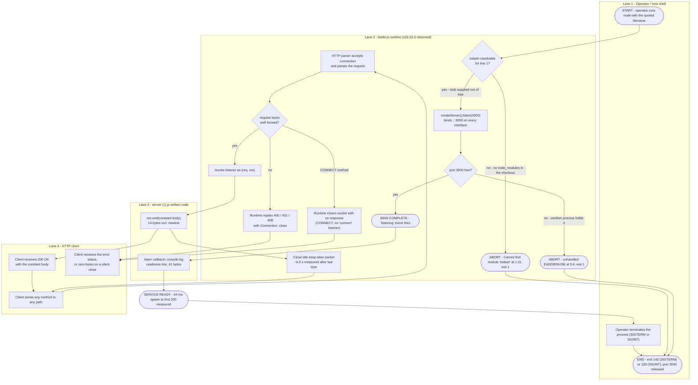

### 4.2.2 Stage-by-Stage Walkthrough

| Stage | Lane driving it | Steps performed | Decision | Observed outcome | Timing |
| --- | --- | --- | --- | --- | --- |
| 1. Load | Operator, then Node.js runtime | The shell hands the file to the runtime; line 1 loads `lodash` into `_`; line 3 loads `node:http` and calls `createServer` with the inline listener | Is `lodash` resolvable? | In a fresh checkout: `Cannot find module 'lodash'` at `server (1).js:1:11`, `MODULE_NOT_FOUND`, exit 1, no socket and no stdout | Startup to readiness measured at 44 ms when the dependency resolves |
| 2. Bind | Node.js runtime, with the artifact's `listen` call | `listen(3000)` is invoked with no host argument and with the second inline callback registered | Is port 3000 free? | Bound on `:::3000`; the readiness callback fires and writes exactly one 41-byte line; a competing instance exits 1 with an unhandled `EADDRINUSE` raised at `5:4` and writes nothing to stdout | The `listening` event precedes the single stdout write; no retry and no fallback port exist |
| 3. Serve | HTTP client, runtime, artifact | The runtime accepts the connection, parses the request, invokes the listener; the listener ignores `req` and calls `res.end` once | Is the request bytes parseable? | `200 OK` with the constant body for any method and any path; runtime-generated `400`, `431` or `408` for malformed, oversized or incomplete input; a silent close for `CONNECT` | Loopback `GET /` measured at 0.0039 s total; 50 concurrent requests all returned `200`; idle keep-alive sockets closed ~6.0 s after the last byte |
| 4. Terminate | Operator / host | No in-process step exists: the source registers no signal handler, calls no `server.close()`, and exposes no lifecycle API | — | `SIGTERM` → exit 143, `SIGINT` → exit 130; the port is released as the process dies and a restarted instance binds again immediately; in-flight work is not drained | Port was available for a fresh bind within 0.4 s of termination |

The stage table's fourth row is the reason the workflow has no "stop" process box: termination is something done *to* the process, never something the process does.

### 4.2.3 Start Points, End Points and User Touchpoints

| Kind | Item | Where it sits in the flow |
| --- | --- | --- |
| Start (primary) | `node "server (1).js"` issued from the repository root by an operator | Lane 1, before stage 1; quoting is required because the filename contains a space and parentheses |
| Start (alternate) | Any module that `require`s the file | Identical to the primary start: loading the module binds the port, and the export object stays empty (`Object.keys(module.exports)` → `[]`) while the port answers `200` |
| End (success, steady state) | Service ready and serving until the host terminates it | Reached after the bind; the flow then loops on the serve stage forever |
| End (failure, pre-bind) | Startup aborted on an unresolvable `lodash` | Exit 1, stderr stack, no socket, no stdout |
| End (failure, at bind) | Startup aborted on a port conflict | Exit 1, unhandled `error` event on the server instance, no readiness line |
| End (per connection) | Connection closed by the runtime after a reply | A `Connection: close` reply, a parser rejection, a silent `CONNECT` close, or the ~6 s idle keep-alive close |
| End (process) | Host signal or host process termination | Exit 143/130, abrupt, with no drain |
| Touchpoint | Operator reading the single readiness line on stdout | The only signal that distinguishes "listening" from "hung"; there is no health or readiness endpoint |
| Touchpoint | Client sending the request and reading the constant body | The only inbound interface; unauthenticated and cleartext, so any reachable peer is served identically |

No configuration touchpoint exists: `process.env` and `process.argv` both produce zero matches in the source, so no operator input other than the command itself can influence the flow.

## 4.3 Core Business Process Flows

Each of the three workflows identified in 4.1 is expanded below into its own flowchart with explicit start and end points, process steps, decision diamonds, system boundaries, user touchpoints, error states with their recovery paths, and measured timing. Validation rules are stated per step in tabular form here and consolidated in 4.7.

### 4.3.1 W-1 — Load-Time Process Startup and Readiness (F-003, F-002)

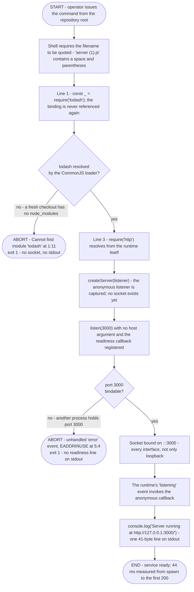

| Step | Actor | Code anchor | Rule applied | Failure |
| --- | --- | --- | --- | --- |
| 1. Invoke the file | Operator / shell | — | The filename must be quoted; an unquoted command fails in the shell before Node is reached | Shell error, process never starts |
| 2. Resolve `lodash` | Node.js CommonJS loader | `server (1).js:1` | The load is unconditional and its binding `_` is never used, so the step has no functional purpose but still gates everything after it | `MODULE_NOT_FOUND` at `1:11`, exit 1 |
| 3. Resolve `http` | Node.js CommonJS loader | `server (1).js:3` | Core module, always resolvable from the runtime | Not attainable |
| 4. Create the server | Artifact code | `server (1).js:3` | One `createServer` call carrying one inline listener; no handler registry, no routes | Not attainable |
| 5. Bind the socket | Artifact code, then runtime | `server (1).js:5` | `listen(3000)` receives no host argument, so the socket binds every interface; the port is a literal and cannot be configured | `EADDRINUSE` (errno -98, syscall `listen`, address `::`, port 3000) raised at `5:4` |
| 6. Announce readiness | Artifact code | `server (1).js:5` | One `console.log` from the `listen` callback; the line is a literal that names `127.0.0.1` while the socket binds `::` | None: the write's result is never checked, and a run with stdout closed still bound the port and answered `200` |

**Start and end points.** Start: the operator's command in lane 1. End (success): the readiness line on stdout with the socket bound, from which the flow passes into W-2's serve loop. End (failure A): abort before any socket exists. End (failure B): abort at the bind. Both failure ends leave port 3000 free or held by the pre-existing process respectively, and both exit with code 1.

**Decision points.** Two, both above: whether `lodash` resolves, and whether the port can be bound. There is no third decision, because the artifact accepts no configuration and has no lifecycle API — no flag, argument or environment variable exists that could take a different path (zero matches for `process.env` and `process.argv`).

**Error states and recovery paths.** Neither failure is recoverable inside the process: the source registers no `error` listener on the server and no signal handler, and `build_prompt (5).md` lines 16-17 forbid adding one. Recovery is therefore entirely external — supply the package the loader demands, or free port 3000, and start the process again. The compliant structural remedy for the first failure is the deletion of the unused import on line 1, since the constraint set forbids declaring the dependency in a manifest or vendoring a lockfile (lines 6-7, 14-15); that reading is recorded in Sections 1.3.4 and 2.4.5 of this specification, and the diagram in 4.3.3 carries it as a branch.

**Timing.** Startup measured 44 ms from process spawn to the first successful `200`, on two separate runs, with the readiness line appearing before that. No startup target, budget or SLA is recorded in any file.

**Boundary and touchpoints.** The operator is the only actor that initiates the flow, and stdout is the only channel back to them: there is no health endpoint, no metrics endpoint and no log sink. The `lodash` package is a third-party actor inside the process boundary even though it is not in the repository.

### 4.3.2 W-2 — Request–Response Serve Cycle (F-001)

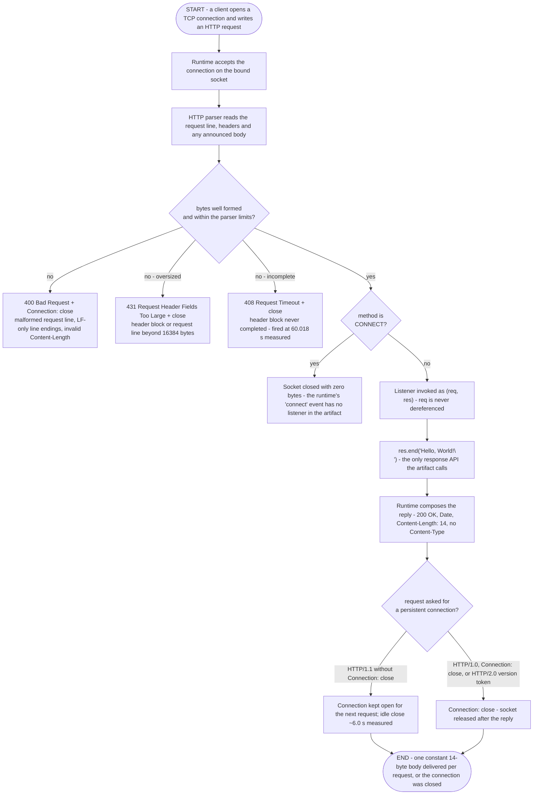

| Step | Actor | Code anchor | Rule applied | Observed evidence |
| --- | --- | --- | --- | --- |
| 1. Connection accepted | Runtime | `server (1).js:5` (the bound socket) | Any client that can reach the host is accepted; no address, host or origin restriction exists | A request from the host's own address returned `200` |
| 2. Request parsed | Runtime HTTP parser | — | Parsing is entirely the runtime's; the artifact contributes no validation, because `req` is never read | `grep -c 'req\.'` → 0 |
| 3. Listener invoked | Runtime → artifact | `server (1).js:3-4` | The listener is called for every parseable request regardless of method, path, query, headers or body | `GET /`, `GET /deep/path`, `POST /anything?x=1`, an absolute-form URI and 200,000-byte uploads all reached it |
| 4. Response written | Artifact code | `server (1).js:4` | Exactly one `res.end` call with a constant literal and a trailing newline; no status, header or content type is set, so the runtime supplies its defaults | Body 14 bytes, `Content-Length: 14`, no `Content-Type` |
| 5. Connection reused or closed | Runtime | — | Keep-alive follows the request's own protocol and headers, not any artifact logic | `Connection: keep-alive` with `Keep-Alive: timeout=5`, two pipelined requests answered on one socket, `HTTP/1.0` answered with `Connection: close` |

**Method, path and header outcomes.** Eight methods (`GET`, `HEAD`, `POST`, `PUT`, `DELETE`, `OPTIONS`, `PATCH`, `TRACE`) each returned `200`, as did an arbitrary deep path and a query string. `HEAD` returned `200` with no body and no `Content-Length` header. A request carrying `Expect: 100-continue` received an interim `HTTP/1.1 100 Continue` before the `200`, because the runtime handles that automatically and the artifact registers no `checkContinue` listener. A leading blank line before the request line was tolerated and still answered `200`. Nothing observed in this workflow varies the response.

**Decision points.** Three, and none of them is taken by the artifact: parseability (runtime), the `CONNECT` special case (runtime), and connection persistence (runtime, from the request's version and `Connection` header). The artifact's own code contains no conditional at all — no `if`, no `try`, no ternary; the only decisions in the whole system belong to the runtime.

**Error states and recovery paths.** Every error in this workflow is raised by the runtime, closes one connection, and leaves the process running: the server wrote zero bytes to stderr across malformed request lines, invalid `Content-Length`, oversized headers, an oversized request line, an aborted request body and 50 concurrent requests, and it answered the next request with `200`. Recovery is client-side only — reconnect and send a well-formed request. Two of these paths matter operationally: a TLS handshake attempted against the cleartext port produced `400 Bad Request` and a close, so TLS clients cannot talk to it at all; and a `CONNECT` request produced no response bytes, since no `connect` listener is registered.

**Timing.** Descriptive measurements only: the response itself is a single buffered write, and a loopback `GET /` completed in 0.0039 s (`time_starttransfer` 0.0038 s), a 200,000-byte upload in 0.0009 s because the body is never read, and 50 concurrent requests all returned `200`. The runtime's own timers bound the slow cases: an incomplete header block was closed with `408 Request Timeout` at 60.018 s, matching the runtime's `headersTimeout` of 60,000 ms, while `requestTimeout` (300,000 ms) was not exercised and idle connections were closed ~6.0 s after the last byte, against the `Keep-Alive: timeout=5` the response advertises. The repository states no throughput, latency or availability target for this workflow.

**Boundary and touchpoints.** The client is the only touchpoint in this workflow and it is anonymous: no credential is requested, no authorization decision is made, and no rate limit, origin check or request rejection path exists. The system's response to a conforming client and to a hostile one is byte-identical.

### 4.3.3 W-3 — Output-Contract Change Delivery (F-004, F-005)

W-3 is the repository's only process for changing the artifact. It runs in lanes that no diagram of the running system shows — an implementer and a reviewer acting on `build_prompt (5).md` — and its output is a file diff rather than a runtime state.

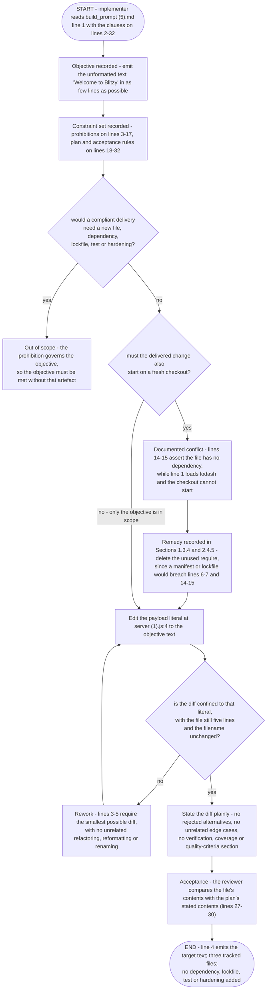

| Step | Actor | Source clause | Process rule |
| --- | --- | --- | --- |
| 1. Read the objective | Implementer | Line 1 | The target text is the unformatted string `Welcome to Blitzy`, produced in as few lines as possible with minimal token usage; the emission point is the payload literal at `server (1).js:4`, per the reading recorded in Section 2.4.6 (A-001) |
| 2. Read the constraints | Implementer | Lines 3-32 | Roughly thirty clauses of restraint govern one clause of behavior; they are binding on the delivery, not advisory |
| 3. Test the scope gate | Implementer | Lines 6-7, 14-15, 16-17 | A delivery that needs a new file, a dependency, a lockfile, a test or unrequested hardening is out of scope by construction; the objective must be satisfied inside the two existing files |
| 4. Resolve the startup blocker | Implementer | Lines 14-15 versus `server (1).js:1` | The two statements cannot both describe the committed file. This specification's recorded reading is deletion of the unused import as the only remedy consistent with the prohibitions (Sections 1.3.4, 2.4.5); the repository itself reconciles nothing |
| 5. Apply the edit | Implementer | Lines 3-5 | One literal, one line, no import added, no encoding helper, no surrounding change; the filename and line order stay as they are |
| 6. Check diff minimality | Implementer | Lines 3-5 | The file remains five lines and 185 bytes at baseline; the diff touches line 4 only; nothing is renamed or reformatted |
| 7. State the plan | Implementer | Lines 18-19, 25-26, 31-32 | The diff is stated plainly, the file list and scope boundary appear once, and no rejected alternative or unrelated edge case is enumerated |
| 8. Accept by inspection | Reviewer | Lines 27-30 | No digest check, command table or test-style criterion is admissible; the plan's stated file contents are the acceptance criterion itself |

**Start and end points.** Start: the implementer reads the requirement document. End: the reviewer accepts file contents that match the plan, with the tracked-file list unchanged at three paths. Intermediate terminal states exist only as rework loops back into the edit step.

**Error states and recovery paths.** W-3's failures are clause breaches rather than exceptions: a new file, an added dependency, an added test, a reformatted block or an over-long `README.md` each invalidate the delivery, and the only recovery is to revert the offending part and re-apply a smaller diff. Nothing in the repository would detect such a breach automatically — there is no CI configuration, no linter, no test and no runtime pin — so detection rests on the reviewer's inspection of file contents, exactly as lines 27-30 provide. The one genuine ambiguity in the flow is the startup conflict at step 4: a delivery that changes only the payload literal cannot make the committed checkout start, and a delivery that also removes line 1 changes more than the objective alone names.

**Timing.** None is recorded. The flow has no schedule, due date, approver, release or version plan; the commit log ends at `bc65fd0` ("Add files via upload"), and the repository states no acceptance gate other than the textual comparison in step 8.

**Touchpoints and boundaries.** The implementer reads the requirement document and writes one existing file; the reviewer reads the same file and the plan. Nothing in the repository mediates between them, and the runtime lanes of W-1 and W-2 are affected only through the byte count of the response body if the change is delivered with the trailing newline in place (14 bytes today, 17 bytes with the target text under assumption A-002 in Section 2.4.6).

## 4.4 Integration Workflows

The system has exactly one integration: inbound HTTP on TCP port 3000. There is no outbound data flow to trace, no message to publish or consume, and no batch sequence, because the source contains no client code of any kind — zero matches for `fs.`, `dns.`, `net.`, `https`, `tls`, `cluster`, `child_process`, `setTimeout` and `setInterval` in `server (1).js`.

### 4.4.1 Inbound HTTP Integration and API Interaction Sequence

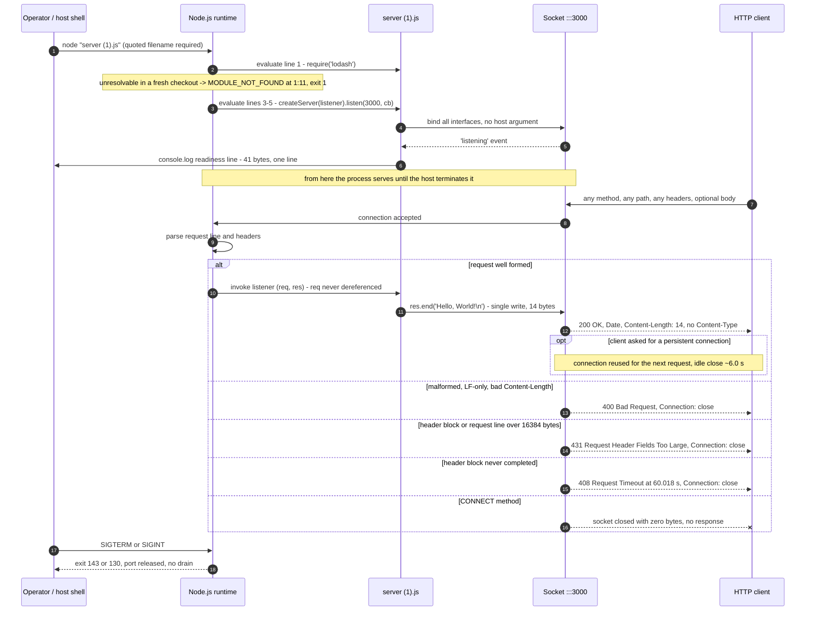

| Interface | Direction | Protocol and shape | Authentication | Contract |
| --- | --- | --- | --- | --- |
| HTTP listener on TCP port 3000 | Inbound | HTTP/1.1 over cleartext TCP; the request is parsed but never read by the artifact, so no request schema, parameter or method contract exists | None. Every client is served identically | Response is fixed: `200 OK` for any parseable request, body `Hello, World!` plus `\n` (14 bytes) at commit `bc65fd0`, header set supplied by the runtime |
| Standard output | Outbound to the host | One `console.log` write of 41 bytes per process lifetime | Not applicable | One line, no level, timestamp, correlation identifier or sink; nothing in the repository consumes it |
| Process control signals | Inbound from the host | `SIGTERM` / `SIGINT`; no other signal or control channel exists | Not applicable | Abrupt termination; exit 143 / 130; port released on exit |
| CommonJS module resolution | Load-time, inbound | `require('lodash')` at line 1, `require('http')` at line 3 | Not applicable | `http` resolves from the runtime; `lodash` is undeclared and unpinned, and its absence aborts startup |

**API interaction pattern.** There is one operation and one response shape, so no interaction sequence beyond "send anything, receive the constant body" exists: a request to `/` and a request to `/deep/path?x=1` are indistinguishable in the response, and an 8-method sweep (`GET`, `HEAD`, `POST`, `PUT`, `DELETE`, `OPTIONS`, `PATCH`, `TRACE`) returned `200` for every method. Because `req` is never dereferenced, the request's content cannot appear in the response, in a log line or in any downstream call — the data flow from client to system terminates inside the runtime's parser, and the data flow from system to client is a compile-time literal.

**What the integration does not carry.** No correlation identifier, no session, no cookie, no tenant, no trace context and no request logging crosses this boundary in either direction. A client that disconnects mid-request leaves no trace in the system: after an aborted 100-byte-announced body the process wrote zero bytes to stderr and answered the next request with `200`.

### 4.4.2 Outbound, Event and Batch Workflows: None Exist

| Workflow class the prompt anticipates | Status in this system | Evidence |
| --- | --- | --- |
| Data flow between systems | Absent. Data moves in one direction only — a client's bytes in, a constant literal out — and the inbound bytes are discarded unread | `grep -c 'req\.'` → 0; the only response API called is `res.end` |
| Outbound API interactions | Absent. The artifact never acts as an HTTP client, opens no socket as a client and calls no external endpoint | Zero matches for `https`, `tls`, `dns.`, `net.`; no URL, host or credential literal appears in the file |
| Event processing flows | Absent as a subsystem. The only event the artifact consumes is the runtime's `listening` event, routed to the second inline callback; no `error` listener and no `connect` listener is registered, which is precisely why a bind conflict kills the process and a `CONNECT` request gets no reply | Zero matches for `on(` in `server (1).js`; `EADDRINUSE` surfaced as an unhandled `error` event, and `CONNECT` closed with zero bytes |
| Batch processing sequences | Absent. Nothing is scheduled, queued, aggregated or run on a timer; the only repeating unit of work is a single served connection | Zero matches for `setTimeout`, `setInterval`, `child_process`, `cluster`, `worker_threads`; no `fs.` access, since the only durable state is the file itself |
| Message publication or subscription | Absent. No broker client, queue, topic or subscription exists, and no manifest declares a messaging dependency | No manifest, no lockfile and no dependency declaration exists in the repository; line 1's `lodash` load is unused |
| Pipeline or webhook integration | Absent, and prohibited for the pending change | No CI configuration or pipeline definition exists; `build_prompt (5).md` lines 6-7 and 16-17 forbid new artifacts and unrequested hardening |

Two consequences follow for the rest of this specification. First, there is no asynchronous workflow to fail partially: every unit of work either serves one connection to completion or aborts the whole process before serving anything. Second, the event surface is a single registered callback, so the system's error behavior is a property of the *unregistered* events — an `error` event that nothing handles, and a `connect` event that nothing answers — as much as of the code that runs.

## 4.5 Decision Points, Error States and Recovery Paths

Failures in this system divide on one line: failures raised before the socket exists kill the process and are detected only from stderr and the exit code, while failures raised after the socket exists are decided by the runtime's HTTP parser and cost exactly one connection. The artifact's own code raises nothing — it contains no `try`, no `catch`, no conditional at all — so it likewise has nothing to recover with.

### 4.5.1 Error-Handling Flowchart

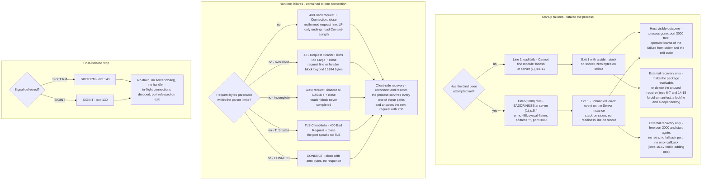

The diagram's asymmetry is the system's most consequential error property: the fatal branch has no in-process remedy at all, while the contained branch has no in-process detection at all — the artifact never learns that a request was rejected, because the parser answers before the listener is ever invoked.

### 4.5.2 Failure Catalogue

| Failure | Raised by | Trigger | Detection surface | Blast radius | Recovery available today | Recovery the constraint set forbids |
| --- | --- | --- | --- | --- | --- | --- |
| `MODULE_NOT_FOUND` for `lodash` | Node.js CommonJS loader | Line 1 evaluated when the package is not resolvable — the state of a fresh checkout | stderr stack naming `server (1).js:1:11`; exit code 1; no socket; zero bytes on stdout | Total: no service, on every start attempt | Make `lodash` resolvable outside the repository, or delete the unused import | Adding a manifest or lockfile to declare it (lines 6-7, 14-15) |
| `EADDRINUSE` | Node.js runtime, as an unhandled `error` event | A second instance started while port 3000 is held | stderr stack naming `server (1).js:5:4` with errno -98, syscall `listen`, address `::`; exit code 1; no readiness line | Total for that instance; the first instance is unaffected and keeps serving | Free the port, then start again — a rebind succeeded immediately after termination, with no `TIME_WAIT` obstruction | Registering an error callback, a retry, a fallback port or environment-variable configuration (lines 16-17) |
| `400 Bad Request` | Runtime HTTP parser | Malformed request line, LF-only line endings, invalid `Content-Length`, or a TLS ClientHello sent to the cleartext port | The client receives `400` and `Connection: close`; the process writes nothing to stderr | One connection | Client-side: reconnect and send a well-formed request | Not applicable — no artifact code is involved |
| `431 Request Header Fields Too Large` | Runtime HTTP parser | Request line or header block exceeding `maxHeaderSize` (16,384 bytes) | The client receives `431` and `Connection: close`; stderr stays empty | One connection | Client-side: send a smaller request | Not applicable |
| `408 Request Timeout` | Runtime HTTP parser | A header block that is never completed | The client receives `408` at 60.018 s measured; stderr stays empty | One connection | Client-side: complete the request within `headersTimeout` (60,000 ms) | Not applicable |
| Silent close on `CONNECT` | Runtime, because no `connect` listener is registered | A `CONNECT` request | The socket closes with zero response bytes measured | One connection | None available | Registering a listener would be new capability (lines 16-17) |
| Aborted client request | Neither party | The client disconnects mid-body | No signal at all: stderr stayed at zero bytes and the next request returned `200` | None | None needed | Not applicable |
| Response write to a vanished client | Runtime socket layer | Connection destroyed while a reply is in flight (observed during the raw-socket probes of W-2) | No stderr output was produced in any probe run | One connection | None needed | Not applicable |
| Abrupt termination | Host, via signal | `SIGTERM` or `SIGINT` while serving | Exit code 143 or 130; the port is free immediately afterwards | All in-flight connections, silently | None available in-process | Adding a signal handler or `server.close()` (lines 16-17) |
| Readiness line lost | Host I/O, not the artifact | Process started with stdout closed | None from inside the system; measured: the instance still bound the port and answered `200` | Operator awareness only | Redirect stdout somewhere capture-able | Checking the write result would be new code (lines 3-5) |

### 4.5.3 Retry, Fallback and Notification Flows

**Retry.** None exists in any lane. The artifact makes no repeated attempt of anything: `listen` is called once, there is no loop around it, no timer and no reconnect logic. The runtime's parser performs no retry either — each connection is parsed once, and a failure closes it. The only retry in the whole system is the client's, performed outside the boundary.

**Fallback.** None exists. There is no fallback port, no degraded response, no cached answer and no alternative listener; the port is an inline literal passed once to `listen(3000)`, and the body is a compile-time constant that cannot vary by circumstance. The single fallback-shaped behavior in the system is negative: when a request cannot be parsed, the runtime answers with a status the artifact never chose.

**Notification.** Two notification channels exist and neither is structured. On a fatal startup failure, the runtime writes a Node.js stack trace to stderr and the process exits — the readiness line never appears, so its absence is the operator's second signal. On a successful start, the artifact writes one 41-byte line to stdout. Nothing else is emitted: there is no request log, no error log, no metrics counter, no alerting hook and no correlation identifier, and the runtime's per-connection rejections produce no output anywhere in the process. The consequence for operators is that a serving instance and a healthy-but-idle instance are indistinguishable from the outside, and a stream of rejected requests is invisible unless the client reports it.

**Recovery procedures.** The procedures the evidence supports are all external to the process: supply the unresolved package or delete the unused import, free port 3000, restart the process after a signal, and retry from the client. No procedure can preserve in-flight work, because no drain or close path exists; no procedure can change the port or the payload, because no configuration surface exists; and no procedure can distinguish healthy from degraded service, because the system exposes no health signal beyond the startup line.

### 4.5.4 Decision Point Inventory

Every branch in this section's diagrams is listed once, with the actor that decides it and the branch the artifact actually takes at commit `bc65fd0`.

| # | Decision | Decided by | Branches | Branch observed |
| --- | --- | --- | --- | --- |
| D-1 | Is the filename quoted for the shell? | Operator | Quoted / unquoted | Quoted in every successful run; an unquoted command fails before Node starts |
| D-2 | Is `lodash` resolvable for line 1? | Node.js CommonJS loader | Resolvable / not resolvable | Not resolvable in the committed checkout; resolvable only with a package supplied out of tree |
| D-3 | Is port 3000 bindable? | Node.js runtime | Free / held | Free on the first start; held on every second instance, which aborts at `5:4` |
| D-4 | Did the bind complete? | Node.js runtime | `listening` fired / `error` fired | `listening` on success; the `error` branch is unhandled and exits 1 |
| D-5 | Are the request bytes parseable within the parser limits? | Runtime HTTP parser | Parseable / malformed / oversized / incomplete / TLS bytes | All four failing branches were reproduced; parseable requests all return `200` |
| D-6 | Is the method `CONNECT`? | Runtime HTTP parser | Yes / no | Yes produces a silent close with zero bytes |
| D-7 | Does the client request a persistent connection? | Runtime, from the HTTP version and `Connection` header | Keep-alive / close | Keep-alive for HTTP/1.1 without `Connection: close`; close for HTTP/1.0, for an explicit `Connection: close`, and for an `HTTP/2.0` version token |
| D-8 | How long may an idle or half-open connection live? | Runtime timers | Idle keep-alive / incomplete headers | Idle sockets closed ~6.0 s after the last byte; incomplete header blocks closed with `408` at 60.018 s |
| D-9 | How is the process terminated? | Host | `SIGTERM` / `SIGINT` / host kill | 143 or 130 respectively; no other outcome is available to the process |
| D-10 | Does a compliant delivery need a new file, dependency, lockfile, test or hardening? | Implementer, per `build_prompt (5).md` lines 6-17 | Yes / no | "Yes" is out of scope by construction, so the objective must be met inside the existing files |
| D-11 | Does the delivery also have to make a fresh checkout start? | Implementer, per the conflict at lines 14-15 | Yes / no | Unresolved in the repository; the reading recorded in Sections 1.3.4 and 2.4.5 is that it does, and that the remedy is deleting the unused import |
| D-12 | Is the diff confined to the payload literal with the file unchanged at five lines? | Implementer and reviewer, per lines 3-5 | Yes / no | Determined by inspection; "no" returns the flow to the edit step because no automated gate exists |
| D-13 | Do the file contents match the plan? | Reviewer, per lines 27-30 | Accept / rework | The stated file contents are themselves the acceptance criterion; no test, digest or command table is admissible |

## 4.6 State Management

The system holds no application state. The artifact declares one module-level binding — `const _ = require('lodash')` on line 1 — and never reads it; beyond that, the only mutable state in the process belongs to the Node.js runtime: the bound socket, the parser buffers, the keep-alive and timeout timers, and the event loop. There is no session store, no request context, no accumulator, no counter and no cache.

### 4.6.1 Process State Transitions

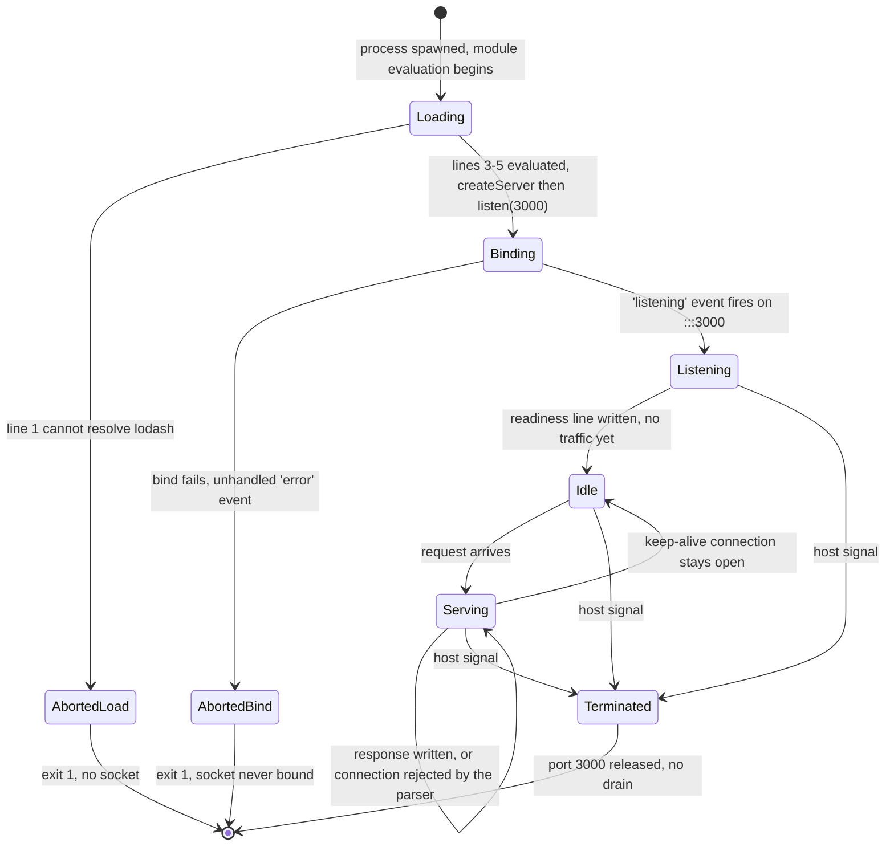

| From | To | Trigger | Evidence |
| --- | --- | --- | --- |
| Loading | AbortedLoad | `require('lodash')` rejects | `Cannot find module 'lodash'` at `server (1).js:1:11`, exit 1 |
| Loading | Binding | The chained expression is evaluated by the module loader | `server (1).js:3-5`; startup to first `200` measured 44 ms |
| Binding | AbortedBind | A competing process holds port 3000 | Unhandled `EADDRINUSE` raised at `5:4`, exit 1, no stdout |
| Binding | Listening | The runtime reports the socket bound | Readiness line — one 41-byte write — follows the bind |
| Idle → Serving → Idle | — | Each request is served and the socket returns to idle | Response written; connection reused for a second pipelined or sequential request |
| Any live state | Terminated | `SIGTERM` or `SIGINT` from the host | Exit 143 or 130; no handler intercepts the signal |
| Terminated | — | Process death releases the port | A fresh instance bound port 3000 within 0.4 s of termination |

The transition set is deliberately incomplete in two ways that matter for operations: there is no transition *into* a drained or draining state, because no `server.close()` or shutdown handler exists anywhere in the file, and there is no transition back from either abort state, because neither failure leaves a process alive to act on.

### 4.6.2 Connection State Transitions

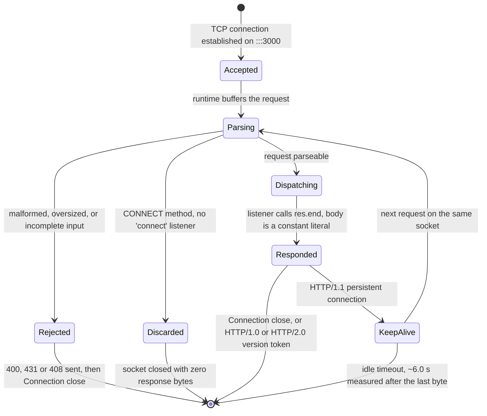

Because every response is generated from a literal, the connection's transitions carry no data dependence: the state machine for a `GET /` is identical to that for a `POST /upload` with 200,000 bytes, apart from how long the runtime spends reading the request. A connection's states are the runtime's, not the artifact's — the listener is invoked at exactly one point in them (`Dispatching`), terminates the response at the next (`Responded`), and is never consulted again.

### 4.6.3 Persistence, Caching and Transaction Boundaries

| Aspect | Status in this system | Evidence |
| --- | --- | --- |
| Persistence points | None. Nothing is written to disk, a database, a cache or a remote store, and nothing is read from one | Zero matches for `fs.` in `server (1).js`; no data store, path literal, connection string or credential appears in any file |
| Durable artifacts of a run | Only what the host captures: the single stdout readiness line, any stderr stack from a fatal start, and the process exit code. The repository's own three files are the only other durable state, and the runtime never writes them | Readiness line 41 bytes on stdout, stderr 0 bytes on every successful run |
| Caching requirements | None. No cache layer, cache header, `ETag`, `Cache-Control` or `Last-Modified` exists, and none is emitted in a response | Response headers observed: `Date`, `Connection`, `Keep-Alive`, `Content-Length` only |
| Nearest thing to a cached value | The response body is a compile-time literal, so every response is byte-identical without any memoization; the runtime re-encodes the string per response and the artifact computes nothing | Body measured at 14 bytes for every method, path and body size tested |
| Transaction boundaries | None, and none is needed: a request has no side effect to commit or roll back. The atomic unit is one connection, which either receives its full constant reply or is closed | No `fs`, database or queue call exists; `res.end` is the only state-changing call the artifact makes |
| Idempotency and retry safety | Total. Repeating any request produces the identical response and no state change, so client retries are always safe | Fifty concurrent requests and repeated sequential requests all returned `200` with the same body |
| Session or user state | None. No cookie, token, header inspection, tenant, correlation identifier or client identity is stored or read | `grep -c 'req\.'` → 0; no response header beyond the runtime's defaults is emitted |
| Concurrency model | A single-threaded event loop over one process and one socket; no worker thread, cluster worker or child process exists, so no state can be shared across processes because none is created | Zero matches for `cluster`, `worker_threads` and `child_process` |
| Crash-recovery state | None to recover. After an abrupt termination there is nothing to replay, reconcile or reload: the process restarts into the same constant behavior | A restarted instance bound the port and served identical responses with no recovery step |

Two operational consequences follow from the table. First, the system is trivially replicable *in principle* — with no state to synchronize, N instances would be interchangeable — but not in practice, because the port is a hard-coded literal and a second instance on the same host exits on `EADDRINUSE`. Second, the absence of state removes whole classes of flow from this specification: there is no cache-invalidation flow, no transaction-rollback flow, no migration flow and no consistency model to document, because there is no data to keep consistent.


## 4.7 Validation Rules and Checkpoints

Validation in this system exists at two levels, and neither of them is a validation the artifact performs. The runtime validates HTTP wire format before the listener is called; the implementer and reviewer validate the source file against the clauses of `build_prompt (5).md`. The artifact's own code validates nothing, because it consumes no input: `req` is never dereferenced, no body is parsed, no header is read and no value from outside the file influences the response.

### 4.7.1 Business Rules at Each Step

| Workflow and step | Business rule | Source | Where it is enforced | Consequence of breach |
| --- | --- | --- | --- | --- |
| W-1.2 Resolve `lodash` | Every start attempt loads `lodash` before anything else, whether or not it is available | `server (1).js:1` | Node.js CommonJS loader | Startup aborts with `MODULE_NOT_FOUND`, exit 1 — the rule is unconditional and admits no bypass |
| W-1.4 Bind on port 3000 | The port is the fixed literal `3000`; the service must bind all interfaces, since `listen` takes no host argument | `server (1).js:5` | The single `listen` call, once per process | `EADDRINUSE` on a contested port; no fallback port or retry is available |
| W-1.6 Announce readiness | Exactly one readiness line is written, after the bind, and never again | `server (1).js:5`; `F-002-RQ-001…003` | The `listen` callback, which fires once | A second line would breach the single-notice rule; today none can occur, because no other `console.log` exists |
| W-2.1 Accept any client | Every reachable client is served identically; no request may be rejected on identity, origin, rate or reputation grounds | Measured behavior of `server (1).js:3-4` | No enforcement point exists | Not applicable — the rule holds by construction, which is also the system's principal security gap (4.7.3) |
| W-2.4 Answer with the constant body | The body is `Hello, World!` plus a newline at commit `bc65fd0`, identical for every method, path, header and body size | `server (1).js:4`; `F-001-RQ-002` | The single `res.end` call | No branch can vary the body, so the rule cannot be broken without editing the literal |
| W-2.5 Serve until terminated | The process serves for as long as the socket is bound and stops only when the host ends it | `server (1).js:3-5`; `F-001-RQ-004` | Absence of any shutdown path | No in-process alternative exists; termination is always abrupt |
| W-3.3 Avoid out-of-scope artifacts | No new file, dependency, lockfile, test or unrequested hardening may be introduced by the change | `build_prompt (5).md` lines 6-7, 14-15, 16-17 | Implementer self-check, then reviewer inspection | The delivery is invalid; nothing in the repository would detect it automatically |
| W-3.5 Confine the edit | The change is the smallest possible diff, touching only the payload literal, with no unrelated refactoring, reformatting or renaming | `build_prompt (5).md` lines 3-5 | Implementer self-check; reviewer compares the file against the plan | The diff is invalid and must be reduced; a larger diff also removes the only structural protection the surrounding behavior has, since no test exists |
| W-3.8 Accept by inspection | The exact file contents stated in the plan are the acceptance criterion; no digest check, command table or test-style criterion is admissible | `build_prompt (5).md` lines 27-30 | Reviewer, comparing file contents with the plan | Acceptance has no other instrument; the repository contains no CI configuration or test that could substitute |

### 4.7.2 Data Validation Requirements

| Aspect | Requirement | Evidence |
| --- | --- | --- |
| Input validation by the artifact | None, and none is possible: no input reaches any code the artifact executes | `grep -c 'req\.'` → 0; the listener's only statement is `res.end('Hello, World!\n')` |
| Schema, type or range validation | None. No data model, schema, field, type or range is defined anywhere in the repository | Three files exist: two documents and one five-line source file; no schema or configuration file is present |
| Wire-format validation | Delegated entirely to the runtime's HTTP parser, which rejects malformed framing, oversized headers and incomplete header blocks before the listener is invoked | `400`, `431` and `408` responses were reproduced; in none of them did the artifact's code run |
| Payload validation | None. The response is a compile-time literal rather than a computed value, so there is nothing to validate at runtime and no path by which a value could be invalid | `server (1).js:4` contains a string literal with no interpolation, placeholder or concatenation |
| Request-body validation | None, and deliberately unnecessary: the body is read by the parser and then discarded | A 200,000-byte upload returned the same 14-byte response in 0.0009 s, with no error and no stderr output |
| Constraint validation for the change | The only validation performed against a written specification is the clause check on the W-3 edit | `build_prompt (5).md` lines 3-32, checked by inspection per lines 27-30 |

### 4.7.3 Authorization Checkpoints

There are none. The list below is therefore an inventory of the checkpoint-shaped places where an authorization decision would ordinarily sit, each recorded as absent rather than as satisfied.

| Checkpoint that would normally exist | State | Evidence |
| --- | --- | --- |
| Client authentication | Absent. No credential, token, certificate or client identity is requested or examined | No `req` dereference exists; no header is read; a request from the host's non-loopback address returned `200` |
| Authorization or role check | Absent. There is one behavior for every caller, so there is no privileged path to protect | All eight HTTP methods returned `200` with the same body |
| Rate limiting or quota | Absent. No counter, window or throttle exists, and the artifact keeps no state in which one could live | No state beyond the dead `lodash` binding; 50 concurrent requests were all served |
| Origin, CORS or host-header check | Absent. The `Host` and `Origin` headers are never read, and no CORS header is emitted | Absolute-form request URIs and arbitrary `Host` values both returned `200` |
| Administrative or health endpoint protection | Not applicable — no such endpoint exists, so there is nothing to protect or to probe | No route inspection exists in the artifact; the readiness line is the only operational output |
| Transport protection | Absent. The listener is cleartext; a TLS ClientHello was answered with `400 Bad Request` and a close, so the port cannot serve encrypted traffic at all | Reproduced against the running artifact |
| Network exposure control | Absent in effect. `listen(3000)` receives no host argument, so the socket binds every interface, while the readiness line states `127.0.0.1` — the one place where the system's own output misrepresents its behavior | Request to 10.11.0.13:3000 returned `200`; the readiness literal is on `server (1).js:5` |

An operator reading only the startup line would conclude the service is loopback-only. The measured behavior contradicts that conclusion, and no file in the repository states otherwise; the mismatch is recorded here and in Sections 1.2.1, 2.2.1 and 2.4.2, and it cannot be corrected by the pending change, since lines 16-17 forbid hardening that the objective does not request.

### 4.7.4 Regulatory and Compliance Checks

No regulatory, privacy, retention or audit control is stated or implemented anywhere in the repository, and none can be evidenced from the artifact's behavior. The supporting facts are these: no `LICENSE`, privacy notice, retention rule, audit log or data-processing statement exists in any of the three files; `build_prompt (5).md` lines 6-7 and 8-13 forbid adding a license file or documentation sections, so such material cannot be introduced by the pending change either; and the system processes no personal, financial or otherwise regulated data, since it stores nothing, reads no request content and emits a constant literal. The nearest thing to a compliance-relevant artifact is the readiness line, which becomes durable wherever the host captures stdout — the only record a run leaves behind. This sub-section therefore reports an absence, not a compliance claim: absence of a stated obligation in the repository is not evidence that an obligation does not apply.

## 4.8 Timing and SLA Considerations

No file in the repository states a latency, throughput, availability or recovery objective; `build_prompt (5).md` lines 27-30 explicitly forbid verification, coverage and quality-criteria sections. Every timing value below is therefore a descriptive measurement of the artifact at commit `bc65fd0` on Node.js v22.23.3, reported so that the flowcharts' timing annotations can be read against their source, and none of it is a target the system commits to.

### 4.8.1 Measured Timings by Workflow

| Workflow | Event measured | Value | Conditions |
| --- | --- | --- | --- |
| W-1 | Process spawn to first successful `200` (and therefore past the bind and the readiness write) | 44 ms | Loopback, two independent runs, identical result |
| W-1 | Bind-conflict failure | Immediate at the bind attempt | Second instance while port 3000 was held; the process exits 1 with no retry interval, backoff or fallback port |
| W-1 | Termination to port release | Under 0.4 s | `SIGTERM`; a new instance then bound the same port immediately, with no `TIME_WAIT` obstruction |
| W-2 | Loopback `GET /` end to end | 0.003903 s total; 0.000119 s to connect; 0.003788 s to first byte | Local host, curl, single client |
| W-2 | `POST` with a 200,000-byte body | 0.000870 s | The body is parsed by the runtime and never read by the artifact |
| W-2 | 50 concurrent requests, 25 at a time | All returned `200` | No latency target; the measurement establishes survival, not throughput |
| W-2 | Idle keep-alive connection closed after the reply | 6.003 s, 6.009 s, 6.009 s measured | Three samples on one running instance; the response advertises `Keep-Alive: timeout=5`, so the measured close lags the advertised value by about one second |
| W-2 | Incomplete header block closed | 60.018 s, with `408 Request Timeout` | Matches the runtime's `headersTimeout` of 60,000 ms |
| W-2 | Request-body timeout | Not exercised | The runtime's `requestTimeout` is 300,000 ms; no test ran long enough to reach it, so no behavior is claimed for that path beyond the runtime default |
| Process | Shutdown exit | Immediate, exit 143 on `SIGTERM`, exit 130 on `SIGINT` | No handler, no drain, in-flight connections dropped |
| W-3 | Delivery timing | None recorded | The repository has no schedule, due date, milestone, release or approver; the commit log ends at `bc65fd0` |

### 4.8.2 Timeouts and Timing Constraints Imposed by the Runtime

| Property | Runtime value | Effect on the flows |
| --- | --- | --- |
| `keepAliveTimeout` | 5,000 ms | A connection left idle after a completed exchange is closed by the runtime (~6.0 s measured); the artifact takes no part in the decision and cannot be notified of it |
| `headersTimeout` | 60,000 ms | A client that never completes its header block is answered `408` after 60.018 s; this is the system's only slow-client defense and it belongs to the runtime |
| `requestTimeout` | 300,000 ms | The runtime's upper bound for a whole request; not exercised in this investigation |
| `timeout` | 0 (disabled) | No application-level inactivity limit is applied by the artifact; the socket's lifetime is governed by the two timers above |
| `maxHeaderSize` | 16,384 bytes | Requests exceeding it — header block or request line — are answered `431` and closed; this is a size limit that behaves as a latency cliff for large-header clients |
| Automatic `100 Continue` | Enabled | A client sending `Expect: 100-continue` gets an interim `100 Continue` before the `200`, so the response is delivered in two writes |
| Event-loop model | Single-threaded | Response latency is bounded only by the runtime's parser and the socket write; the artifact adds no computation, no I/O and no lock, so it can neither shorten nor lengthen that bound |

### 4.8.3 Stated Targets

None exist. No KPI, SLO, SLA, error budget, availability percentage, throughput figure, concurrency limit or recovery-time objective appears in `server (1).js`, `build_prompt (5).md` or `README.md`, and Section 1.2.3 records the same absence from the requirements side. The countable quantities the repository does state are structural rather than temporal — three tracked files, a five-line source file, `README.md` under five lines, a JSDoc comment limited to one line, and "as few lines as possible" for the change — and they are measured by inspecting file contents, not by timing anything.

### 4.8.4 Reading the Timing Values Correctly

- **The startup gate is absolute.** Nothing is served, and no readiness line appears, until the bind succeeds. A caller has no way to learn about progress in between; the two failure modes are visible only on stderr and in the exit code, so an operator's detection time equals the time it takes to notice a stack trace.
- **The serve path has no self-imposed delay.** The response is a single `res.end` of a constant, so the artifact contributes no latency of its own; anything measured above comes from connection setup, the parser and the socket.
- **Timeout behavior is entirely delegated.** Slow, incomplete and oversized requests are handled by the runtime's timers and limits, and the artifact is never informed of them; consequently there is no path in which the system could apply its own timeout, backpressure or circuit-breaking, and none may be added for the pending change (lines 16-17).
- **Shutdown has no time allowance at all.** Because no drain or close path exists, the effective shutdown grace period is zero for in-flight requests; any orchestrator would have to supply its own.
- **Two timing facts are unmeasured, and are stated as such.** Throughput beyond 50 concurrent requests was not established, and the `requestTimeout` path was not reached. No extrapolation from either is offered.
- **The measurements are runtime-dependent.** The repository pins no Node.js version — no `.nvmrc`, `.node-version` or manifest exists — so header details and timer behavior could differ on another host runtime without any change to the source.

## 4.9 References

- `server (1).js` — the repository's only executable file and the sole subject of every flow in this section: line 1's unconditional `lodash` load, lines 3-5's `createServer(...).listen(3000, ...)` chain, the request listener that never dereferences `req` at lines 3-4, the constant payload literal at line 4, and the readiness `console.log` at line 5. Its zero-match properties (`process.env`, `process.argv`, `SIGTERM`, `SIGINT`, `.close(`, `req.`, `cluster`, `worker_threads`, `child_process`, `setTimeout`, `setInterval`, `fs.`, `dns.`, `net.`, `https`, `tls`, `on(`, `try`, `catch`) are the evidence for the boundaries, state, error and integration claims above.
- `build_prompt (5).md` — the requirement baseline that governs the W-3 flow: line 1's objective (`Welcome to Blitzy`, unformatted, minimal lines), lines 3-5's smallest-diff rule, lines 6-7's no-new-file prohibition, lines 8-13's documentation bounds, lines 14-15's no-test/no-lockfile/no-dependency clause and its conflict with `server (1).js:1`, lines 16-17's prohibition on unrequested hardening, lines 18-19 and 25-26 and 31-32's plan-concision rules, lines 20-24's research scope, and lines 27-30's acceptance-by-inspection instrument.
- `README.md` — the dataset label `# 14Oct2026_3Files`, establishing that the repository carries no run documentation, no dependency note and no statement of the readiness line or the port.
- Repository root (`""`, the checkout itself) — contained exactly three tracked files (`git ls-files`) and no sub-folder, manifest, lockfile, test, runtime pin or CI definition (`package.json`, `package-lock.json`, `yarn.lock`, `.nvmrc`, `.node-version`, `Dockerfile`, `docker-compose.yml`, `Procfile`, `.github`, `.circleci` all absent), and no `.blitzyignore`; this is the evidence for the file-list, change-boundary and absent-toolchain claims.
- Node.js runtime v22.23.3 (host-provided; unpinned by the repository) — the source of the runtime defaults quoted in 4.8.2 (`keepAliveTimeout` 5000, `headersTimeout` 60000, `requestTimeout` 300000, `timeout` 0, `maxHeaderSize` 16384, automatic `100 Continue`), of the parser-generated responses described in 4.3.2 and 4.5.2 (`400`, `431`, `408`, silent `CONNECT` close), of the fatal startup errors in 4.3.1 (`MODULE_NOT_FOUND` at `1:11`, `EADDRINUSE` at `5:4`), and of the measured startup, response, idle-close, timeout and shutdown timings in 4.8.1. Execution measurements were taken against commit `bc65fd0` with `lodash` resolvable only from a stub outside the repository, because the checkout contains no package that could satisfy line 1.

No web source, external document or third-party specification was consulted for this section; every statement rests on the files above or on execution of the artifact as described.

# 5. System Architecture

## 5.1 High-Level Architecture

The architecture of this system is the architecture of a single 185-byte CommonJS file, `server (1).js`, executed directly by a host-supplied Node.js runtime. It has one process, one listening socket, one request listener and one constant response; it has no modules, no layers, no data tier and no outbound calls. Every statement below rests on the file's five lines, on `build_prompt (5).md` (the requirement and constraint document), and on behavior measured by executing the artifact on Node.js v22.23.3.

### 5.1.1 System Overview

**Architecture style.** The system is a single-file, single-process, event-loop-driven script with no internal structure: lines 3-5 are one chained expression, `require('http').createServer(<listener>).listen(3000, <callback>)`, and the file defines no class, no named function, no exported value and not even a comment. The style is best described as a *procedural single-script service* whose module-evaluation side effect is the deployment: importing the file is equivalent to starting it. There is no layering, no dependency-injection seam, no middleware pipeline, no router, no configuration layer and no persistence layer — the absence of each is verified by keyword scans of the file (zero matches for `process.env`, `module.exports`, `fs`, `cluster`, `worker_threads`, and any outbound client call).

**Rationale.** The repository contains no design document, no ADR file and no code comment, so no architect's rationale is recorded. The only rationale that *is* recorded is the constraint set in `build_prompt (5).md`: lines 6-7 forbid creating any file (explicitly including architecture diagrams), lines 14-15 forbid a manifest, lockfile, dependency or test, and lines 16-17 forbid a 404 handler, error handler, environment-variable configuration "or any hardening not explicitly requested". Against a one-line objective (`build_prompt (5).md:1`), those constraints leave exactly one viable shape — everything the service does must fit in the existing five lines, using only the Node.js standard library. The architecture is therefore prohibition-driven minimalism rather than a deliberate enterprise design, and that reading is consistent with how the already-written specification sections describe the system (Sections 1.2, 3.2, 3.6).

**Architectural principles embodied in the code.**

- **One artifact, one process.** The deliverable is the source file; it is executed as written, with no compiler, bundler, container or pipeline in between (Section 3.6).
- **Behavior fixed at edit time.** Port, response body and log text are inline literals, so the running system's behavior is a property of the file's bytes rather than of its environment.
- **Startup as a load-time side effect.** The module exports nothing (verified: `Object.keys(module.exports)` is `[]` while the port is answering), so there is no `main` function, no bootstrap and no lifecycle API.
- **All protocol framing delegated to the runtime.** The artifact writes a body and nothing else; the status line, `Date`, `Connection`, `Keep-Alive` and `Content-Length` come from `node:http`.
- **Shared-nothing and stateless.** No request field is read (zero `req.` dereferences), nothing is stored, and no cache exists, so an instance holds no state beyond its bound socket.
- **Zero egress.** The file opens no client connection, writes no file and contacts no service; its only outputs are the socket and stdout.

**Patterns and standards exercised.** The file instantiates standard Node.js patterns — the module side-effect entry point, the `(req, res)` request-listener callback, and the `listen(port, callback)` readiness callback. The wire behavior it produces is HTTP/1.1 as parsed by the runtime's llhttp 9.4.3 parser (`process.versions.llhttp`), and its dependency resolution follows CommonJS specifier resolution against a bare npm package name. No standards document, RFC reference, style guide or versioning convention is recorded anywhere in the repository.

**System boundaries and major interfaces.**

| Boundary | Direction | Interface | Evidence |
| --- | --- | --- | --- |
| Process boundary | Inbound | HTTP/1.1 over cleartext TCP on port 3000, any method, any path, unauthenticated | `server (1).js:3-5`; every method and path tested returned `200` with the same 14-byte body |
| Process boundary | Outbound | None — no client socket, no file, no IPC, no subprocess | Zero matches for `fs`, for `cluster`/`worker_threads`, and for `http.request`/`http.get` in the file |
| Host runtime interface | Inbound | CommonJS module load; `createServer`; the `(req, res)` and `listen` callbacks | `server (1).js:1`, `:3-5` |
| Runtime binding | Inbound | `listen(3000)` with no host argument, so the socket binds `::` — every interface | `server.address()` returned `{"address":"::","family":"IPv6","port":3000}` |
| Logging interface | Outbound | `process.stdout`, one 42-byte line per process lifetime | Measured stdout: exactly `Server running at http://127.0.0.1:3000/\n`, unchanged by traffic |
| Package resolution | Load-time | Bare specifier `lodash` resolved by the host's module loader | `server (1).js:1`; `npm ls lodash` reports an empty tree and `require.resolve('lodash')` throws |

**Architectural assumptions.** Each assumption below is what the artifact requires to run; the verification column records how it was checked during this investigation.

| Assumption | Why the system requires it | Verification |
| --- | --- | --- |
| The host supplies a Node.js runtime with CommonJS resolution | The file is CommonJS and calls `node:http`; nothing else can execute it | Verified on Node.js v22.23.3; the runtime is unpinned (no `.nvmrc`, `.node-version` or `engines` field) |
| `lodash` is resolvable at load time, or line 1 is deleted | Line 1 evaluates unconditionally before anything else | Without it the process exits 1 with `Cannot find module 'lodash'` at `1:11` |
| Port 3000 is free on the host | The literal port is neither configurable nor replaceable | A second instance dies with an unhandled `EADDRINUSE` and exit code 1 |
| Exactly one instance runs per host | The port is a literal, so two instances collide | Measured: the second process exits 1 with 0 bytes on stdout |
| The host captures or forwards stdout | The readiness line is the only operational signal emitted | Measured: one line per process lifetime, written at bind |
| No layer inside the artifact mediates trust | No proxy, gateway, TLS terminator or authenticator exists in the repository, and the request listener inspects nothing | TLS ClientHello received on the plaintext port is rejected by the runtime with `400`; a credential-bearing request to `/secret/admin` returned `200` |
| The client speaks HTTP as parsed by llhttp | No negotiation or fallback exists; the artifact cannot adapt | HTTP/1.1, HTTP/1.0 and absolute-form requests were all answered; malformed input was rejected by the runtime |

### 5.1.2 Core Components

The system has six runtime components, one external actor and one vestigial dependency reference. The table folds the prompt's five requested columns into four: *Primary Responsibility* and *Key Dependencies* are combined in one column, since each component has at most two dependencies and they read together.

| Component | Primary responsibility and key dependencies | Integration points | Critical considerations |
| --- | --- | --- | --- |
| `server (1).js` — the application artifact (185 bytes, 5 lines, CommonJS) | Starts the listener as a load-time side effect and owns the whole service behavior. Depends on `http` (line 3) and, unconditionally, on `lodash` (line 1) | Loaded by the CommonJS loader; binds the TCP socket; writes one stdout line; exports nothing | Cannot start where `lodash` is unresolvable; the port is a literal; its export object is empty |
| Request listener — anonymous arrow, lines 3-4 | Terminates every response with the constant body `Hello, World!\n`. No dependencies | Invoked by `node:http` once per request; never dereferences `req` | Single response path: no routing, no method distinction, no error branch |
| Listen callback — anonymous arrow, line 5 | Writes the one readiness notice to stdout. Depends on `console`/`process.stdout` | Runs once, after the port is bound, to stdout | Its text claims `127.0.0.1` although the socket binds every interface |
| `node:http` core module (llhttp 9.4.3 parser) | Parses requests, frames responses, generates headers, manages keep-alive and timeouts, and emits protocol-level rejections. Depends on the host runtime | Called from line 3; drives the request listener; writes to the socket | Observable wire behavior — header set, timeouts, `400`/`431` replies — belongs to the runtime, not the artifact, and drifts with its version |
| Host Node.js runtime (v22.23.3 observed, unpinned) | Resolves the module graph, runs the event loop, owns the socket and stdout. Depends on the host machine | Process boundary; supplies `http`, `console`, timers and the TCP stack | No version pin exists in the repository; a different runtime can change headers, timeouts and error replies |
| `lodash` module reference | None — bound to `_` at line 1 and never referenced again. Depends on the host's package resolution | Participates only in load-time CommonJS resolution | Gates startup (`MODULE_NOT_FOUND`, exit 1) and is the only third-party code executed at startup; undeclared and unpinned |
| HTTP client (external actor) | Initiates connections; the system presumes nothing about it. No dependencies | TCP port 3000 on every interface; cleartext HTTP | Unauthenticated and unidentifiable: no header, credential or address is inspected |
| `build_prompt (5).md`, `README.md` | Not runtime components: the first is the requirement and constraint baseline, the second an 18-byte dataset label | None at run time | The constraint set in `build_prompt (5).md:2-32` governs what may be added to the system |

Nothing else exists. There is no reverse proxy, gateway, load balancer, TLS terminator, container, orchestrator, supervisor, configuration store, message broker, database, cache, object store, identity provider, metrics sink, log aggregator, APM agent, scheduler or batch runner anywhere in the repository, and Section 5.2.4 records each absence with its evidence.

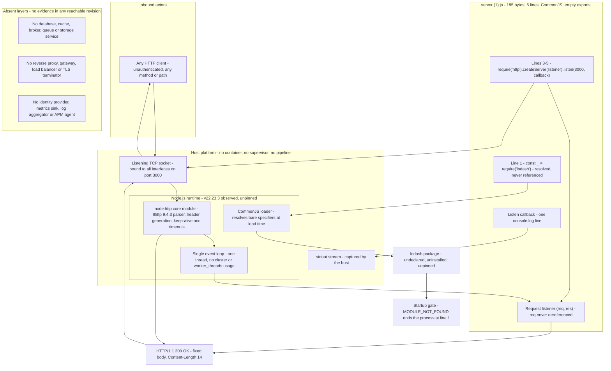

### 5.1.3 Data Flow Description

The system has two flows: a load-time flow that decides whether the service exists at all, and a per-request flow that produces the only response the service can produce. Both carry a single 14-byte constant; no other payload exists.

**Flow one — load-time startup (load-time data flow).** When the runtime evaluates the module, the CommonJS loader resolves `require('lodash')` at `:1`. If the package cannot be resolved, the loader throws `Cannot find module 'lodash'` at `1:11` and an uncaught error ends the process with exit code 1 — no socket, no log line. If it resolves, the value is bound to `_` and discarded unused, `require('http')` at `:3` returns the core module, `createServer(listener)` allocates the server, and `listen(3000, callback)` binds `::` on port 3000. The bind completes, the callback writes the single 42-byte readiness line to stdout, and module evaluation finishes with an empty export object. Process control then rests entirely with the event loop (measured: 31 ms from spawn to the first successful `200`, 45 ms across a restart after `SIGTERM`).

**Flow two — request-response (per-request data flow).** A client connection is accepted by the runtime, the llhttp parser reads the request line, headers and any body, and `node:http` invokes the listener with `(req, res)`. The listener ignores both arguments' request side and calls `res.end('Hello, World!\n')` at `:4`; the runtime writes the status line and framing headers and flushes 14 bytes. There is no intermediate hop: no middleware, no router, no service call, no template render, no serializer, no queue and no second process.

**Integration patterns and protocols.**

- **Synchronous request/response over cleartext HTTP/1.1 on TCP.** One response per request, no callbacks into the client, no subscriptions, no streaming, no batching, no retry and no idempotency key.
- **Connection reuse by default.** The runtime keeps connections alive and advertises `Keep-Alive: timeout=5`; an idle connection was measured closing after 6.002, 6.007 and 6.007 s. An HTTP/1.0 request received `Connection: close`.
- **No content negotiation.** The response header set is exactly `Date`, `Connection`, `Keep-Alive` and `Content-Length` — no `Content-Type`, no `Content-Encoding`, no `Cache-Control`, no `ETag`, no `Last-Modified`, no `Server`. Compression is never applied (14 bytes of plain text).
- **The runtime, not the artifact, handles protocol faults.** A malformed request line and a TLS ClientHello on the plaintext port both drew `400 Bad Request` with `Connection: close`, and a 20 KB header block drew `431 Request Header Fields Too Large` — all generated by `node:http`, with the artifact uninvolved and stderr silent.
- **No outbound integration of any kind.** The artifact never calls an external system; the only egress in the whole system is the response bytes on an accepted connection.

**Data transformation points.** There is exactly one: the string literal on `server (1).js:4` becomes the response body, and the runtime wraps it with a status line, four headers and `Content-Length: 14`. There is no deserialization, validation, mapping, enrichment or templating stage, because request data is never read: the request object is not dereferenced once, so query strings, headers, cookies and bodies are parsed by the runtime and immediately dropped. A `POST` with a 200,000-byte body returned the same 14-byte body in 7.767 ms, and stdout stayed at exactly one line.

**Data stores and caches.** None. No database, cache, object store, file or shared-memory structure is touched: the artifact's imports are only `http` and the unused `lodash`, and the only bytes the system retains anywhere are the source literal and, if the host captures it, the single readiness line on stdout. Section 5.3.3 records the storage and caching decisions and Section 3.5 the empty data tier.

| Flow | Participants | Payload and format | Measured behavior |
| --- | --- | --- | --- |
| F-1 Load-time startup | Operator, Node.js runtime, CommonJS loader, artifact, TCP stack, stdout | None — control flow only; one 42-byte text line out | 31 ms spawn to first `200`; exit 1 and no bind when `lodash` is unresolvable |
| F-2 Request-response | HTTP client, socket, `node:http`, request listener | 14-byte constant text body; runtime-generated headers | `200` for every method and path tested; 0.879 ms for a loopback `GET` |
| F-3 Readiness notice | Listen callback, `process.stdout`, host capture | One UTF-8 line, 42 bytes including the newline | Exactly one line per process lifetime, unchanged by any traffic |
| F-4 Runtime rejections | Client, socket, llhttp parser | `400`/`431` status with `Connection: close`; no body from the artifact | Malformed request line, TLS ClientHello and a 20 KB header block all rejected; stderr empty, process unaffected |

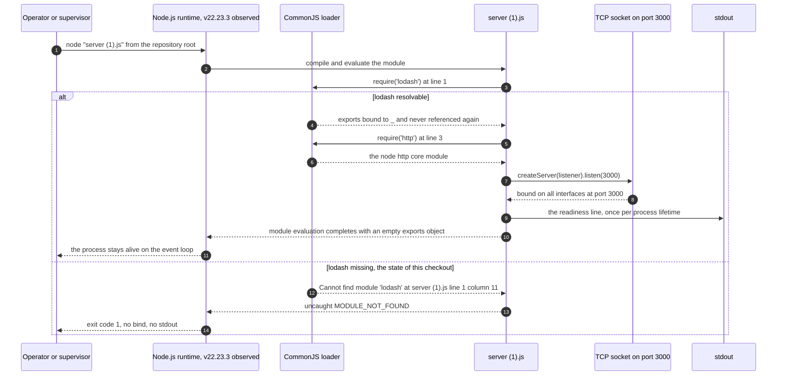

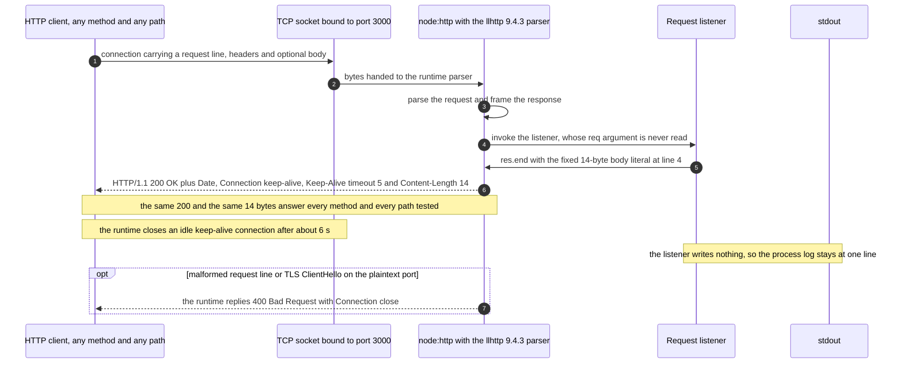

### 5.1.4 External Integration Points

The system has one inbound integration, one load-time resolution dependency, one distribution channel and one outbound sink. It integrates with no enterprise system: there is no database, cache, broker, queue, identity provider, monitoring backend, cloud service, CI system or container registry in any reachable revision, and the artifact makes no outbound call of any kind (zero matches for `http.request`/`http.get`, `fs`, `net.connect` or any client library). The table folds the prompt's fifth column into the fourth, since no integration point carries a recorded SLA — the repository states no service level for anything (Sections 1.2.3, 5.4.5).

| System name | Integration type | Data exchange pattern | Protocol, format and SLA |
| --- | --- | --- | --- |
| Any HTTP client (external actor; no specific consumer is named anywhere) | Inbound network interface | Request/response, one response per request, no continuation, no correlation, no retry | Cleartext HTTP/1.1 over TCP port 3000 on every interface; request body and headers accepted but never read; response is 14 bytes of text with no `Content-Type`. No SLA is recorded; measured loopback `GET` 0.879 ms and 20 concurrent requests all `200` |
| npm registry (implicit resolution source for line 1) | Load-time dependency resolution, performed by the host's package manager, never by the process | One-off package fetch when the host installs the package; nothing at run time | HTTPS to the configured registry (`https://registry.npmjs.org/`); bare unpinned specifier; `latest` observed as 4.18.1. No SLA and no runtime dependency — the process never contacts it |
| Git repository `lakshya-blitzy/14Oct2026_3Files` | Source distribution channel | Clone/fetch by an operator; two commits, three blobs, no tags | Git over HTTPS. No SLA; no artifact publication, no registry, no image |
| Host stdout capture (log sink) | Outbound one-way sink from the process | One 42-byte UTF-8 line per process lifetime, written at bind | Text on file descriptor 1; no structured format, no level, no timestamp. No SLA; nothing is written if the host discards the stream |

**Integrations that do not exist.** No database, ORM, cache, message broker, queue, object store, file share, identity provider, secrets manager, feature-flag service, payment or messaging API, APM/telemetry backend, log aggregator, status endpoint or CI/CD system is referenced, configured or called. The evidence is threefold: the artifact's only imports are `http` and the unused `lodash`; the file contains zero `process.env` reads, so no credential or endpoint could be configured; and the ecosystem probe finds no manifest, container, pipeline or infrastructure definition in the repository (Sections 3.4, 3.5, 3.6). Because `build_prompt (5).md:6-7` forbids creating any file, any such integration would have to be introduced without a configuration or deployment artifact — which is why the integration surface is a bare listening socket rather than a managed endpoint.

## 5.2 Component Details

The system's executable surface consists of one application component, the host runtime it runs inside, and one vestigial dependency reference that decides whether it runs at all. Each is detailed below with its purpose, technologies, interfaces, persistence posture and scaling characteristics; the two repository documents that carry no runtime role are covered with the absent layers in Section 5.2.4. The component interaction diagram appears in Section 5.1.2, the two sequence diagrams in Section 5.1.3, and the process state transition diagram in Section 5.2.1.

### 5.2.1 Application Component: `server (1).js`

**Purpose and responsibilities.**

- Bind a TCP listener on port 3000 across all interfaces as a load-time side effect of module evaluation.
- Answer every request — any method, any path — with the constant body `Hello, World!\n`.
- Emit exactly one readiness line to stdout when the bind completes.
- Do nothing else: the component performs no routing, no request inspection, no validation, no persistence, no logging per request and no outbound call.

**Technologies and frameworks.** Plain JavaScript in CommonJS form, executed directly by the host runtime; the only library APIs used are `require('http')`, `createServer`, `listen` and `console.log`. No framework, transpiler, type system, bundler or template engine is involved (Sections 3.1, 3.2), and the file contains no comment or annotation of any kind.

**Key interfaces and APIs.**

| Interface | Type | Contract | Evidence |
| --- | --- | --- | --- |
| Module load (CommonJS) | Load-time, bidirectional side effect | Evaluating the module starts the listener and returns an empty export object | `Object.keys(module.exports)` is `[]` while port 3000 answers `200`; no `module.exports` assignment exists |
| Inbound HTTP | Network, synchronous request/response | Any method, any path, any headers and any body receive `200` with the 14-byte constant body | `GET`, `HEAD`, `POST`, `PUT`, `DELETE`, `OPTIONS`, `PATCH`, `TRACE` on `/`, `/x?a=1&b=%20` and `/nonexistent-path` all returned `200`; a 200 KB body was accepted and discarded |
| Listen call | Runtime binding API | `listen(3000, callback)` with no host argument and no `error` callback | `server.address()` returns `{"address":"::","family":"IPv6","port":3000}`; a second instance dies with an unhandled `EADDRINUSE` |
| Readiness notice | One-way output to `process.stdout` | One line per process lifetime, written after bind | Exact text `Server running at http://127.0.0.1:3000/` (42 bytes with the newline), unchanged by any traffic |
| Response body source | In-process constant | The literal on `:4` is the entire payload the artifact controls | Header set is exactly `Date`, `Connection`, `Keep-Alive`, `Content-Length: 14`; no `Content-Type` |

**Data persistence requirements.** None. The component never touches the filesystem (zero `fs` matches), holds no session, cookie or cache, and retains no request data — the request object is never dereferenced. The only residual record is the readiness line, and only if the host captures stdout.

**Scaling considerations.**

- **Scale-out within a host is blocked by the literal port.** With no configuration surface (zero `process.env` reads) and no `EADDRINUSE` handling, a second instance on the same host exits 1 rather than binding another port, so horizontal scale-out requires editing the source or introducing external port translation.
- **The component is stateless, so replicas need no coordination.** Nothing would have to be shared, replicated or synchronised between instances — the obstacle is purely the fixed port and the absence of any orchestration layer to place instances behind.
- **One thread, one event loop.** The file references neither `cluster` nor `worker_threads`, so all work happens on a single thread; 20 concurrent loopback requests were all answered `200`, and the response cost is a constant 14-byte write, so the concurrency ceiling is set by the runtime's socket handling rather than by any work the artifact performs.
- **No capacity limits are set by the artifact.** `maxRequestsPerSocket` is `0` (unlimited), `maxHeadersCount` is `null` (unlimited) and `maxHeaderSize` is 16384 bytes; the timeouts in force are the runtime defaults (`keepAliveTimeout` 5000 ms, `headersTimeout` 60000 ms, `requestTimeout` 300000 ms).
- **Nothing to shard or warm.** With no cache and no state, there is no warm-up, no cold-start penalty beyond module load, and no data migration path on scale-out.

**Process life cycle.** The component has five reachable states and two terminal failure states. It cannot stop gracefully: the file registers no `SIGTERM`/`SIGINT` handler and never calls `server.close()`, so a host signal ends the process and the port is released immediately, with no drain of in-flight connections.

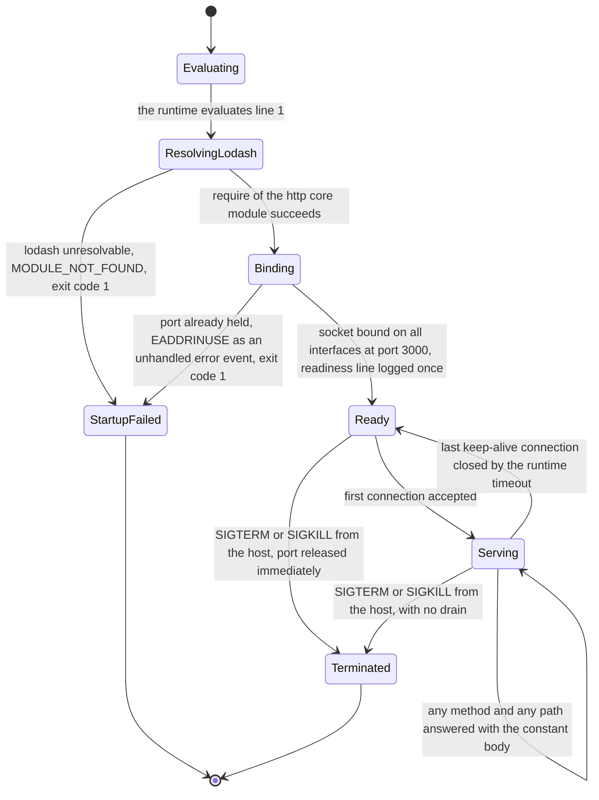

### 5.2.2 Runtime Component: Node.js and `node:http`

**Purpose and responsibilities.** The host Node.js installation is not merely a substrate here — it supplies the majority of what the system observably does. It compiles and evaluates the CommonJS module graph, resolves the bare specifier `lodash`, allocates the server object, performs the actual `bind` and `listen`, parses HTTP requests with its llhttp parser, generates every response header except the body, manages connection reuse and timeouts, and produces all protocol-level error replies. It also owns stdout, the process exit status and the event loop on which the listener runs.

**Technologies and versions observed.** Node.js **v22.23.3**, with ABI `modules: 127`, `napi: 10`, V8 12.4.254.21-node.57, `llhttp` 9.4.3, OpenSSL 3.5.8, `nghttp2` 1.69.0, undici 6.28.1, ICU 78.3 and SQLite 3.51.3 (all read from `process.versions`). The runtime is **unpinned**: no `.nvmrc`, `.node-version` or `engines` field exists, so the artifact runs on whatever the host provides. HTTP/2 (`nghttp2`), the bundled fetch/undici stack and the bundled SQLite engine are present in the runtime but never engaged by the artifact — there is no HTTP/2 listener, no outbound fetch and no database access.

**Key interfaces and APIs used by the system.**

| Runtime interface | Used at | Behavior this system depends on |
| --- | --- | --- |
| CommonJS `require` and specifier resolution | `server (1).js:1`, `:3` | Resolves `lodash` from the host's module paths; resolves `http` from the core; throws before any bind if a specifier fails |
| `http.createServer(listener)` / `server.listen(port, callback)` | `server (1).js:3-5` | Allocates the server, binds every interface when no host is given, invokes the readiness callback after bind |
| `(req, res)` listener invocation and `res.end(body)` | `server (1).js:3-4` | Parses the request, calls the listener once, and frames the response with status line, `Date`, `Connection`, `Keep-Alive` and `Content-Length` |
| Server defaults | Read from the server object | `keepAliveTimeout` 5000, `headersTimeout` 60000, `requestTimeout` 300000, `timeout` 0 (disabled), `maxHeaderSize` 16384, `maxHeadersCount` `null`, `maxRequestsPerSocket` 0 |
| Runtime-generated error replies | On protocol faults | `400 Bad Request` for a malformed request line and for a TLS ClientHello on the plaintext port; `431 Request Header Fields Too Large` for a 20 KB header block; each with `Connection: close` |
| `process.stdout` and the process exit path | `server (1).js:5`; on fatal errors | Hosts the single readiness line; reports uncaught load and bind errors on stderr and exits with code 1 |

**Data persistence requirements.** None inside the repository; the runtime's bundled SQLite is unused, no file is opened, and stdout capture — if any — is the host's concern, not the artifact's.

**Scaling considerations.** One process binds one port; the runtime could host multiple worker processes or threads, but the artifact never loads `cluster` or `worker_threads`, so nothing in this system can exploit them. Conversely, the runtime is the *only* component whose version can change observable behavior without a source change: response headers, keep-alive advertisement, timeout semantics and error replies are all runtime properties under an unpinned runtime (Sections 3.2.3, 3.6.6).

### 5.2.3 Dependency Component: the `lodash` Module Reference

**Purpose and responsibilities.** None that is observable. `server (1).js:1` executes `const _ = require('lodash')` and the binding `_` is never referenced again anywhere in the file. The import's only effect is a module load performed before anything else in the artifact.

**Technologies and interface.** A bare npm specifier resolved by the host's CommonJS loader at load time; the dependency participates in no runtime request path and no value is read from it. It is undeclared (no manifest exists), uninstalled (`npm ls lodash` reports an empty tree, `require.resolve('lodash')` throws) and unpinned (the registry's `latest` was observed as 4.18.1, but any package satisfying the bare specifier would execute).

**Data persistence requirements.** None; a module load only.

**Effect on the architecture.** This single line is the system's only pre-bind single point of failure and its only third-party code path:

| Aspect | Finding | Evidence |
| --- | --- | --- |
| Startup gate | The process cannot start on a clean checkout | `node "server (1).js"` exits 1 with `Error: Cannot find module 'lodash'` at `1:11`, MODULE_NOT_FOUND; no bind and no stdout |
| Supply-chain surface | Any resolvable package executes during load of an otherwise dependency-free artifact | Line 1 is unconditional; nothing declares or verifies what satisfies it (Sections 2.4, 3.3) |
| Functional value | Zero | `_` has no second occurrence; removing the line changes no response |
| Constraint context | The governing document asserts the file has no dependency today and that a change must add none | `build_prompt (5).md:14-15`; lines 6-7 forbid adding a manifest that would declare one |

**Scaling considerations.** Every process instance repeats the resolution independently; there is no shared dependency cache inside the system, only whatever the host's `node_modules` tree or `NODE_PATH` supplies. Because each instance must resolve the same bare specifier, two hosts with different installed versions would run different third-party code while producing the same response — an inconsistency that is invisible from the wire and from the source.

### 5.2.4 Non-Components: Repository Documents and Absent Layers

Two of the three repository files are not runtime components, and the layers an enterprise architecture would normally define at this level do not exist. Recording them explicitly keeps the component inventory closed.

| Item | Status | Evidence and consequence |
| --- | --- | --- |
| `README.md` | Present, runtime-inert | 18 bytes holding the single title `# 14Oct2026_3Files`; no install, run, port or prerequisite information, so an operator must read the source to learn how to start the service |
| `build_prompt (5).md` | Present, runtime-inert | The requirement and constraint baseline: one objective line and thirty constraint lines that forbid new files (`:6-7`), new dependencies, lockfiles and tests (`:14-15`), hardening and configuration (`:16-17`), and any verification or quality-criteria section (`:27-30`). It governs change, not execution |
| Edge layer (reverse proxy, gateway, load balancer, TLS terminator) | Absent | No such definition exists in the repository; requests terminate directly in the process. Measured: a TLS ClientHello on port 3000 is rejected by the runtime with `400`, so nothing terminates TLS for this service |
| Configuration and secret store | Absent | Zero `process.env` reads; port, body and log text are inline literals; no configuration file, `.npmrc`, key or credential exists in the checkout |
| Container, orchestrator, supervisor, process definition | Absent | No `Dockerfile`, `docker-compose.yml`, `Procfile`, service unit or restart policy exists; the process runs unsupervised on the host |
| Data tier (database, cache, broker, queue, object store) | Absent | Zero references to any client library; nothing is read or written; the empty tier is documented in Section 3.5 |
| Identity and access layer | Absent | No identity provider, token validation, session store or IP allowlist; every request is served (Section 5.4.4) |
| Service discovery and registry | Absent | The service advertises nothing and resolves nothing; its address is the host address and the literal port 3000 |
| Observability layer (metrics, tracing, log aggregation, APM) | Absent | No exporter, agent or endpoint; the only signal is one stdout line (Section 5.4.1) |
| CI/CD and artifact distribution | Absent | No pipeline configuration, package manifest, version, tag, image or release artifact; the only distribution channel is the Git repository (Section 3.6.4) |
| Scheduler and batch runner | Absent | The system only responds to inbound connections; it has no timer, job or background loop, and the file registers no interval or timeout |

None of these layers can be introduced from inside the system as it is governed: each would require a new file, a new dependency or configuration, which `build_prompt (5).md:6-7`, `:14-15` and `:16-17` respectively forbid. They therefore form the system's environmental boundary — whatever an operator supplies around the process, the artifact itself remains unaware of it.

## 5.3 Technical Decisions

No architecture decision record exists in the repository: there is no design document, no ADR file, no comment in `server (1).js` and no rationale statement beyond the constraint list in `build_prompt (5).md`. The decisions below are therefore read from two places only — what the five lines of source actually do, and what the constraint document permits — and each is stated with the consequence that was measured rather than an intention that was never written down. Where a decision has no recorded rationale, that gap is marked as unexplained instead of being filled with an invented motive. Section 5.3.5 collects the same decisions as retrospective ADRs alongside the decision tree that models them.

### 5.3.1 Architecture Style Decisions and Tradeoffs

| Decision as embodied in the code | Rationale recorded in the repository | Benefit observed | Cost observed |
| --- | --- | --- | --- |
| D-1 Single-file procedural script; no modules, layers, framework, DI container or middleware | `build_prompt (5).md:6-7` forbids creating any file; `:14-15` forbids adding any dependency | 185 bytes of source in a three-file, 2,034-byte checkout; execution needs no build, install or pipeline step | No seam for routing, configuration, error handling or tests; every future behavior change edits the same five lines |
| D-2 Behavior fixed by inline literals (port 3000, `Hello, World!\n`, log text) | `build_prompt (5).md:16-17` forbids environment-variable configuration | No config file, no parsing, no defaulting logic and no secret material to leak | The port and the response body cannot change without editing source; two instances cannot coexist on one host |
| D-3 Startup as a module-evaluation side effect, with an empty export object | None recorded — no comment or design note explains it | `node "server (1).js"` is the whole deployment action; there is no bootstrap code to maintain | The module is not usable as a library: importing it binds a port and returns nothing; there is no lifecycle API to start, stop or test it |
| D-4 All HTTP framing delegated to the `node:http` core module | Implied by `:6-7` and `:14-15`: nothing may be added that would implement framing | Correct HTTP/1.1 framing, keep-alive, header generation, timeouts and `400`/`431` rejections are obtained with zero dependencies | Wire-visible behavior (headers, timeouts, error replies) is owned by an unpinned runtime and can change without any change to the artifact |
| D-5 No persistence and no caching layer | None recorded; there is nothing to persist and no request data is read | No schema, no migration, no backup obligation and no data-at-rest risk | The service cannot serve stateful content; adding any data tier would first require a manifest and a dependency, both currently forbidden |
| D-6 One instance per host behind a literal port, unsupervised | None recorded | Deployment is a single command with nothing to configure | No horizontal scale-out and no blue/green swap on the same host; a port collision is fatal rather than reported |

The tradeoff taken as a whole is coherent: the design minimizes artifact surface (smallest possible source, no state, no secrets, no egress, no configuration) and pays for it with configurability, scalability, observability and error handling. Because the constraint set explicitly forbids each of the missing capabilities, the trade is a consequence of the governing requirements rather than an oversight in the code — with one exception, D-3, whose rationale is recorded nowhere.

### 5.3.2 Communication Pattern Choices

| Aspect | Choice embodied | Evidence | Consequence |
| --- | --- | --- | --- |
| Interaction style | Synchronous request/response, one response per request; no queueing, streaming, callbacks into the client or batching | `server (1).js:3-4`; every request returned one complete response | No contract, schema, versioning or correlation to maintain — and no way to serve anything that is not a constant |
| Transport | Cleartext HTTP/1.1 over TCP on port 3000, every interface | Verified `200` from `127.0.0.1` and from the host address `10.11.0.13`; a TLS ClientHello on the port drew `400` | Traffic is unencrypted and unattributable; any host or network able to reach the port reaches the service |
| Framing and payload | Body only; all headers generated by the runtime; 14 bytes of text, no `Content-Type`, no compression | Reply header set measured as exactly `Date`, `Connection`, `Keep-Alive`, `Content-Length: 14` | Clients must not expect a media type; intermediaries have no validator to cache against |
| Connection management | Runtime keep-alive default with no per-connection limit set by the artifact | `Keep-Alive: timeout=5` advertised; idle close measured at 6.002-6.007 s; `maxRequestsPerSocket` 0 and `maxHeadersCount` `null` | Long-lived connections are cheap for clients, and the artifact imposes no ceiling of its own |
| Method semantics | No method or path distinction of any kind | `GET`, `HEAD`, `POST`, `PUT`, `DELETE`, `OPTIONS`, `PATCH` and `TRACE` all returned `200` with the same body, including on `/nonexistent-path` | The interface is not RESTful or RPC-like; there is no verb contract to honour, and no `404` semantics exist |
| Error signalling | None from the artifact; the runtime emits `400`/`431` with `Connection: close` | Malformed request line, TLS ClientHello and a 20 KB header block all rejected by `node:http` | Clients receive protocol-correct errors for malformed input but no application-level error channel |
| Outbound communication | None | Zero matches for `http.request`/`http.get`, `net.connect`, `fs` or any client library in the artifact | The system has no egress path, no credential to leak and no upstream dependency that could fail |

This is the smallest communication surface capable of answering the stated objective: one inbound HTTP listener, one constant body, and every other protocol concern delegated to the runtime. It removes the need for a message format, a versioning scheme and a delivery guarantee, at the price of being unable to express any of them.

### 5.3.3 Data Storage and Caching Decisions

**Storage: none, by absence of need.** The artifact imports only `http` and the unused `lodash`; it never opens a file, connection pool or client, and it holds no schema, model, migration or query. Request data is parsed by the runtime and discarded — the request object is not dereferenced once — so nothing is even transiently retained per request. The consequences are favorable and limiting at once: there is no backup, retention, recovery-point or data-protection obligation, and equally no capability to remember anything across requests, which forecloses any future feature that needs state without first changing the constraint set that forbids new dependencies.

**Caching: no mechanism, and no cache directive either way.** There is no cache client, no in-memory cache, no memoisation and no cache layer in the runtime path; the response is produced by a bare `res.end` with a literal. No caching header is emitted — the reply carries no `Cache-Control`, `ETag`, `Last-Modified` or `Expires` (the full header set was measured as `Date`, `Connection`, `Keep-Alive`, `Content-Length`). Caching behaviour is therefore decided entirely outside the system:

| Concern | Decision | Evidence | Architectural note |
| --- | --- | --- | --- |
| Persistence | None | Zero `fs`/database/cache references; only imports are `http` and `lodash` | Nothing to back up, nothing to migrate, nothing to lose on restart |
| Per-request state | None retained | Zero `req.` dereferences; a 200 KB body was read by the runtime and dropped | Replicas would never need to agree on shared state |
| Response cacheability | Undeclared | No cache-related header in the measured reply | Clients may cache heuristically; a future change to the body literal could therefore be masked by a stale cached copy, and there is no validator to revalidate against |
| Cache invalidation | Not applicable | No cache exists inside the system | No invalidation path is needed, and none is available if one were added |

### 5.3.4 Security Mechanism Selection

No security rationale is recorded in the repository, and the constraint document actively forbids adding the usual mechanisms: `build_prompt (5).md:16-17` prohibits a `404` handler, an error handler, environment-variable configuration "or any hardening not explicitly requested". The selection is therefore *no mechanism*, and the honest reading is that it follows from the constraint set rather than from a risk assessment.

| Security concern | Mechanism selected | Evidence | Residual exposure |
| --- | --- | --- | --- |
| Authentication | None | A request to `/secret/admin` carrying `Authorization: Bearer <token>`, a cookie and `X-Forwarded-For` returned `200` with the constant body and the same four headers | No caller is identified; every request is answered |
| Authorization | None | No path, method or role is evaluated; `/` and `/nonexistent-path` behave identically | No protected resource exists and no access decision is possible |
| Transport security | None | Plaintext port; a TLS ClientHello received there was rejected by the runtime with `400 Bad Request`; no TLS terminator exists in the repository | Traffic is readable and modifiable by anything on the path; TLS would have to be supplied by an external component |
| Network exposure control | None in the artifact | `listen(3000)` passes no host, so the socket binds `::`; a request to the host address `10.11.0.13:3000` returned `200`, while the readiness line claims `127.0.0.1` | Every interface is exposed while the only operator-facing text implies loopback-only — a misleading assurance |
| Input validation | Delegated to the runtime | The artifact reads no request field; malformed request lines and oversized headers are handled by `node:http` (`400`, `431`) | No injection or deserialization surface exists in the artifact, and equally no application-level validation |
| Resource-exhaustion control | None set by the artifact | `maxRequestsPerSocket` 0, `maxHeadersCount` `null`; only the runtime defaults apply (`keepAliveTimeout` 5000 ms, `headersTimeout` 60000 ms, `requestTimeout` 300000 ms, `maxHeaderSize` 16384) | No rate limit, quota or connection cap of the system's own; the runtime's header cap is the only hard bound observed |
| Secret and credential handling | Not applicable | Zero `process.env` reads; no key, token or configuration file in the checkout | No secret can leak from the system — and none can be provisioned to it either |
| Third-party code | One unused, undeclared, unpinned load | `server (1).js:1`; `npm ls lodash` empty; registry `latest` observed as 4.18.1 | Supply-chain surface: whatever package satisfies the specifier executes during startup (Section 5.2.3) |
| Misleading operator signal | Unmitigated | `server (1).js:5` logs `http://127.0.0.1:3000/` while the socket binds all interfaces | An operator could reasonably assume loopback-only exposure |

The net posture is that security is entirely a property of the surrounding network: the system cannot authenticate, authorize, encrypt or restrict anything, and its impact is bounded only by the fact that the response is a constant and nothing is stored. Any control — a firewall rule, a network policy, a TLS-terminating proxy or simply not exposing port 3000 — must live outside the repository, and none of it can be represented inside the artifact.

### 5.3.5 Decision Tree and Architecture Decision Records

The decision tree below models the choices embodied by the code as a reader would reconstruct them from the source and the constraint document. It is a documentation artefact, not a record of a design session: at the two nodes marked as having no recorded rationale in the ADR table, the repository states nothing at all.

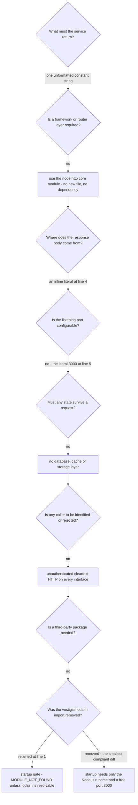

| ADR | Decision and status | Recorded rationale and evidence | Consequence |
| --- | --- | --- | --- |
| ADR-001 | Single-file, zero-framework, single-process service — **in effect** | `build_prompt (5).md:6-7` forbids any new file and `:14-15` any dependency; the artifact is one chained statement at `:3-5` | No routing, configuration, error-handling or testing seam; every change edits the same five lines |
| ADR-002 | Configuration by inline literal instead of environment or file — **in effect** | `:4`, `:5` hold the body, port and log text; zero `process.env` reads; `:16-17` forbids environment-variable configuration | Port and body changes require a source edit; one instance per host; no secrets can be provisioned |
| ADR-003 | Startup as a load-time side effect with an empty export object — **in effect, rationale not recorded** | `:1-5`; `Object.keys(module.exports)` is `[]` while the port answers `200`; the file contains no comment | The module cannot be imported as a library, cannot be started or stopped through an API, and cannot be exercised in isolation |
| ADR-004 | No data tier and no cache — **in effect by absence of need** | Zero references to any database, cache, broker or storage client; request object never dereferenced (Section 3.5) | Stateless and trivially recoverable, but incapable of persisting anything; a data tier would first require a manifest and a dependency that the constraint set forbids |
| ADR-005 | No authentication, no authorization, no transport security — **in effect by default, rationale not recorded** | Unauthenticated, credential-bearing and non-loopback requests all returned `200`; a TLS ClientHello drew `400`; `:16-17` forbids unrequested hardening | Access control degenerates to network reachability; every control must be supplied externally |
| ADR-006 | Bind the literal port on every interface — **in effect, rationale not recorded** | `server.address()` is `{"address":"::","family":"IPv6","port":3000}` while `:5` logs `127.0.0.1` | All-interface exposure with a misleading readiness line; a second instance exits 1 with `EADDRINUSE` |
| ADR-007 | Retain the unused `lodash` import — **in effect, rationale not recorded** | `:1` binds `_` with no later use; `npm ls lodash` empty; the process exits 1 with MODULE_NOT_FOUND on a clean checkout | An otherwise dependency-free service acquires a hard startup gate and a supply-chain surface; deleting the line is the smallest diff that clears both |
| ADR-008 | Response body is the literal `Hello, World!\n` — **in effect, and currently out of step with the requirement** | `:4` emits `Hello, World!`; `build_prompt (5).md:1` requires `Welcome to Blitzy`, and `:27-30` makes the stated file contents the acceptance criterion | The documented objective is not yet implemented; until the literal changes, the recorded requirement and the behavior disagree |

All eight records are retrospective: none has a date, an author or a superseding entry, because the repository holds no decision log. Each remains in effect until the artifact is edited, and every edit is bounded by the same constraint set that produced the decisions — for example, ADR-007 can be reversed by deleting one line, whereas ADR-002, ADR-006 and ADR-005 cannot be reversed without either editing literal values or adding configuration that `:16-17` forbids.

## 5.4 Cross-Cutting Concerns

The artifact implements none of the usual cross-cutting concerns as a dedicated capability. Each sub-section below records what actually exists (very little), the measurements that establish it, and the operational consequence — because "absent" is itself an architectural property here: with no instrumentation the operator's only signal is a process's exit status, and with no authentication the system's trust boundary degenerates into network reachability.

### 5.4.1 Monitoring and Observability

The system exports no metrics, exposes no health or readiness endpoint, registers no APM agent and emits no telemetry. The single operational signal in the entire system is the readiness line written once when the bind completes.

| Signal | Available | Evidence | Operational consequence |
| --- | --- | --- | --- |
| Readiness | One stdout line per process lifetime | Exact text `Server running at http://127.0.0.1:3000/`, 42 bytes with the newline, written at bind and never repeated | Start-up can be confirmed only by reading the process's stdout; if the host discards stdout there is no signal at all |
| Liveness / health | None | Every path returns the same `200` body, so no request distinguishes a health probe from ordinary traffic; no `/health`, `/metrics` or status route exists | An orchestrator or load balancer could not gate on the service's own health; liveness must be inferred externally by probing the port |
| Request metrics (count, latency, status, errors) | None | No instrumentation in the artifact; stdout stayed at exactly one line under a 20-request concurrency burst, a 200 KB `POST` and dozens of probe requests | Traffic is invisible: there is no way to tell whether the service served one request or a million |
| Process-level errors | stderr only, in the runtime's default format | A second instance printed an unhandled `EADDRINUSE` stack to stderr and exited 1 with 0 bytes on stdout; stderr remained empty under all normal traffic | Failures are visible to whoever reads the process's stderr, and to no monitoring system |
| Resource metrics | None | No exporter, no agent, no `/metrics`; nothing is registered with a monitoring backend | Capacity planning and alerting must rely on host-level tooling (process up/down, socket state, CPU) |
| Distributed tracing | None | No trace propagation of any kind (Section 5.4.2) | Not applicable in a single-hop system, but no external observer could correlate this service's activity with a caller's |

The practical consequence is that observability is external and binary: a running process with an open port looks healthy, and a missing process looks dead. There is no intermediate signal — no degraded state, no error counter, no latency histogram — so the operator's model of the system is limited to "up" or "gone".

### 5.4.2 Logging and Tracing

**Logging.** Exactly one log statement exists: `console.log` in the listen callback at `server (1).js:5`, producing the single line `Server running at http://127.0.0.1:3000/` (42 bytes including the newline). There is no logging library, no log level, no timestamp, no request or access log, no correlation identifier and no file sink — output goes to file descriptor 1 and nowhere else.

| Aspect | Implementation | Evidence | Gap |
| --- | --- | --- | --- |
| Log statements | One, at `:5` | The file contains a single `console.log` call and no other output statement | No per-request logging, no startup diagnostics beyond the readiness line, no shutdown message |
| Format and level | Free text, no level, no timestamp | Measured stdout is exactly one line of plain text | Nothing is machine-parseable; no severity can be filtered on |
| Volume | One line per process lifetime | Stdout remained at one line after concurrency, large bodies and protocol errors | Log volume carries no traffic information at all |
| Error output | Uncaught-error stacks on stderr, runtime-formatted | The `EADDRINUSE` failure printed a Node stack to stderr with 0 bytes on stdout | Error visibility depends on the host capturing stderr |
| Accuracy of the log | Misleading about the bind address | The line claims `127.0.0.1` while `server.address()` is `::` on every interface | An operator reading the log may believe exposure is loopback-only |
| Log aggregation | None | No agent, endpoint or collector is referenced anywhere in the repository | Logs live only where the host puts them |
| Tracing | None | No trace ID, span, `traceparent` header or request-ID response header; the measured reply headers are `Date`, `Connection`, `Keep-Alive`, `Content-Length` | No correlation is possible with any upstream caller or downstream (there is no downstream) |

Adding a logger, a log format or a level would require either a dependency or configuration, both forbidden by `build_prompt (5).md:14-15` and `:16-17`, so the logging posture is as much a constraint outcome as an omission.

### 5.4.3 Error Handling Patterns

**Code-level posture.** The artifact contains no `try`/`catch`, no `error` event handler, no callback error parameter, no fallback port, no retry and no `404` or application-level error response. The only error handling that occurs when the system runs is performed by the runtime, and the only handling available to the operator is to restart the process.

| Failure | Detected by | Observed outcome | Recovery path |
| --- | --- | --- | --- |
| `lodash` unresolvable at load time | CommonJS loader | `Error: Cannot find module 'lodash'` raised at `server (1).js:1:11`, MODULE_NOT_FOUND; stack on stderr; exit code 1; no bind, no stdout | Operator makes the package resolvable or deletes line 1; nothing in the artifact retries or reports |
| Port 3000 already held | `net` layer, surfaced as an unhandled `error` event on the server object at `:5:4` | `Error: listen EADDRINUSE: address already in use :::3000`; exit code 1; 0 bytes on stdout | Operator frees the port (or stops the other instance); there is no fallback port and no retry |
| Malformed request line | llhttp parser inside `node:http` | Runtime replies `HTTP/1.1 400 Bad Request` with `Connection: close`; process unaffected; stderr unchanged | None needed from the artifact; the client retries correctly |
| TLS ClientHello on the plaintext port | `node:http` | Runtime replies `HTTP/1.1 400 Bad Request` with `Connection: close` | None — the service offers no TLS, so a client must use cleartext or an external terminator |
| Header block above 16 KB | `node:http` (`maxHeaderSize` 16384) | Runtime replies `HTTP/1.1 431 Request Header Fields Too Large` with `Connection: close`; process and stderr unaffected | Client must reduce headers; no artifact code runs |
| Incomplete header block or body beyond the runtime timeouts | `node:http` (`headersTimeout` 60000 ms, `requestTimeout` 300000 ms, `keepAliveTimeout` 5000 ms) | The runtime closes the connection on its own schedule; the artifact has no code on that path | None needed from the artifact |
| Host signal (`SIGTERM`, `SIGKILL`) | Operating system | Process ends by signal; the port is released immediately; no drain of in-flight connections, because no handler or `server.close()` exists | Operator restarts; measured restart to first `200` was 45 ms |

The pattern is therefore fail-fast at startup and never-fail during serving. Startup errors are terminal and loud on stderr with exit code 1, while request handling has no error branch at all: the listener always calls `res.end` with the same 14 bytes, so no request can produce an application error. Client-facing error responses (`400`, `431`) are HTTP-correct but originate in the runtime, and nothing in the system counts, logs or reacts to them.

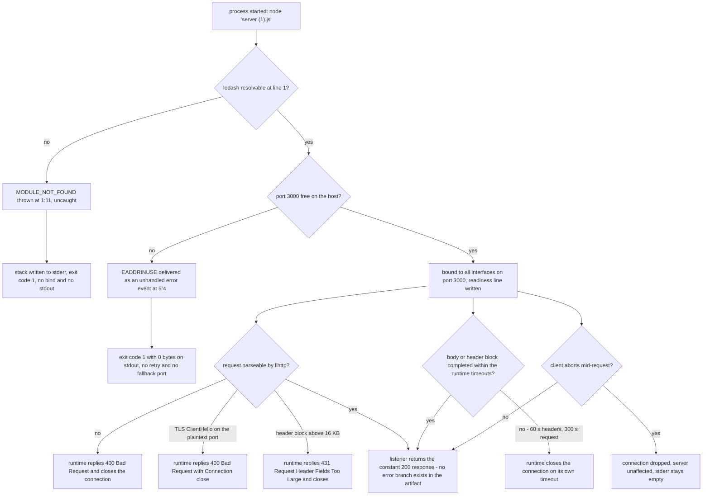

### 5.4.4 Authentication and Authorization

No authentication or authorization mechanism exists in the system, and none is possible within the current artifact: the listener never dereferences the request, so no header, cookie, token, address or body is available to any access decision.

| Control | Status | Evidence | Note |
| --- | --- | --- | --- |
| Authentication | Absent | A request to `/secret/admin` with `Authorization: Bearer <token>`, a cookie and `X-Forwarded-For` returned `200` with the constant body and the same four headers as an anonymous request | Credentials are neither validated nor observed; the response is identical either way |
| Authorization | Absent | No path, method or role is evaluated; `/`, `/x?a=1` and `/nonexistent-path` are served identically | There is no protected resource and no access decision to make |
| Session and cookie handling | Absent | No `Set-Cookie` is emitted and no cookie is read; the response body depends on nothing in the request | No session fixation, theft or replay surface exists — and no way to identify repeat callers |
| Identity provider integration | Absent | No OAuth, OIDC, SAML, LDAP or token library reference; zero `process.env` reads, so no issuer or client credential could be supplied | Federation would require configuration the artifact cannot accept |
| Transport identity (mTLS) | Absent | Plaintext port; a TLS ClientHello drew `400 Bad Request` | No client certificate can be presented or verified |
| Network-level restriction | Not present in the artifact | The socket binds `::` and answered `200` on the host address `10.11.0.13:3000`, while the readiness line claims loopback | Restriction must come from a host firewall, network policy or absent exposure |

The impact of an open, unauthenticated endpoint is bounded here by what the system exposes: a 14-byte constant and one connection slot per client. There is no data to steal, no action to trigger and no state to corrupt, so the realistic risks are service-level — unauthenticated traffic consuming connections and the service being discovered and probed — plus the reputational one of the misleading loopback claim in the log. The architectural conclusion is nevertheless structural: because the artifact cannot represent a trust boundary, every control that the deployment needs must be applied outside it, and the specification can only record that the system itself provides none.

### 5.4.5 Performance Requirements and SLAs

**No target is recorded.** No latency, throughput, availability, error-budget or concurrency objective appears in any of the three files, and `build_prompt (5).md:27-30` explicitly forbids including a verification, coverage or quality-criteria section, naming the exact file contents as the acceptance criterion. The repository therefore defines no SLA, and every figure below is a descriptive measurement of current behavior on Node.js v22.23.3, not a commitment.

| Dimension | Target | Measured (loopback, v22.23.3) | Interpretation |
| --- | --- | --- | --- |
| Start-up to first successful response | None recorded | 31 ms from spawn to first `200`; 45 ms across a restart after `SIGTERM` | Start-up is dominated by module evaluation and bind; there is no warm-up or dependency initialization |
| Single-request latency | None recorded | 0.879 ms for a `GET /` | The work per request is a constant 14-byte write; latency is dominated by the runtime and the loopback path |
| Large body handling | None recorded | `POST /upload` with a 200,000-byte body answered in 7.767 ms with the same 14-byte response | The body is consumed by the runtime and discarded; request size does not change the response |
| Concurrency | None recorded | 20 concurrent loopback requests all returned `200`; no error or refusal observed | Behavior under higher concurrency is unmeasured here; the artifact sets no limit of its own |
| Payload cost | None recorded | 14 bytes per response, no compression, no `Content-Type` | Response cost is constant and negligible; bandwidth is bounded by connection overhead, not by data |
| Connection economics | None recorded | `Keep-Alive: timeout=5` advertised; idle connections closed after 6.002-6.007 s | Client connection reuse is the main lever available; reconnects cost a TCP handshake |
| Hard limits in force | None set by the artifact | `maxHeaderSize` 16384 bytes, `maxHeadersCount` `null`, `maxRequestsPerSocket` 0, `headersTimeout` 60000 ms, `requestTimeout` 300000 ms, `keepAliveTimeout` 5000 ms | All limits are runtime defaults; a very slow or very large client is bounded only by the runtime |

**SLA implications.** Availability equals process uptime, since there is no failover, no replica and no supervisor (Section 5.4.6); throughput is bounded by a single-threaded event loop, a single listening socket and the literal port; and there is no error budget to measure against because the only application-level outcome is a success. Any service level an operator wants must be defined outside the system and asserted by external probing.

### 5.4.6 Disaster Recovery and Availability

**What recovery requires.** There is nothing to restore: the system holds no data, no configuration and no state beyond its bound socket, so recovery is entirely a matter of restarting a 185-byte file on a host that can resolve the runtime and the unused `lodash` import. In that narrow sense the system is exemplary — recovery needs no backup, no restore ordering, no migration and no data validation. What it lacks is every automation around that restart.

| Dimension | Position | Evidence | Consequence |
| --- | --- | --- | --- |
| Recovery point objective | Not applicable | Nothing is persisted; the only residual record is the optional stdout capture | No data can be lost because none is stored |
| Recovery time objective | Not defined; measured best-case restart | From `SIGTERM` to the first successful `200` on the same host: 45 ms | The dominant term is human detection and the operator's action, not the restart itself |
| Backup and restore | None | No backup configuration, no volume, no data store | Nothing to protect and nothing to rebuild beyond the source file and the host runtime |
| Redundancy and failover | None | One process, one literal port; a second instance exits 1 with `EADDRINUSE`; no replica, load balancer or standby definition exists | The process is a single point of failure; availability is bounded by one host's uptime |
| Process supervision and automated restart | None | No `Dockerfile`, `docker-compose.yml`, `Procfile`, service unit or restart policy; no CI/CD pipeline | A crash stays a crash until a human or an external supervisor intervenes |
| Health gating | None | No health endpoint and no readiness contract beyond the single stdout line; every path returns `200` | An orchestrator could not distinguish a healthy instance from one serving nothing useful |
| Graceful shutdown and connection draining | None | The file registers no `SIGTERM`/`SIGINT` handler and never calls `server.close()`; measured: the port is released immediately, with no drain of in-flight connections | Rolling replacement or restart drops connections abruptly; clients see resets rather than a drained close |
| Disaster (host loss) | Manual rebuild | Deployment is `node "server (1).js"` from a checkout of the Git repository; nothing is published or packaged | Recovery on a new host means obtaining the source, installing a runtime, making `lodash` resolvable and starting the process by hand |

**Recovery procedure as the artifact actually permits it.**

| Step | Action | Expected result | Residual risk |
| --- | --- | --- | --- |
| 1 | Detect loss from outside, since the system reports nothing | Process absent or non-responding; exit status 1 with a stack on stderr if it failed at startup | Nothing alerts an operator automatically |
| 2 | Confirm `lodash` is resolvable (or remove line 1) | The load-time gate at `server (1).js:1` no longer aborts the process | A resolvable package of unknown version executes at startup |
| 3 | Confirm port 3000 is free | The bind succeeds instead of raising an unhandled `EADDRINUSE` | An orphaned process on the same host blocks recovery with no automatic diagnosis |
| 4 | Start the process from the repository root | One readiness line on stdout; first `200` within roughly 50 ms | Start-up success is visible only to whoever reads stdout |
| 5 | Probe the port to confirm service | Any method or path returns `200` with the 14-byte body | The probe cannot distinguish a healthy instance from a partially misconfigured one |

**Availability summary.** The system has no availability mechanism of its own: no replica, no failover, no health gate, no supervisor and no graceful stop. Its availability is exactly the availability of one unsupervised process on one host — offset by the fact that its statelessness makes each restart cheap and safe.

## 5.5 References

- `server (1).js` — the only executable artifact and the sole source of every architectural fact in this section: the unused `lodash` import at `:1`, the chained `createServer`/`listen` expression at `:3-5`, the constant body at `:4`, the literal port 3000 and the readiness log at `:5`, the empty export object, and the absence of any routing, configuration, error handling, shutdown path, cache or persistence.
- `build_prompt (5).md` — the requirement and constraint baseline: the objective at `:1` (`Welcome to Blitzy`, unformatted, fewest lines), and the constraints cited for the decisions and cross-cutting limitations — `:6-7` (no new file), `:14-15` (no dependency, lockfile or test), `:16-17` (no 404 handler, error handler, environment-variable configuration or unrequested hardening), `:27-30` (no verification, coverage or quality-criteria section; the stated file contents are the acceptance criterion).
- `README.md` — 18 bytes holding only the title `# 14Oct2026_3Files`; establishes that the repository documents no install, run, port or prerequisite information.
- Repository root of the checkout (the three-file folder listed by the repository tools; no sub-folders exist) — established the complete file inventory, the ecosystem absence probes (no `package.json`, lockfile, `node_modules`, `.nvmrc`, `.node-version`, `Dockerfile`, `docker-compose.yml`, `Procfile`, `.github`, `.gitlab-ci.yml`, `Makefile`, `LICENSE` or test configuration) and the absence of a `.blitzyignore` file.
- `.git/` (repository metadata) — provenance and history: commits `2ee3243` ("Initial commit") and `bc65fd0` ("Add files via upload") authored by `lakshya-blitzy` on 2026-10-14; branches `main` and `1410_01` both at `bc65fd0`; seven Git objects in total (two commits, two trees, three blobs), so no wider revision set exists.
- Node.js runtime v22.23.3 on the host — read directly rather than from documentation for the runtime facts quoted here: `process.versions` (llhttp 9.4.3, nghttp2 1.69.0, undici 6.28.1, OpenSSL 3.5.8, SQLite 3.51.3, V8 12.4.254.21-node.57, ABI `modules` 127, `napi` 10) and the live server defaults (`keepAliveTimeout` 5000 ms, `headersTimeout` 60000 ms, `requestTimeout` 300000 ms, `timeout` 0, `maxHeaderSize` 16384, `maxHeadersCount` `null`, `maxRequestsPerSocket` 0), plus all measured behavior — bind address, statuses, headers, latencies, concurrency, `400`/`431` replies, `EADDRINUSE`, signal exits and the empty export object.
- [web] npm registry, `https://registry.npmjs.org/` (queried with `npm view lodash version` and `npm ls lodash`) — confirmed that the configured registry publishes `lodash` `latest` as 4.18.1 while no dependency is installed in the checkout, establishing that the line-1 specifier is unpinned.
- Cross-referenced specification sections drawn from the same repository evidence, used for terminology and consistency rather than as new sources: Sections 1.2 (System Overview), 3.2 (Frameworks & Libraries), 3.5 (Databases & Storage) and 3.6 (Development & Deployment).

# 6. SYSTEM COMPONENTS DESIGN

## 6.1 Core Services Architecture

### 6.1.1 Applicability Statement

**Verdict**

> **Core Services Architecture is not applicable for this system.**

#### 6.1.1.1 Basis of the Determination

The system is one 185-byte CommonJS file, `server (1).js`, executed by a host-supplied Node.js runtime. It runs as a single operating-system process with one listening socket, one request listener and one constant response. Nothing in the repository is independently deployable from anything else, because nothing else exists: the working tree holds exactly three tracked files — the artifact, `build_prompt (5).md` (the requirement and constraint baseline) and `README.md` (an 18-byte dataset label) — delivered in two commits, with no second entry point, no `package.json`, no lockfile, no container definition, no orchestration manifest and no pipeline (Section 3.6 records each absence).

Section 5.1.2 enumerates six runtime constituents of this artifact: the artifact itself, the request listener, the listen callback, the `node:http` core module, the host runtime and the vestigial `lodash` reference. None is a service in the architectural sense. They are not separately deployable, addressable, versioned or scalable; the two listeners are anonymous arrow functions captured inside a single chained expression at `server (1).js:3-5`, and the core module is a library loaded into the same process. That distinction defines this section's scope: the system has components *inside* one boundary and no boundaries *between* components.

| Requested architecture area | Prerequisite in a service-oriented system | What this repository shows | Determination |
| --- | --- | --- | --- |
| Distinct deployable services | Two or more units with separate lifecycles | One executable artifact; the remaining two files are a constraint document and an 18-byte label; no manifest, no second entry point | Single unit; no fleet to describe |
| Service boundaries and contracts | A callable interface crossing a process boundary | Zero `module.exports`/`exports` assignments; the module's only effect is binding a port; zero `req` dereferences, so no request contract exists | No internal service boundary |
| Inter-service communication | An outbound client, socket or broker | Zero matches in the working tree for `http.request`, `http.get`, `axios`, `fetch`, `redis`, `amqp`, `kafka`, `socket.io` | No inter-service traffic |
| Service discovery | A registry, DNS lookup or configurable endpoint | Port `3000` is an inline literal at `server (1).js:5`; zero `process.env` reads; no registry or discovery client | No discovery mechanism |
| Load balancing | Multiple listeners behind a distributer | A second instance on the same host exits `1`; zero matches for `cluster`, `fork`, `child_process`, `worker_threads`, `replicas`; no proxy configuration in the three-file tree | No balancing component (Section 6.1.2.3) |
| Circuit breaker, retry, fallback | A remote call whose failure must be contained | The listener is one unconditional statement, `res.end('Hello, World!\n')` at `:4`; zero matches for `retry`, `backoff`, `timeout`, `circuit`, `breaker`, `fallback` | No failure path to protect (Section 6.1.2.3) |
| Auto-scaling | A metric and a scaling controller | Zero matches for `metrics`, `health`, `ready`, `liveness`, `docker`, `kubernetes`; the only signal emitted is one 42-byte stdout readiness line per process lifetime | No scaling signal or controller (Section 6.1.3.1) |
| Failover and disaster recovery | Replicas, health checks, a recovery runbook | No supervisor, no replica, no backup, no runbook; `README.md` is one line and `build_prompt (5).md:6-7` forbids creating any file | No failover or DR machinery (Section 6.1.4) |

#### 6.1.1.2 Why the Verdict Holds

Three properties, each verified in the repository, force the determination.

**Cardinality is one, and it is enforced by the artifact.** `server (1).js:3-5` is a single expression that creates a server and binds a literal port with `listen(3000, ...)`. There is no host argument, so the socket binds every interface, and there is no error callback, so a port conflict ends the process: a second instance on the same host dies with an unhandled `'error'` event — `listen EADDRINUSE: address already in use :::3000` — and exit code `1`. Two instances cannot coexist on one host, which removes the local precondition for any distribution of load.

**No second process exists anywhere in the system.** The artifact starts no child, no fork and no worker thread (zero matches for `cluster`, `fork`, `child_process`, `worker_threads`). Its own dependencies are `node:http` at `:3` and a single unused `lodash` specifier at `:1` — a reference bound to `_` and never used again. Consequently there is no call graph, no service registry entry, no health contract and no message contract to document; the entire runtime topology is one process and one socket (Section 5.1.2).

**The governing constraint set forbids the artifacts a service architecture requires.** `build_prompt (5).md:6-7` forbids creating any other file — naming `CONTRIBUTING.md`, `CHANGELOG.md`, `LICENSE`, a `docs/` folder, architecture diagrams and badges — and `:14-15` forbids adding a test suite, test files, a lockfile or any dependency. A service decomposition, container image, gateway, registry, orchestrator manifest or pipeline each requires at least one new file, and normally a dependency and a manifest as well. The verdict is therefore a requirement-compliance outcome of the constraint set, not an omission in the code; Section 5.3.1 reaches the same conclusion for the architecture style (decisions D-1 and D-6).

#### 6.1.1.3 What the Remaining Sub-Sections Record

Because the system is not distributed, the prompt's service-architecture areas cannot be answered with boundaries and topologies, so they are answered at the level where they still have operational meaning — the single process and the host that runs it:

- **Section 6.1.2, Service Components** — the one service unit, its interface, and the peers it does not have: inter-service communication, discovery, load balancing, circuit breaking, retry and fallback. Figure 6.1.1 is the service interaction diagram, including the tiers that are absent.
- **Section 6.1.3, Scalability Design** — the only scaling direction the artifact supports (host-level vertical), the auto-scaling triggers that do not exist, resource allocation as observed, the performance characteristics inherited from the runtime, and capacity planning guidelines for a one-process-per-host deployment. Figure 6.1.2 is the scalability architecture diagram.
- **Section 6.1.4, Resilience Patterns** — the fault modes reproduced by execution, their containment, the failover and degradation policies that are absent, and the recovery path that must be supplied externally. Figure 6.1.3 is the resilience diagram.

For the system viewed as an application rather than a service fleet, see Sections 5.1 (High-Level Architecture), 5.2 (Component Details), 5.3 (Technical Decisions) and 3.6 (Development & Deployment).


### 6.1.2 Service Components

#### 6.1.2.1 Service Boundaries and Responsibilities

The system comprises one service unit. Everything else in the runtime is either a library inside that unit or a sink the unit writes to. The table below states each element's responsibility, the boundary it sits on, and the evidence for that description; a unit that owns nothing is marked accordingly, because its emptiness is the reason no service topology exists.

| Element | Responsibility | Boundary and ownership | Evidence |
| --- | --- | --- | --- |
| The Node.js process running `server (1).js` — **the only service unit** | Owns the listening socket, answers every request with one constant body, writes one readiness line, and holds no other state | Its own process boundary; one instance per host, because the port is a literal | `server (1).js:3-5`; a second instance exits `1` with `EADDRINUSE :::3000`; `Object.keys` of its exports is empty, so it exposes no API beyond the socket |
| `node:http` core module (runtime library, not a service) | Parses requests, frames responses, generates headers, manages keep-alive, emits protocol-level rejections, and enforces runtime timeouts | Inside the same process; the artifact owns none of it and configures none of it | `server (1).js:3`; runtime-side behaviors are recorded in Sections 5.1.2 and 5.3.4 |
| CommonJS resolution of `lodash` (load-time gate, not a running component) | Blocks or permits startup; the bound value is never used | Inside the same process, before any socket exists | `server (1).js:1`; without a resolvable package the process exits `1` with `Cannot find module 'lodash'` at `1:11` |
| `process.stdout` (one-way operational sink, not a service) | Carries the single readiness notice per process lifetime; has no consumer inside the repository | Outbound from the process, terminated by whatever the host does with the stream | `server (1).js:5`; exactly one 42-byte line, unchanged by any traffic (Section 5.1.3, flow F-3) |
| HTTP client (external actor, not a component of the system) | Initiates connections; the system inspects nothing about it | Inbound, crossing the process boundary over cleartext TCP | Every method and path tested returned `200` with the same 14-byte body |

**The unit's complete public surface** is therefore a single interface: cleartext HTTP/1.1 on TCP port 3000, bound to every interface, on any path and any method, unauthenticated, answering with `Content-Length: 14` and the header set `Date`, `Connection`, `Keep-Alive`, `Content-Length`. There is no versioned contract, no schema, no media type, no capability endpoint and no administrative interface. The `127.0.0.1` literal in the readiness line is log text only; the bind is to the wildcard address, as the `EADDRINUSE :::3000` failure of a second instance shows directly, and as `server.address()` returning `{"address":"::","family":"IPv6","port":3000}` records in Section 5.1.1 (decision ADR-006 in Section 5.3.5).

Reachability of the boundary is the whole of the access decision, and the boundary is not represented by any resource: no route table, no middleware chain, no authentication stage and no authorization check exist in the request path, which ignores the request object entirely (zero `req` dereferences in the file).

#### 6.1.2.2 Inter-Service Communication and Service Discovery

**Inter-service communication: none exists, in either direction.** The artifact makes no outbound call of any kind — no `http.request`/`http.get`, no `net.connect`, no `fs`, no client library, and no broker client — so there is no inter-service traffic to chart, and no call graph to document. The only network exchange in the system is the inbound request/response, whose counterparty is unnamed and unauthenticated. The table inventories every exchange the system performs.

| Direction | Counterparty | Protocol and format | Observed behavior |
| --- | --- | --- | --- |
| Inbound | Any HTTP client, no specific consumer named anywhere | Cleartext HTTP/1.1 over TCP, port 3000, every interface; body is 14 bytes of text with no `Content-Type` | `200` for every method and path tested; loopback `GET` measured at 0.879 ms; 20-way concurrency answered without error |
| Outbound (process) | `process.stdout` only | One UTF-8 line of 42 bytes, written once at bind | Exactly one line per process lifetime; nothing is written per request |
| Outbound (network) | None | — | Zero matches for any outbound client or broker reference across the three-file working tree |

Because there is no egress, there is also no inter-service pattern to select: no request/reply between peers, no publish/subscribe, no queue, no stream, no batch transfer, no correlation identifier, no idempotency key and no schema registry. Section 5.3.2 reaches the same conclusion for the application's communication choices, and the consequence for this section is structural rather than stylistic — a failure domain that cannot extend beyond the single process, because no remote dependency exists to fail.

**Service discovery: no mechanism, and no artifact to discover with.** The endpoint is a literal: `listen(3000, ...)` at `server (1).js:5`, with the port neither configurable nor announceable. Consumers must therefore be told the `host:port` pair out of band, and nothing in the repository does that. There is no registry client, no DNS-based lookup, no environment-variable configuration (zero `process.env` reads), no configuration file, no discovery sidecar and no orchestrator integration. The only discovery aid the system produces is the readiness line, and its text — `Server running at http://127.0.0.1:3000/` — names loopback while the socket binds every interface, so an operator or tooling that treated the line as an endpoint advertisement would derive an address the service does not actually restrict itself to. Any future discovery integration would need inputs the system does not produce: a health or readiness endpoint, service metadata, or a port announcement.

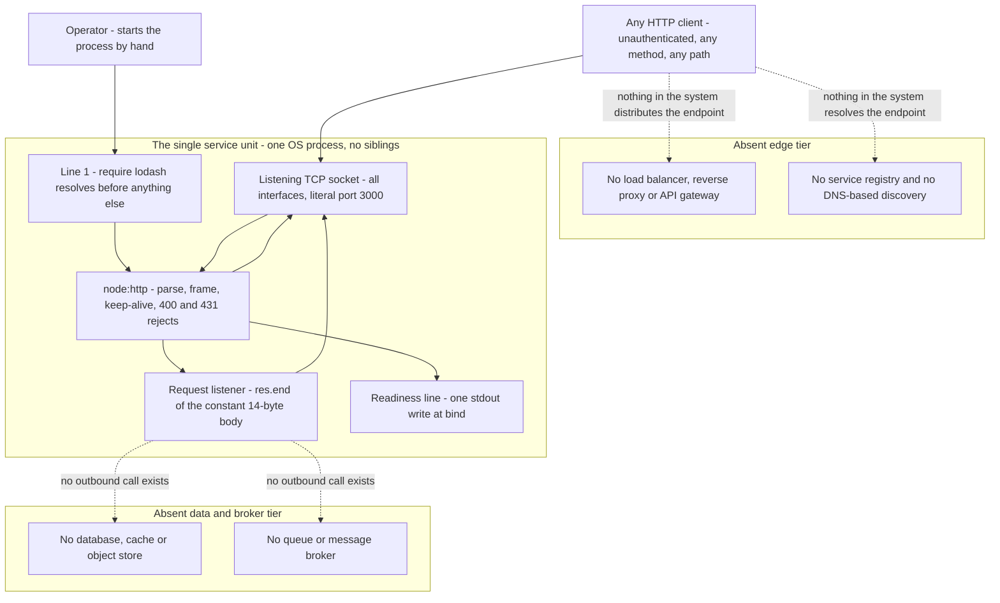

*Figure 6.1.1 — Service interaction diagram. The system's entire topology is one process and one socket; the dashed edges mark the interactions that do not exist.*

#### 6.1.2.3 Load Balancing, Circuit Breaking, Retry and Fallback

Each requested mechanism is absent, and in three of the four cases its absence is what the code structure would produce even if a mechanism were desired: there is nothing to balance, nothing to break, and no branch to fall back to.

| Concern | Mechanism present | Evidence | Consequence for the unit |
| --- | --- | --- | --- |
| Load balancing | None | A second instance on the same host fails with unhandled `EADDRINUSE :::3000` and exit `1`; zero matches for `cluster`, `fork`, `worker_threads`, `replicas`; no proxy or balancer configuration in the three-file tree | No in-process or local distribution is possible. Spreading load requires distinct hosts or network namespaces plus a distributer, neither of which the repository contains or can declare |
| Connection distribution | Not applicable, with one interaction to note | The runtime keeps connections alive and advertises `Keep-Alive: timeout=5`, closing an idle connection at about 6.00 s (Section 5.1.3) | Any future external distributer would see long-lived connections, so per-request rebalancing would not occur without a connection policy the artifact cannot set |
| Circuit breaker | None | Zero matches for `circuit` and `breaker`; the artifact issues no outbound call and reads no dependency state | There is no remote dependency whose failure could trip a breaker; the only failure domain is the process itself |
| Retry | None | Zero matches for `retry` and `backoff`; no client code exists, and the listener contains no error branch that could be retried | A failed request is retried only by the client, and a retry always lands on the same unconditional `200` path. Nothing inside the system can compensate for a failure |
| Fallback | None | The listener is one statement, `res.end('Hello, World!\n')` at `server (1).js:4`; no alternative response, cache, static file or degraded mode exists | There is no second response variant to fall back to; a degraded answer cannot be expressed |
| Timeouts protecting the exchange | Only runtime defaults, never set by the artifact | The artifact passes no options to `createServer`; runtime defaults are `keepAliveTimeout` 5000 ms, `headersTimeout` 60000 ms, `requestTimeout` 300000 ms, `maxHeaderSize` 16384 bytes (Section 5.3.4) | A stalled or slow exchange is bounded by the runtime, not by any policy of the system; the artifact neither observes nor adjusts those bounds |

One structural property substitutes for containment in practice: because the request handler never dereferences `req` and performs no I/O, it cannot fail per request. The failure domain is therefore the whole process, and a request either receives the constant `200` or receives nothing at all — the distinction documented in Section 6.1.4.1.


### 6.1.3 Scalability Design

#### 6.1.3.1 Scaling Approach and Auto-Scaling Triggers

**Vertical scaling is the only direction the system supports, and it is a host-level operation.** The artifact contains no scaling mechanism of its own: zero matches for `cluster`, `fork`, `child_process`, `worker_threads` and `pm2`, and no configuration surface through which any could be influenced. Enlarging the host, or supplying a host with a faster single-core runtime, is the only change that affects capacity, and it changes nothing in the source.

**Horizontal scaling is blocked by the artifact, not merely unimplemented.** `listen(3000, ...)` at `server (1).js:5` binds a literal port, so two instances cannot share a host: the second exits `1` with an unhandled `EADDRINUSE` on the wildcard bind. Adding replicas therefore requires a second host or a second network namespace, plus a distributer placed in front — a component the repository neither contains nor can declare, since a manifest, container or pipeline file would violate `build_prompt (5).md:6-7` and would normally introduce a dependency that `:14-15` forbids.

**No auto-scaling trigger or rule exists, because no signal exists for a controller to consume.** The system exposes no health, readiness, liveness or metrics endpoint (zero matches for `health`, `ready`, `liveness`, `metrics`), emits no per-request telemetry, and reads no environment variables. Its only runtime output is the readiness line — one 42-byte stdout write per process lifetime, at bind (Section 5.1.3, flow F-3) — which is informational and terminal rather than a scaling signal. An autoscaler would therefore have to act on host-level evidence gathered outside the system, such as process liveness or host CPU, and the repository configures none of it.

| Scaling dimension | Availability | Blocking evidence | External requirement |
| --- | --- | --- | --- |
| Horizontal — replicas on one host | Not available | Second instance exits `1` with `EADDRINUSE :::3000`; literal port at `:5` | None available; the port cannot be made unique without editing source |
| Horizontal — replicas across hosts | Possible only outside the repository | No manifest, no container, no orchestrator file exists; `build_prompt (5).md:6-7` forbids creating one | One host or namespace per instance, plus a distributer and a discovery mechanism the system does not supply |
| Vertical — larger host or runtime | Available, and the only supported direction | Zero matches for `cluster`, `fork`, `worker_threads`: the process never uses more than one JavaScript thread | Host capacity planning performed manually, outside the system |
| Auto-scaling | Not available | No health, readiness or metrics endpoint; only one stdout line per process lifetime | A controller acting on host-level signals, configured entirely outside the repository |

```mermaid
flowchart TB
  subgraph ScaleUnits["Scaling units the system offers"]
    HostUnit["Host machine - supplies CPU, RAM and the Node.js runtime"]
    ProcessUnit["One Node.js process - one event loop, one bound socket"]
  end
  subgraph HorizontalPath["Horizontal scaling path"]
    ReplicaAttempt["Second process on the same host"]
    PortCollision["Unhandled EADDRINUSE on the wildcard bind - exit 1"]
    ExternalNeed["Needs a second host or namespace plus an external distributer"]
  end
  subgraph VerticalPath["Vertical scaling path - the only direction supported"]
    BiggerHost["Larger or faster host - no change to the artifact"]
    NoCores["Extra cores unusable - no cluster, fork or worker_threads in the artifact"]
  end
  SignalAbsent["Auto-scaling signal - no health endpoint, no metrics, one stdout line per lifetime"]
  ManualPolicy["Scaling therefore remains manual and host-level"]
  HostUnit --> ProcessUnit
  ProcessUnit --> ReplicaAttempt
  ReplicaAttempt --> PortCollision
  PortCollision --> ExternalNeed
  ProcessUnit --> BiggerHost
  BiggerHost --> NoCores
  ProcessUnit --> SignalAbsent
  SignalAbsent --> ManualPolicy
  ExternalNeed --> ManualPolicy
```

*Figure 6.1.2 — Scalability architecture. One process per host is the only placement the literal port permits; the horizontal branch terminates in a startup failure unless an external tier is supplied.*

#### 6.1.3.2 Resource Allocation and Performance Optimization

**Resource allocation: nothing is declared, so everything is default.** There is no container and therefore no cgroup limit, no `--max-old-space-size` setting, no connection or request ceiling set by the artifact (`maxRequestsPerSocket` 0, `maxHeadersCount` `null` per Section 5.3.4), no pool, no cache and no buffer of the system's own. What the process holds was measured directly: 7 threads and roughly 52 MB resident memory, with no observable growth across traffic — the file descriptor count stayed at 22 before and after a 300-request burst, and stdout stayed at one line. The only resource the system claims is a single TCP listener and its event loop.

**Performance optimization: the artifact performs none, and inherits a favorable path from the runtime.** Its request path is one `res.end` with a literal: no deserialization, no validation, no template, no serialization, no disk access, no network call and no allocation per request — the request object is never dereferenced. What remains is the runtime's own work, which is well optimized and outside the artifact's control: llhttp request parsing, header generation, and keep-alive connection reuse. Three optimizations commonly expected at this layer are absent rather than overlooked: no compression (the reply never carries `Content-Encoding`), no cache directives (no `Cache-Control`, `ETag`, `Last-Modified` or `Expires`), and no connection cap. Caching behavior is consequently decided entirely outside the system — documented as the cacheability decision in Section 5.3.3.

| Resource or performance aspect | Declared by the artifact | Observed | Implication |
| --- | --- | --- | --- |
| Memory | Nothing | ≈ 52 MB RSS observed for the base process; unchanged by traffic | Footprint is a runtime constant, not a function of request volume |
| Threads | Nothing | 7 threads observed; JavaScript execution remains on one event loop | Additional host cores do not raise the artifact's throughput |
| Per-request cost | Nothing | 300 requests at 20-way concurrency all returned `200` in 0.224 s wall time; loopback `GET` measured at 0.879 ms (Section 5.1.3) | Cost is dominated by the runtime's framing, not by application logic |
| Concurrency ceiling | None set | Only runtime per-socket defaults apply; a 200,000-byte `POST` body was accepted and discarded in 7.767 ms (Section 5.1.3) | No artifact-level admission control exists; the runtime's header and request timeouts are the only bounds observed |

#### 6.1.3.3 Capacity Planning Guidelines

The repository states no service level, no throughput target and no availability commitment for anything (Sections 1.2.3 and 5.4.5 record the absence); the guidelines below are therefore derived from what the artifact requires to run and from what the probes actually measured, and they should be read as the planning envelope rather than as a commitment.

| Planning dimension | Guideline | Basis |
| --- | --- | --- |
| Deployment unit | Exactly one process per host; one host per instance | The port is a literal, so a second instance on the same host fails at bind with `EADDRINUSE` |
| Startup prerequisites | A free port 3000, a Node.js runtime supplied by the host, and a resolvable `lodash` (or the deletion of `server (1).js:1`) | Verified by execution: without a resolvable package the process exits `1` before binding; the runtime is unpinned (Node.js v22.23.3 observed) |
| Memory sizing | Budget the Node.js base process (≈ 52 MB RSS observed); do not size for request volume | The artifact allocates nothing per request and retains no state |
| CPU sizing | Size for a single JavaScript thread; extra cores raise host capacity, not service concurrency | No `cluster`, `fork` or `worker_threads` usage exists in the artifact |
| Concurrency headroom | Assume no system-imposed ceiling; plan against the runtime's per-socket defaults and the host's network limits | `maxRequestsPerSocket` 0 and `maxHeadersCount` `null` (Section 5.3.4); 20-way concurrency answered without error in the probe |
| Availability headroom | Provision external supervision; a single unit is a single point of failure whose restart is manual | No supervisor, replica or health check exists (Section 3.6.6 records the manual procedure) |
| Runtime version pinning | Treat the runtime as a planning variable, not a constant; behavior such as headers and timeouts belongs to it | No `.nvmrc`, `.node-version` or `engines` field exists; the runtime supplies all wire behavior (Section 5.3.1, decision D-4) |
| Capacity evidence | Collect capacity data outside the system, then attach it to the deployment | The system emits no metrics and no per-request logs — one stdout line per process lifetime, and nothing else |


### 6.1.4 Resilience Patterns

#### 6.1.4.1 Fault Tolerance and Failover

No fault-tolerance mechanism is implemented: the file contains no `try`/`catch`, no error callback on `listen`, no `uncaughtException` or `unhandledRejection` handler (zero matches for both), and no `SIGTERM`/`SIGINT` handler. Faults were therefore reproduced by execution, and they divide cleanly into those the runtime contains and those that end the process.

| Fault | Trigger observed | Behavior | Containment |
| --- | --- | --- | --- |
| Unresolvable `lodash` at load | Starting the artifact in a clean checkout — no `package.json`, no `node_modules` | `Error: Cannot find module 'lodash'` thrown at `server (1).js:1:11`; exit code `1`; no bind, no stdout line | None. Startup cannot complete; the remedy is to make the package resolvable or to delete the unused import (ADR-007 in Section 5.3.5) |
| Port collision | A second instance on the same host | Unhandled `'error'` event: `listen EADDRINUSE: address already in use :::3000`; exit code `1`; stdout stays empty | None. `listen` at `:5` receives no error callback, so the runtime's default — terminate — applies |
| Malformed request line, TLS ClientHello on the plaintext port, or an oversized header block | Malformed HTTP input; a TLS handshake sent to port 3000; a 20 KB header block | `400 Bad Request` (with `Connection: close`) or `431 Request Header Fields Too Large`, generated by `node:http`; stderr silent; process unaffected (Sections 5.1.3 and 5.3.4) | Contained by the runtime. The artifact neither participates in nor learns of these rejections |
| Idle keep-alive connection | A connection left open after a response | The runtime closes it after about 6.00 s (Section 5.1.3) | Contained by the runtime's keep-alive defaults |
| Abrupt termination | `SIGTERM` or `SIGINT` | The process exits immediately; no handler, no `server.close()` call, so in-flight requests are dropped | None. Shutdown cannot be graceful, and no drain period exists |
| Application-level exception in the request handler | Structurally unreachable today, because the handler calls only `res.end` with a literal | No path exists; any future throw would reach the unhandled-error default and end the process | None. There is no application error handler to absorb it |

**Failover: none exists.** There is no replica to promote, no health or readiness check to detect a dead instance, no load balancer to remove it from rotation and no supervisor to restart it. Availability is therefore a function of how long a human takes to notice the absence and re-run the start command; Section 3.6.6 records that procedure, and the measured recovery cost is small once the cause is cleared — 31 ms from spawn to the first successful `200`, and about 45 ms across a restart after `SIGTERM` (Section 5.1.3) — but nothing in the repository detects the failure or triggers the restart. Failover across hosts would require at least one external component and a way to announce the endpoint; Section 6.1.2.2 records that no discovery mechanism exists, so a failover target could not be advertised without further non-repository machinery.

One property limits the blast radius by construction: the process is stateless and holds no shared resource beyond its bound socket, so a restart is always safe and never needs state reconciliation. That strength is a side effect of doing nothing — the system has no state to reconcile because it retains none.

#### 6.1.4.2 Disaster Recovery and Data Redundancy

**Disaster recovery: no procedure is documented, and recovery reduces to re-obtaining the source and starting it.** `README.md` is an 18-byte title with no run instructions, and `build_prompt (5).md:6-7` and `:11-13` forbid adding documentation of any kind, so no runbook, recovery plan, retention policy, RTO or RPO is stated anywhere. What the repository does preserve is the artifact itself: two commits and three blobs in git, uploaded through the host's web interface to the remote recorded in Section 3.6.4. Restoring service after host loss therefore means cloning that repository and running one command from the repository root — a manual, undocumented sequence that depends on the git remote rather than on any redundancy the system provides.

**Data redundancy: not applicable, because the system holds no data.** There is no database, cache, object store, file or shared-memory structure — the artifact's only imports are `node:http` and the unused `lodash`, and nothing is written per request. The response body is a source literal at `:4`, not a stored record, so no replica, backup, snapshot, journal or retention obligation arises. The one redundancy that exists is historical rather than operational: the source is preserved in git history, so a lost running process can be reconstituted from version control even though nothing it held can be recovered — because it held nothing.

| Recovery concern | Status | Evidence | Implication |
| --- | --- | --- | --- |
| Documented recovery procedure | None | `README.md` is one line; the constraint list forbids adding documentation | Recovery relies on operator knowledge that the repository does not record |
| Backup and restore of system state | Not applicable | Zero data stores or files touched; no request data is retained | Nothing to back up; nothing to restore |
| Source availability | Git history only | Two commits, three blobs; remote and branches recorded in Section 3.6.4 | A lost host is recoverable only while the git remote remains reachable |
| Recovery time | Undocumented; measured cost is negligible once the cause is cleared | Failure without `lodash` prevents startup entirely; with prerequisites met, spawn to first `200` measured at 31 ms (Section 5.1.3) | The dominant factor is human detection and diagnosis, not process startup |
| Recovery point | Not applicable per request; the artifact is the recovery point | Zero `req` dereferences; nothing is persisted between requests | Restart loses no in-flight data beyond the dropped connections |

#### 6.1.4.3 Service Degradation Policies

**No degradation policy exists, and none can be expressed in the current code.** The request listener has exactly one branch — `res.end('Hello, World!\n')` at `:4` — so the system cannot return a reduced response, cannot enter a read-only or maintenance mode, cannot reject a subset of traffic, and cannot shed load or queue it. There is no rate limit, no quota, no concurrency cap and no feature flag, and no state in which the service could be "partly available": it either answers with the constant `200` or the process is gone.

The only work shedding that occurs happens below the application, inside the runtime and on defaults the artifact never sets. These behaviors are invisible to the system but visible to clients, and they are the entirety of its graceful-degradation surface:

| Runtime-level shedding | Bound observed | Effect on the unit |
| --- | --- | --- |
| Malformed or non-HTTP input | `400 Bad Request` with `Connection: close`, emitted by `node:http` for a malformed request line or a TLS ClientHello on the plaintext port | The bad exchange is terminated without disturbing the process |
| Oversized headers | `431 Request Header Fields Too Large`; `maxHeaderSize` 16384 bytes | A resource-exhaustion path at the header layer is closed by the runtime |
| Slow or stalled exchange | `headersTimeout` 60000 ms, `requestTimeout` 300000 ms, `keepAliveTimeout` 5000 ms (Section 5.3.4) | Stalled requests are reclaimed by the runtime; the artifact imposes no bound of its own |

Any deliberate degradation policy would first require a mechanism the governing constraint set currently excludes: a health or status endpoint, a rate limiter, a feature flag or a load-shedding branch each needs a new file or a dependency, which `build_prompt (5).md:6-7` and `:14-15` forbid, and a circuit breaker would additionally need the remote dependency and the state store that Section 6.1.2.3 shows to be absent.

```mermaid
flowchart TB
  StartNode{"How does the process behave?"}
  StartNode -->|"load-time gate at line 1"| LodashGate{"Is lodash resolvable?"}
  LodashGate -->|"no - the state of this checkout"| FatalModule["MODULE_NOT_FOUND at 1:11 - exit 1, no socket, no stdout"]
  LodashGate -->|yes| BindGate{"Is port 3000 free on the host?"}
  BindGate -->|"no"| FatalBind["Unhandled EADDRINUSE on the wildcard bind - exit 1"]
  BindGate -->|yes| Serving["Serving - every request receives 200 and 14 bytes"]
  Serving --> ProtocolFault{"Protocol-level fault arrives?"}
  ProtocolFault -->|"malformed line, TLS hello, oversized headers"| RuntimeReject["node:http replies 400 or 431 with Connection close - process survives"]
  ProtocolFault -->|"none"| ConstantReply["Constant 14-byte response, no error branch in the listener"]
  RuntimeReject --> Serving
  ConstantReply --> Serving
  Serving --> StopGate{"Termination signal arrives?"}
  StopGate -->|"SIGTERM or SIGINT"| AbruptExit["Immediate exit - no handler, no server.close, in-flight requests dropped"]
  StopGate -->|"no signal"| Serving
  FatalModule --> ManualRestart["Operator restarts by hand - no supervisor, replica, health check or failover"]
  FatalBind --> ManualRestart
  AbruptExit --> ManualRestart
  ManualRestart --> StartNode
```

*Figure 6.1.3 — Resilience pattern implementation. Faults the runtime contains leave the process serving; startup gates and signals end it, and the only recovery path is a manual restart, since no supervisor, replica or health check exists.*


### 6.1.5 References

- `server (1).js` — the system's only executable artifact (185 bytes, 5 lines, CommonJS). Establishes the single service unit, the literal port, the constant response body, the unused `lodash` load-time gate, the empty export object and the absence of any error, signal, retry, discovery or egress logic.
- `build_prompt (5).md` — requirement and constraint baseline. Lines 1, 6-7, 11-17 and 27-30 establish the governing prohibitions (no new file, no diagram, no dependency, no lockfile, no manifest, no environment configuration, no unrequested hardening, no test-style criteria) that make a service architecture unattainable in this repository.
- `README.md` — 18-byte dataset label; establishes that no run instructions, recovery procedure or operational documentation exist.
- `/` (repository root, path `""`) — flat three-file checkout with no sub-folders; establishes the total absence of manifests, container definitions, orchestration files, pipelines, tests and configuration.
- `.git/` — version control history; two commits and three blobs (`2ee3243` "Initial commit", `bc65fd0` "Add files via upload") establish the artifact as the only preserved state and the sole redundancy for disaster recovery.
- Section 5.1, High-Level Architecture — cross-reference for the six runtime constituents, the wildcard bind `{"address":"::","family":"IPv6","port":3000}`, the runtime-generated header set, `400`/`431` rejections, idle keep-alive close and startup timings.
- Section 5.3, Technical Decisions — cross-reference for decisions D-1 to D-6, ADR-006 (bind on every interface), ADR-007 (retained unused `lodash` import), and the runtime default timeouts and socket limits.
- Section 3.6, Development & Deployment — cross-reference for the absence of build, containerization and CI/CD, the manual deployment procedure, and the git remote recorded as the only distribution channel.

No external web source was consulted for this section; every statement rests on the files above, on the cited sections of this specification, or on behavior measured by executing `server (1).js` on Node.js v22.23.3 in the checkout.


## 6.2 Database Design

### 6.2.1 Applicability Determination

**Verdict**

> **Database Design is not applicable to this system.**

The repository contains no database engine, no schema, no data model, no data file, no connection configuration and no persistence code path of any kind. The system's entire runtime state is one listening socket and one source-level string constant, and everything it does with request data is to discard it.

#### 6.2.1.1 Basis of the Determination

Three properties, each verified in the repository, force the verdict.

**The artifact performs no storage I/O — not even a file read.** `server (1).js` is 185 bytes over five lines: a `require('lodash')` binding at `:1` that is never referenced again, and a single chained expression at `:3-5` that creates an HTTP server, answers every request with `res.end('Hello, World!\n')` at `:4`, and binds port 3000 with a `console.log` callback at `:5`. No `fs` member, stream, buffer, file handle or database client appears anywhere. A case-insensitive sweep of the whole working tree for `sqlite`, `mysql`, `postgres`, `mongo`, `redis`, `database`, `fs.`, `writeFile`, `readFile`, `localStorage`, `session`, `sequelize`, `knex`, `typeorm`, `prisma`, `pool`, `migrat`, `schema` and `cache` returns no matches. A behavioral probe confirms the absence rather than inferring it: with the process serving a request, its descriptor table held exactly one socket plus stdout and stderr, no regular file was open for read or write, no file was created in a watched directory, and the repository working tree remained clean (`git status --porcelain` empty) after the run.

**No persistence artifact exists to describe.** The checkout is flat — three tracked files and no sub-folders — with no `package.json`, no lockfile, no `node_modules`, no configuration file, and no file with a data-bearing extension (`.sql`, `.db`, `.sqlite`, `.json`, `.yaml`, `.csv`) in the working tree or in either commit. Both commits (`2ee3243` "Initial commit" with `README.md` alone, then `bc65fd0` "Add files via upload" adding `build_prompt (5).md` and `server (1).js`) added files only; nothing was ever deleted, so no removed schema, migration or dataset is recoverable from history.

**Nothing in the system holds data to model.** The request listener never dereferences `req` — the parameter appears at `server (1).js:3` and is never read again — so headers, query strings, bodies and cookies are framed by `node:http` and then dropped. The response body is a literal in the source file, not a stored record, and the only other output is one readiness line at bind. Section 1.3.2 consequently records "Data domains included: None", Section 3.5 determines that there is no data tier, and Section 6.1 reaches the same conclusion for the service architecture, including the absence of the data and broker tiers.

#### 6.2.1.2 Area-by-Area Disposition

Each capability this section is asked to document is dispositioned below against the artifact as it exists.

| Requested area | Prerequisite in a database-backed system | What this repository shows | Determination |
| --- | --- | --- | --- |
| Engine and schema | A running database engine and a declared schema | No engine, no DDL, no model declaration in any of the three files; zero datastore driver packages resolvable (`sqlite3`, `better-sqlite3`, `pg`, `mysql2`, `mongodb`, `redis` all absent) | Not applicable |
| Entity relationships and data models | Entities with keys and cardinalities, stored columns and types | No table, class, type or model exists; the only served value is the 14-byte literal at `server (1).js:4`, produced per request rather than stored | Not applicable |
| Indexing and constraints | Rows to index, keys to enforce | No table, therefore no primary key, index or constraint; no DDL statement exists in the repository | Not applicable |
| Partitioning | A dataset large enough to split across nodes or shards | No dataset and no second node; the literal port at `:5` even prevents a second instance on one host (`EADDRINUSE`, exit `1`) | Not applicable |
| Replication and backup | A primary dataset, a replica, and a backup target with a restore path | No replica, no copy mechanism, no dump, snapshot or retention schedule; nothing at rest exists to replicate or protect | Not applicable |
| Migration and versioning | A schema under version control and a migration tool | No schema, no migration directory, no migration tool (no ORM or migration library referenced), no schema version, no manifest, no tags | Not applicable |
| Caching | Repeated reads of derived or expensive data | No cache client, no in-memory cache, no memoisation, and no `Cache-Control`, `ETag`, `Expires` or `Last-Modified` header on the response | Not applicable |
| Retention, privacy, audit, access control | Persisted records carrying classification and lifecycle rules | Nothing is persisted, no personal data is processed, no audit record is written, and no credential or role exists (zero `process.env` reads) | Not applicable |
| Pooling and read/write splitting | A connection pool and a read replica | No outbound connection of any kind exists to pool; the inbound side is the runtime's own socket handling | Not applicable |

#### 6.2.1.3 An Unused Engine Is Present, Which Does Not Change the Verdict

The Node.js runtime observed in the checkout (v22.23.3) has SQLite **3.51.3** compiled into it — `process.versions.sqlite` reports that version, and the built-in `node:sqlite` module is resolvable from the repository root. This is a facility of the host runtime, not a component of the system: the artifact never imports it, and no table, file or `DatabaseSync` handle is ever created. It is significant in exactly one respect, recorded in Section 6.2.7: it is the only persistence engine the system could reach without breaching the dependency prohibition in the governing constraint document. Its availability does not make the system database-backed today, because availability is not use and no code path opens it.

#### 6.2.1.4 How the Remaining Sub-Sections Answer the Prompt

Because the system has no data tier, the remaining sub-sections cannot describe schemas, migrations or topologies; they record, for each requested area, exactly what is absent and the evidence that establishes the absence, at the level where the question still has meaning — the single process and the value it serves.

- **Section 6.2.2, Schema Design** — entity relationships, data models, indexing, partitioning, replication and backup, with the complete inventory of indexes and constraints (all zero) and the substitute for an entity-relationship diagram.
- **Section 6.2.3, Data Management** — migration procedures, versioning, archival, storage and retrieval mechanisms, and caching.
- **Section 6.2.4, Compliance Considerations** — retention rules, backup and fault-tolerance policy, privacy controls, audit mechanisms and access controls.
- **Section 6.2.5, Performance Optimization** — query optimization, caching strategy, connection pooling, read/write splitting and batch processing, together with the performance characteristics the system actually exhibits.
- **Section 6.2.6, Required Diagrams** — the data flow diagram that replaces an empty schema chart and the replication/backup topology diagram that shows the absent tiers explicitly.
- **Section 6.2.7, Conditions That Would Change the Determination** — what would have to be introduced, and why the constraint document currently forecloses it.

For the system as a whole the absence of a data tier has already been established in Section 3.5 (Databases & Storage), and the architectural consequences — statelessness, trivial restart, no state reconciliation — are recorded in Sections 6.1.4.1 and 6.1.4.2.


### 6.2.2 Schema Design

**Schema design is not applicable: the system declares zero entities, zero relationships and therefore zero indexes, constraints, partitions, replicas and backups.** Each requested element is dispositioned below with the evidence that establishes it, and the two inventories the prompt requires — every index and every constraint — are given in full, both of them empty.

#### 6.2.2.1 Entity Relationships

There are no entities to relate. The artifact declares no table, class, struct, type, schema object or model definition; it imports no ORM, query builder or validator; and its only declared values are two module bindings (`lodash` at `server (1).js:1`, `http` inline at `:3`) plus two anonymous arrow callbacks at `:3` and `:5`. No key of any kind — surrogate, natural, composite or foreign — exists, because there is no stored row for a key to identify and no second relation for a foreign key to reference.

The request handler's signature supplies the only two objects in the system that a relational design might otherwise model, and neither becomes a record: `req` is never dereferenced (bodies, headers, query strings and cookies are parsed by `node:http` and discarded), and `res` is used exactly once to emit a constant. There is no lifecycle in which a request becomes persisted state, so no cardinality — one-to-one, one-to-many or many-to-many — can be expressed or observed.

#### 6.2.2.2 Data Models and Structures

The system's complete set of structured values is small enough to list exhaustively.

| Structure | Where it lives | Nature | Persistence |
| --- | --- | --- | --- |
| Response body | Source literal at `server (1).js:4` — `Hello, World!\n` | 14-byte constant, identical for every method and path (verified `200` with 14 bytes downloaded) | None; it is code, compiled into the process, not a stored record |
| Response headers | Generated by `node:http` per response (`Content-Length: 14`, `Date`, `Connection`, `Keep-Alive`) | Runtime framing of the constant, not data the system supplies | None; recomputed per exchange |
| Readiness line | `console.log` at `server (1).js:5` — `Server running at http://127.0.0.1:3000/` | 42-byte operational notice, written once per process lifetime | None by the system; whatever the host does with stdout is external to it |
| Request payload | Framed by `node:http` from the wire | Discarded unread — zero `req` dereferences in the file | None |

There is no serialization or deserialization layer: no JSON parse or stringify call, no template, no schema validator, no column type declaration and no field-level constraint appears anywhere in the three files. The header set above is a wire contract regenerated per request by the runtime, which is why Section 6.1.2.1 records it as an interface rather than as a data model.

#### 6.2.2.3 The ERD Determination

A conventional entity-relationship diagram cannot be produced for this system because it would require at least one entity and one relationship, and neither exists. Figure 6.2.1 is the honest substitute: the complete inventory of state the system holds, separated into what lives only in process memory and what outlives the process. It establishes, in one view, that the only durable state is the source code itself and that no read or write edge leaves the process.

```mermaid
flowchart TB
  subgraph ProcessState["State held only in process memory - rebuilt at every start"]
    SockNode["Bound TCP listener - all interfaces, literal port 3000"]
    LitNode["Response literal - 14 bytes read from source line 4"]
    LogNode["Readiness line - 42 bytes to stdout, once at bind"]
  end
  subgraph DurableState["State that outlives the process - the only durable artifact"]
    SrcBlob["Three tracked blobs in git - README.md, build_prompt (5).md, server (1).js"]
  end
  ClientNode["HTTP client - any method, any path, unauthenticated"]
  StoreAbsent["No table, key, row, index, constraint or relationship exists"]
  ClientNode --> SockNode
  SockNode --> LitNode
  LitNode --> ClientNode
  SrcBlob -. "read once at load, never written back" .-> LitNode
  SockNode -. "no read or write path" .-> StoreAbsent
  LitNode -. "no read or write path" .-> StoreAbsent
  LogNode -. "no read or write path" .-> StoreAbsent
```

*Figure 6.2.1 — Entity inventory in place of an entity-relationship diagram. The system's stored state consists of one constant served per request and the three source blobs that contain it; no entity, key, attribute or relationship exists, and the dashed edges mark the persistence paths that do not exist.*

#### 6.2.2.4 Indexing Strategy and the Complete Index Inventory

There is no table to index and no query that could use an index, because no statement in the repository is a data-access statement. Every index class is therefore empty, and the inventory is exhaustive rather than illustrative: the three files were read in full, and none contains a DDL statement, a model declaration or an index definition. The only lookup mechanism in the runtime is `node:http`'s own request routing for a single listener, which is dispatch, not a data access path.

| Index class | Count | Basis for the count |
| --- | --- | --- |
| Primary key indexes | 0 | No table or model declaration exists in any of the three files |
| Secondary or non-unique indexes | 0 | No DDL statement exists; no query is ever issued |
| Unique indexes | 0 | No column or field is declared, so no uniqueness can be enforced or required |
| Composite or covering indexes | 0 | No multi-column structure exists |
| Full-text, spatial or partial indexes | 0 | No search, geospatial or conditional access path exists |

#### 6.2.2.5 Complete Constraint Inventory

Every constraint class is likewise empty. Nothing is validated, deduplicated, defaulted or referentially enforced, because no stored structure exists to constrain; the constant response would satisfy any constraint one could imagine, which is why none is defined.

| Constraint class | Count | Basis for the count |
| --- | --- | --- |
| Primary and foreign keys | 0 | No entity or relation exists to key or reference |
| Unique and not-null constraints | 0 | No column or field is declared |
| Check, default and domain constraints | 0 | No type declaration, default expression or validation call appears in the file |
| Triggers, views, sequences, stored procedures | 0 | No database object of any kind is defined or called |

#### 6.2.2.6 Partitioning Approach

Partitioning is not applicable at any level of the design. There is no dataset to split by range, hash or list, and there is no second storage node to receive a partition. The system cannot even be split across processes on one host: `listen(3000, ...)` at `server (1).js:5` binds a literal port on the wildcard address, so a second instance fails at bind with an unhandled `EADDRINUSE` and exit code `1` (Sections 6.1.2.3 and 6.1.3.1). The one splitting property the system does exhibit is involuntary and trivial — its response is identical for every caller, so no partition could produce a divergent answer.

#### 6.2.2.7 Replication Configuration

There is no primary to replicate from, no replica to receive a copy, no replication mode (synchronous, asynchronous or semi-synchronous), no log shipping, no quorum or consensus requirement, and no failover target. The system holds no shared state that replicas would have to agree on; its only state is a source literal that each process compiles in independently. Two consequences follow, and both are recorded facts rather than inferences:

- **Replication would be unnecessary but is blocked anyway.** Because there is no state to synchronise, replicas would need no coordination — yet no second instance can start on the same host, for the port reason above, so replication would require separate hosts and an external distributer that the repository neither contains nor can declare (Section 6.1.3.1).
- **The only replicated artifact is the source.** Three blobs and two commits in git, on the remote recorded in Section 3.6.4, constitute the whole of the redundancy the system has.

#### 6.2.2.8 Backup Architecture

No backup architecture exists, and none is required, because there is nothing at rest to protect: no database dump, no snapshot, no write-ahead log archive, no retention window, no off-site copy, no restore procedure and no recovery-point objective. The request path is stateless — the response is a source literal and request data is discarded unread — so a restart loses nothing except the connections in flight at the moment the process ends, and there is no graceful-shutdown path to drain them (Section 6.1.4.1). The repository itself is the sole restorable artifact: recovery means cloning the git remote and issuing one start command from the repository root, an undocumented procedure that depends on the remote rather than on any mechanism the system provides (Section 6.1.4.2).

| Backup concern | Status | Evidence |
| --- | --- | --- |
| Data to back up | None | Zero datastores, files or request records; the response is a compiled-in literal |
| Backup mechanism and schedule | None | No job, script, cron entry or snapshot configuration exists in the repository |
| Restore procedure and objective | None stated | `README.md` is one line; `build_prompt (5).md:6-7` and `:11-13` forbid adding documentation, so no runbook, RTO or RPO is recorded |
| Only restorable artifact | Git history (3 blobs, 2 commits) | `git ls-files` lists exactly `README.md`, `build_prompt (5).md` and `server (1).js`; no file was ever deleted |

Because a schema would first require a store, and a store requires either a driver package (a new dependency and a lockfile, forbidden by `build_prompt (5).md:14-15`) or the runtime's unused built-in SQLite, schema design in this repository is a compliance outcome of the governing constraint set rather than an omission from the code. Section 6.2.7 states the conditions under which that would change.


### 6.2.3 Data Management

**Data management is not applicable: the system has no dataset to migrate, version, archive, store, retrieve or cache.** The only value it serves is a source constant, and the only bytes it writes are one readiness line at startup. Each requested mechanism is dispositioned below.

| Requested mechanism | Prerequisite in a data-backed system | Evidence in this repository | Determination |
| --- | --- | --- | --- |
| Migration procedures | A schema under change and a tool to apply it | No schema, no migrations directory, no migration or ORM library referenced, no manifest to declare one | Not applicable |
| Versioning strategy | A schema or dataset with a versioned evolution | No schema version table, no manifest version, no release or git tag; the two commits carry no version identifier | Not applicable |
| Archival policies | Records that age out of active use | No record is created, so nothing ages; the only history is git's, which archives code and not data | Not applicable |
| Storage and retrieval mechanisms | A read path and a write path | No `fs` member, no client, no buffer or temp file; retrieval is the literal at `server (1).js:4`; a running process held one socket and stdout/stderr only, and created no file | Not applicable |
| Caching policies | Cached derived values or a cache layer | No cache client, no in-memory map, no memoisation, and no cache directive on the response | Not applicable |

#### 6.2.3.1 Migration Procedures

There are no migration procedures because there is no schema to migrate. The repository contains no migrations folder, no SQL file of any extension, no schema definition module, and no migration or ORM package (zero references to `sequelize`, `knex`, `typeorm` or `prisma`; no datastore driver resolvable). There is also no manifest in which such a tool could be declared, and no package manager state at all: no `package.json`, no lockfile, no `node_modules`.

The governing constraint set forecloses the practice rather than merely omitting it. A migration requires a new file — forbidden by `build_prompt (5).md:6-7` — and normally a new dependency plus a lockfile, forbidden by `:14-15`. Even an inline DDL statement inside the existing artifact would breach the smallest-diff clause at `:3-5` and serve no stated requirement, since the only objective the document states is that the program print `Welcome to Blitzy` (`:1`).

#### 6.2.3.2 Versioning Strategy

The system versions nothing about its data layer, because it has none. What it does have is two incidental forms of version identity, neither of which is a data versioning strategy:

- **Source revisions.** Two commits, `2ee3243` ("Initial commit", 2026-10-14 12:23:07 +0530) and `bc65fd0` ("Add files via upload", 2026-10-14 12:23:52 +0530), on branches `1410_01` and `main`, with no tags and no divergence between the two branches. This versions the code; the served value is inseparable from it.
- **An unpinned runtime.** The host supplies Node.js — v22.23.3 was observed in this checkout — and the repository pins nothing: no `engines` field (no manifest exists), no `.nvmrc` and no `.node-version`. Section 5.3.1 records the same finding as decision D-4: the runtime is a planning variable, not a constant.

No application version, API version, schema version or data-contract version exists anywhere, and the response carries none: no version header, no media type, no capability document.

#### 6.2.3.3 Archival Policies

Nothing is archived, because nothing is retained in the first place. The system creates no record of a request, no log per exchange and no historical snapshot; the only state it holds between requests is the bound socket. The one archival mechanism in the picture is version control, and it archives the source — three blobs, including the response literal at `server (1).js:4` — rather than any operational data. Where a host captures the process's stdout, that capture retains the single readiness line and nothing else, so any archiving of system output is an external decision the repository neither specifies nor constrains.

The absence of archival policy is consistent with the absence of a retention rule: with no data at rest, there is no tier to move, no lifecycle boundary to cross and no deletion obligation to discharge (Section 6.2.4.1).

#### 6.2.3.4 Data Storage and Retrieval Mechanisms

**Storage: none, by construction.** The artifact writes no file, opens no handle, allocates no shared-memory structure and holds no queue or buffer of its own. This was verified behaviorally rather than inferred: while the process was serving requests, its descriptor table contained exactly one socket descriptor plus stdout and stderr, no regular file was open for reading or writing, no file appeared in a watched directory, and the repository's working tree stayed clean. The only per-request output is the network response; the only startup output is one line to stdout.

**Retrieval: a constant, not a lookup.** Every request is answered by `res.end('Hello, World!\n')` at `:4`. There is no read path to a store, no key or query parameter that influences the result, and no branch in the handler at all — the listener is a single unconditional statement. A direct probe confirms the observable consequence: an arbitrary path returned `200` with 14 bytes, identical to the response for any other path or method (Section 1.3.1).

**Request data is discarded, not stored.** `node:http` frames each request, and the listener never dereferences `req`; bodies, headers, query strings and cookies therefore leave no trace anywhere in the system. That behavior is what makes the descriptor inventory above meaningful: there is no hidden write path that a request could activate.

#### 6.2.3.5 Caching Policies

No caching policy exists, and no cache mechanism is present. The system contains no cache client, no in-memory cache, no memoisation layer and no cache library, and it sets no cache-related response header: the response is produced by a bare `res.end` with a literal, leaving the header set to `Content-Type`-less defaults generated by the runtime (`Content-Length: 14`, `Date`, `Connection`, `Keep-Alive`). There is no `Cache-Control`, no `Expires`, no `ETag`, no `Last-Modified` and no `Vary`.

Two consequences follow. First, cacheability is decided entirely outside the system, by any proxy or client that interprets the default heuristics — the same conclusion Section 3.5.3 records and Section 5.3.3 documents as the cacheability decision. Second, the absence is inconsequential in practice rather than consequential: the response is identical for every request and carries no state, so a cached copy cannot diverge from a fresh one. The system still neither enables nor forbids caching, because it expresses no policy at all.


### 6.2.4 Compliance Considerations

**Compliance controls are not applicable to a data tier that does not exist.** With nothing persisted and nothing personal processed, retention, backup, privacy, audit and access-control obligations have no subject matter here. Each requested area is dispositioned below, together with the one exposure the system genuinely carries — an unauthenticated, unencrypted listener bound to every interface.

| Concern | Control present | Evidence | Consequence |
| --- | --- | --- | --- |
| Data retention rules | None | Nothing is stored or logged per request; no policy statement exists (`README.md` is one line; `build_prompt (5).md:11-13` forbids adding documentation) | No retention clock, deletion request or purge job can arise, because no data at rest exists to hold |
| Backup and fault tolerance | None | No replica, dump, snapshot or supervisor; startup gates abort the process (`Cannot find module 'lodash'` at `1:11`, exit `1`; `EADDRINUSE` on the wildcard bind, exit `1`) | Availability depends on manual restart; no data is at risk because none is retained |
| Privacy controls | None required; none implemented | Zero `req` dereferences, so client data is parsed and discarded; no identity, session, cookie or profile; zero `process.env` reads | No personal data is processed, stored or transmitted; the only egress is a 14-byte network constant and one 42-byte stdout line |
| Audit mechanisms | None | No request log, access log, audit table, metric or trace; the only output is the line at `server (1).js:5` | No record exists to attribute an action to a caller; accountability would have to come from outside the system |
| Access controls | None | No credential is read or checked, no role or grant exists, no environment-variable configuration is supported (`build_prompt (5).md:16-17` forbids it) | The sole control is network reachability of port 3000, unauthenticated and cleartext |

#### 6.2.4.1 Data Retention Rules

No retention rule is stated or needed. The system retains no record of any request, keeps no audit trail, writes no temporary or persistent file, and holds no session. Its residual evidence is one 42-byte readiness line per process lifetime, emitted to stdout at bind through `console.log` at `server (1).js:5` — and even that line is not retained by the system, only by whatever the host does with the stream. The repository records no retention period, deletion schedule, legal-hold provision or data-classification entry, and none could be inferred from a service whose only payload is a compile-time literal.

#### 6.2.4.2 Backup and Fault Tolerance Policies

There is no backup policy and no fault-tolerance policy: no backup job, no replica, no health check, no supervisor and no recovery runbook (Section 6.1.4). Fault tolerance was tested rather than assumed, and it fails at the two startup gates the artifact contains:

| Fault | Observed behavior | Fault tolerance |
| --- | --- | --- |
| `lodash` unresolvable at load | `Error: Cannot find module 'lodash'` at `server (1).js:1:11`; exit code `1`; no socket, no stdout | None; startup cannot complete, and this is the state of the committed checkout |
| Port 3000 already bound | Unhandled `'error'` event, `EADDRINUSE` on the wildcard bind; exit code `1` | None; `listen` at `:5` receives no error callback, so the runtime's terminate default applies |
| Protocol-level fault (malformed request line, TLS hello, oversized headers) | `400` or `431` generated by `node:http`; process unaffected | Contained by the runtime, not by the system |
| `SIGTERM` or `SIGINT` | Immediate exit; no handler, no `server.close()` | None; in-flight requests are dropped |

Because the process is stateless, a restart is always safe — there is no state to reconcile and no partial write to repair — but nothing in the repository detects a failure or triggers the restart. Continuity is a function of human response time, and recovery consists of re-obtaining the source from git and running one start command (Section 6.1.4.2).

#### 6.2.4.3 Privacy Controls

The system processes no personal or business data. The request listener never reads the request object, so headers (including any authorization token or cookie), query strings and bodies are framed by `node:http` and immediately discarded; nothing is written, echoed back, or logged. There is no user model, no account, no session store, no consent mechanism and no data-subject interface, and Section 1.3.2 records "Data domains included: None" for exactly this reason.

The privacy exposure that does exist is not in a data store but on the wire, and it is worth stating plainly: the service answers unauthenticated requests on port 3000 over cleartext HTTP, bounded on every interface (`:::3000`), while the readiness line names `127.0.0.1` in text only (decisions ADR-006 in Section 5.3.5 and the bind evidence in Section 6.1.2.1). No transport encryption, no field-level encryption and no redaction logic exists, because there is no field and no payload to protect.

#### 6.2.4.4 Audit Mechanisms

No audit mechanism exists at any layer of the data design or the application. The system writes no access log, no query log, no change history, no audit table and no structured event; it emits no metric, trace or span; and it has no health or status endpoint to interrogate. The complete operational record of a running instance is one line, written once, at bind:

```javascript
}).listen(3000, () => console.log('Server running at http://127.0.0.1:3000/'));
```

Nothing distinguishes a request from the absence of requests: traffic produces no output at all. Any accountability, usage accounting or forensic reconstruction would therefore have to be provided by an external tier — a reverse proxy access log, a packet capture or host-level tooling — none of which the repository configures or declares.

#### 6.2.4.5 Access Controls

Access control over data is moot: there are no data assets, no roles, no grants, no privileges and no credentials. The artifact reads no environment variable (zero `process.env` references; the word "configuration" appears in the repository only in the prohibition at `build_prompt (5).md:17`), opens no authenticated dependency, and exposes no administrative interface. The boundary that does exist is access to the listening socket, and it is unguarded: any client that can reach port 3000 receives the same `200` response, by any method, on any path, without presenting a credential. Consequently the only access-control decision available to an operator is network-level — firewall, security group or namespace — applied outside the system, which the repository neither documents nor constrains.

Should a persistent store ever be introduced, these five areas would acquire obligations at once: data classification and retention, backup and restore objectives, privacy and consent handling, audit logging, and least-privilege credentials. Section 6.2.7 states what that introduction would require and why the current constraint set forbids it.


### 6.2.5 Performance Optimization

**Performance optimization is not applicable to a data tier that does not exist.** The system executes no query, holds no cache, opens no outbound connection and processes no batch; its request path is one `res.end` with a source constant. What follows dispositions each requested optimization and then records the performance characteristics the system does exhibit, which belong to the runtime rather than to any application logic.

| Requested optimization | Prerequisite | Evidence in this repository | Determination |
| --- | --- | --- | --- |
| Query optimization | A query, a planner or a data-access layer | No SQL statement, query builder, ORM or prepared statement exists; no engine is connected | Not applicable |
| Caching strategy | Repeated reads of derived or expensive data | No cache client, in-memory map or memoisation; no `Cache-Control`, `ETag`, `Expires` or `Vary` header | Not applicable |
| Connection pooling | Outbound connections to reuse | No outbound call of any kind exists; the only connections are inbound and are managed by `node:http` | Not applicable |
| Read/write splitting | A read replica and a write primary | No store, no replica and no read or write path; the served value is a literal | Not applicable |
| Batch processing | Queued or batched work over a dataset | No queue, scheduler, worker thread, cluster or bulk transfer; each request is handled independently and identically | Not applicable |

#### 6.2.5.1 Query Optimization

No query is ever issued, so there is nothing to optimize. The repository contains no SQL text, no query builder invocation, no ORM call, no index hint and no prepared statement; the handler's single statement returns a literal rather than consulting a store (`server (1).js:4`). Consequently none of the patterns this area normally covers — index selection, join strategy, predicate pushdown, plan caching, N+1 avoidance — has a subject in this system. The only "lookup" performed at runtime is `node:http` dispatching a request to the one listener that exists, which is dispatch rather than data access.

#### 6.2.5.2 Caching Strategy

There is no first-level, second-level or application cache, no in-process store, no memoisation and no cache-invalidation path, because there is no data whose repeated computation could be avoided. The response also carries no cache directive, so any caching that occurs is the default behaviour of an intermediary or client interpreting the runtime's header set, not a decision taken by the system (Sections 3.5.3 and 5.3.3). Where a caching strategy would normally be chosen — for expensive reads, hot keys or a shared session — the input to the decision is absent, and the constant response makes the decision inconsequential: a stale copy cannot differ from a fresh answer.

#### 6.2.5.3 Connection Pooling

No pool exists on either side of the exchange. Outbound pooling would require an outbound connection, and the artifact makes none — no `http.request`, no `net.connect`, no client library, and no broker reference. Inbound connections are the runtime's responsibility, not the application's: `createServer` is called with no options object at `server (1).js:3`, so the artifact sets no pool size, no socket limit and no idle policy. The defaults that govern the inbound side are the runtime's own — `keepAliveTimeout` 5000 ms, `maxRequestsPerSocket` 0 and `maxHeadersCount` `null` (Section 5.3.4) — and the observed behaviour is keep-alive reuse with an idle connection closed at about 6.00 s (Sections 5.1.3 and 6.1.2.3). That is connection reuse managed by the runtime, not pooling configured by the system.

#### 6.2.5.4 Read/Write Splitting

Read/write splitting is not applicable because the system neither reads nor writes. There is no primary endpoint, no replica endpoint, no read-only credential, no routing rule and no consistency model to select; there is also no second host on which a replica could run, since a second instance on one host exits `1` on `EADDRINUSE` against the literal port (Sections 6.1.2.3 and 6.1.3.1). The distinction between a read path and a write path does not exist in this artifact: both are the same single unconditional statement.

#### 6.2.5.5 Batch Processing Approach

No batch processing exists in any form. The artifact starts no worker thread, child process or cluster worker, contains no scheduler, timer loop, cron entry or job definition, and accumulates nothing between requests: each exchange is answered independently, immediately and identically, and the process retains no queue, buffer or partial result. Bulk data handling is likewise absent — no streaming body consumption exists, because `req` is never dereferenced — so a large upload is framed by the runtime and discarded rather than batched for processing.

#### 6.2.5.6 Performance Characteristics the System Does Exhibit

What remains measurable is the cost of the runtime serving a constant, and none of it is tunable from within the artifact. The values below are the ones recorded by execution in Section 6.1.3.2, reproduced here as the system's actual performance envelope rather than as a data-tier concern.

| Characteristic | Observed value | Basis |
| --- | --- | --- |
| Response cost | 0.879 ms for a loopback `GET`; the response is 14 bytes with no content negotiation or compression | Measured by probe; recorded in Section 5.1.3 |
| Sustained concurrency | 300 requests at 20-way concurrency answered without error in 0.224 s wall time; no admission control beyond runtime defaults | Measured by probe; recorded in Section 6.1.3.2 |
| Memory | Approximately 52 MB RSS for the base process, unchanged by traffic; the artifact allocates nothing per request | Measured by probe; recorded in Section 6.1.3.2 |
| Threads and CPU parallelism | 7 threads observed, with JavaScript execution confined to one event loop; additional host cores do not raise the artifact's throughput | Measured by probe; recorded in Section 6.1.3.2 |
| Storage I/O in the request path | Zero — no file descriptor other than the socket and stdout/stderr; no file created; repository clean after the run | Verified by descriptor inventory and a watched-directory probe during this investigation |
| Tunable surface | None exposed by the artifact: no port, timeout, pool, limit or compression option is passed to `createServer`, and no environment variable is read | `server (1).js:3-5`; zero `process.env` references |

The operational conclusion is narrow and firm: there is no data-access performance surface to optimize, and the only levers available are the host's runtime and the runtime's per-socket defaults, neither of which the system configures. Any capacity planning therefore proceeds as Section 6.1.3.3 sets out — sizing the host for one Node.js process and gathering capacity evidence outside a system that emits no metrics.


### 6.2.6 Required Diagrams

Three diagram classes are requested for this section. One has no content to depict, and the other two are drawn as the system actually is — a data flow with no read or write path, and a persistence topology whose replica, backup and failover tiers are explicitly empty.

| Requested diagram | Status | Disposition |
| --- | --- | --- |
| Database schema diagram / ERD | Cannot be drawn as an ERD; substituted | Zero entities, attributes, keys and relationships exist, so Figure 6.2.1 in Section 6.2.2 replaces the ERD with the complete inventory of state the system holds |
| Data flow diagram | Provided | Figure 6.2.2 below; the only data movement is one inbound request, one constant outbound body, and one stdout line at bind |
| Replication architecture | Provided as an absence diagram | Figure 6.2.3 below; the system has no primary–replica topology, so the figure records the absent replica, backup and failover tiers against the single process that exists |

#### 6.2.6.1 Data Flow Diagram

The system's complete data flow is four hops long, and every one of them is a constant or a discard. A request is framed by `node:http`; the listener never dereferences it, so all client-supplied data stops at the parser and leaves no trace; the response body is the literal at `server (1).js:4`, framed by the runtime with headers the artifact does not set; and the only other write in the process is the readiness line emitted once, when the port is bound. Figure 6.2.2 marks the persistence edges that do not exist, so the absence is visible rather than merely asserted.

```mermaid
flowchart LR
  ClientNode["HTTP client - any method, any path, unauthenticated"]
  subgraph RuntimeTier["node:http - runtime behavior, not application logic"]
    ParseNode["Parse request line and headers - body framed and then dropped"]
    FrameNode["Frame response - Content-Length 14 plus Date, Connection, Keep-Alive"]
  end
  subgraph AppTier["Application logic - server (1).js lines 3 to 5"]
    BindNode["listen 3000 - wildcard address, literal port"]
    ListenerNode["Request listener - never dereferences req"]
    LiteralNode["Constant literal - Hello, World! from line 4"]
  end
  subgraph SinkTier["Operational sink - consumed outside the repository"]
    StdoutNode["One readiness line per process lifetime, captured by the host"]
  end
  DiscardNode["Request data dropped - no trace in memory, file or log"]
  StoreAbsent["Absent tier - no store, no cache, no queue, no file"]
  ClientNode --> ParseNode
  ParseNode --> ListenerNode
  ParseNode -. "discarded unread" .-> DiscardNode
  ListenerNode --> LiteralNode
  LiteralNode --> FrameNode
  FrameNode --> ClientNode
  BindNode --> StdoutNode
  ListenerNode -. "no persistence call exists" .-> StoreAbsent
  LiteralNode -. "no persistence call exists" .-> StoreAbsent
  BindNode -. "no persistence call exists" .-> StoreAbsent
```

*Figure 6.2.2 — Data flow. The request is parsed and dropped, the response is a source constant, and the only other output is one startup line; the dashed edges are the read and write paths that do not exist.*

#### 6.2.6.2 Replication Architecture

There is no replication architecture to depict, because there is no state that replicas would share and no second instance that could run beside the first: `listen(3000, ...)` binds a literal port, so a second process on the same host fails at bind with an unhandled `EADDRINUSE` and exit code `1` (Sections 6.1.2.3 and 6.1.3.1). Figure 6.2.3 therefore records the empty tiers against the one primary that exists, together with the only recovery source the system has — the git remote — which restores code, not data.

```mermaid
flowchart TB
  subgraph PrimaryTier["Primary - present"]
    ProcNode["One Node.js process - one socket, one event loop, no retained state"]
    LitSource["Source literal - the only value served, compiled in at load"]
  end
  subgraph ReplicaTier["Replica tier - absent"]
    RepAbsent["No replica, no copy mode, no quorum, no log shipping"]
  end
  subgraph BackupTier["Backup tier - absent"]
    BkAbsent["No dump, snapshot, log archive, schedule or restore procedure"]
  end
  subgraph FailoverTier["Failover tier - absent"]
    FoAbsent["No health check, no promotable replica, no supervisor; a second instance on one host exits 1 on EADDRINUSE"]
  end
  subgraph RecoverySource["Sole recovery source"]
    GitRepo["Git remote - two commits, three blobs, no data"]
  end
  ProcNode --> LitSource
  LitSource -. "nothing to replicate" .-> RepAbsent
  LitSource -. "nothing to back up" .-> BkAbsent
  RepAbsent -. "no replica to promote" .-> FoAbsent
  GitRepo -. "re-clone and one start command, undocumented" .-> ProcNode
```

*Figure 6.2.3 — Replication and backup architecture. The primary is a single stateless process holding one literal; the replica, backup and failover tiers are absent, and recovery of the artifact depends on the git remote rather than on any mechanism inside the system.*

No partitioning diagram is provided for the same reason: no dataset exists to split, and the only splitting property the system exhibits is that it cannot place two instances on one host. Section 6.1.2.2 contains the complementary service-topology figure, which shows the absent data and broker tiers from the architectural viewpoint.


### 6.2.7 Conditions That Would Change the Determination

The absence of a database design in this repository is a consequence of the constraint set the repository carries, not an omission in the code. `build_prompt (5).md` is the requirement and constraint baseline for the artifact, and each element a data tier would need is foreclosed by a specific clause of it. The table below states what would have to be introduced, what it requires, and where the constraint document stands.

| Capability to introduce | What it requires | Constraint status | Effect on the data design |
| --- | --- | --- | --- |
| A persistent store | An engine opened from code, plus a storage location to hold it | A driver package is a new dependency and normally a lockfile (`:14-15` forbids both); the runtime's built-in SQLite needs no dependency | No tier exists today, and the one reachable engine is unused |
| Schema, DDL or models | A schema module, a migrations directory, or inline DDL | A new file is forbidden by `:6-7`; inline DDL would breach the smallest-diff clause at `:3-5` and serve no stated objective | Zero entities, keys, indexes and constraints, as Section 6.2.2 inventories |
| Connection and credential handling | Environment-variable configuration or a configuration file | Environment-variable configuration is forbidden by `:16-17`; a config file is a new file, forbidden by `:6-7` | No connection string, host, port or credential exists |
| Migration and versioning tooling | A migration tool, a versions table or schema-version column | A tool is a new dependency (`:14-15`); its directory is a new file (`:6-7`) | No migration procedure or schema version exists (Section 6.2.3) |
| Backup, monitoring and retention machinery | Job definitions, a runbook, monitoring configuration | New files are forbidden by `:6-7`; adding repository documentation is forbidden by `:11-13` | No backup job, replica, health check or retention rule exists |
| A reason to store anything | A requirement that implies state — records, sessions, uploads or history | The only requirement stated is `:1`, that the program print `Welcome to Blitzy`; it needs no state | Nothing is retained, so nothing needs modelling |

**Which clause would bite first.** If persistence were ever undertaken, the dependency clause would not be the binding constraint: `node:sqlite` resolves from the repository root today and SQLite 3.51.3 is compiled into the observed runtime (Node.js v22.23.3), so an engine could in principle be opened without adding a package or a lockfile. What blocks a data design is the pair of clauses around it — a schema, migration or model must live in a file, and creating one is forbidden by `build_prompt (5).md:6-7`; and the smallest-diff clause at `:3-5` confines any change to the existing artifact, where a data tier answers no requirement the document states. The verdict in Section 6.2.1 therefore changes only when the constraint document changes first.

**What a future data design would inherit.** Should that happen, the design would be greenfield and unusually cheap to introduce. There is no schema to migrate, no dataset to backfill, no index set to preserve, no compatibility contract to honour, no retention history to reconcile and no cached copy to invalidate; the system holds no state between requests, so a store could be added without a cutover or a dual-write period. The only state anyone would have to reconcile is whatever an operator captured from the process's stdout, which is one line per process lifetime. The counterweight is equally clear: the moment a store exists, the obligations catalogued as not applicable in Section 6.2.4 — retention and deletion rules, backup and restore objectives, privacy and consent handling, audit logging, and least-privilege credentials — all become live, and the statelessness that makes restarts trivially safe (Sections 6.1.4.1 and 6.1.4.2) would be lost.

**Consequence for this document.** This section documents an empty data tier as of the repository state inspected for this specification: two commits, three tracked files, no data-bearing artifact in the working tree or in history, and a 5-line artifact whose only stored value is the response literal at `server (1).js:4`. Any later introduction of a store would invalidate every sub-section above and require this section to be rewritten from a schema that does not exist today.


### 6.2.8 References

- `server (1).js` — the system's only executable artifact (185 bytes, 5 lines, CommonJS). Establishes the entire persistence surface: an unused `lodash` load at `:1`, a chained expression at `:3-5`, the constant response literal at `:4`, the literal port and readiness line at `:5`, the never-dereferenced `req` parameter, the empty export object and the absence of any store, cache, file, query or credential.
- `build_prompt (5).md` — the requirement and constraint baseline. `:1` states the only functional objective (print `Welcome to Blitzy`); `:3-5`, `:6-7`, `:14-15` and `:16-17` establish the prohibitions that make a data tier unattainable — smallest possible diff, no new file, no dependency or lockfile, no environment-variable configuration.
- `README.md` — an 18-byte, single-line dataset label (`# 14Oct2026_3Files`). Establishes that no run, recovery, retention or data-handling documentation exists anywhere in the repository.
- `/` (repository root, path `""`) — flat three-file checkout with no sub-folders, no `package.json`, no lockfile, no `node_modules` and no data-bearing file. Establishes the complete absence of manifests, configuration and migration or schema artifacts.
- `.git/` — version control history and the system's only durable state: two commits (`2ee3243` "Initial commit" with `README.md`; `bc65fd0` "Add files via upload" adding `build_prompt (5).md` and `server (1).js`), three tracked blobs, no deletions in any commit, no tags, and branches `1410_01` and `main` with no divergence.
- Section 3.5, Databases & Storage — cross-reference for the same determination from the technology-stack viewpoint: no primary or secondary database, no schema or ORM, no persistence strategy, no caching and no storage service.
- Section 6.1, Core Services Architecture — cross-reference for the service-level findings this section builds on: the single stateless process, the wildcard bind (`{"address":"::","family":"IPv6","port":3000}`), the absent data and broker tiers, the measured runtime envelope (~52 MB RSS, 7 threads, 0.879 ms loopback `GET`, 300 requests at 20-way concurrency in 0.224 s), the runtime socket defaults, the reproduced startup faults (`Cannot find module 'lodash'` at `1:11`; `EADDRINUSE ::3000`), and the absence of failover or disaster-recovery machinery.
- Section 1.3, Scope — cross-reference for "Data domains included: None" (`1.3.2`), the explicit exclusion of persistence (`1.3.3`), the delivered capability set (`1.3.1`) and the list of integrations not covered, including databases, caches and brokers (`1.3.5`).
- Sections 5.1.3, 5.3.1, 5.3.3, 5.3.4, 5.3.5 and 3.6.4 — cross-references for the measured request timings and keep-alive close, the unpinned runtime (decision D-4), the cacheability decision, the runtime header and timeout defaults, decision ADR-006 on the wildcard bind, and the git remote that constitutes the system's only recovery source.

No external web source was consulted for this section; every statement rests on the files above, on the cited sections of this specification, or on behavior verified by executing `server (1).js` on Node.js v22.23.3 and inspecting the running process's descriptor table and the repository working tree.


## 6.3 Integration Architecture

### 6.3.1 Applicability Statement

> **Integration Architecture is not applicable for this system.**

#### 6.3.1.1 Verdict and Its Scope

The determination covers integration with external systems and services in every direction: outbound calls to third-party APIs, brokered messaging, stream and batch exchange, gateway-mediated contracts, and any standing dependency on a service outside the process. The system has none of these. Its entire repository is three files — `server (1).js` (185 bytes, five lines of CommonJS), `build_prompt (5).md` (the requirement and constraint baseline) and `README.md` (an 18-byte label) — and the artifact's only network behavior is to accept connections on TCP port 3000 and answer each one with a 14-byte constant (`server (1).js:3-5`).

What the system does possess is exactly one integration surface: an unauthenticated, unencrypted HTTP listener that any party able to reach the host can call. Because that listener is the only place where an outside party meets the system, the three areas the section prompt enumerates — API Design, Message Processing and External Systems — are answered at the level where they still carry operational meaning: what the wire contract actually is, what contract machinery is missing around it, and which external dependency the process relies on (one, at load time). Sections 4.4 (Integration Workflows), 5.1.4 (External Integration Points), 3.4 (Third-Party Services) and 6.1 (Core Services Architecture) reach the same conclusion from their own vantage points.

| Requested integration area | Prerequisite in an integrating system | What this repository shows | Determination |
| --- | --- | --- | --- |
| Third-party API consumption | A client call to a named external endpoint, plus credentials or configuration | Zero matches in the working tree for `http.request`, `http.get`, `fetch`, `axios`, `net.connect`, `https` or `tls`; zero `process.env` reads, so no endpoint or credential could be supplied; the file's only URL, `http://127.0.0.1:3000/`, is text inside the log string on `:5` | No outbound integration; Section 6.3.4 |
| Message brokering | A broker client, a connection string and a queue or topic | No broker, queue, topic, subscription or scheduler reference exists in any file; no manifest declares a messaging dependency | No messaging tier; Section 6.3.3 |
| Stream processing | A streaming source or sink and windowed state | The response is a single 14-byte `res.end` write at `:4`; nothing is chunked, buffered, windowed or aggregated | No stream processing; Section 6.3.3 |
| Batch exchange | A scheduled job, file transfer or bulk endpoint | Zero matches for `setTimeout`, `setInterval`, `fs.` and `cron`; nothing runs on a timer and nothing is read from or written to disk | No batch flows; Section 6.3.3 |
| API gateway or TLS termination | A proxy, gateway or certificate configuration in front of the service | No reverse proxy, gateway, load balancer or terminator exists, and no container or pipeline definition exists to hold one; a TLS ClientHello sent to port 3000 draws a plaintext `400 Bad Request` from the runtime | No gateway tier; Section 6.3.4 |
| Caller authentication and authorization | A credential check, token validation or policy decision in the request path | The request object is never dereferenced (zero `req.` occurrences); a request carrying `Authorization: Bearer faketoken`, `X-API-Key` and a cookie to `/admin/secret` returned the same `200` and the same four headers as an anonymous request | No authn or authz; Section 6.3.2.2 |
| API versioning and contract governance | A version identifier in path, header or payload, plus a compatibility policy | `/`, `/v1/orders`, `/v2/orders`, `/api/v1/orders` all returned `200` with a 14-byte body — the path is not inspected at all; no version header is emitted | No versioning; Section 6.3.2.4 |
| Rate limiting and quota | A counter, token bucket or upstream limiter | 60 sequential requests were answered `200` with no `429`, no `503` and no `Retry-After`; no limiter reference exists in any file | No rate limiting; Section 6.3.2.3 |
| API documentation and specification | A specification artifact and a documentation surface | No `OpenAPI`, `Swagger` or documentation artifact exists; `/openapi.json`, `/swagger.json` and `/api-docs` each returned the constant 14-byte body; `README.md` is one title line, and `build_prompt (5).md:6-7` forbids a `docs/` folder | No API documentation; Section 6.3.2.5 |

#### 6.3.1.2 Why the Verdict Holds

Three properties, each verified in the repository, force the determination.

**No egress exists, in code or in configuration.** The artifact imports exactly two specifiers: `lodash` at `:1`, bound to `_` and never referenced again, and `http` at `:3`, whose only member used is `createServer`. It opens no client socket, writes no file, starts no subprocess and publishes nothing: a keyword scan of the working tree returns no match for any outbound client, broker or transport reference in source, and the file contains zero `process.env` reads, so even a future external endpoint or credential would have no configuration channel. The sole bytes the process emits outside a response are one readiness line on stdout, written once at bind — measured at 41 bytes including the newline, where Section 5.1 records 42 (the two measurements differ only in that byte count; Sections 4.4.1 and 3.4 agree on 41).

**The one external dependency is load-time only, and it is undeclared.** The bare specifier `lodash` at `server (1).js:1` is the system's single reference to code outside the repository. It is not a service call — it is CommonJS resolution performed by the host's module loader before any socket exists — and its result is discarded unused. There is no `package.json`, lockfile or `node_modules` in the checkout, so the reference is unpinned and, in the state of this repository, unresolvable: the process exits `1` with `Cannot find module 'lodash'` at `1:11` before binding. The only third-party system the repository touches at all is therefore the package registry the host happens to be configured with (`https://registry.npmjs.org/`), contacted by the host's package manager and never by this process.

**The governing constraint set forbids the artifacts integration requires.** `build_prompt (5).md:6-7` forbids creating any other file, explicitly naming a `docs/` folder, architecture diagrams and badges; `:14-15` forbids a test suite, a lockfile or any dependency; `:16-17` forbids a 404 handler, an error handler, environment-variable configuration "or any hardening not explicitly requested". A gateway definition, a broker client, an authentication middleware, a versioned route table and an API specification each require at least one new file, and most require a dependency as well. The absence of integration architecture is thus a compliance outcome of the constraint baseline, not an oversight in the code.

#### 6.3.1.3 The Single Integration Surface That Is Documented

The listener is documented in full because it is the system's only counterparty-facing interface; everything else in this section records an absence with its evidence. The table states the surface as measured.

| Attribute | Observed value | Evidence |
| --- | --- | --- |
| Direction and transport | Inbound only; cleartext HTTP/1.1 over TCP, no TLS anywhere | `server (1).js:3-5`; a TLS ClientHello on the plaintext port is answered with `400 Bad Request` |
| Address and bind scope | Literal port 3000, bound on every interface (no host argument, wildcard bind); the readiness line's `127.0.0.1` is log text only | `listen(3000, ...)` at `:5`; `server.address()` returns `{"address":"::","family":"IPv6","port":3000}` (Section 5.1.1) |
| Request contract | None in practice: the request object is never dereferenced, so no method, path, header, cookie or body is read or validated | Zero `req.` occurrences in the artifact; 8-method sweep and arbitrary paths all returned `200` |
| Response contract | `HTTP/1.1 200 OK` with `Date`, `Connection`, `Keep-Alive` and `Content-Length: 14`; body is the literal `Hello, World!\n`; no `Content-Type`, `Content-Encoding`, `Cache-Control`, `ETag` or version header | Measured by `curl -i` and by a raw TCP exchange; the header set is generated entirely by `node:http` |
| Access control | None: no client is identified, challenged, throttled or rejected | Credential-bearing request served identically to an anonymous one |
| Contract durability | The response body is a source literal at `:4`, with no version signal available to a consumer | `build_prompt (5).md:1` directs the output to become "Welcome to Blitzy"; `git grep "Welcome to Blitzy"` matches only that line in any revision, so the new literal does not yet exist and any client pinned to the current bytes would break with no version identifier to observe |

#### 6.3.1.4 What the Remaining Sub-Sections Record

- **Section 6.3.2, API Design** — the protocol specification as observed on the wire, the absence of authentication, authorization, rate limiting, versioning and documentation standards, with the API architecture diagram (Figure 6.3.1) and the API interaction sequence diagram (Figure 6.3.2).
- **Section 6.3.3, Message Processing** — event processing, message queue architecture, stream processing and batch flows (all absent, each with its evidence), the error-handling strategy that exists only at the runtime level, and the message flow diagram (Figure 6.3.3).
- **Section 6.3.4, External Systems** — third-party integration patterns, legacy interfaces, gateway configuration and external service contracts (all absent), the complete register of external dependencies, and the integration flow diagram (Figure 6.3.4).
- **Section 6.3.5, References** — every file and specification section this section cites.

For adjacent coverage, see Section 4.4 (the inbound integration workflow and what it does not carry), Section 5.1.4 (external integration points), Section 3.4 (third-party services) and Section 6.1 (why no service topology exists).

### 6.3.2 API Design

The system exposes one interface: a cleartext HTTP listener that answers every parseable request with the same 14-byte body. There is no endpoint catalogue, no request schema and no negotiated media type, because the request object is never dereferenced (zero `req.` occurrences in `server (1).js`) and the response is a source literal at `:4`. This sub-section documents that interface, then records — each with its evidence — the five API concerns the prompt enumerates that the system does not implement.

#### 6.3.2.1 Protocol Specifications

**The protocol is cleartext HTTP/1.1 over TCP on a literal port, with all framing, header generation and protocol faults owned by the host runtime.** The artifact contributes one statement — `res.end('Hello, World!\n')` at `server (1).js:4` — and the `node:http` core module (llhttp 9.4.3 parser on the observed Node.js v22.23.3 runtime) supplies the status line, `Date`, `Connection`, `Keep-Alive`, `Content-Length` and every rejection status. Nothing in the file sets an option, a header or a timeout.

| Protocol aspect | Specification as observed | Evidence |
| --- | --- | --- |
| Transport and security | TCP on port 3000, bound on every interface, cleartext; no TLS, no certificate, no terminator | `listen(3000, ...)` with no host argument at `:5`; `server.address()` returns `{"address":"::","family":"IPv6","port":3000}`; a TLS ClientHello on the port draws a plaintext `400 Bad Request` and the TLS client aborts with `wrong version number` |
| HTTP versions accepted | HTTP/1.1 default; an HTTP/1.0 request is answered with status line `HTTP/1.1 200 OK` plus `Connection: close`; absolute-form request URIs, a leading CRLF and `Expect: 100-continue` (answered `100 Continue`, then `200`) are all tolerated | Raw TCP exchange and `curl --http1.0`; runtime parser behavior recorded in Sections 4.4.1 and 5.1.3 |
| Methods | Every method is served identically: `GET`, `HEAD`, `POST`, `PUT`, `DELETE`, `OPTIONS`, `PATCH`, `TRACE` all returned `200`; `CONNECT` gets the socket closed with zero bytes and no response | 8-method sweep; no method inspection exists in the artifact |
| Paths and query strings | No routing or path matching: `/`, `/deep/path?x=1`, `/v1/orders`, `/admin/secret`, `/openapi.json` and `/robots.txt` are indistinguishable in the response | Measured: all returned `200` with a 14-byte body |
| Response shape | Body is the literal `Hello, World!` followed by a newline, `Content-Length: 14`, no `Content-Type` | Measured by `curl -i` and by a raw exchange showing CRLF framing |
| Response headers | Exactly `Date`, `Connection`, `Keep-Alive` and `Content-Length` — no `Server`, no `Content-Type`, no `Content-Encoding`, no `Cache-Control`, no `ETag`, no `Last-Modified`, and no `Access-Control-*` header | Header set measured repeatedly across methods and paths; the absence of any CORS header means a browser-based consumer could not read the response cross-origin |
| Content negotiation and compression | None: a request advertising `Accept-Encoding: gzip, deflate, br` received the same four headers and 14 uncompressed bytes | Measured; the artifact never reads request headers |
| Persistent connections | Keep-alive by default with `Keep-Alive: timeout=5`; an idle connection was measured closing after about 6.00 s; HTTP/1.0 requests receive `Connection: close` | Measured idle close at 6.002 / 6.007 / 6.007 s; `keepAliveTimeout` 5000 ms (Section 5.3.4) |
| Request bodies | Accepted and discarded: a `POST` with a 200,000-byte body returned the same 14-byte body in 7.767 ms; a client disconnect mid-body left the process unaffected | Section 5.1.3; zero `req.` dereferences |
| Status codes the surface can emit | `200` from the listener; `400`, `431` (`maxHeaderSize` 16384 bytes), `408` (incomplete header block, measured at 60.018 s) and `100 Continue` from the runtime. No `404`, `405`, `401`, `403` or `429` path exists | Runtime probes recorded in Sections 4.4.1 and 5.1.3 |
| Runtime timeouts that bound a call | `headersTimeout` 60000 ms, `requestTimeout` 300000 ms, `keepAliveTimeout` 5000 ms, `maxRequestsPerSocket` 0 (unlimited), `maxHeadersCount` `null` | Read from the running server object (Section 5.3.4); the artifact sets none of them |

```mermaid
flowchart TB
  ClientNode["HTTP client - any method, any path, no credential recognised"]
  subgraph AbsentEdgeTier["Absent edge tier - nothing of this kind exists in the repository"]
    NoGatewayNode["No API gateway, reverse proxy or load balancer"]
    NoTlsNode["No TLS terminator - cleartext HTTP only"]
    NoAuthStageNode["No authentication or authorization stage"]
    NoRateLimiterNode["No rate limiter, quota or API key check"]
    NoVersionRouterNode["No version router - v1 and v2 paths answer identically"]
  end
  subgraph WireSurface["API surface as observed on the wire"]
    SocketNode["Listening socket - wildcard bind on the literal port 3000"]
    HttpLayerNode["node:http with llhttp 9.4.3 - parsing, framing, keep-alive, 400 and 431 rejects"]
    ListenerNode["Single request listener - one res.end call with the constant body"]
  end
  ResponseShapeNode["Response contract - 200 OK, Date, Connection, Keep-Alive and Content-Length 14, no Content-Type, no version header"]
  subgraph AbsentContractTier["Absent contract machinery"]
    NoSpecNode["No OpenAPI, Swagger or documentation endpoint - every doc path returns the constant body"]
    NoSchemaNode["No request or response schema and no media type"]
    NoVersionNode["No version identifier in path, header or response"]
    NoDocArtifactNode["No run instructions - README is an 18-byte title"]
  end
  ClientNode --> SocketNode
  ClientNode -. "requests pass through untouched" .-> NoGatewayNode
  ClientNode -. "no handshake is accepted" .-> NoTlsNode
  ClientNode -. "no credential is evaluated" .-> NoAuthStageNode
  ClientNode -. "no counter is kept" .-> NoRateLimiterNode
  ClientNode -. "no path is inspected" .-> NoVersionRouterNode
  SocketNode --> HttpLayerNode
  HttpLayerNode --> ListenerNode
  ListenerNode --> ResponseShapeNode
  HttpLayerNode --> ResponseShapeNode
  ResponseShapeNode --> SocketNode
  SocketNode --> ClientNode
  ListenerNode -. "nothing is described" .-> NoSpecNode
  ListenerNode -. "nothing is validated" .-> NoSchemaNode
  ResponseShapeNode -. "nothing is emitted" .-> NoVersionNode
  NoSpecNode -. "nothing is written" .-> NoDocArtifactNode
```

*Figure 6.3.1 — API architecture. The dotted edges terminate in the tiers an integrating system would place in front of, and around, the listener; none of them exists in this repository, so requests reach the single listener unfiltered and the response carries no contract metadata.*

#### 6.3.2.2 Authentication and Authorization

**Neither authentication nor authorization exists, and no framework is referenced anywhere in the repository.** The file contains no credential read, no `process.env` access, no token or signature verification, no session, no header inspection and no policy decision; the request listener does not dereference its `req` argument even once. Access control therefore reduces entirely to network reachability of port 3000.

Measured consequence: a request carrying `Authorization: Bearer faketoken`, `X-API-Key: k1` and `Cookie: s=1` to `/admin/secret` returned `HTTP/1.1 200 OK` with the same four headers and the same 14-byte body as an anonymous request to `/`. No `401`, `403` or `WWW-Authenticate` path exists in the code, and no identity provider, SSO, mTLS or API-key store is configured (Section 3.4). Two further properties of the surface sharpen the finding: the bind is the wildcard address, so the listener is reachable on every host interface, and Section 5.1.2 records the readiness line advertising `127.0.0.1` while the socket binds `::`, a discrepancy an operator could mistake for a loopback restriction (decision ADR-006 in Section 5.3.5).

A compliant remedy cannot be added inside the current baseline: an authentication stage needs either a new dependency (forbidden by `build_prompt (5).md:14-15`) or new code paths with configuration and error handling (forbidden by `:16-17`, which bars an error handler and environment-variable configuration). Any future authorization layer must therefore be supplied outside the artifact — at a proxy, gateway or network boundary — and would have to identify callers without any signal from the system, which exposes no identity, session or tenant concept to build on.

#### 6.3.2.3 Rate Limiting Strategy

**No rate limiting, quota or throttling mechanism exists at any layer of the repository.** There is no counter, token bucket, concurrency cap, queue or admission control; the artifact passes no options to `createServer`, so even the runtime's per-socket defaults remain at `maxRequestsPerSocket` 0 (unlimited) and `maxHeadersCount` `null`. Measured: 60 sequential requests were answered `200` — tally `60 200` — with no `429`, no `503`, no `Retry-After` and no observable slowdown; earlier probes recorded 300 requests at 20-way concurrency all returned `200` in 0.224 s wall time, and 20 concurrent requests all succeeded.

The only bounds on a caller are the runtime's protocol timeouts, which are resource protections rather than policies the system chose: `headersTimeout` 60000 ms, `requestTimeout` 300000 ms, `maxHeaderSize` 16384 bytes (a 20 KB header block drew `431`), and an idle keep-alive connection closed after about 6.00 s. Because the request body is discarded without being read and no state is accumulated per client, there is no artifact-level resource that a limiter would need to protect; the exposure is the listener's availability for the host's entire network reach, not a per-caller quota. Any future rate limiting would again require a component outside the artifact — the same constraint set that bars a new dependency and a new file blocks an in-process limiter.

#### 6.3.2.4 Versioning Approach

**The API is unversioned, and no version identifier exists on the wire in either direction.** No path is inspected (`/v1/orders`, `/v2/orders`, `/api/v1/orders` and `/` all returned `200` with a 14-byte body), no version header or media type is emitted, and no version is negotiated from the request. The artifact contains no version literal; the only occurrence of the string "version" in the repository is prose inside `build_prompt (5).md`.

The practical consequence for a consumer is that the contract can change without any signal the client can observe. The response body is a source literal at `server (1).js:4`, and `build_prompt (5).md:1` directs that output to become "Welcome to Blitzy"; `git grep "Welcome to Blitzy"` matches only that requirement line in every reachable revision, so the new literal does not exist in source yet. When it is introduced, every client pinned to `Hello, World!\n` — including any consumer that checks `Content-Length: 14` — breaks at once, with no version header, no deprecation window and no alternate route to fall back on. The only versioning mechanism the system has today is the source revision itself: commit `bc65fd0` identifies the contract in force, which makes the git history the de facto API version record rather than anything the API exposes. This is consistent with the platform-level conclusion in Sections 3.2 and 5.3: no versioning convention, specification or style guide is recorded anywhere in the repository.

#### 6.3.2.5 Documentation Standards

**No API documentation, specification or contract artifact exists.** There is no OpenAPI, Swagger, RAML or JSON Schema file, no documentation site and no endpoint catalogue; `/openapi.json`, `/swagger.json`, `/api-docs` and `/robots.txt` each returned the constant 14-byte body, generated by the same unconditional `res.end` that serves every other path. The repository's own documentation is `README.md`, a single 18-byte title line (`# 14Oct2026_3Files`) with no install or run instructions, and the constraint baseline caps that file at five lines while forbidding architecture, deployment, testing and contributing sections, a table of contents, a `docs/` folder and architecture diagrams (`build_prompt (5).md:6-7`, `:11-13`). Lines `:20-22` limit any research to what is needed for accurate install/run instructions, and `:27-30` reject verification or acceptance-criteria sections, so the permissible documentation surface for this system is a short README and nothing more.

The de facto contract documentation is therefore the measured wire behavior itself: transport, port, bind scope, method and path insensitivity, the four response headers, the 14-byte body and the runtime-generated error statuses described in Section 6.3.2.1. A consumer integrating with this system has no published schema to code against and no description of the response's media type, so the 14 bytes must be treated as opaque text; Section 5.1.4 records the same conclusion from the integration-point perspective.

#### 6.3.2.6 Key API Interaction Sequence

The single key flow is one request in, one constant response out, with no continuation, correlation or per-request side effect. Figure 6.3.2 traces it end to end and marks the contract metadata that is never produced.

```mermaid
sequenceDiagram
  autonumber
  participant C as HTTP client
  participant S as Socket bound to all interfaces on port 3000
  participant H as node:http with the llhttp 9.4.3 parser
  participant L as Request listener, lines 3 to 4 of the artifact
  C->>S: request line, headers and optional body, any method and any path
  S->>H: bytes handed to the runtime parser
  H->>H: parse the request and frame the response
  H->>L: invoke the listener with req and res
  Note over L: req is never dereferenced, so path, method, headers and body are read by nobody
  L->>H: res.end with the body literal from line 4
  H-->>C: 200 OK with Date, Connection keep-alive, Keep-Alive timeout 5 and Content-Length 14
  Note over C,H: no Content-Type, no Content-Encoding, no Cache-Control and no version identifier are emitted
  opt credential headers are supplied
    Note over H: Authorization, X-API-Key and Cookie are parsed and dropped, and the same 200 returns
  end
  opt a burst of requests arrives
    Note over H: 60 sequential requests were all answered 200, with no 429 and no throttling
  end
  opt a TLS ClientHello arrives on the plaintext port
    H-->>C: the runtime replies 400 Bad Request with Connection close
  end
```

*Figure 6.3.2 — API interaction sequence for the system's only operation. Every call takes the same path and receives the same contract; the alternatives show the three integration-relevant behaviors that are absent (credential evaluation, throttling, transport security).*

### 6.3.3 Message Processing

The system processes no messages in the messaging sense: there is no broker, no queue, no topic, no stream and no scheduled job. The only unit of work that exists is a single HTTP exchange — one request in, one constant response out — executed synchronously on the runtime's event loop. Every pattern the prompt enumerates is therefore documented as absent, with the evidence, followed by the error-handling behavior that does exist: which failures the runtime contains and which failures end the process.

#### 6.3.3.1 Event Processing Patterns

**The artifact registers no event listener of its own, and produces no event of its own.** The file contains no `on(` call, no `EventEmitter`, no pub/sub client and no callback beyond the two anonymous arrows that `createServer` and `listen` accept: the request listener at `:3-4` and the readiness callback at `:5`. There is no dispatch table, no handler registry, no event type, no routing rule and no middleware chain, so no event-driven pattern — fan-out, choreography, event sourcing, event-carried state transfer — can be expressed in the current code.

Two consequences follow directly from what is *not* registered.

- **Inbound events from a client terminate inside the runtime.** A request is parsed by `node:http` (llhttp 9.4.3) and handed to the listener, which never dereferences `req`. Query parameters, headers, cookies and bodies are therefore consumed by the parser and dropped: the system has no event payload to process, and the data flow from client to system ends at the parser (Section 4.4.1).
- **The runtime's own events are handled only where a callback exists.** The `listening` event is routed to the readiness callback, which writes one line to stdout. No `error` listener is registered, which is precisely why a bind conflict terminates the process as an unhandled `'error'` event rather than being reported and survived; and because no `connect`-method handling exists, a `CONNECT` request is closed with zero bytes and no response. The system's behavior under fault is thus a property of the unregistered events as much as of the code that runs.

Per-request side effects are also absent: after any amount of traffic the process log remains exactly one line (41 bytes, written once at bind), so no request produces an observable event anywhere.

#### 6.3.3.2 Message Queue Architecture

**There is no queue architecture, no broker and no asynchronous channel of any kind.** Keyword scans of the working tree find no reference to a broker, queue, topic, subscription, exchange or connection string, and no manifest, lockfile or dependency declaration exists through which a messaging client could be introduced (Section 3.5 records the empty data tier). The repository contains no producer, no consumer, no group, no partition and no offset.

The consequences are structural rather than stylistic:

- **No buffering and no decoupling.** With nothing between client and listener, a request that arrives while the process is down is refused at the TCP layer rather than queued. No store-and-forward, no at-least-once delivery and no replay exists; delivery semantics are exactly one in-flight exchange on a live socket, with no persistence of the message beyond the response bytes.
- **No ordering, deduplication or idempotency machinery.** No correlation identifier, message key, sequence number or idempotency key crosses the boundary in either direction, so there is nothing with which to order, deduplicate or replay work. That absence carries no risk today only because the handler has no side effects: `res.end('Hello, World!\n')` at `:4` reads nothing and writes nothing but the socket, which makes the request trivially idempotent and leaves nothing to reconcile after a retry.
- **No back pressure between components.** There is one component and one bounded write per request, so the queue-depth, consumer-lag and dead-letter metrics an operator would normally watch have no counterpart here. The only lag that can exist is a client's own wait for the event loop, bounded by the runtime's request timeout of 300000 ms (Section 5.3.4).

#### 6.3.3.3 Stream Processing Design

**No stream processing design exists because no stream is produced or consumed.** The artifact neither opens a socket as a client, nor reads a file, nor subscribes to any source; its imports are `lodash` (unused, line 1) and `http` (line 3), and it contains zero matches for `fs.`, `net.`, `dns.` and any streaming client. Nothing is windowed, aggregated, joined or checkpointed, and there is no offset, watermark or state store to manage.

On the wire the flow is a single write rather than a stream. The response is one `res.end` call with `Content-Length: 14`, so the reply is self-delimiting and never uses chunked transfer; there is no progressive emission, no server-sent events, no WebSocket upgrade and no long-poll hold — a `GET` returns its 14 bytes and the exchange is complete. Request bodies are streamed into the runtime's parser and immediately discarded, which is why a 200,000-byte `POST` completed in 7.767 ms with no artifact-visible effect; the artifact never applies or observes flow control, leaving socket-level backpressure entirely to the runtime. The only rate-like behavior on the surface belongs to the runtime as well: an idle keep-alive connection is closed after about 6.00 s, and a stalled header block is reclaimed by the `headersTimeout` of 60000 ms (measured at 60.018 s, answered `408`).

#### 6.3.3.4 Batch Processing Flows

**No batch processing flow exists, and no scheduling primitive is present.** The file contains zero matches for `setTimeout`, `setInterval`, `cron`, `child_process`, `cluster` and `worker_threads`, so nothing runs on a timer, nothing forks, and nothing accumulates work for later execution. There is no bulk endpoint to distinguish from a single-item endpoint — no path is inspected at all — and no aggregation stage: each connection is served independently and immediately, with no batching window, no transaction boundary and no commit step.

What the system does repeatedly is one connection at a time, entirely inside the request path. Any batching on the caller's side must therefore be the caller's own concern: a client wanting to exchange many items must issue many requests, each answered identically, and the system will hold nothing between them. Because there is no durable state, no partial batch can exist and no batch can fail half-applied.

#### 6.3.3.5 Error Handling Strategy

**The system has no application-level error handling; all fault behavior is inherited from the runtime.** `server (1).js` contains no `try`/`catch`, no error callback on `listen`, no `uncaughtException` or `unhandledRejection` handler, no `server.close()` call and no signal handler. Faults were reproduced by execution and fall into two classes: those the runtime contains, leaving the process serving, and those that end the process.

| Failure class | Trigger | Observed behavior and containment |
| --- | --- | --- |
| Load-time dependency failure | Starting the artifact in a clean checkout — no `package.json`, no lockfile, no resolvable `lodash` | `Error: Cannot find module 'lodash'` at `server (1).js:1:11`; exit code `1`; no bind, no stdout. Not contained: startup cannot complete |
| Bind conflict | A second instance on the same host | Unhandled `'error'` event — `listen EADDRINUSE: address already in use on the wildcard bind`; exit code `1`; stdout empty. Not contained: `listen` at `:5` is given no error callback |
| Protocol fault | Malformed request line, LF-only line endings, invalid `Content-Length`, a TLS ClientHello on the plaintext port, oversize header block or request line | Runtime replies `400 Bad Request` (or `431 Request Header Fields Too Large`) with `Connection: close`; stderr stays silent; the process is unaffected and answers the next request `200` |
| Stalled or idle connection | Header block never completed; an idle keep-alive connection | `408 Request Timeout` at about 60 s; idle connection closed after about 6.00 s — both by runtime defaults |
| Unsupported method semantics | `CONNECT` | Socket closed with zero bytes and no response; the process continues serving |
| Client abort mid-request-body | A client disconnecting while announcing a body | No artifact-visible effect: stderr stays at zero bytes and the next request returns `200` |
| Request-handler exception | Structurally unreachable: the handler calls only `res.end` with a literal and dereferences nothing | No path exists; should one ever be introduced, it would reach Node's unhandled-error default and end the process |
| Termination signal | `SIGTERM` or `SIGINT` | Immediate exit (143 / 130) with no drain, so in-flight requests are dropped; the port is released at once and a restarted instance binds again |

**Message-level error semantics are absent in every dimension a messaging system would define.** There is no retry or backoff (zero matches for `retry`, `backoff`, `circuit`, `breaker`), no dead-letter queue, no poison-message handling, no replay path and no compensating action — the artifact issues no outbound call, so nothing downstream can fail and need compensation. A failed exchange is retried only if the client chooses to retry, and a retry necessarily lands on the same unconditional `200` path. Nor is an error surfaced to the caller by the application: the runtime's `400`/`431`/`408` replies carry no artifact-generated body or error code, and failures are not logged at all — stdout holds its single readiness line and stderr stayed empty throughout the probes, so a fault is visible only through the host's record of the exit code and stderr stream.

```mermaid
flowchart LR
  ProducerNode["HTTP client - the only message producer in the system"]
  subgraph SyncPath["The only message path - synchronous and in band"]
    SocketNode["Listening socket - wildcard bind, port 3000"]
    ParseNode["Runtime parser - the request is consumed and discarded"]
    ReplyNode["Single write of the constant 14-byte reply, once per request"]
  end
  subgraph AbsentMessagingTier["Absent message-processing paths"]
    NoBrokerNode["No broker, queue, topic, subscription or connection string"]
    NoEventNode["No event or listener surface beyond the runtime listening callback"]
    NoStreamNode["No streaming response, chunked transfer or artifact-level backpressure"]
    NoBatchNode["No scheduler, timer, job runner or batch aggregation"]
    NoRetryNode["No retry, dead-letter queue, replay or idempotency key"]
  end
  ProducerNode --> SocketNode
  SocketNode --> ParseNode
  ParseNode --> ReplyNode
  ReplyNode --> SocketNode
  SocketNode --> ProducerNode
  ReplyNode -. "nothing is enqueued" .-> NoBrokerNode
  ParseNode -. "nothing is emitted as an event" .-> NoEventNode
  ReplyNode -. "the reply is one write" .-> NoStreamNode
  ParseNode -. "nothing is scheduled" .-> NoBatchNode
  ParseNode -. "no failed message exists to route" .-> NoRetryNode
```

*Figure 6.3.3 — Message flow. The solid path is the entire lifetime of a message in this system — accepted, parsed, discarded, answered; the dashed edges mark the messaging tiers that do not exist, so no message can be queued, streamed, batched, retried or replayed.*

### 6.3.4 External Systems

The system integrates with no external system or service: no outbound call is made, no third-party SDK is loaded, no gateway or proxy sits in front of it, and no contract with an outside party is recorded anywhere in the repository. The relationships it does have are four, and all but one are outside the request path: an inbound caller it cannot identify, a package registry consulted once at load time by the host's module loader, a git remote that distributes the source, and the host's stdout stream. This sub-section documents each, then records the integration classes that do not exist.

#### 6.3.4.1 Third-Party Integration Patterns

**No third-party integration pattern is implemented.** The artifact issues no outbound request, publishes no event, exposes no callback and accepts no webhook; a keyword scan of the working tree returns no match for any outbound client, SDK or transport reference, and the file contains zero `process.env` reads, so no endpoint, credential, tenant or region could be configured even if a client existed. The runtime it runs on bundles an HTTP client, an HTTP/2 stack, a DNS resolver and TLS primitives, but none is reachable from code that only calls `createServer`, `listen`, `res.end` and `console.log` (Section 3.4).

The single reference to third-party code is the bare specifier `lodash` at `server (1).js:1`, and its character is unusual enough to state precisely: it is a **load-time gate, not an integration**. The value is bound to `_` and never referenced again; CommonJS resolution happens before any socket exists; and because the package is undeclared (no `package.json`, no lockfile) and uninstalled in this checkout, the reference currently prevents startup altogether — the process exits `1` with `Cannot find module 'lodash'` at `1:11`. The registry consulted is whatever the host is configured with (`https://registry.npmjs.org/`, where the latest published version was observed as 4.18.1), and it is contacted by the host's package manager, never by the running process. Decision ADR-007 in Section 5.3.5 records the retained import; Section 3.4.4 records its supply-chain consequence: the only external code executed at startup is a package nothing declares and nothing uses.

**The constraint baseline forecloses any pattern the prompt anticipates.** `build_prompt (5).md:14-15` forbids adding any dependency, `:16-17` forbids environment-variable configuration, error handlers and unrequested hardening, and `:6-7` forbids creating another file — so a client library, a retry policy, a circuit breaker configured through environment variables, or a webhook receiver would each violate the baseline. Any future third-party integration would therefore have to be introduced through a change of requirements, not through the current artifact.

#### 6.3.4.2 Legacy System Interfaces

**No legacy interface exists, and none is described anywhere.** There is no adapter, translator, connector or anti-corruption layer; no file exchange, fixed-width or flat-file format; no SOAP, EDI, CORBA or remote-procedure interface; no database link or gateway query; and no message-queue bridge (Section 3.5 records the empty data tier). The artifact also reads nothing outside its own process at run time: it touches no file, so it has no dependency on any legacy data artifact, export or fixture. The repository's only historical residue is its version-control history — two commits (`2ee3243` "Initial commit", `bc65fd0` "Add files via upload") and three blobs (Section 3.6) — which is a source record rather than an interface the running system consults.

Because the system neither consumes nor produces a legacy format, no migration, coexistence or dual-run concern arises at the integration boundary; the only compatibility surface is the inbound HTTP response described in Section 6.3.2.1.

#### 6.3.4.3 API Gateway Configuration

**No gateway, reverse proxy, load balancer or TLS terminator is configured, and the listener is exposed directly on every interface.** The repository contains no proxy configuration, no ingress or route definition, no certificate or key material, and no container, service or pipeline definition in which such configuration could live (`Dockerfile`, `docker-compose.yml`, `.github` and `.gitlab-ci.yml` are all absent — Section 3.6). The listener is therefore the outermost tier of the system: `listen(3000, ...)` at `server (1).js:5` passes no host argument, so the socket binds the wildcard address and is reachable on every host interface, as `server.address()` returning `{"address":"::","family":"IPv6","port":3000}` shows directly and as the second-instance failure on the wildcard bind confirms (decision ADR-006 in Section 5.3.5).

Three properties of the surface would constrain any gateway placed in front of it later:

- **No address advertisement to consume.** The only operational signal the system emits is the readiness line, and its text — `Server running at http://127.0.0.1:3000/` — names loopback while the socket binds every interface. A gateway or discovery mechanism that trusted that line as an endpoint announcement would derive an address the service does not actually restrict itself to (Section 3.4.1).
- **No health or readiness endpoint.** `/health`, `/metrics` and `/ready` are served the same 14-byte body as any other path, so an upstream proxy cannot distinguish a healthy instance from a serving one except by TCP reachability; there is also no administrative or control endpoint to reconfigure or drain the instance.
- **Connection behavior set below the application.** The runtime keeps connections alive and advertises `Keep-Alive: timeout=5`, closing an idle connection after about 6.00 s, so a proxy would see long-lived connections and would need its own connection policy; the artifact cannot set one, and it passes no options to `createServer`. The response likewise carries no `Server`, no `Via` and no forwarded-header handling — the artifact never reads request headers at all, so it is oblivious to proxy-inserted metadata.

Practical consequence: TLS termination, authentication, request filtering, rate limiting and load distribution — if required — must all be supplied outside the artifact at a network boundary the repository does not define, and would have to identify or throttle callers using signals the system never provides.

#### 6.3.4.4 External Service Contracts

**No contract exists with any external service.** There is no provider agreement, no API key, no subscription, no endpoint and no quota recorded anywhere: no file in the repository names a third party, and the artifact holds no credential (zero `process.env` reads). The only contract this system has is the one it offers inbound, and that contract is implicit — it is observable on the wire but stated nowhere in the repository. No service level, availability commitment or support arrangement is recorded for anything (Sections 1.2.3 and 5.4.5).

| Contract attribute | What the system guarantees | What it does not |
| --- | --- | --- |
| Availability | Nothing stated; a single process on one host, with no supervisor, replica or health check, restarted by hand if it dies | No availability target, no failover, no maintenance mode |
| Latency and throughput | Nothing stated; loopback `GET` measured at 0.879 ms and 300 requests at 20-way concurrency answered in 0.224 s | No published latency, throughput or concurrency limit |
| Payload and semantics | A 14-byte response body for every parseable request, with `Content-Length` and four runtime headers | No media type, no schema, no field semantics, no error taxonomy |
| Change management | Nothing beyond the source revision: commit `bc65fd0` is the version of record | No version identifier, no deprecation notice, no compatibility window — even though `build_prompt (5).md:1` directs the body literal to change to "Welcome to Blitzy" |
| Failure notification | Exit status and stderr on the host; no log, alert or status endpoint | No error response from the application, no monitoring integration, no notification channel |

The corollary for a consumer is that the entire obligation sits with the caller: it must be told the `host:port` pair out of band because no discovery mechanism exists, must treat the body as opaque text because no media type is declared, and must tolerate any change to those 14 bytes because no version signal is available.

```mermaid
flowchart TB
  subgraph ExternalParties["External parties"]
    ConsumerNode["HTTP client - unnamed, unauthenticated, any location on the network"]
    OperatorNode["Operator - starts and stops the process by hand"]
    StdoutSinkNode["Host stdout capture - the only operational sink"]
    RegistryNode["npm registry - load-time package resolution"]
    GitRemoteNode["Git remote - source distribution only"]
  end
  subgraph SystemBox["The system - one process with no outbound call"]
    ArtifactNode["server (1).js - 185 bytes, 5 lines, CommonJS"]
    LoadGateNode["Line 1 - unused require that gates startup"]
    SocketPortNode["Listening socket - all interfaces, port 3000"]
    ConstReplyNode["Constant 200 reply of 14 bytes"]
  end
  subgraph AbsentIntegrationTier["Integration classes that do not exist"]
    NoEgressNode["No outbound HTTP call, SDK, webhook or callback"]
    NoStoreNode["No database, cache, object store or file write"]
    NoQueueNode["No broker, queue or stream"]
    NoIdentityNode["No identity provider, secrets manager or gateway"]
    NoTelemetryNode["No metrics, tracing or log aggregation backend"]
  end
  OperatorNode --> ArtifactNode
  GitRemoteNode --> OperatorNode
  RegistryNode --> LoadGateNode
  ArtifactNode --> LoadGateNode
  ConsumerNode --> SocketPortNode
  SocketPortNode --> ConstReplyNode
  ConstReplyNode --> ConsumerNode
  ArtifactNode --> StdoutSinkNode
  ArtifactNode -. "no egress exists" .-> NoEgressNode
  ConstReplyNode -. "no state is read or written" .-> NoStoreNode
  ConstReplyNode -. "no message is produced" .-> NoQueueNode
  SocketPortNode -. "no client is identified" .-> NoIdentityNode
  StdoutSinkNode -. "no telemetry is emitted" .-> NoTelemetryNode
```

*Figure 6.3.4 — Integration flow. The five solid paths are every external relationship the system has: the inbound caller, the load-time package resolution that gates startup, the git remote that distributes source, the operator who runs the process, and the stdout sink. The dashed edges mark the integration classes that do not exist.*

#### 6.3.4.5 External Dependency Register

Every external dependency of the running system is listed below. There is no data store, broker, identity provider, gateway, registry of services, telemetry backend or CI system to add, because no file in the repository references one (Sections 3.4, 3.5, 3.6). The dependency register is therefore short, and each entry is a platform facility rather than a service contract.

| Dependency | Relationship to the system | When it is required | Behavior if unavailable |
| --- | --- | --- | --- |
| Node.js runtime (v22.23.3 observed, unpinned) | Executes the CommonJS artifact and supplies `node:http` and the event loop | Always, for the process to exist at all | Nothing runs; no `.nvmrc`, `.node-version` or `engines` field records a version requirement |
| `lodash` package, resolved through the host's npm registry | Bare specifier at `server (1).js:1`, resolved by the CommonJS loader, value unused | At load time, before any socket exists | Startup aborts: `Cannot find module 'lodash'` at `1:11`, exit `1`, no bind and no log line — the state of this checkout |
| Host TCP/IP stack and a free port 3000 | Carries the only interface; the port is a literal, not configurable | At bind time and for every request | A second instance fails with an unhandled `EADDRINUSE` on the wildcard bind and exit `1` |
| Host stdout capture (file descriptor 1) | Receives the single 41-byte readiness line per process lifetime | At bind, once | The process still binds and serves `200` with fd 1 closed; the only operational signal is silently lost |
| Git remote `lakshya-blitzy/14Oct2026_3Files` | Distributes the source; the sole channel by which the system can be obtained or restored | Outside the running system, at recovery or deployment time | No image, package or registry publication exists, so there is no alternate distribution channel |
| Any reachable HTTP client | The counterparty of the inbound interface; unauthenticated and unidentified | At request time; the system presumes nothing about it | The system is unaffected — it holds no state, expects no particular caller and has no dependency on a consumer being present |

No external service is monitored, billed, rate-limited by contract, or depended on for correctness; conversely, no external service would notice this system's failure, because no alerting, telemetry or status endpoint exists.

### 6.3.5 References

- `server (1).js` — the system's only executable artifact (185 bytes, 5 lines, CommonJS). Establishes the whole integration surface: `require('lodash')` as the unused load-time gate at `:1`, the single chained `createServer(listener).listen(3000, callback)` at `:3-5`, the constant 14-byte body literal at `:4`, the readiness log at `:5`, the literal port, the absence of exports, and zero occurrences of `req.`, `process.env`, `try`, `catch` and any outbound client.
- `build_prompt (5).md` — requirement and constraint baseline (1,831 bytes, 32 lines). Line 1 states the objective that would change the response body to "Welcome to Blitzy"; lines 6-7 forbid any new file (naming a `docs/` folder and architecture diagrams); lines 11-13 cap `README.md` at five lines and bar architecture, deployment, testing and contributing sections; lines 14-15 forbid a dependency, lockfile or test; lines 16-17 forbid error handlers, environment-variable configuration and unrequested hardening; lines 20-22 limit research to install/run accuracy; lines 27-30 reject verification or acceptance-criteria sections.
- `README.md` — 18-byte, single-line dataset label (`# 14Oct2026_3Files`). Establishes that no run instructions, contract description or operational documentation exist.
- `/` (repository root, path `""`) — flat three-file checkout with no sub-folders. Establishes the total absence of manifests, lockfiles, container definitions, pipelines, tests and configuration, and that no `.blitzyignore` excludes anything.
- `.git/` — version control history: two commits (`2ee3243` "Initial commit", `bc65fd0` "Add files via upload"), three blobs, branches `1410_01` and `main`. Establishes the source revision as the only version of record for the API contract and the sole distribution and recovery channel.
- Section 1.2.2 — records the four capabilities and the ten current limitations, including the unimplemented "Welcome to Blitzy" objective.
- Section 1.2.3 — establishes that no service level, throughput target or business metric is recorded anywhere.
- Section 3.2 — establishes `node:http` as the sole HTTP layer, `lodash` as the sole third-party reference (unused, undeclared, uninstalled; registry latest observed 4.18.1), and the runtime as Node.js v22.23.3 with llhttp 9.4.3.
- Section 3.4, Third-Party Services — the inbound-only surface, the absence of external APIs, identity, monitoring and cloud services, and the security implications of unauthenticated all-interface exposure.
- Section 3.5, Databases & Storage — the empty data tier, confirming no persistence, cache or storage service for a message or dependency to pass through.
- Section 3.6, Development & Deployment — absence of build, containerization and CI/CD; the manual deployment procedure; the git remote as the only distribution channel.
- Section 4.4, Integration Workflows — the inbound HTTP integration workflow, the four-interface table, and the absent outbound, event and batch workflows.
- Section 5.1, High-Level Architecture — the six runtime constituents, the wildcard bind `{"address":"::","family":"IPv6","port":3000}`, the runtime-generated header set, the runtime `400`/`431` rejections, the idle keep-alive close at about 6.00 s, and the startup timings.
- Section 5.1.4, External Integration Points — the four integration points (HTTP client, npm registry, git repository, stdout sink) and the integrations that do not exist.
- Section 5.3, Technical Decisions — decisions D-1 to D-6, ADR-006 (bind on every interface) and ADR-007 (retained unused `lodash` import), plus the runtime defaults `keepAliveTimeout` 5000 ms, `headersTimeout` 60000 ms, `requestTimeout` 300000 ms, `maxHeaderSize` 16384 bytes, `maxRequestsPerSocket` 0 and `maxHeadersCount` `null`.
- Section 5.4.5 — confirms that no performance target or SLA is recorded.
- Section 6.1, Core Services Architecture — the inapplicability determination for service topology, the single service unit, and the absence of discovery, load balancing, circuit breaking, retry and fallback.

No external web source was consulted for this section. Every registry fact cited (the configured registry `https://registry.npmjs.org/` and lodash 4.18.1 as the latest published version) was read from the host's npm configuration and from `npm view`, and every behavioral statement rests on the files above, on the cited sections of this specification, or on behavior measured by executing `server (1).js` on Node.js v22.23.3 in this checkout. Note one measurement discrepancy carried forward deliberately: the readiness line is 41 bytes including its newline as measured here and as recorded in Sections 3.4 and 4.4.1, while Section 5.1 records 42.

## 6.4 Security Architecture

### 6.4.1 Applicability Statement

> **Detailed Security Architecture is not applicable for this system.**

#### 6.4.1.1 Verdict and Its Scope

The determination covers every area the section prompt enumerates — authentication, authorization, data protection, and the controls that support them: identity, multi-factor authentication, sessions, tokens, password policy, roles, permissions, policy enforcement points, audit logging, encryption, key management, masking, secure communication and compliance controls. It is made against the repository as inspected: three tracked files (`README.md`, `build_prompt (5).md`, `server (1).js`), no sub-folders, no manifest, no lockfile, no `node_modules`, no CI or container definition and no configuration file, whose only executable artifact is `server (1).js` — five lines of CommonJS that open an HTTP listener on port 3000 and answer every request with the same 14-byte constant.

The verdict is not a claim that the system has no security posture. It has a materially exposed one, and recording it is the substance of this section. What is absent is security *mechanism* inside the artifact: no principal is identified, no credential is read, no access decision is taken, no data is persisted or encrypted, no key exists, and no security event is recorded. Because the governing constraint document forbids the code changes any of those mechanisms would require, no security architecture can be implemented within this repository. The verdict therefore means that the controls this deployment needs must be supplied outside the artifact, and that this section's obligation is to state precisely which controls are missing, what the repository does establish, and which standard practices apply instead.

The same conclusion is reached from four adjacent vantage points already written: Section 6.3.2.2 (no authentication or authorization on the API surface), Section 5.4.4 (authentication and authorization as a cross-cutting concern), Section 3.4.4 (security implications of third-party exposure) and Section 6.2.4 (compliance considerations of an empty data tier).

#### 6.4.1.2 Basis of the Determination

Three properties, each verified in the repository, force the verdict.

**No identity exists, and no resource exists that would need protecting.** The request listener never dereferences its `req` parameter — `req` appears once, at `server (1).js:3`, and is never read again — so no header, cookie, token, source address or body is available to any access decision. Measured consequence: a request to `/admin/secret` carrying `Authorization: Bearer faketoken`, `X-API-Key: k1` and `Cookie: sid=abc` returned `HTTP/1.1 200 OK` with the same four headers and the same 14-byte body as an anonymous `GET /`. Every method (`GET`, `POST`, `PUT`, `DELETE`, `OPTIONS`, `PATCH`, `TRACE`) is answered `200`; the service does not even disable `TRACE`. No path is treated differently from any other, so there is no protected resource to secure and no principal to authorize. Section 5.4.4 records the same measured result with a different credential set.

**No data and no key exist to protect.** The artifact performs no storage I/O: a source scan returns zero occurrences of `fs.`, `JSON`, `sqlite`, `redis`, `crypto`, `randomUUID`, `morgan` and `winston`, and zero `process.env` reads, so no secret could be supplied to it even if it wanted one. The only value it serves is the compile-time literal at `server (1).js:4`, and the only bytes it writes outside a response are one readiness line on stdout. Section 6.2 determines that the data tier is entirely empty and Section 3.5 reaches the same finding: there is nothing at rest to encrypt, no key to manage, no personal data to mask and no retention obligation to discharge.

**The constraint baseline forecloses every security artifact the design would need.** `build_prompt (5).md:16-17` states: "Do not add a 404 handler, error handler, environment-variable configuration, or any hardening not explicitly requested." Lines `:14-15` forbid a test suite, test files, a lockfile or any dependency; `:6-7` forbid creating any other file, naming a documentation folder and architecture diagrams; `:3-5` confine the change to the smallest possible diff. An authentication middleware, an authorization policy file, a TLS listener, a secrets configuration and an access-log sink each require at least one new file and, in most cases, a dependency. The absence of a security architecture here is therefore a compliance outcome of the constraint baseline, not an oversight in the code — the point Sections 5.4.2, 6.2.3.1 and 6.3.4.4 also make for logging, schema design and integration respectively.

#### 6.4.1.3 Area-by-Area Disposition

Each area the section prompt enumerates is dispositioned below against the artifact as it exists. "Determination" is not a judgment about importance; it records whether the repository contains anything for the area to govern.

| Requested area | Prerequisite in a secured system | What this repository shows | Determination |
| --- | --- | --- | --- |
| Identity management | A principal, account, directory or identity provider | No user model, no account, no tenant, no API-key store; zero matches for OAuth, OIDC, SAML, LDAP, JWT or Auth0 across the working tree (Section 3.4.1) | Not applicable |
| Multi-factor authentication | A first factor to supplement and a challenge mechanism | No challenge is ever issued; the request path has no stage in which a factor could be requested or verified | Not applicable |
| Session management | Server-side or signed session state | No session store, no `Set-Cookie` on any response, no cookie read; nothing is retained between requests | Not applicable |
| Token handling | Token issuance, validation, signature verification or revocation | No token is issued, read or verified; a bearer token was accepted and dropped, and no `WWW-Authenticate` header exists | Not applicable |
| Password policies | A credential store and a hashing function | No credential is accepted, stored or compared; no hashing library reference exists and no password can be submitted to any endpoint | Not applicable |
| Role-based access control | Roles, grants and assignments | Zero occurrences of role, permission or grant in the artifact; no principal to assign a role to | Not applicable |
| Permission management | A permission model and an administrative surface | No ACL, policy file or grant table exists; every path, including `/admin/secret`, is served identically | Not applicable |
| Resource authorization | A protected resource with an owner or tenant | The only resource is a 14-byte constant identical for every caller; no ownership, tenancy or row-level concept exists | Not applicable |
| Policy enforcement points | A decision point able to allow or deny a request | One enforcement-capable location exists (the request listener) and it contains no decision; no middleware, proxy or gateway artifact exists in the repository | Not applicable |
| Audit logging | An event record attributable to an actor | No access log, auth event or failure record: after roughly eighty requests including credential-bearing and oversize-header traffic, stdout held one 41-byte line and stderr zero bytes (Section 5.4.2) | Not applicable |
| Encryption standards | Data in transit, at rest or in use | Cleartext HTTP only; a TLS ClientHello on port 3000 is rejected as `wrong version number`, nothing listens on 443, and no data is at rest to cipher | Not applicable |
| Key management | Key material, a store and a rotation lifecycle | No certificate, private key, PEM, keystore, KMS or secrets manager; no tracked file contains a credential, and zero `process.env` reads exist | Not applicable |
| Data masking rules | Classified fields and a redaction path | No field, payload or record is read, stored, echoed or logged, so no value reaches a place a masking rule would govern | Not applicable |
| Secure communication | Transport security and peer authentication | No TLS, no HSTS, no request signing, no peer identity; the only protocols in force are HTTP/1.1 over plain TCP (Section 6.3.2.1) | Not applicable |
| Compliance controls | Data, identities or regulated processing to govern | No personal or business data is processed, no egress is made, no license or policy artifact exists in the repository (Section 6.2.4) | Not applicable |

#### 6.4.1.4 The Security Posture the Repository Does Establish

Because the artifact implements no control, its posture is defined entirely by its exposure and by the few accidental properties that limit it. Both directions are recorded below, each with the measured evidence, since an operator assuming a control exists is the risk this section is written to remove.

| Property | Direction | Measured evidence |
| --- | --- | --- |
| Listener reachable on every host interface, unauthenticated | Exposure | `/proc/net/tcp6` shows the listening socket at `00000000000000000000000000000000:0BB8` with state `0A` (the IPv6 wildcard `::`); a request to the host's non-loopback address `10.11.0.13:3000` returned `200` |
| Transport is cleartext; no cipher suite, certificate or TLS version is configured | Exposure | `openssl s_client -connect 127.0.0.1:3000` fails at the record layer with `wrong version number`; nothing listens on 443; zero `tls`, `https` or `crypto` occurrences in the artifact |
| No security response header is emitted | Exposure | Counts of zero for `Strict-Transport-Security`, `Content-Security-Policy`, `X-Content-Type-Options`, `X-Frame-Options`, `Set-Cookie`, `WWW-Authenticate`, `Access-Control-Allow-Origin`, `X-XSS-Protection`, `Referrer-Policy` and `Permissions-Policy`; the response carries only `Date`, `Connection`, `Keep-Alive` and `Content-Length` |
| An undeclared, unused third-party package gates startup | Exposure | `require('lodash')` at `server (1).js:1`, bound to `_` and never referenced; with no manifest or lockfile the version is unresolved, and in this checkout the process exits `1` with `Cannot find module 'lodash'` at `1:11` before binding (decision ADR-007, Section 5.3.5) |
| The only operational message misstates the exposure | Exposure | The readiness line reads `Server running at http://127.0.0.1:3000/` (41 bytes including its newline as measured here; Sections 5.4.2 and 6.2.2.2 record 42, Section 6.3 notes the same discrepancy) while the socket binds `::` (decision ADR-006, Section 5.3.5) |
| No security-relevant event is ever recorded | Exposure | Roughly eighty requests — including a credential-bearing request to `/admin/secret`, a 20,000-byte header block that drew `431`, and a 200,000-byte `POST` body — left stdout at one line and stderr at zero bytes |
| No admission control bounds an unauthenticated caller | Exposure | Sixty sequential requests were all answered `200` with no `429`, `503` or `Retry-After`; `createServer` receives no options, so the runtime defaults `maxRequestsPerSocket` 0 and `maxHeadersCount` `null` apply (Section 5.3.4) |
| The process holds no privilege-separated or sandboxed context | Exposure | The artifact starts no child process, worker thread or cluster worker, drops no privilege and applies no sandbox option; it runs under whatever user the operator invokes |
| No secret exists to leak and no configuration surface exists to misconfigure | Protective | Zero `process.env` reads; no `.env`, no configuration file and no credential in any tracked file (Section 3.4.4) |
| No caller-supplied value can be reflected, logged, injected or persisted | Protective | Zero `req` dereferences, so headers, cookies, query strings and bodies are framed by `node:http` and discarded; the response body is a source literal, and no per-request log statement exists to forge |
| Protocol-level faults are contained by the runtime rather than the application | Protective | The runtime answers malformed requests `400` and oversize header blocks `431` and keeps serving; the artifact itself has no error branch at all (Section 5.4.3) |

#### 6.4.1.5 Standard Security Practices That Apply Instead

Since no control can be implemented inside the artifact, the security architecture of this deployment is whatever surrounds it. The practices below are the standard ones that apply to an unauthenticated, cleartext, single-process service, stated with where each has to live. Section 6.4.7.3 maps them onto recognised control frameworks and Section 6.4.7.4 records the constraint clause that blocks each from being implemented in code.

| Practice | What it requires in this deployment | Where it must be applied |
| --- | --- | --- |
| Network exposure control | Restrict reachability of port 3000 to intended peers; the artifact cannot bind narrowly (no host argument at `server (1).js:5`), so restriction is firewall, security-group or namespace work | Host firewall, cloud security group, orchestrator network policy |
| TLS termination | Encrypt the client hop and present a certificate, since the artifact offers no TLS listener and answers a ClientHello with `400` | External reverse proxy, load balancer or ingress controller |
| Authenticating front end | Identify and authorize callers, because the system has no principal, credential store or decision point to build on | API gateway or authenticating proxy in front of the listener |
| Edge response hardening | Add `Strict-Transport-Security`, `X-Content-Type-Options` and a `Content-Security-Policy`; the artifact sets no header and cannot be changed to add one under `build_prompt (5).md:16-17` | Reverse proxy or gateway response rules |
| Edge rate limiting and connection caps | Bound unauthenticated traffic, since no limiter, quota or concurrency cap exists in the artifact | Gateway, proxy or host-level connection limits |
| Dependency integrity | Declare `lodash`, pin an exact version, commit a lockfile and run installs from it; today the specifier is bare, unused and unresolvable, and nothing records a version | Build and release process; `package.json` plus lockfile would be new files, forbidden by `build_prompt (5).md:6-7` and `:14-15` |
| Supply-chain verification | Inventory the single third-party reference, scan it and generate an SBOM; the only external code loaded at startup is a package nothing declares and nothing uses | CI or release pipeline (none exists in the repository — Section 3.6) |
| Secret management | Keep credentials out of the repository and inject them at run time; today none exist and no `process.env` read exists to receive one | Deployment platform secret store |
| Least privilege for the process | Run the listener as an unprivileged, purpose-specific user with resource limits, since the artifact applies no sandbox or privilege drop | Host service unit, container runtime or orchestrator |
| Runtime and OS patching | Track the host runtime and patch it; no `engines` field, `.nvmrc` or `.node-version` records a version, and Node.js v22.23.3 was observed as a planning variable (Section 5.3.1) | Platform patch management |
| Boundary logging and audit | Record who called the service and when; the artifact writes no access log, so this must be captured at the proxy or by host audit tooling | Reverse proxy access log, host audit subsystem, SIEM |
| Availability supervision | Restart and alert on process loss, since no supervisor, health endpoint or graceful shutdown exists and the process drops in-flight requests on `SIGTERM` | systemd, container restart policy or process supervisor |
| Change control | Review and record every change to the served constant, because git history is the only version of record for the response contract (Section 6.3.2.4) | Repository review process and branch protection |

#### 6.4.1.6 What the Remaining Sub-Sections Record

- **Section 6.4.2, Authentication Framework** — identity management, multi-factor authentication, session management, token handling and password policies, each dispositioned with its measured evidence, and the authentication flow diagram (Figure 6.4.1) showing the absent stages against the path every request actually takes.
- **Section 6.4.3, Authorization System** — role-based access control, permission management, resource authorization, policy enforcement points and audit logging, with the authorization flow diagram (Figure 6.4.2) in which the only decision is network reachability.
- **Section 6.4.4, Data Protection** — encryption standards, key management, data masking, secure communication and the compliance controls that belong to data protection, with the runtime protocol limits that do exist.
- **Section 6.4.5, Security Zones and Trust Boundaries** — the zones the deployment has, the single trust boundary it crosses, and the security zone diagram (Figure 6.4.3).
- **Section 6.4.6, Security Control Matrix** — the control matrices for identity and access, transport and data protection, and operational and supply-chain controls, with a coverage summary.
- **Section 6.4.7, Compliance Requirements and Standard Security Practices** — applicable regimes and standards, the compliance control register, the OWASP-aligned risk view, and the constraint-baseline conflict that forecloses implementing any of it in code.
- **Section 6.4.8, References** — every file, folder and specification section this section cites.

### 6.4.2 Authentication Framework

The system authenticates nobody. There is no identity, no credential, no challenge, no session, no token validation and no password anywhere in the repository, and no request path in which any of them could exist: the listener at `server (1).js:3-4` never reads its `req` argument. Access to the system is therefore decided solely by whether a caller can reach port 3000, a property of the network rather than of the application. Each area the prompt enumerates is dispositioned below with its evidence and the practice that has to replace it.

#### 6.4.2.1 Identity Management

The system has no concept of a principal. There is no user model, account, group, tenant, service identity or API-key store; no table, class or configuration value in any of the three files describes an actor; and zero occurrences of `auth`, `token`, `session`, `password`, `secret` or `role` appear in the artifact. No identity provider is integrated either: the working tree contains no reference to OAuth, OIDC, SAML, LDAP or Auth0, and because the artifact performs zero `process.env` reads there is no configuration channel through which an issuer, client credential or tenant could even be supplied (Section 3.4.1).

The only identity signal that reaches the process at all is the peer address, and the application never sees it: `node:http` frames the connection, and the listener takes no argument from it. The observable consequence is that every caller is indistinguishable from every other. A request from the host's non-loopback address `10.11.0.13:3000` and one from loopback receive identical responses, and a request presenting `Authorization: Bearer faketoken`, `X-API-Key: k1` and `Cookie: sid=abc` to `/admin/secret` was answered `200` with the same four headers and the same 14-byte body as an anonymous request to `/`.

| Identity element | Status | Evidence | Practice to apply instead |
| --- | --- | --- | --- |
| Principal or account model | Absent | No user, account, group or tenant structure in any file; no entity exists to key one (Section 6.2) | Identify callers at an authenticating proxy or gateway and pass a verified identity downstream |
| Credential store | Absent | No credential is read, compared or persisted; zero `process.env` reads and no configuration file exists | Hold identities in an external directory or identity provider, never in this repository |
| Identity provider or federation | Absent | Zero references to OAuth, OIDC, SAML, LDAP or Auth0; no client credential could be configured (Section 3.4.1) | Terminate federation at the proxy or gateway in front of the listener |
| Client-address identification | Not used | The peer address is framed by `node:http` and never read; the listener has no address-based branch | Apply source-address allowlisting at the network or proxy layer |
| Caller differentiation | Absent | Anonymous and credential-bearing requests to any path returned the same `200` and the same headers | Make the boundary, not the application, the place where a caller is known |

#### 6.4.2.2 Multi-Factor Authentication

No second factor exists, and none can be introduced in the artifact: multi-factor authentication requires a stored first factor, a challenge-response exchange and a server-side record of which factors a caller satisfied, none of which the system has. No one-time-password, TOTP, WebAuthn, push or hardware-token reference appears anywhere in the repository; no challenge is ever returned to a caller, and no response status capable of demanding one is reachable — the surface emits `200` from the listener and `400`, `408` or `431` from the runtime, with no `401` or `403` path in the code (Section 6.3.2.1). Certificate-based mutual authentication is equally impossible, because the listener is cleartext: a TLS ClientHello on port 3000 is rejected by the runtime with `400 Bad Request`, so no client certificate can be presented or verified (Section 6.3.2.1).

| Factor capability | Status | Evidence | Practice to apply instead |
| --- | --- | --- | --- |
| Challenge-response exchange | Absent | No challenge is emitted; every response to every request is `200` with the constant body | Enforce MFA at the identity-aware proxy that fronts the service |
| One-time password or TOTP | Absent | Zero references to OTP, TOTP, HOTP or authenticator mechanisms in the repository | Validate the second factor at the identity provider, not in this artifact |
| WebAuthn or hardware token | Absent | No authenticator, public-key or challenge handling exists; no `crypto` reference exists either | Enforce at the identity provider |
| Client certificates (mTLS) | Impossible today | Plaintext port; a TLS ClientHello drew `400 Bad Request`; no certificate, CA bundle or keystore exists in the repository | Terminate mutual TLS at an external terminator, then forward the verified identity |
| Elevated-action re-authentication | Absent | No endpoint, action or privileged operation exists that could require step-up | Apply step-up policy to the administrative interfaces an operator places in front of the service |

#### 6.4.2.3 Session Management

The system has no session in any sense. No session store, session identifier, signed cookie or server-side state is created; no `Set-Cookie` header appears on any response (measured count zero), no cookie is read, and no request changes any state that a later request could observe. The response body is a compile-time literal and the process holds exactly one resource between requests — its bound socket. Section 5.4.4 records the same finding, and Section 6.2 determines that nothing is persisted.

Two properties that could be mistaken for session behaviour are worth distinguishing precisely. **HTTP keep-alive is not a session**: `Keep-Alive: timeout=5` is advertised by the runtime and an idle connection is closed after about 6.00 s (Section 5.1.3), but connection reuse carries no identity and no state, and the handler cannot observe which connection a request arrived on. **Absence of sessions also removes the risks sessions carry**: with no session identifier there is no fixation, hijacking, replay or cross-site request-forgery surface, and no cookie to mark `Secure`, `HttpOnly` or `SameSite`.

| Session element | Status | Evidence | Practice to apply instead |
| --- | --- | --- | --- |
| Session creation and identifier | Absent | No session is created; no identifier is generated or returned | Manage sessions at the fronting proxy or identity provider |
| Cookie emission and parsing | Absent | `Set-Cookie` count zero on every measured response; no cookie is read (zero `req` dereferences) | Apply `Secure`, `HttpOnly` and `SameSite` attributes where sessions are managed |
| Server-side session state | Absent | Nothing is retained between requests; no store, cache or file is opened (Section 6.2) | Keep session state in an external store with its own retention and rotation policy |
| Session timeout and rotation | Not applicable | No session exists to expire; the only timeout is the runtime's idle keep-alive close at about 6.00 s | Configure idle and absolute timeouts in the session tier |
| Connection reuse | Runtime default only | `Keep-Alive: timeout=5` with `keepAliveTimeout` 5000 ms; idle close measured at 6.002-6.007 s (Section 5.3.4) | Tune connection limits at the proxy that terminates client connections |

#### 6.4.2.4 Token Handling

No token is issued, accepted, parsed, validated, refreshed or revoked. The artifact contains no bearer-token check, no signature verification, no key material, no expiry comparison, no audience or issuer check and no revocation list; zero `jwt`, `crypto` and `token` occurrences exist in the source, and the runtime's own cryptographic primitives are unreachable from code that only calls `createServer`, `listen`, `res.end` and `console.log` (Section 3.4.1). Measured behaviour confirms it: a request carrying `Authorization: Bearer faketoken` was served identically to one carrying no credential at all, and no `WWW-Authenticate` header exists to signal a scheme or a realm. Because there is no session and no browser-delivered credential, there is also no token-in-cookie or token-in-URL exposure to protect against — the risk here is simply that no token means anything.

| Token element | Status | Evidence | Practice to apply instead |
| --- | --- | --- | --- |
| Issuance and format | Absent | No token is generated; no signing key, algorithm or claim structure exists | Issue tokens at the identity provider fronting the service |
| Validation on request | Absent | `Authorization: Bearer faketoken` was parsed and dropped; the response was the constant `200` | Validate signature, issuer, audience and expiry before forwarding to the listener |
| Signature verification and key material | Absent | Zero `crypto` and `tls` references; no key, keystore or JWKS endpoint exists | Verify with keys held in the fronting tier or a KMS |
| Expiry, refresh and rotation | Not applicable | No lifetime or refresh mechanism exists, because no token exists | Set short lifetimes and rotation at the issuing tier |
| Revocation | Absent | No denylist, introspection call or state store exists (Section 6.2) | Revoke at the issuing tier, which owns the token lifecycle |

#### 6.4.2.5 Password Policies

No password policy exists, and none can be enforced, because the system never receives a credential. There is no authentication endpoint, no credential field, no comparison, no hash and no account lockout; the artifact accepts any request body and discards it unread, so a `POST` carrying a username and password is answered `200` with the same 14-byte constant as a `POST` carrying nothing at all. No password-hashing library is referenced (`bcrypt`, `argon2` and `scrypt` appear nowhere), no salt or iteration parameter exists in any file, and no rotation, complexity, length, reuse, expiration or breach-checking rule is recorded in the repository. `build_prompt (5).md:16-17` additionally forbids adding the environment-variable configuration such a policy would typically be read from.

| Policy element | Status | Evidence | Practice to apply instead |
| --- | --- | --- | --- |
| Credential submission path | Absent | No authentication endpoint; any body is accepted and discarded unread (200,000-byte `POST` answered `200` in 0.52 ms) | Collect credentials at a fronting identity service, never at this listener |
| Storage and hashing | Absent | No credential is stored; zero references to `bcrypt`, `argon2`, `scrypt` or any hashing call | Store only salted hashes in the identity provider |
| Complexity and length rules | Not applicable | No password is accepted anywhere; no policy text exists in any file | Enforce in the identity provider's policy configuration |
| Rotation and expiration | Not applicable | No credential exists to rotate; nothing in the repository records a lifetime | Enforce at the identity provider |
| Failed-attempt lockout and rate control | Absent | No failure counter or limiter exists; 60 sequential requests were all answered `200` with no `429` (Section 5.4.4) | Apply lockout and throttling at the authenticating tier |

#### 6.4.2.6 Authentication Flow

Every request takes one path, and authentication contributes nothing to it. The runtime parses the request — including any `Authorization` header, cookie or body — and the listener answers with the constant before any identity question could be asked. Figure 6.4.1 draws that path and, alongside it, the authentication stages a comparable service would interpose, so the absence is visible rather than merely asserted.

```mermaid
flowchart TB
  ClientNode["Client - any method, any path, any headers, cookies or body"]
  subgraph ActualPath["Actual request path - authentication contributes nothing"]
    SocketNode["TCP socket on port 3000 - wildcard bind, cleartext"]
    ParserNode["node:http parser - frames method, path, headers, cookies and body"]
    ListenerNode["Request listener - the req parameter is never dereferenced"]
    ReplyNode["res.end with the 14-byte constant - status 200"]
  end
  subgraph AbsentAuthTier["Absent authentication stages"]
    NoIdentityNode["No identity is claimed, read or resolved"]
    NoCredentialNode["No credential, signature or password is verified"]
    NoMfaNode["No second factor and no challenge response"]
    NoSessionNode["No session is created and no Set-Cookie is emitted"]
    NoTokenNode["No bearer token, issuer or expiry is validated"]
    NoDenyNode["No 401 or 403 path exists in the artifact"]
  end
  ClientNode --> SocketNode
  SocketNode --> ParserNode
  ParserNode --> ListenerNode
  ListenerNode --> ReplyNode
  ReplyNode --> ClientNode
  ParserNode -. "credentials parsed and dropped unread" .-> NoIdentityNode
  ParserNode -. "no credential is checked" .-> NoCredentialNode
  ListenerNode -. "nothing is challenged" .-> NoMfaNode
  ReplyNode -. "no cookie is set" .-> NoSessionNode
  ListenerNode -. "no token is verified" .-> NoTokenNode
  ListenerNode -. "the listener cannot deny a request" .-> NoDenyNode
  SocketNode -. "no TLS handshake means no client certificate" .-> NoCredentialNode
```

*Figure 6.4.1 — Authentication flow as observed. The solid path is the whole of the request's life: parsed by the runtime, answered by one unconditional statement. The dashed edges terminate in the authentication stages that do not exist, and the last one records a structural fact rather than a policy gap — the listener has no branch in which a request could be refused.*

Two consequences follow for anyone placing controls in front of this listener. First, an authenticating front end must own the entire identity lifecycle, because the downstream service exposes no principal, no session and no token to build on. Second, the front end cannot rely on the service to enforce anything: every request it forwards will be served `200` regardless of the credential presented, so the decision to forward is the only decision that will exist. Section 6.4.5.4 states which controls belong at that boundary, and Section 6.4.7.4 records the constraint clauses that prevent implementing them inside the artifact.

### 6.4.3 Authorization System

The system authorizes nothing. There is no role, grant, permission, policy, protected resource or access decision anywhere in the repository, and no audit record of any request. Authorization therefore degenerates into a single non-application property — whether a caller can reach TCP port 3000 — which Section 5.4.4 and Section 6.2.4.5 also record. The consequence that matters operationally is that no request is ever refused for a policy reason: the only refusals the surface can produce are protocol-level, and they are generated by the runtime, not by the system.

#### 6.4.3.1 Role-Based Access Control

No role-based access control exists at any level. The repository declares no role, group, attribute, scope or subject type; zero occurrences of `role`, `permission` or `grant` appear in the artifact; and no principal exists for a role to be assigned to, so the RBAC objects a model would need — role, permission, assignment and session-role — all count zero. The artifact also holds no administration surface in which roles could be managed: there is no user-management route, no administrative interface and no control endpoint, and every path (including `/admin/secret`, `/users` and `/roles`) is served the same 14-byte constant, since no path is inspected at all (Section 6.3.2.1). `build_prompt (5).md:16-17` forbids the environment-variable configuration such a model would typically be driven from, and `:6-7` forbids the additional file a policy definition would require.

| RBAC element | Status | Evidence | Practice to apply instead |
| --- | --- | --- | --- |
| Roles and role definitions | Absent | Zero `role` occurrences in the artifact; no definition file exists in the repository | Define roles in the fronting identity service or gateway policy |
| Role assignment to a principal | Not applicable | No principal exists to receive a role; callers are indistinguishable | Assign roles at the identity provider, keyed to the verified identity |
| Role hierarchy or inheritance | Absent | No structure of any kind is declared in any file (Section 6.2) | Model hierarchy in the policy store of the fronting tier |
| Administrative management surface | Absent | No administrative route; `/admin/secret` returned the constant `200` | Administer roles through the platform's own console, not this service |
| Attribute- or tenant-based variants | Absent | No tenant, attribute or scope concept exists anywhere in the repository | Apply attribute or tenant policy at the gateway using external context |

#### 6.4.3.2 Permission Management

No permission model exists, so there is nothing to manage. The system contains no ACL, capability list, policy file, permission matrix, scope definition or grant record, and no mechanism by which a permission could be granted, inspected or revoked; the working tree holds no configuration artifact of any kind (no manifest, no lockfile, no `.env`, no YAML or JSON file). Nor is there a surface through which permissions could be administered: the listener has no branch, so it exposes no endpoint that distinguishes a mutating operation from a read — every method, including `DELETE` and `PUT`, is answered `200` with the same constant body. Where a permission model would normally attach to an operation, this system has no operation to attach it to.

| Permission element | Status | Evidence | Practice to apply instead |
| --- | --- | --- | --- |
| Permission or scope definitions | Absent | No policy, ACL or scope artifact exists; the repository has three files, none of them configuration | Define scopes and permissions in the gateway or identity provider |
| Grant and revoke lifecycle | Absent | No store, no administrative call and no state exists to change | Manage grants in the platform that owns the policy |
| Policy distribution or reload | Absent | No configuration read exists (zero `process.env`); the process cannot receive a policy at run time | Distribute policy to the fronting tier, which the artifact cannot refuse |
| Method- or operation-level permissions | Absent | `GET`, `POST`, `PUT`, `DELETE`, `OPTIONS`, `PATCH` and `TRACE` all returned `200`; no method is distinguished | Enforce method restrictions at the proxy before the request reaches the listener |

#### 6.4.3.3 Resource Authorization

There is no protected resource. The only value the system serves is the compile-time literal `Hello, World!\n` at `server (1).js:4`, identical for every caller, carrying no ownership, tenancy, classification or sensitivity attribute; nothing is persisted, so no record exists that could belong to one principal rather than another (Section 6.2). Resource-level controls such as object ownership checks, row-level security, field-level authorization and tenant scoping consequently have no subject matter. The corollary is a genuine, if narrow, reduction of risk: because the response depends on nothing in the request, there is no way for a caller to name a resource it should not see, and no identifier to tamper with — the enumeration, insecure-direct-object-reference and privilege-escalation classes of attack require a resource reference or a role the system does not have.

| Resource-authorization element | Status | Evidence | Practice to apply instead |
| --- | --- | --- | --- |
| Protected resource and ownership | Not applicable | One constant value, identical for every caller; nothing is stored (Section 6.2) | Introduce ownership and tenancy checks with the first stateful endpoint, at the data layer |
| Object-reference authorization | Not applicable | No path, query string or body is read, so no caller-supplied reference reaches any lookup | Validate object references in the application that owns the data |
| Field- or tenant-level filtering | Not applicable | No field, record or tenant exists; the response has no structure at all | Apply filtering in the data tier of any future service |
| Sensitivity classification | Absent | No classification label or policy exists; the served constant is not sensitive data | Classify data where data exists; here the only sensitivity is the exposure of the port itself |

#### 6.4.3.4 Policy Enforcement Points

Exactly one location in the system is capable of making an access decision — the request listener at `server (1).js:3-4` — and it contains no decision. The listener has one unconditional statement and no branch, so it cannot allow or deny anything; the statuses the surface can emit are `200` from the listener and `400`, `408` and `431` from the runtime's protocol handling, with no `401`, `403` or `404` path in the code. There is no middleware chain, no interceptor, no plugin, no reverse proxy and no gateway artifact in the repository, and `build_prompt (5).md:6-7` and `:16-17` forbid adding one.

The practical determination is that enforcement must be external and must precede the listener, because anything the listener receives will be served. The table records the candidate enforcement points, what each could decide, and why the repository cannot supply it.

| Enforcement point | Could decide | Repository support | Determination |
| --- | --- | --- | --- |
| Request listener (in-process) | Nothing — the handler reads no request input and has no branch | `server (1).js:4`, a single `res.end` with a literal | Not available without a code change that `build_prompt (5).md:16-17` forbids |
| Middleware chain | Nothing — no framework, chain or interceptor exists | No dependency and no route table exist; `createServer` receives a bare listener | Not available |
| Reverse proxy or API gateway | Authentication, authorization, method and path policy, request filtering | No proxy, gateway or ingress definition exists in the repository (Section 6.3.4.3) | Required location for every access decision |
| TLS terminator | Client-certificate verification, transport policy | No certificate, keystore or terminator configuration exists | Required for any encrypted or mutually authenticated path |
| Host firewall or network policy | Reachability of port 3000, source-address allowlisting | Nothing in the repository binds narrowly or configures a rule; `listen(3000, ...)` passes no host argument | The only enforcement that exists today, applied outside the artifact |
| Runtime protocol limits | Refusing malformed or oversize requests | `maxHeaderSize` 16384 bytes, `headersTimeout` 60000 ms, `requestTimeout` 300000 ms, `maxRequestsPerSocket` 0, `maxHeadersCount` `null` (Section 5.3.4) | In force by default, but these are resource protections, not policy |

One distinction deserves emphasis for anyone reading a monitoring dashboard: a `400` or `431` from this surface is not a denial of access. It is the runtime rejecting a request it could not parse or frame, and it carries no policy meaning. A burst of them says nothing about authorization, only about traffic shape.

#### 6.4.3.5 Audit Logging

No audit mechanism exists, and no request leaves a record. The system writes no access log, no authentication or authorization event, no failure record, no structured event and no metric; it emits no span or trace identifier, and the response carries no request-correlation header. The complete operational output of a running instance is one line, written once at bind:

```javascript
}).listen(3000, () => console.log('Server running at http://127.0.0.1:3000/'));
```

That line was measured at 41 bytes including its newline in this investigation, and it is the entire log. After roughly eighty requests — including a credential-bearing request to `/admin/secret`, an oversize header block that drew `431`, a 200,000-byte `POST` body and a TLS ClientHello that drew `400` — stdout still held exactly one line and stderr held zero bytes (Section 5.4.2 records the same behavior for load, concurrency and error traffic). Nothing in the system therefore distinguishes served traffic from silence, and no event can be attributed to a caller. `build_prompt (5).md:16-17` forbids adding the error handler a logging path would live beside, and `:14-15` forbids the logging dependency it would need.

| Audit element | Status | Evidence | Practice to apply instead |
| --- | --- | --- | --- |
| Request or access log | Absent | One `console.log` statement exists, in the listen callback at `:5`; ~80 requests produced no additional output | Capture access logs at the reverse proxy or gateway |
| Authentication and authorization events | Absent | No identity and no decision exist to record | Log authentication and policy decisions in the authenticating tier |
| Failure and denial records | Absent | Runtime `400`/`431` responses are not logged; stderr stayed at zero bytes throughout the probes | Alert on boundary refusals at the proxy and host level |
| Attribution to a caller | Absent | No principal, session, token, address or request identifier is retained anywhere | Attribute actions using the verified identity the proxy forwards and logs |
| Tamper resistance and retention | Not applicable | No log store, sink, rotation or retention rule exists; only the host's capture of stdout remains | Use a centralized, access-controlled log store with defined retention |
| Correlation identifiers | Absent | No trace ID, request ID or `traceparent` header is emitted; the response carries four runtime headers only | Inject and propagate correlation IDs at the gateway |

Two properties of the absence are worth stating because they cut in opposite directions. There is no log-forging or log-injection surface, since no caller-supplied value is ever written to a log — the same property that makes attribution impossible. And there is no personal data in a log to leak or retain, because no request content is recorded at all.

#### 6.4.3.6 Authorization Flow

The authorization flow of this system is a single question asked by the network: can the caller reach port 3000? If it can, the request is served; if it cannot, no part of the application participates in the refusal. Figure 6.4.2 draws that decision path and the authorization elements that would surround it in a system with subjects and resources.

```mermaid
flowchart TB
  ReqNode["Inbound request - any method, any path, any credential"]
  ReachGate{"Can the caller reach TCP port 3000?"}
  ServedNode["Served - 200 OK with the constant 14-byte body"]
  RefusedNode["Refused before the application - firewall, routing or host policy"]
  subgraph AbsentAuthzTier["Absent authorization elements"]
    NoPrincipalNode["No authenticated principal - identity is never established"]
    NoRoleNode["No role, group, scope or attribute is resolved"]
    NoResourceNode["No protected resource, owner or tenant exists"]
    NoPepNode["No policy enforcement point inside the process"]
    NoAuditNode["No access decision is recorded anywhere"]
    NoDenyNode["No 401 or 403 response path exists"]
  end
  ReqNode --> ReachGate
  ReachGate -->|yes| ServedNode
  ReachGate -->|no| RefusedNode
  ServedNode -. "there is no subject to authorize" .-> NoPrincipalNode
  NoPrincipalNode -. "no role can be resolved" .-> NoRoleNode
  ServedNode -. "the served constant has no owner" .-> NoResourceNode
  ReachGate -. "the only decision is made outside the system" .-> NoPepNode
  ServedNode -. "nothing is written down" .-> NoAuditNode
  RefusedNode -. "the application never sees the refusal" .-> NoDenyNode
```

*Figure 6.4.2 — Authorization flow as observed. The single decision in the system belongs to the network stack, not the application: requests that reach the socket are served, and requests that do not are refused by a control that no file in this repository defines. The dashed edges mark the authorization elements that would have to exist for that decision to be made about a caller rather than about reachability.*

The structural reading of this figure is that the system has no authorization architecture to review. It has an exposure surface, and the authorization model for it is whatever the operator's network policy says — a fact Section 6.4.5 states as a trust-boundary problem, Section 6.4.6 records as a control status, and Section 6.4.7.4 traces to the constraint clauses that prevent changing it in code.

### 6.4.4 Data Protection

Data protection in this system is entirely a transport question, because the system holds no data. It serves one compile-time constant, stores nothing, logs no request content and reads no configuration, so there is nothing at rest to encrypt, no key to manage and no field to mask. What remains — and what an operator must address — is that the constant is served over cleartext HTTP from a socket bound to every interface (Section 6.3.2.1, Section 5.4.4).

#### 6.4.4.1 Encryption Standards

The system applies no encryption in any state, and only one of the three states is applicable.

**In transit: cleartext, no cipher suite.** The artifact calls `require('http').createServer` and never `https`, so the listener speaks plain HTTP/1.1 over TCP with no handshake, no cipher negotiation and no protocol version selection; zero `tls`, `https` and `crypto` occurrences exist in the source, and no certificate or keystore exists in the repository (Section 3.4.1). Measured: a TLS ClientHello sent to port 3000 is rejected by the runtime at the record layer — `openssl s_client` reports `wrong version number` and the runtime replies `400 Bad Request` — so a client cannot negotiate encryption even if it tries; nothing listens on port 443 either. The only confidentiality the wire has is the TCP checksum for integrity and whatever protection the underlying network provides.

**At rest: not applicable.** Nothing is written. Section 6.2 establishes the empty data tier, and the behavioral evidence is direct: the process opens no regular file, creates no file, and its descriptor table holds only the listening socket plus stdout and stderr (Section 6.2.3.4). The only durable artifact in the picture is the source code itself, stored as three unencrypted blobs in git — which is not a data-protection concern, because no tracked file contains a credential or personal data (Section 3.4.4).

**In use: not applicable.** No sensitive value exists in memory: the only in-process data is the 14-byte literal compiled from `server (1).js:4` and the runtime's own request framing, which is discarded unread. There is no secret to hold in memory, no key material to unseal, and therefore no requirement for memory protection beyond the operating system's own process isolation.

| Data state | Standard control expected | Observed in this system | Determination |
| --- | --- | --- | --- |
| In transit | TLS with a current protocol version and cipher suite; HSTS on responses | Plaintext HTTP/1.1 on port 3000; TLS ClientHello rejected as `wrong version number`; `Strict-Transport-Security` count zero | Absent — encryption must be terminated outside the artifact |
| At rest | Encryption of stored records, backups and secrets | No file, record, backup or secret is written; no storage engine is opened (Section 6.2) | Not applicable — nothing is stored |
| In use | Key unsealing, memory protection, secret rotation | No secret, key or sensitive value is loaded; zero `process.env` reads | Not applicable — nothing sensitive is held |
| Transport integrity | Message authentication over the client hop (TLS MAC or signature) | No authentication tag, request signature or message digest exists; TCP checksum only | Absent — integrity relies on the network path alone |

#### 6.4.4.2 Key Management

There is no key to manage. The repository contains no private key, certificate, PEM file, keystore, trust store, KMS or secrets-manager reference, and no key-like literal in any source line; it also contains no credential of any kind in a tracked file, which Section 3.4.4 states as a positive property of the stack — with no service credential and no environment-variable reference, there is no secret to leak, rotate or misconfigure. Every element a key-management lifecycle would cover is therefore empty: no generation, distribution, storage, rotation, revocation, escrow, expiry or audit of keys exists or is needed.

Two details sharpen the finding. First, the runtime does ship cryptographic capability — the `node:crypto` module and TLS primitives are present in Node.js v22.23.3 — but no code path reaches them, since the artifact only calls `createServer`, `listen`, `res.end` and `console.log` (Section 3.4.1). Second, the *unused* dependency at `server (1).js:1` is the closest thing to a supply-chain key risk the repository has: an undeclared, unresolved package whose code executes at load time before anything else runs (Section 6.3.4.5).

| Key-management element | Status | Evidence | Practice to apply instead |
| --- | --- | --- | --- |
| Key and certificate inventory | Absent | No key, certificate, PEM, keystore or trust store exists in any tracked file or folder | Manage TLS certificates and API keys in the terminating tier or a KMS |
| Secret storage and injection | Absent | Zero `process.env` reads; no `.env` or configuration file exists | Inject secrets at deploy time from a managed secret store |
| Rotation and expiry | Not applicable | No key exists to rotate; nothing in the repository records a lifetime | Automate rotation in the certificate or secret manager |
| Revocation and trust distribution | Absent | No CRL, OCSP, trust anchor or JWKS reference exists | Handle revocation where certificates are terminated |
| Cryptographic library use | Unused but present | `node:crypto` and TLS primitives ship with the runtime; zero `crypto` references exist in the artifact | Use the platform's vetted primitives in any future encrypted path |

#### 6.4.4.3 Data Masking and Redaction

No masking or redaction rule exists, and none is needed, because no data reaches a place a rule would govern. The listener never dereferences `req`, so headers, cookies, query strings and bodies are framed by `node:http` and dropped; nothing is persisted (Section 6.2), nothing is echoed back (the response is a source literal), and nothing is logged (the only log statement is the readiness line at `server (1).js:5`). There is no field, record, payload or log line containing a caller-supplied value, so there is no PII, token, credential or card number to mask in transit, at rest or in output. Section 6.2.4.3 reaches the same conclusion for privacy controls.

The absence carries one genuine protective property, and it is worth stating precisely because it is the reason several common attack classes have no purchase here: **because no request value is ever read, no request value can be reflected, injected, logged or stored.** The reflected-input and stored-input families — cross-site scripting through a reflected parameter, log forging through a crafted header, injection through an unvalidated field, and persistent data corruption — all require the application to consume input, which this application does not. Conversely there is no redaction mechanism to reuse if stateful behaviour is ever added: a masking rule would have to be designed from scratch alongside the first endpoint that reads a value.

| Masking element | Status | Evidence | Practice to apply instead |
| --- | --- | --- | --- |
| Sensitive-field classification | Absent | No field, payload or record is read or produced; the repository declares no data structure (Section 6.2.2.2) | Classify fields when a data model is first introduced |
| Masking or tokenization in output | Not applicable | The response is the constant `Hello, World!\n` for every request; no input reaches the response | Mask in the application that owns the data, before it is returned or logged |
| Redaction in logs | Not applicable | No request content is logged; the only output is one readiness line per process lifetime | Redact at the logging tier before records leave the process boundary |
| Retention-based deletion | Not applicable | Nothing is retained, so no deletion obligation arises (Section 6.2.4.1) | Apply retention and erasure in the store that retains anything |

#### 6.4.4.4 Secure Communication

The system's communication is secure in none of the senses the term normally covers, and it relies entirely on the network path. Measured properties: the client hop is unencrypted and unauthenticated in both directions, there is no peer identity (no client certificate, no server certificate, no token), there is no message integrity protection beyond TCP, there is no anti-replay or freshness mechanism, and there is no policy header on any response — counts of zero for `Strict-Transport-Security`, `Content-Security-Policy`, `X-Content-Type-Options`, `X-Frame-Options`, `Referrer-Policy` and `Permissions-Policy`. The response also declares no media type: `Content-Type` is absent, so a browser consuming the 14 bytes must infer them, and `Access-Control-Allow-Origin` is absent, which means browser script on another origin cannot read the response — a browser-enforced restriction rather than a control the system chose.

What does exist is a set of runtime protocol protections that bound how much a malformed or abusive peer can consume. They are resource protections, not security policy, and the artifact sets none of them.

| Communication property | Standard control expected | Observed | Effect today |
| --- | --- | --- | --- |
| Confidentiality | TLS 1.2 or 1.3 on the client hop | Plaintext HTTP/1.1; TLS ClientHello answered `400` | Any peer on the path can read or modify the response bytes |
| Peer authentication | Server certificate; client identity where required | None — no certificate exists, no client identity is read | Both parties are anonymous; the caller cannot verify it reached the intended service |
| Integrity and anti-replay | TLS record integrity; signed or nonce-bearing requests | None beyond the TCP checksum; no signature, nonce or timestamp is examined | A modified request is served identically; there is nothing to replay that changes state |
| Response hardening headers | HSTS, `nosniff`, CSP, frame and referrer policy | All counts zero; only `Date`, `Connection`, `Keep-Alive` and `Content-Length` are emitted | A browser client receives no transport or content policy guidance |
| Media type and caching policy | Explicit `Content-Type`; explicit cache directives | Both absent (Sections 3.5.3, 6.2.3.5) | The body is opaque text and cacheability is decided by intermediaries |
| Oversize request protection | Header and body size limits | `maxHeaderSize` 16384 bytes — a 20,000-byte header block drew `431 Request Header Fields Too Large` with `Connection: close` | Contained by the runtime |
| Slow-client protection | Header and request timeouts | `headersTimeout` 60000 ms, `requestTimeout` 300000 ms (Section 5.3.4); an incomplete header block was reclaimed at about 60 s with `408` | Contained by the runtime |
| Per-socket request limit | Connection-level request cap | `maxRequestsPerSocket` 0 (unlimited) and `maxHeadersCount` `null`; 60 sequential requests all returned `200` | No per-connection bound exists; only the idle keep-alive close at about 6.00 s reclaims a connection |
| Malformed-input protection | Reject requests the protocol cannot frame | Malformed requests and a TLS hello are answered `400 Bad Request` with `Connection: close` | Contained by the runtime; the process keeps serving |

The determination is therefore that secure communication is achievable for this deployment only by placing an encrypting, certificate-bearing terminator in front of the listener and, if peer identity is required, authenticating the caller at that same boundary — because the artifact can neither encrypt nor identify, and the constraint baseline prevents it from learning to.

#### 6.4.4.5 Compliance Controls in Data Protection

No data-protection compliance control exists inside the system, and none has a subject: there is no classified data, no PII, no retention period, no erasure obligation, no residency constraint and no data-processing record, because no data is stored or transmitted beyond a 14-byte constant and a 41-byte startup line (Section 6.2.4). No DLP, consent, data-subject-request or breach-notification mechanism is implemented or configured, and no policy artifact exists in the repository — `build_prompt (5).md:11-13` caps `README.md` at five lines and forbids architecture, deployment and contributing sections, and `:6-7` forbids a documentation folder. Section 6.4.7 documents the applicable regimes in full and the compliance control register; what belongs here is the data-protection half of that picture:

- **No data classification scheme exists**, so no control is scoped to a sensitivity level; the only asset with any protection relevance is the listener's reachability.
- **No retention or deletion rule exists**, and none can be violated, since nothing is retained (Section 6.2.4.1).
- **No encryption requirement is met or unmet**, because the only regulated-data candidate — request content — is never read, stored or echoed.
- **The one compliance-relevant exposure is the cleartext, all-interface, unauthenticated listener**, which any audit would record as an unmitigated transport and access-control finding; it must be closed outside the artifact (Sections 6.4.5.4 and 6.4.7.3).

Should any persistent store or stateful endpoint ever be introduced, the obligations catalogued as not applicable here become live at once — data classification, retention and erasure, encryption at rest, key management, masking and auditability — as Section 6.2.7 also notes for the data tier.

### 6.4.5 Security Zones and Trust Boundaries

The security zone model for this deployment is unusually thin: there are two zones, one boundary and no control at the boundary. Every zone a secured service would normally interpose — an edge or DMZ tier, a trusted application tier, a protected data zone — is absent, and the only segmentation that exists is the one the operating system and the network provide around a single process. The section records the zones as they are, identifies the single crossing point, and states which controls must be applied at each boundary.

#### 6.4.5.1 The Zones This Deployment Has

Four zones can be distinguished, three of which contain something and one of which is empty by construction.

**The peer zone — untrusted, and the only source of requests.** Every client that can reach the host is in this zone: unidentified, unauthenticated, unthrottled and unlimited in number. Nothing in the repository restricts which peers may connect, and no artifact exists that could: `listen(3000, ...)` at `server (1).js:5` passes no host argument, so the socket binds the wildcard address, `/proc/net/tcp6` shows the listening socket on the all-zero address `::` in state `0A`, and a request to the host's non-loopback address `10.11.0.13:3000` returned `200`. The readiness line nevertheless tells an operator the service is at `127.0.0.1`, which describes a zone the service does not restrict itself to (decision ADR-006, Section 5.3.5).

**The boundary zone — absent.** There is no reverse proxy, gateway, load balancer, ingress definition or TLS terminator, and no container, service or pipeline definition in which one could be declared: the repository contains no `Dockerfile`, no `docker-compose.yml`, no `.github` directory and no CI configuration (Section 3.6). The listener is therefore the outermost tier of the system, and the peer zone touches it directly (Section 6.3.4.3).

**The host zone — trusted by inheritance.** The process runs inside the host's operating system, under whatever user the operator used, with no sandbox, no privilege drop, no resource limit and no seccomp or container confinement defined by anything in the repository. All trust in this zone comes from the host and its configuration, not from the system; the artifact's own footprint inside it is one listening socket plus the standard three descriptors.

**The application zone — no internal trust boundary.** Inside the process there is a parser and one listener, with no middleware chain, no route table, no plugin boundary and no privilege separation between parsing and handling. A request crosses from the parser to the handler with no check, and the handler answers unconditionally.

**The protected-data zone — absent.** No data store, secret store or key store exists; the only durable artifact is the source code in git, and no tracked file contains a credential (Section 3.4.4, Section 6.2).

| Zone | What it contains | Boundary control present | Evidence |
| --- | --- | --- | --- |
| Peer (untrusted) | Any client able to reach the host; no identity, no quota | None in the artifact; whatever firewall or network policy an operator applies | Anonymous and credential-bearing requests both served `200`; 60 sequential requests all `200` |
| Boundary (edge/DMZ) | Nothing — no proxy, gateway, terminator or ingress definition | Not applicable, because the zone does not exist | No proxy, gateway, certificate or container definition in the repository (Section 6.3.4.3) |
| Host (trusted by inheritance) | One Node.js process, one listening socket, stdout and stderr | Operating system controls only; no sandbox or privilege drop is applied by the artifact | Process opens no file beyond the socket and standard streams (Section 6.2.3.4) |
| Application (no internal boundary) | `node:http` parser and the single listener at `server (1).js:3-4` | None — the parser hands every request to a listener with no branch | Zero `req` dereferences; every method and path served identically |
| Protected data | Nothing — no store, secret store or key store | Not applicable, because the zone does not exist | Zero `fs.`, `sqlite`, `redis`, `crypto` references; zero `process.env` reads |

#### 6.4.5.2 Trust Boundaries and Their Crossing Points

This system has exactly one trust boundary, and it is crossed at one point: the TCP socket on port 3000. On the peer side of that boundary nothing is known about the caller; on the host side the request is trusted implicitly, because no code evaluates it before it is served. The boundary is therefore real in a network sense — packets do pass from an untrusted zone to a trusted one — but unmediated in a security sense: there is no point at which a decision is taken about the crossing.

Three properties of the crossing matter for any review of this architecture.

- **The boundary is drawn by the network, not by the application.** Whether a caller may cross depends solely on routing, firewall and host reachability. The application contributes no rule, so any boundary document for this system must describe an external control that no file in the repository defines or constrains.
- **The boundary is in the wrong place for the claim the system makes.** The only operational message misidentifies it: the readiness line names `127.0.0.1`, which would describe a boundary at loopback, while the socket accepts connections on every interface. An operator who trusts the log would under-count the exposure (Section 5.1.2, Section 3.4.2, decision ADR-006).
- **Crossing the boundary yields the same result regardless of what the caller brings.** Credentials, cookies, API keys, `X-Forwarded-For` headers, arbitrary methods and arbitrary paths all produce the identical `200` and the identical four response headers, so no crossing carries a privilege level and none can be elevated (Section 5.4.4).

#### 6.4.5.3 Security Zone Diagram

Figure 6.4.3 draws the zones, the single boundary and the absent tiers in one view. It is deliberately drawn as an absence diagram: the dotted edges mark where the boundary controls of a secured deployment would sit, so a reader can see both what exists and what has to be added around it.

```mermaid
flowchart TB
  subgraph PeerZone["Peer zone - untrusted, unauthenticated"]
    PeerNode["Any HTTP client - no identity, no quota, unlimited in number"]
  end
  subgraph AbsentBoundaryZone["Boundary zone - absent, no repository artifact exists here"]
    NoDmzNode["No reverse proxy, gateway or load balancer"]
    NoTlsNode["No TLS terminator and no certificate material"]
    NoFilterNode["No WAF, request filter or rate limiter"]
    NoAllowlistNode["No address allowlist, mTLS or network policy in the repository"]
  end
  subgraph HostZone["Host zone - trust inherited from the operating system"]
    InterfaceNode["Interfaces - loopback plus 10.11.0.13, reachable on every interface"]
    ProcessNode["One Node.js process - one OS user, no sandbox, no privilege drop"]
    DescriptorNode["File descriptors - listening socket, stdout, stderr only"]
  end
  subgraph AppZone["Application zone - no internal trust boundary"]
    ParserZone["node:http parser - frames the request, including credentials"]
    ListenerZone["Single listener - one unconditional res.end, no branch"]
    LogZone["One stdout line at bind - 41 bytes per process lifetime"]
  end
  subgraph AbsentDataZone["Protected data zone - absent"]
    NoStoreNode["No data store, cache or file"]
    NoSecretNode["No secret, key or configuration surface"]
  end
  PeerNode --> InterfaceNode
  PeerNode -. "nothing intercepts the request" .-> NoDmzNode
  PeerNode -. "no handshake terminates or encrypts" .-> NoTlsNode
  PeerNode -. "no inspection or quota applies" .-> NoFilterNode
  PeerNode -. "no source address is checked" .-> NoAllowlistNode
  InterfaceNode --> ProcessNode
  ProcessNode --> DescriptorNode
  ProcessNode --> ParserZone
  ParserZone --> ListenerZone
  ListenerZone --> InterfaceNode
  ProcessNode --> LogZone
  ListenerZone -. "nothing is persisted" .-> NoStoreNode
  ProcessNode -. "no secret is loaded" .-> NoSecretNode
```

*Figure 6.4.3 — Security zones and trust boundaries. One solid path runs from an anonymous peer across the only boundary — the socket — into a single process that answers unconditionally; the dashed edges terminate in the edge tier, the transport-security tier and the protected-data zone, none of which exists in this repository. The figure also records the boundary mismatch: the process listens on every interface while its only log line names loopback.*

#### 6.4.5.4 Controls Required at Each Boundary

Because the artifact supplies no control, every boundary control this deployment needs must be applied by the platform around it. The table states each boundary, the control that belongs there, and why the repository cannot provide it. Section 6.4.7.3 maps these onto recognised control frameworks, and Section 6.4.7.4 records the constraint clause that blocks each from being implemented in code.

| Boundary | Control required | Why it cannot come from this repository |
| --- | --- | --- |
| Peer to host | Network restriction: firewall, security group or namespace policy limiting who may reach port 3000 | `listen(3000, ...)` passes no host argument, so the socket binds every interface and the artifact has no configuration surface (zero `process.env` reads) |
| Peer to host | Encryption and server authentication on the client hop | No `https`, `tls` or `crypto` reference exists; a TLS ClientHello is rejected with `400`; no certificate material exists in the repository |
| Peer to host | Caller identification and authorization, or mutual TLS where the peer must be authenticated | The listener never reads the request, so no credential, address or token is available to any decision (Sections 6.4.2, 6.4.3) |
| Peer to host | Rate limiting, connection caps and abuse filtering | No limiter, quota or admission control exists; 60 sequential requests were all served, and `maxRequestsPerSocket` is 0 (Section 5.3.4) |
| Boundary to application | Request policy: permitted methods, paths and body sizes | No proxy or middleware exists, and the application distinguishes no method or path; only the runtime's `maxHeaderSize` bound applies |
| Application to host | Least privilege, sandboxing and resource limits for the process | The artifact starts no child process, drops no privilege and applies no sandbox; it inherits the operator's user context |
| Application to data | Data classification, encryption at rest, key management, retention | The protected-data zone does not exist; nothing is stored, so the control is deferred rather than implemented (Section 6.2.4) |
| Host to operator | Tamper-evident logging, alerting and change control for the served contract | The system logs one line at bind and nothing else; git history is the only version record of the response (Sections 5.4.2, 6.3.2.4) |

The summary determination for this area is that the deployment's trust boundary exists, is reachable from an untrusted zone, and has no control on it — so its security depends entirely on the network configuration around a host whose operator may be reading a log line that says `127.0.0.1`.

### 6.4.6 Security Control Matrix

The matrices below are the security control inventory for the system as observed. Their purpose is to be complete rather than encouraging: every control the preceding sub-sections disposition appears once, with its status and the evidence that establishes it, so that an operator or auditor can see at a glance which controls exist, which do not, and which are supplied by the runtime rather than the application. Three statuses are used throughout:

- **Absent** — the control does not exist and nothing in the artifact performs it.
- **Not applicable** — the control has no subject matter in this system (no data, no identity, no resource).
- **In force (runtime default)** — behaviour that protects the process, applied by `node:http` because the artifact sets no options, not a policy the system chose.

#### 6.4.6.1 Control Matrix — Identity and Access

| Control | Status | Evidence |
| --- | --- | --- |
| Caller authentication | Absent | No credential is read or verified; a request with `Authorization: Bearer faketoken`, `X-API-Key` and `Cookie` to `/admin/secret` returned the same `200` as an anonymous `GET /` |
| Caller identification | Absent | The peer address is never read; the listener has no address branch, and no account, user or tenant model exists |
| Multi-factor authentication | Absent | No challenge is issued and no response path can demand one; no OTP, WebAuthn or client-certificate handling exists |
| Session management | Absent | No `Set-Cookie` on any response (count zero); no session store or state exists between requests |
| Token validation | Absent | No issuer, audience, signature or expiry check; zero `jwt` and `crypto` references in the source |
| Password and credential policy | Not applicable | No credential is accepted, stored or compared anywhere; zero `bcrypt`, `argon2` and `scrypt` references |
| Role-based access control | Absent | Zero `role`, `permission` and `grant` occurrences in the artifact; no principal exists to assign a role |
| Policy enforcement point in-process | Absent | The listener at `server (1).js:3-4` has one unconditional statement and no branch; no middleware or route table exists |
| Denial response path (`401`/`403`) | Absent | The surface can emit `200` from the listener and `400`, `408`, `431` from the runtime; no authentication or authorization status exists in the code |
| Authentication and authorization audit | Absent | No access, authentication or failure event is recorded; stderr held zero bytes across ~80 requests including invalid ones |
| Network-level access restriction | Absent in the artifact | No host argument is passed to `listen`, so the socket binds every interface and no allowlist, mTLS or proxy rule exists in the repository |

#### 6.4.6.2 Control Matrix — Transport and Data Protection

| Control | Status | Evidence |
| --- | --- | --- |
| Transport encryption | Absent | Plaintext HTTP/1.1; a TLS ClientHello on port 3000 is rejected as `wrong version number`; nothing listens on 443 |
| Server certificate and peer authentication | Absent | No certificate, keystore or trust anchor exists in the repository; no client identity is read |
| Response security headers | Absent | Counts of zero for `Strict-Transport-Security`, `Content-Security-Policy`, `X-Content-Type-Options`, `X-Frame-Options`, `Referrer-Policy` and `Permissions-Policy`; only `Date`, `Connection`, `Keep-Alive` and `Content-Length` are emitted |
| Explicit response media type | Absent | No `Content-Type` header is set; the 14-byte body is declared only by its `Content-Length` |
| Encryption at rest | Not applicable | No file, record or backup is written; no store exists (Section 6.2) |
| Key and secret management | Not applicable | No key, certificate or credential is present in any tracked file; zero `process.env` reads |
| Data masking and redaction | Not applicable | No caller-supplied value is read, stored, echoed or logged, so no value reaches a place a masking rule governs |
| Retention and deletion policy | Not applicable | Nothing is retained beyond one startup line per process lifetime, and that line is not held by the system (Section 6.2.4.1) |
| Input-consumption risk (reflection, injection, log forging) | Protective by construction | Zero `req` dereferences: no request value can reach a response, a log or a store |
| Oversize request protection | In force (runtime default) | `maxHeaderSize` 16384 bytes; a 20,000-byte header block drew `431 Request Header Fields Too Large` with `Connection: close` |
| Malformed input protection | In force (runtime default) | Malformed request lines and a TLS hello on the plaintext port are answered `400 Bad Request`; the process keeps serving |
| Slow-client protection | In force (runtime default) | `headersTimeout` 60000 ms (a stalled header block drew `408` at about 60 s) and `requestTimeout` 300000 ms (Section 5.3.4) |
| Connection reclamation | In force (runtime default) | `Keep-Alive: timeout=5`; an idle connection closed after 6.002-6.007 s |
| Per-socket request cap | Absent | `maxRequestsPerSocket` is 0 (unlimited) and `maxHeadersCount` is `null`; 60 sequential requests all returned `200` |

#### 6.4.6.3 Control Matrix — Operational, Logging and Supply Chain

| Control | Status | Evidence |
| --- | --- | --- |
| Access and error logging | Absent | Exactly one `console.log` statement exists, in the listen callback at `:5`; stdout held one 41-byte line after ~80 requests, stderr zero bytes |
| Security monitoring and alerting | Absent | No metric, trace, alert rule, health endpoint or monitoring agent reference exists in the repository |
| Incident detection and attribution | Absent | Nothing distinguishes served traffic from silence, and no caller identity is ever retained |
| Dependency declaration and pinning | Absent | `require('lodash')` at `:1` is a bare specifier with no `package.json`, no lockfile and no version record; the package is unused and, in this checkout, unresolvable (exit `1` at `1:11`) |
| Supply-chain verification (SCA, SBOM, integrity) | Absent | The only third-party reference is undeclared and unverified; no CI pipeline exists to scan or inventory it (Section 3.6) |
| Runtime version pinning | Absent | No `engines` field, `.nvmrc` or `.node-version`; Node.js v22.23.3 was observed as a planning variable (Section 5.3.1) |
| Least privilege for the process | Absent | No privilege drop, sandbox, seccomp profile, resource limit or container confinement is defined by anything in the repository |
| Graceful shutdown and connection draining | Absent | No `SIGTERM` or `SIGINT` handler and no `server.close()`; measured: immediate exit with no drain (Section 5.4.6) |
| Availability supervision and restart | Absent | No supervisor, restart policy, replica or health gate exists; the process is a single point of failure |
| Change control for the served contract | Partial, outside the system | Git history is the only version of record (commit `bc65fd0`); no version identifier is exposed on the wire, so a contract change is invisible to consumers (Section 6.3.2.4) |
| Secret handling in the repository | Protective by construction | No tracked file contains a credential; zero `process.env` reads mean no secret can be misconfigured (Section 3.4.4) |
| Configuration hardening surface | Not applicable | No configuration file, manifest or environment-variable read exists, so there is nothing to harden or misconfigure |

#### 6.4.6.4 Coverage Summary

Counted across the three matrices, the artifact implements no security control of its own. The controls in force are runtime defaults that bound resource consumption, and the controls that are protective are consequences of the design rather than choices: the process holds no data and consumes no input.

| Control family | Controls assessed | Implemented by the artifact | In force by runtime default |
| --- | --- | --- | --- |
| Identity and access | 11 | 0 | 0 |
| Transport and data protection | 14 | 0 | 4 |
| Operational, logging and supply chain | 12 | 0 | 0 |
| Total | 37 | 0 | 4 |

The three protective properties in the matrices — no request value is consumed, no secret exists to leak, and the process holds no data — are real but narrow, and each is a by-product of the artifact doing almost nothing rather than a control someone chose. They will disappear with the first stateful or input-reading endpoint: at that moment every row marked "Not applicable" acquires obligations, every row marked "Absent" becomes a finding, and the standard practices catalogued in Section 6.4.7.3 stop being peripheral to the deployment and become part of the design.

### 6.4.7 Compliance Requirements and Standard Security Practices

This sub-section documents the compliance position of the system as it exists, the regulatory and standards regimes that apply to its deployment, the compliance control register, and the standard security practices that govern instead of an implemented architecture. It closes with the constraint-baseline conflict that explains why nothing in this section can be implemented inside the repository, and the conditions that would change the determination.

#### 6.4.7.1 Applicable Regulatory and Standards Regimes

No regulatory obligation attaches to the system from what it processes, and none is documented in the repository. The system handles no personal data, no health data, no payment data and no regulated record: the listener never reads the request, so no caller-supplied value is collected, and the only value served is a compile-time constant (Sections 6.2.4.3, 6.4.4.3). It makes no outbound call, so no data leaves the system (Section 3.4.1), and it stores nothing, so no retention, residency, erasure or breach-notification duty has a subject. Consistent with that, the repository contains no policy, notice, privacy statement, licence file or control attestation — `build_prompt (5).md:6-7` forbids creating any additional file, naming `LICENSE` explicitly, and `:11-13` caps `README.md` at five lines and forbids contributing, licence, testing, deployment and architecture sections.

Two consequences follow for anyone placing this system in a governed environment.

- **The obligations are inherited from the deployment, not from the code.** An operator who exposes this listener inside a regulated network — for example as a health probe, a demo endpoint or an internal placeholder — acquires the access-control, transport-encryption, logging and availability obligations of that environment even though the system itself processes nothing regulated. Those obligations are discharged at the boundary: Sections 6.4.5.4 and 6.4.7.3 state which controls belong there.
- **The cleartext, unauthenticated, all-interface listener is the single control-relevant fact an audit would record.** It appears in the disposition table of Section 6.4.1.3 as an exposure, in Section 3.4.4 as the stack's largest third-party-facing risk, and in Section 5.4.4 as the reason the system's trust boundary degenerates into network reachability. Every other compliance question about this system resolves to "not applicable" because there is no subject matter.

#### 6.4.7.2 Compliance Control Register

The register states each control class a compliance assessment would ask about, its status in this system, and the evidence that establishes that status. It is the compliance counterpart of the technical matrices in Section 6.4.6.

| Control class | Status | Evidence |
| --- | --- | --- |
| Access control (least privilege, need to know) | Absent | No identity, role or permission exists; every caller receives the same response, and the process applies no privilege separation of its own (Sections 6.4.2, 6.4.3) |
| Confidentiality in transit | Absent | Cleartext HTTP/1.1 on every interface; a TLS ClientHello is rejected and no certificate material exists in the repository |
| Confidentiality at rest | Not applicable | Nothing is stored: no file, record, backup or secret, and no storage engine is opened (Section 6.2) |
| Integrity of the served contract | Absent | No request or response signing, digest or version identifier; git history is the only record of the contract (Section 6.3.2.4) |
| Auditability and accountability | Absent | No access, authentication or error event is logged; ~80 requests produced no output beyond the single startup line (Section 5.4.2) |
| Availability and continuity | Absent | No supervisor, replica, health gate or graceful shutdown; recovery is manual and restart takes about 45 ms (Section 5.4.6) |
| Change and configuration management | Partial, external | Two commits and three tracked blobs with no tags, no branch protection defined in the repository and no configuration surface to manage (Sections 3.6, 6.2.3.2) |
| Supply-chain integrity | Absent | One undeclared, unresolved, unused third-party reference at `server (1).js:1`; no lockfile, no SCA or SBOM mechanism and no CI pipeline (Sections 3.4.4, 6.3.4.5) |
| Vulnerability and patch management | Absent | No `engines` field, `.nvmrc` or `.node-version`; Node.js v22.23.3 observed as a planning variable (Section 5.3.1) |
| Data protection and privacy controls | Not applicable | No personal data is processed, stored, echoed or logged; request content is discarded unread (Section 6.2.4.3) |
| Retention and disposal | Not applicable | Nothing is retained, so no retention period or disposal obligation exists (Section 6.2.4.1) |
| Incident response and notification | Absent | No monitoring, alerting, status endpoint or log sink exists; failures are visible only as a process exit status and a stderr stack |

#### 6.4.7.3 The Standards and Practices That Govern the Deployment

Because no control can be implemented inside the artifact, the deployment's compliance posture is whatever the surrounding platform asserts. The control frameworks below are the ones a reviewer would apply to a system of this shape; none of them is referenced in the repository, and each is stated here as the practice to be followed instead of an implemented architecture.

| Framework or benchmark | What it governs for this deployment | How it applies here |
| --- | --- | --- |
| NIST SP 800-53 control families (AC, IA, AU, SC, CM, RA) | Access control, identification and authentication, audit, system and communications protection, configuration management, risk assessment | Every family is discharged at the platform level: network restriction, an authenticating front end, boundary logging, TLS termination, host configuration management and dependency risk assessment |
| OWASP ASVS and Top 10 | Application-level verification of authentication, session, access-control, cryptography, configuration and logging requirements | The system fails most verification items by absence rather than by defect; the items that can be satisfied at all are satisfied in the boundary tier (Section 6.4.7.4) |
| CIS benchmark for Node.js and the host OS | Runtime flags, process privileges, file permissions, dependency hygiene, logging | Nothing is configured in the artifact; all of it is host and deployment configuration, including running the process as an unprivileged user |
| ISO/IEC 27001 Annex A and SOC 2 trust criteria | Organizational controls around access, operations, change and monitoring | No attestation artifact exists in the repository; the controls belong to the operator's management system |
| Software supply-chain practices (SBOM, lockfile discipline, SCA scanning) | Provenance and integrity of third-party code loaded at startup | The single third-party reference is undeclared and unused; it must be pinned or removed, and its resolution verified in CI (Section 6.3.4.5) |
| Cryptographic standards (TLS 1.2+ with current cipher suites, key custody) | Encryption in transit and key lifecycle | Satisfied only by an external terminator holding the certificate, since the artifact offers no TLS path |
| Privacy regimes (GDPR, CCPA and equivalents) | Lawful basis, retention, erasure, breach notification | No personal data is processed, so no obligation attaches; the determination changes the moment input is read or state is stored |

#### 6.4.7.4 Risk View Against Recognised Weakness Classes

The table maps the OWASP Top 10 categories onto this system, marking each as applicable to the deployment as exposed or not applicable because the prerequisite for the weakness does not exist. It is a review aid rather than a scan result: each row cites the repository evidence behind the determination.

| Risk class | Applicability here | Basis |
| --- | --- | --- |
| Broken access control | Applicable | No authentication or authorization exists; credentials are ignored and every path and method is served (`/admin/secret` returned `200` with a bearer token, API key and cookie presented) |
| Cryptographic failures | Applicable | Cleartext transport on every interface, no HSTS, no certificate; a TLS ClientHello is rejected, so no client can obtain encryption |
| Injection (SQL, command, template, log) | Not applicable | No request value is read, so nothing can reach a query, a shell, a template or a log record; zero `fs.`, `sqlite`, `redis` and `process.env` references exist |
| Insecure design | Applicable | The bind is the wildcard address with no host argument, there is no edge tier, and the only operational message misstates the exposed address as loopback (decision ADR-006) |
| Security misconfiguration | Applicable as an exposure, absent as a configuration surface | No security header is emitted and the process runs as invoked with no sandbox; simultaneously there is no configuration file, manifest or environment-variable read that could be misconfigured |
| Vulnerable or outdated components | Applicable | An undeclared, unresolved package is loaded at `server (1).js:1`; the runtime version is unpinned and unrecorded (Sections 3.4.4, 5.3.1) |
| Identification and authentication failures | Applicable | No identification or authentication mechanism exists at all; no session, token or password handling is present |
| Software and data integrity failures | Applicable | No lockfile or dependency integrity check exists; the git remote is the only distribution channel and no package or image is published (Sections 3.6, 6.3.4.5) |
| Security logging and monitoring failures | Applicable | No access log, error log, metric, trace or alert exists; failures surface only as exit status and stderr on the host |
| Server-side request forgery | Not applicable | No outbound request capability exists: the process initiates no connection of any kind (Section 3.4.1) |

#### 6.4.7.5 The Constraint-Baseline Conflict

The reason no control from Section 6.4.7.3 is implemented is not the absence of a requirement but the presence of a prohibiting document. `build_prompt (5).md` is the artifact's requirement and constraint baseline, and each control the security architecture would need collides with at least one of its clauses.

| Control to introduce | What it requires | Forbidding clause |
| --- | --- | --- |
| Authentication or authorization middleware | New code paths, a credential source and a dependency or store | `:16-17` forbids "any hardening not explicitly requested" and environment-variable configuration; `:14-15` forbids a dependency; `:6-7` forbids a new file |
| Narrow or configurable bind address | A host argument to `listen`, or configuration to supply it | `:3-5` confines changes to the smallest possible diff; `:16-17` forbids environment-variable configuration; the only stated objective is `:1` |
| TLS listener or certificate handling | Certificate material and key storage, or a dependency | `:6-7` forbids new files (certificate and key material included); `:14-15` forbids a dependency |
| Security response headers | `res.setHeader` calls in the listener | `:16-17` forbids unrequested hardening; `:3-5` forbids changes beyond the smallest diff |
| Access or error logging | A logging path beside an error handler, plus a sink or dependency | `:14-15` forbids a dependency; `:16-17` forbids an error handler; `:6-7` forbids a configuration file |
| Dependency pinning or removal | A `package.json` and a lockfile, or the deletion of line 1 | `:14-15` explicitly forbids "a lockfile, or any dependency"; `:3-5` forbids unrelated changes, and line 1 is unrelated to the stated objective |
| Rate limiting or connection caps | A limiter implementation or an option to `createServer`, plus configuration | `:16-17` forbids unrequested hardening and configuration; `:14-15` forbids the dependency a limiter would need |
| Process supervision, health endpoint or graceful shutdown | A service definition, a health route or a signal handler | `:6-7` forbids new files; `:16-17` forbids the error handling and configuration a shutdown path needs |
| Documentation of the security posture | A security section, runbook or policy statement | `:11-13` caps `README.md` at five lines and forbids architecture, deployment and contributing sections; `:6-7` forbids a documentation folder |

The conflict is deliberate and is recorded rather than resolved: the baseline defines the acceptance criterion as the exact file contents it prescribes, so a change that added any of the controls above would fail the requirement it exists to satisfy. Any of these controls may be applied outside the artifact without breaching the baseline — at a proxy, a gateway, a firewall, a supervisor or a host configuration — and that is the only route by which this deployment can acquire a security architecture today.

#### 6.4.7.6 Conditions That Would Change This Determination

The verdict in Section 6.4.1 changes when the constraints change first, not when the code changes. Specifically, this section would need to be rewritten from a real architecture if:

- **Request input is read for the first time.** The moment any handler dereferences `req` — a path, a header, a query parameter or a body — input validation, injection defence, log-redaction and reflected-output controls all become live, and the protective property recorded in Section 6.4.6.2 disappears.
- **A credential, session, role or protected resource is introduced.** Authentication, session management, token validation, password handling, authorization policy and audit logging each acquire subject matter, and Sections 6.4.2 and 6.4.3 stop being absence records and become design descriptions.
- **Any state is persisted.** Retention, encryption at rest, key management, backup integrity and erasure obligations arrive together, as Section 6.2.7 sets out for the data tier.
- **A TLS terminator, gateway or proxy is placed in front of the listener.** The transport, trust-boundary and edge-control sections become implementable and the security zone model in Figure 6.4.3 acquires its missing tier.
- **The constraint baseline is relaxed.** If `build_prompt (5).md:6-7`, `:14-15` or `:16-17` were amended, the controls in Section 6.4.7.5 could be implemented in the artifact rather than around it, and the verdict of inapplicability would lapse.

Until one of those changes occurs, the accurate statement of this system's security architecture is the one this section records: no security mechanism inside the artifact, one unmediated trust boundary at a socket bound to every interface, and a set of standard practices that must be applied around a 185-byte file whose entire job is to answer `Hello, World!`.

### 6.4.8 References

- `server (1).js` — the system's only executable artifact (185 bytes, 5 lines, CommonJS). Establishes the whole security-relevant surface: `require('lodash')` as the unused, undeclared load-time gate at `:1`; the single `createServer(listener).listen(3000, callback)` chain at `:3-5` with no host argument, no options object and no error callback; the constant 14-byte body literal at `:4`; the readiness line at `:5`; the never-dereferenced `req` parameter; and zero occurrences of `process.env`, `crypto`, `tls`, `https`, `auth`, `token`, `session`, `cookie`, `password`, `role`, `permission`, `fs.` and any outbound client.
- `build_prompt (5).md` — requirement and constraint baseline (1,831 bytes, 32 lines). `:1` states the only functional objective; `:3-5` confine changes to the smallest possible diff; `:6-7` forbid creating any other file, naming a documentation folder, architecture diagrams and `LICENSE`; `:11-13` cap `README.md` at five lines and bar contributing, licence, testing, deployment and architecture sections; `:14-15` forbid a test suite, test files, a lockfile or any dependency; `:16-17` forbid a 404 handler, an error handler, environment-variable configuration "or any hardening not explicitly requested"; `:20-22` limit research to install and run accuracy.
- `README.md` — 18-byte, single-line dataset label (`# 14Oct2026_3Files`). Establishes that no run instructions, security policy, notice or operational documentation exist anywhere in the repository.
- `/` (repository root, path `""`) — flat three-file checkout with no sub-folders, no `package.json`, no lockfile, no `node_modules`, no `.env`, no `.gitignore`, no `Dockerfile`, no `docker-compose.yml`, no `.github`, no `.gitlab-ci.yml`, no `.nvmrc` and no `.node-version`. Establishes the total absence of manifests, configuration and pipeline artifacts, and that no `.blitzyignore` excludes anything.
- `.git/` — version control history: two commits (`2ee3243` "Initial commit", `bc65fd0` "Add files via upload"), three tracked blobs, branches `1410_01` and `main`, no tags. Establishes git history as the only version record of the served contract and the only distribution channel for the source.
- Section 6.4.5.4 — the boundary-control requirements this section's zone analysis depends on (network restriction, TLS termination, caller identification, rate limiting, request policy, least privilege, data controls, tamper-evident logging).
- Section 3.4, Third-Party Services — `3.4.1` records the absence of identity, monitoring, cloud, broker and TLS services and of outbound calls; `3.4.2` records the inbound surface (inbound only, HTTP over port 3000, no authentication, no encryption, the misleading advertised address); `3.4.4` records the security implications: unauthenticated, unencrypted, all-interface exposure as the stack's largest third-party-facing risk, no secret that can be leaked or misconfigured, no external safety net, no outbound trust.
- Section 3.5, Databases & Storage — the empty data tier, and `3.5.3` the absence of any cache directive on the response.
- Section 3.6, Development & Deployment — no build, containerization, CI/CD or supervision artifacts; the manual deployment procedure and the git remote as the only distribution channel.
- Section 5.1, High-Level Architecture — `5.1.2` (the readiness line advertising `127.0.0.1` while the socket binds `::`), `5.1.3` (measured response headers, the `400`/`431` rejections, the idle keep-alive close at about 6.00 s), together with the runtime `server.address()` result.
- Section 5.3, Technical Decisions — `5.3.1` (unpinned runtime, decision D-4), `5.3.4` (runtime defaults `keepAliveTimeout` 5000 ms, `headersTimeout` 60000 ms, `requestTimeout` 300000 ms, `maxHeaderSize` 16384 bytes, `maxRequestsPerSocket` 0, `maxHeadersCount` `null`), `5.3.5` (decision ADR-006 on the wildcard bind and ADR-007 on the retained unused `lodash` import).
- Section 5.4, Cross-Cutting Concerns — `5.4.1` (the readiness line as the only operational signal), `5.4.2` (single log statement, no access log or tracing, the misleading address, 42-byte figure), `5.4.3` (fail-fast startup, no error branch while serving), `5.4.4` (the authentication and authorization control-status table and the measured credential-bearing request), `5.4.6` (no supervisor, no graceful shutdown, no health gate).
- Section 6.2, Database Design — `6.2.2.2` (the inventory of structured values, including the 42-byte readiness-line figure), `6.2.3.4` (no storage I/O; descriptor, watched-directory and clean-working-tree evidence), `6.2.3.5` (no caching policy), `6.2.4` and `6.2.4.1`–`6.2.4.5` (retention, backup and fault tolerance, privacy, audit and access control determinations), `6.2.7` (the clause-by-clause conditions that would change the determination).
- Section 6.3, Integration Architecture — `6.3.2.1` (the measured protocol surface, statuses and runtime timeouts), `6.3.2.2` (no authentication or authorization framework, the credential-bearing probe, the wildcard bind and the loopback discrepancy), `6.3.2.4` (unversioned contract, git revision as the version of record), `6.3.4.3` (no gateway, TLS terminator, certificate or key material), `6.3.4.4` (no external service contract), `6.3.4.5` (the external dependency register).
- Sections 3.2 and 6.3.4.5 — the registry facts cited here indirectly: the package registry the host is configured with and the version of `lodash` observed there were read from the host's npm configuration and from `npm view` during those investigations, not re-verified for this section.

No external web source was consulted for this section. Every statement rests on the three files above, on the cited sections of this specification, or on behavior measured by executing the artifact on Node.js v22.23.3 in this checkout: the listening socket read from `/proc/net/tcp6`, reachability confirmed at the host address `10.11.0.13:3000`, the TLS ClientHello rejection (`wrong version number`), the response header set measured with `curl -i`, the zero counts for ten security headers, the identical `200` answers to anonymous and credential-bearing requests, the eight-method sweep including `TRACE`, the 60-request throttle probe, the `431` response to a 20,000-byte header block, the 200,000-byte `POST` body discarded in 0.52 ms, the 41-byte stdout and empty stderr after that traffic, and the immediate port release on `SIGTERM`. Because `lodash` is unresolvable in this checkout, the running surface was probed from a byte-identical copy of `server (1).js` executed outside the repository with an empty stub for the discarded line-1 binding; nothing in lines 3-5 was altered. One measurement conflict is carried forward deliberately: the readiness line is 41 bytes including its newline as measured here and as recorded in Sections 3.4 and 4.4.1, while Sections 5.4.2 and 6.2.2.2 record 42 and Section 6.3 notes the same discrepancy.

## 6.5 Monitoring and Observability

### 6.5.1 Applicability Statement

**Verdict**

> **Detailed Monitoring Architecture is not applicable for this system.**

#### 6.5.1.1 Verdict and Its Scope

The determination covers every area this section's prompt enumerates: the monitoring infrastructure (metrics collection, log aggregation, distributed tracing, alert management, dashboard design), the observability patterns (health checks, performance metrics, business metrics, SLA monitoring, capacity tracking) and the incident-response areas (alert routing, escalation procedures, runbooks, post-mortem processes, improvement tracking).

It is made against the repository as inspected: three tracked files (`README.md`, `build_prompt (5).md`, `server (1).js`), no sub-folders, no manifest, no lockfile, no `node_modules`, no CI, container or supervisor definition and no configuration file, whose only executable artifact is `server (1).js` — five lines of CommonJS that bind TCP port 3000 and answer every request with the same 14-byte constant. Every reachable revision holds those three files and nothing else (`git rev-list --all --objects`: two commits, three trees, three blobs), so no monitoring artifact — agent, exporter, rule, dashboard or runbook — has ever existed in this repository.

The verdict is not a claim that this system cannot be observed. It can be observed in exactly one way: from outside, by probing the port and by reading the process's standard streams. What is absent is instrumentation *inside* the artifact — no metric is exported, no log record describes traffic, no span is emitted, no health route exists, no alert can be raised and no dashboard artifact exists. Because the governing constraint document forbids the code and file changes any of that would require (`build_prompt (5).md:6-7`, `:14-15`, `:16-17`), no monitoring architecture can be implemented within this repository. The verdict therefore means that the practices in Section 6.5.1.3 are the whole of this deployment's monitoring, and this section's obligation is to state precisely what the system emits, what can be observed around it, and which standard practices an operator must supply.

The conclusion is reached from three adjacent vantage points already written: Section 5.4.1 (the readiness line as the only operational signal), Section 6.1.3.1 (no health, readiness or metrics endpoint for an autoscaler to consume) and Section 6.4.6.3 (no security monitoring or alerting, no access or error logging, no supervisor).

#### 6.5.1.2 Basis of the Determination

Three properties, each verified in the repository, force the verdict.

**The artifact contains one output statement and no instrumentation.** `server (1).js` is five lines long, and its entire logging surface is a single `console.log` in the listen callback at `:5`. A case-insensitive search of the working tree for `prometheus`, `grafana`, `datadog`, `newrelic`, `sentry`, `winston`, `morgan`, `pino`, `opentelemetry`, `statsd`, `cloudwatch`, `metric`, `alert`, `trace`, `monitor` and `instrument` matches only that line and an unrelated occurrence of the word *file* in `build_prompt (5).md:6`. The artifact performs zero `process.env` reads, so no runtime configuration could select a logger, an exporter, an endpoint or a sampling rate even if a library were present. Section 3.4.1 records the same absence from the integration side: no monitoring, APM, tracing or log-aggregation client, agent, endpoint or DSN appears in any file, and the process makes no outbound call of any kind in which telemetry could leave it.

**Nothing the system produces could carry monitoring data.** The only bytes a running instance writes outside a response are one readiness line — measured for this section at 41 bytes including its newline, against the 42-byte figure recorded in Sections 5.4.2 and 6.2.2.2 — and it is written once per process lifetime. Measured on a running instance: 20 requests, including a `POST`, left stdout at exactly one line (41 bytes) and stderr at zero bytes; and a malformed request line (`400 Bad Request`), a 20,000-byte header block (`431 Request Header Fields Too Large`) and a TLS ClientHello on the plaintext port (`400 Bad Request`) also left stdout at 41 bytes and stderr at zero bytes. There is no request log, no counter, no timing, no correlation identifier and no per-request output of any kind, and the response carries only the runtime's `Date`, `Connection`, `Keep-Alive` and `Content-Length` headers — so no observer can tie a served request to the process that served it.

**No endpoint distinguishes a health probe from ordinary traffic.** Nine conventional probe paths were requested from a running instance — `/health`, `/healthz`, `/ready`, `/live`, `/livez`, `/metrics`, `/status`, `/health/deep` and `/-/health` — and every one returned `200 OK` with the same 14-byte body as `GET /`. The listener at `server (1).js:3-4` never dereferences its `req` parameter, so no path, method or header can be inspected, and no status code exists in the code that could express unhealthiness. Health, for this system, is therefore not a reported state but an inference an external observer draws from port reachability.

Each area the prompt requests is dispositioned below. "Determination" records whether the repository contains anything the area could govern; the answer is the same for every area, and the *reason* differs, which is what the middle columns preserve.

| Requested area | Prerequisite in a monitored system | What this repository shows | Determination |
| --- | --- | --- | --- |
| Metrics collection | An exporter, agent or client library and a scrape or push endpoint | Zero matches for any metrics library or endpoint; nine probe paths return the constant body; zero `process.env` reads to configure one | Not applicable |
| Log aggregation | A per-event log record, a level, and a collector or shipper | One `console.log` at `server (1).js:5`; one 41-byte line per process lifetime; no level, timestamp, format or sink | Not applicable |
| Distributed tracing | Two or more hops and a trace context to propagate | Single process, no outbound call of any kind (Section 3.4.1); no trace ID, span or `traceparent` header; four runtime headers only | Not applicable |
| Alert management | A rule evaluated against a metric or log, a route and a receiver | No rule, route, receiver, silence or escalation artifact in any revision; no configuration surface could hold a webhook | Not applicable |
| Dashboard design | A time-series backend and panels bound to collected metrics | No dashboard or monitoring-as-code file exists in any revision; `build_prompt (5).md:6-7` forbids creating one | Not applicable |
| Health checks | A route or probe contract that distinguishes healthy from unhealthy | No `/health`, `/ready` or `/live` route; every path returns `200` with the constant body; no unhealthy state is expressible in code | Not applicable |
| Performance metrics | Per-request timing, counters or latency histograms | No timer, counter or histogram exists; latency is measurable only from the client side | Not applicable |
| Business metrics | A countable business event — a caller, session, request or transaction | No request counter, no user or session concept, no persisted state; the response is a compile-time literal, so no business event exists to count | Not applicable |
| SLA monitoring | A stated objective and a signal that can be measured against it | No KPI, SLO, SLA, error budget or availability figure is recorded anywhere (Sections 1.2.3, 4.8.3, 5.4.5); `build_prompt (5).md:27-30` forbids quality criteria | Not applicable |
| Capacity tracking | Exported resource gauges or saturation counters | No gauge or counter is exported; host resource metrics are the only source and the repository configures none of it | Not applicable |
| Alert routing | A rule engine, a notification channel and an owning team | Nothing in the repository routes anything; failures surface as a process exit status and a stderr stack on the host | Not applicable |
| Escalation procedures | A severity model, ownership and a response target | No severity, owner, on-call rota or response target is recorded; `README.md` is an 18-byte label | Not applicable |
| Runbooks | A documented diagnosis and recovery procedure | No runbook exists, and no documentation artifact is permitted (`build_prompt (5).md:6-7`, `:11-13`) | Not applicable |
| Post-mortem processes | An incident record, a timeline and an owner | No incident, timeline, template or tracking artifact exists; two commits are the entire history | Not applicable |
| Improvement tracking | A pipeline, backlog or review process that closes findings | No CI/CD pipeline, issue template, changelog or active git hook exists; the stated acceptance instrument is human inspection of file contents (`build_prompt (5).md:27-30`) | Not applicable |

#### 6.5.1.3 Basic Monitoring Practices Followed Instead

Because no instrumentation can live inside the artifact, monitoring this deployment means observing it from around it. The five practices below cover the whole of what is observable, and each is the only option the repository leaves open.

| Practice | What it observes | Where it must live | Why it is the only option |
| --- | --- | --- | --- |
| External liveness probing | Whether port 3000 accepts a connection and answers `200` | Host-side or off-host monitor: uptime checker, synthetic probe, orchestrator probe | No health route exists and every path returns the same constant, so port reachability is the only available health signal |
| Host capture of stdout and stderr | Startup success (the readiness line) and startup failure (the uncaught-error stack) | Host service unit, container log driver or shell redirection | The process writes to file descriptors 1 and 2 only: 41 bytes stdout and 0 bytes stderr under traffic, 0 bytes stdout and 1,007 bytes stderr on a port conflict |
| Host resource monitoring | Resident memory, thread count, descriptor count, CPU time | Host metrics agent | The process exports no gauge; the measured footprint is 7 threads and about 50,200 KB RSS with no growth across traffic |
| External supervision and restart | Process presence and restart history | systemd, a container restart policy or a process supervisor | Nothing in the repository restarts the process; measured, `SIGTERM` closed the port and no replacement process appeared |
| Change review of the served contract | What changed in the constant that is served | Repository review of the diff, pinned to a commit hash | Git history is the only version of record and the wire carries no version identifier (Section 6.3.2.4) |

Two qualifications govern the use of these practices, and each is a place where an operator could form a wrong conclusion.

- **What they cannot observe.** Per-request volume, latency distribution, error rate, caller identity and every business quantity are invisible, because traffic leaves no trace at all: stdout stayed at one line under a concurrency burst, a 200,000-byte `POST` body and protocol rejections (Section 5.4.1). Any traffic-level metric requires a component that counts traffic in front of the listener, and no such component exists in this repository; Section 6.5.3.3 states the substitution.
- **How the readiness line must be read.** Its text is `Server running at http://127.0.0.1:3000/`, yet `listen(3000, ...)` at `server (1).js:5` passes no host argument and the socket binds the wildcard address — confirmed here by the `/proc/net/tcp6` row `00000000000000000000000000000000:0BB8` in state `0A` and by `http://10.11.0.13:3000/` answering `200`. A probe configured from the log text watches loopback only and would therefore misjudge both reachability and exposure (decision ADR-006, Section 5.3.5; Sections 3.4.2 and 6.4.1.4 record the same risk).

#### 6.5.1.4 What the Remaining Sub-Sections Record

- **Section 6.5.2, Monitoring Infrastructure** — the complete signal inventory and the monitoring architecture diagram (Figure 6.5.1); then metrics collection with the definitions an operator would have to supply externally, log aggregation, distributed tracing, alert management with the alert threshold matrix, and dashboard design with the dashboard layout diagram (Figure 6.5.2). The area answers state what exists, what cannot be collected inside the system, and what must be added around it.
- **Section 6.5.3, Observability Patterns** — health checks and the probe methods that actually work, performance metrics as measured rather than instrumented, the reason no business metric can be produced, the SLA position together with the objectives an operator would have to define externally, and capacity tracking against the observed baselines.
- **Section 6.5.4, Incident Response** — alert routing with the alert flow diagram (Figure 6.5.3), escalation, the runbook the artifact demands, post-mortem reconstruction from host evidence, and improvement tracking, closing with the conditions that would make this verdict lapse.
- **Section 6.5.5, References** — every file, folder and specification section cited by this section.

For the cross-cutting view of these signals, see Sections 5.4.1 (monitoring and observability) and 5.4.2 (logging and tracing); for the resilience and availability view, Sections 6.1.4.1 and 6.1.4.2; for the audit-logging view, Sections 6.4.3.5 and 6.4.6.3; for the deployment procedure these practices attach to, Section 3.6.6; and for the measured timings, Section 4.8.


### 6.5.2 Monitoring Infrastructure

#### 6.5.2.1 Signal Inventory and Monitoring Architecture

The system emits two streams and one exit status, and nothing else. The table is the complete inventory of signals a running instance produces; the last row records what a monitoring architecture would need and what does not exist.

| Signal | Where it is produced | Volume observed | Consumer today |
| --- | --- | --- | --- |
| Readiness notice | stdout, listen callback at `server (1).js:5`, written once when the bind completes | One line, 41 bytes including its newline, per process lifetime | Whoever reads the process's stdout; nothing in the repository |
| Uncaught-error stack | stderr, runtime-formatted, only when the process cannot start | 0 bytes under all served traffic and protocol refusals; 1,007 bytes on a port conflict | The host operator, if stderr is captured |
| Process exit status | The operating system | 1 on either startup gate; 143 on `SIGTERM`, 130 on `SIGINT` | A supervisor, if one exists; none is configured |
| Listening socket state | `node:net` inside the process, port 3000 on the wildcard address | One socket per process (`/proc/net/tcp6` row `00000000000000000000000000000000:0BB8`, state `0A`) | An external prober |
| HTTP response | `res.end` at `server (1).js:4` | 14 bytes with four runtime headers per request | The calling client only; nothing records it |
| Protocol refusals (`400`, `408`, `431`) | `node:http`, from the runtime's own parser and timers | Reply sent to the client; nothing written anywhere (measured: stdout unchanged, stderr 0 bytes) | The calling client only |
| Per-request metrics, access log, spans, alerts, dashboards | — | Zero | None; no such signal exists in any revision |

The monitoring architecture of this deployment is therefore a three-part arrangement, none of its parts inside the repository: the process emits a readiness line, occasional error text and an exit status; the host captures those streams; and an external prober or supervisor asserts liveness and restarts what has stopped. Everything else a conventional monitoring architecture contains — agent, exporter, scrape endpoint, log shipper, trace collector, alert manager, dashboard — is absent, and Figure 6.5.1 marks each with a dashed edge so that the absence is visible rather than inferred.

```mermaid
flowchart TB
  ProbeNode["External prober - TCP connect or HTTP GET on port 3000"]
  OperatorNode["Operator - manual triage and restart"]
  subgraph ProcessTier["The single process - the whole of the monitored system"]
    StartupGate["Startup gate - lodash resolution, then bind on port 3000"]
    SocketNode["Listening TCP socket - wildcard address, literal port 3000"]
    ListenerNode["Request listener - one unconditional res.end, no branch"]
  end
  subgraph EmittedSignals["Signals the process emits today"]
    ReadyLine["stdout - one readiness line per process lifetime, 41 bytes"]
    ErrStack["stderr - uncaught error stack only, 1007 bytes observed on a port conflict"]
    ExitStatus["Exit status - 1 on startup failure, 143 on SIGTERM"]
  end
  subgraph HostCollection["Host-side collection - host configuration only, nothing in the repository"]
    CaptureNode["stdout and stderr capture - file, console or journal"]
    HostMetrics["Host resource metrics - RSS, threads, descriptors"]
    SupervisorNode["External supervisor - restart policy and restart count"]
  end
  subgraph AbsentTiers["Absent monitoring tiers - nothing in any revision of this repository"]
    NoAgent["No metrics agent, exporter or client library"]
    NoEndpoint["No metrics, health, readiness or status endpoint"]
    NoShipper["No log shipper, collector or remote sink"]
    NoApm["No APM agent, tracer or error-reporting DSN"]
    NoAlert["No alert rule, route, receiver or escalation artifact"]
    NoDash["No dashboard and no monitoring-as-code file"]
  end
  ProbeNode --> SocketNode
  SocketNode --> ListenerNode
  ListenerNode --> ProbeNode
  StartupGate --> SocketNode
  StartupGate --> ReadyLine
  ReadyLine --> CaptureNode
  ErrStack --> CaptureNode
  ExitStatus --> SupervisorNode
  CaptureNode --> HostMetrics
  CaptureNode --> OperatorNode
  SupervisorNode --> OperatorNode
  ListenerNode -. "nothing is written per request" .-> NoAgent
  ListenerNode -. "every path answers the same constant" .-> NoEndpoint
  ReadyLine -. "no shipper or remote sink exists" .-> NoShipper
  ErrStack -. "no reporter receives it" .-> NoApm
  HostMetrics -. "no rule evaluates them" .-> NoAlert
  CaptureNode -. "no panel consumes the capture" .-> NoDash
```

*Figure 6.5.1 — Monitoring architecture as observed. The solid path is the whole of the system's telemetry: a startup gate, a socket, a listener that answers with a constant, two standard streams and an exit status. The dashed edges terminate in the instrumentation tiers that do not exist in this repository, and the only monitoring components with any data to show are host-side and must be supplied by the deployment.*

#### 6.5.2.2 Metrics Collection

No metrics are collected, exported or exposed. There is no agent, exporter, client library, scrape endpoint or push endpoint in any revision (Section 3.4.1 records zero matches for a monitoring or APM client, agent, endpoint or DSN), `/metrics` returns the same `200` and the same 14-byte body as every other path, and the artifact performs zero `process.env` reads, so no endpoint, interval, label set or sampling decision could be configured at run time even if a collector existed.

The runtime capability is present but unreachable. Node.js v22.23.3 ships `process.memoryUsage()`, `process.hrtime`, the `os` module and diagnostics channels, and the published runtime bundles an HTTP client, an HTTP/2 stack, a DNS resolver and TLS primitives (Section 3.3.3) — but the artifact calls only `createServer`, `listen`, `res.end` and `console.log` (`server (1).js:3-5`), so no code path reaches any measurement facility. Adding instrumentation would require code the constraint baseline forbids: a metrics dependency (`build_prompt (5).md:14-15`), a configuration surface or error handler (`:16-17`), or an additional file for the module that would carry it (`:6-7`).

The consequence is that every metric for this deployment must be derived from *outside* the process. The table states the metrics an operator can actually compute, their definition, and where each has to be collected; none of them is instrumented by the system.

| Metric to adopt | Definition to compute | Collection source | Instrumented by the artifact? |
| --- | --- | --- | --- |
| Service liveness | 1 if a TCP connect to port 3000 succeeds and the HTTP reply is `200`, else 0 | External or host-side probe | No — every path returns the same constant, so no in-process health metric is possible |
| Startup readiness | 1 if the readiness line appears within the start-up window, else 0 | Host capture of stdout | No — one 41-byte line per process lifetime |
| Process resident memory | RSS of the node process | Host metrics agent | No — no gauge is exported; about 50,200 KB measured as the base footprint |
| Process threads | Operating-system thread count | Host metrics agent | No — 7 threads observed; JavaScript work stays on one event loop |
| Open descriptors | Count of open file descriptors | Host metrics agent | No — 22 observed, stable before and after a 300-request burst (Section 6.1.3.2) |
| Process CPU time | CPU seconds consumed by the process, plus host load | Host metrics agent | No — no counter is exported |
| Restarts and last exit code | Supervisor restart history and the last exit status | External supervisor | No — nothing in the repository restarts or records the process |
| Startup-failure signal | Presence of an uncaught-error stack on stderr | Host capture of stderr | No — 1,007 bytes on a port conflict, 0 bytes under all served traffic |
| Stderr error rate | Lines written to stderr per interval | Host capture of stderr | No — the runtime writes nothing to stderr for served traffic or protocol refusals |
| Probe latency | Client-observed time to first byte | Synthetic probe | No — the system times nothing; a loopback `GET` measured 0.879 ms (Section 4.8.1) |

One semantic caution belongs with the first row. An availability metric derived from a `200` reply is weaker here than in a system that reports its own health, because this system has no unhealthy state it could express: a misconfigured instance and a correct one answer identically, and Section 5.4.1 records the same property as the reason observability is "external and binary". Liveness for this system therefore means only that the process is running and the socket is bound.

#### 6.5.2.3 Log Aggregation

Exactly one log statement exists, and it produces one line. `console.log` in the listen callback at `server (1).js:5` is the file's only output call, and its output is the constant string `Server running at http://127.0.0.1:3000/` — measured at 41 bytes including the newline for this section, and recorded as 42 bytes in Sections 5.4.2 and 6.2.2.2 (Section 6.4.3.5 and this section measure 41, so the two figures are carried here side by side rather than reconciled).

| Log aspect | Implementation observed | Volume measured | Aggregation possible |
| --- | --- | --- | --- |
| Statements and content | One `console.log` at `:5`, free text, no level and no timestamp | One line per process lifetime | Nothing to aggregate beyond that line |
| Machine readability | Unstructured; no severity field, no event type, no request attributes | Unchanged by traffic | No field to filter, parse or index on |
| Request and access logging | Absent — no per-request statement exists | Stdout stayed at one line after 20 requests including a `POST` | No request-level record exists to ship |
| Error output | Runtime-formatted uncaught-error stack on stderr; nothing from the application | 0 bytes for served traffic and for `400`/`431` refusals; 1,007 bytes on a port conflict | Capturable at the host, but not produced by the application |
| Correlation identifiers | Absent — no request ID, trace ID or `traceparent` header; the reply carries `Date`, `Connection`, `Keep-Alive`, `Content-Length` | Not applicable | No identifier to join records on |
| Sink | stdout only (file descriptor 1); stderr for uncaught errors; no file, socket or collector | Not applicable | Host-level capture is the only aggregation path |
| Shipper, collector or remote sink | Absent — no agent, endpoint or DSN in any file (Section 3.4.1) | Not applicable | Must be supplied by the host or the platform |

Aggregation therefore begins and ends on the host: the deployment must capture file descriptors 1 and 2 — through a service unit's journal, a container log driver or a shell redirect — before any log store can receive anything. Once captured, the two searchable records are the readiness line and the uncaught-error stack, and their *absence* is itself the signal: no readiness line in the capture means the process never bound, and a stack means it failed at a startup gate. Neither record carries a level, so severity must be inferred from the stream (stdout versus stderr) and the text.

A caveat belongs with any alerting or log-based rule built on this capture: the sole log line misstates the exposed address. Its text names `127.0.0.1` while `listen(3000, ...)` binds the wildcard address, so a rule or a query that treats the line as an endpoint advertisement inherits an error (decision ADR-006, Section 5.3.5).

#### 6.5.2.4 Distributed Tracing

No tracing exists in any form. There is no span, trace context, sampling decision, collector or storage: a search of the working tree returns no occurrence of `opentelemetry`, no trace ID or span identifier is generated, no `traceparent` header is forwarded or emitted, and the measured response carries four runtime headers, none of them a correlation field. Section 5.4.2 records the same absence for the logging and tracing concern.

Two properties make this absence structural rather than merely unimplemented. The first is that there is nothing to trace: the system has a single hop, no outbound call of any kind (Section 3.4.1), no downstream dependency, no asynchronous work and no state, so a trace would contain one span whose duration is the time taken by `res.end` with a 14-byte literal. The second is that the artifact cannot participate even passively: a correlation identifier is useful only if a process reads it and writes it somewhere, and this listener never dereferences `req` and writes no request record.

| Tracing element | Status | Evidence | Where it would have to live |
| --- | --- | --- | --- |
| Trace context propagation | Absent | No `traceparent` header is read or written; the reply carries `Date`, `Connection`, `Keep-Alive`, `Content-Length` only | The fronting proxy, gateway or ingress, if one is placed in front of the listener |
| Span emission | Absent | No tracer, no span and no exporter; zero matches for `opentelemetry` and no APM client in any file | A fronting tier or an orchestrator that instruments the request outside the process |
| Sampling decision | Absent | No tracing configuration exists, and no `process.env` read could supply one | External instrumentation configuration |
| Collector or exporter endpoint | Absent | No endpoint, DSN or agent reference in any file (Section 3.4.1) | Collector owned by the platform, outside the repository |
| Correlation identifier injection | Impossible in the artifact | Zero `req` dereferences and no per-request output, so an inbound identifier cannot be echoed or logged | Whatever sits in front of the listener; it must also own the access log, since the system keeps none |
| Trace storage and visualisation | Absent | No dashboard or monitoring-as-code file exists in any revision | The platform's tracing backend |

The practical value of tracing for this deployment is limited to one use: a fronting component that injects a request identifier makes an operator's own proxy logs joinable, and the system's contribution to that join is nil.

#### 6.5.2.5 Alert Management

No alert exists, and none can exist inside the system, because there is nothing for a rule to evaluate: no metric is exported (Section 6.5.2.2), no log record describes an event (Section 6.5.2.3), no span is emitted (Section 6.5.2.4) and no endpoint reports state (Section 6.5.3.1). Nor is there anywhere to declare one: `git rev-list --all --objects` shows three blobs in total, so no rule, route, receiver, silence or escalation artifact has ever existed, and the artifact reads no configuration, so no webhook, receiver address or severity mapping could be supplied to it. A rule file or notification configuration would be a new file, which `build_prompt (5).md:6-7` forbids.

Alerting for this deployment is therefore symptom-based, external, and derived from the five observable signals in Section 6.5.1.3. The matrix below is the minimum workable set for a system of this shape.

| Signal | Measurement source and cadence | Warning threshold | Critical threshold |
| --- | --- | --- | --- |
| Port reachability | External probe: TCP connect or `GET /` expecting `200` within 1 s, every 30 s | One failed probe | Three consecutive failures (at least 90 s without a response) |
| Readiness at startup | Host capture of stdout, inspected on each start | No readiness line within 5 s of start, when a start normally reaches first `200` in tens of milliseconds | No readiness line and the port is not bound |
| Process presence | Supervisor state or the host process table, every 30 s | Not applicable — a single unit is either present or absent | Process absent while the port is expected to serve |
| Startup failure | Exit status plus captured stderr, on each start | Non-zero exit code with a stderr stack present | Exit code 1 with `MODULE_NOT_FOUND` or `EADDRINUSE` in the stack |
| Resident memory | Host metrics agent, every 60 s | RSS growth above the observed base footprint of roughly 50,200 KB (about 52 MB per Section 6.1.3.2) | RSS approaching the host or container memory limit |
| Open descriptors | Host metrics agent, every 60 s | Count above the observed 22-descriptor baseline | Continued growth while the process is not serving |
| Stderr line rate | Host capture of stderr, every 60 s | Any stderr line after a successful start | Repeated uncaught-error stacks, indicating a restart loop |
| Restart count | Supervisor history | More than one restart per hour | More than three restarts in ten minutes (flapping) |
| Probe latency | Synthetic prober, every 30 s | Time to first byte above an operator-chosen bound, informed by the 0.879 ms loopback measurement | Sustained probe timeouts |

**None of these thresholds is defined in the repository.** They are stated as the workable minimum because the system supplies no signal of its own, and every one of them must be configured and calibrated outside it, against the host and network the instance actually runs on. Two constraints on how they may be used follow directly from the code:

- **A `400` or `431` must not be alerted on as an application error.** Those replies are the runtime refusing input it cannot frame, produced by `node:http` on the artifact's behalf; the application never learns of them (Sections 5.4.3 and 6.4.3.4). Alarming on them measures traffic shape, not service health.
- **An error-rate alert is impossible in principle.** The listener has one unconditional statement, so the only application-level outcome is a success: there is no error branch that could increment a counter, and Section 5.4.5 records the resulting absence of any error budget to alert against.

It is also worth being explicit about *what* is worth alerting on. The failure modes observed here are terminal and silent from the system's point of view — an unresolvable `lodash` raises `MODULE_NOT_FOUND` before the bind, and an occupied port raises an unhandled `EADDRINUSE` at the bind — both exiting `1` with nothing on stdout and nothing to serve (Section 6.1.4.1). With no supervisor in place, the liveness probe is the only alert that reliably converts a dead instance into a notification; the stderr-based rules exist to shorten diagnosis, not to detect the outage.

#### 6.5.2.6 Dashboard Design

No dashboard exists, and none can be added to this repository: `build_prompt (5).md:6-7` forbids creating any other file and names architecture diagrams explicitly, so a dashboard definition, a monitoring-as-code file or a provisioning artifact would all breach the baseline. The dashboard guidance below therefore describes a dashboard an operator must build in the platform that collects the data, and it is drawn around the only data sources that exist.

Figure 6.5.2 shows the layout that matches those sources. Its first three rows are populated by the probe, the host metrics agent and the host stream capture; the fourth row is retained deliberately, because it names the conventional service panels that have no data source at all and is the reason a dashboard for this deployment is a host dashboard with one service check on it, rather than a service dashboard.

```mermaid
flowchart TB
  subgraph RowLiveness["Row 1 - Service liveness - the paging row, fully populated"]
    P1["Panel: port reachability - external probe result, last success, consecutive failures"]
    P2["Panel: availability timeline - 24-hour probe history with incident annotations"]
  end
  subgraph RowResources["Row 2 - Process and host resources - populated by the host metrics agent"]
    P3["Panel: resident memory - RSS against the roughly 50-52 MB observed baseline"]
    P4["Panel: threads and descriptors - 7 threads and 22 descriptors observed as baselines"]
    P5["Panel: CPU and host load - one JavaScript event loop, no cluster or worker threads"]
  end
  subgraph RowLifecycle["Row 3 - Lifecycle and change events - populated from host stream capture"]
    P6["Panel: startup events - readiness line present, time to first 200 in tens of milliseconds"]
    P7["Panel: exits and errors - exit status, stderr stack text, restart count"]
    P8["Panel: deploy annotations - commit hash added by hand, since no deploy event is emitted"]
  end
  subgraph RowUnsourced["Row 4 - Traffic, latency and business panels - no data source exists"]
    P9["Panel: request rate, status mix and error rate - the system counts nothing"]
    P10["Panel: latency percentiles - only client-side synthetic probes can supply them"]
    P11["Panel: business volume - no user, session or transaction exists to count"]
  end
  P1 -. "if this panel is empty, nothing else on the dashboard can be trusted" .-> ReadingRule["Reading rule: the liveness row is the deployment's only automated health signal"]
```

*Figure 6.5.2 — Dashboard layout matching the available data sources. Rows 1 to 3 are filled by external collection; row 4 names the panels a conventional service dashboard would carry and cannot be populated, because the system exports no request, latency or business signal.*

| Panel row | Panels | Data source | Populated today? |
| --- | --- | --- | --- |
| Service liveness | Port reachability; availability timeline and incident annotations | External probe | Yes — port reachability is the only health signal the system offers |
| Process and host resources | Resident memory; threads and descriptors; CPU and host load | Host metrics agent | Yes — from host instrumentation, not from the process |
| Lifecycle and change events | Startup events; exits and errors; hand-annotated deploys | Host stream capture and supervisor history | Partly — the readiness line and stderr stacks exist, but deploy events must be added by hand |
| Traffic, latency and business | Request rate and status mix; latency percentiles; business volume | None | No — the system counts no request, times no response and records no business event |

Four rules make such a dashboard honest and useful:

- **Keep liveness in the top row and make it the only paging row.** Nothing else on the dashboard can distinguish a dead instance from a healthy one, and an empty panel elsewhere carries no incident meaning.
- **Annotate changes by hand, with the commit hash.** The system emits no deploy event and the served contract has no version identifier on the wire (Section 6.3.2.4), so git history is the only version of record; without manual annotation, a probe failure cannot be correlated with a change.
- **Plot resources against the observed baselines** — roughly 50,200 KB RSS measured here and about 52 MB recorded in Section 6.1.3.2, 7 threads, 22 descriptors — so that drift, rather than absolute value, is what the panels show.
- **Build no panel on the log line's address text.** The readiness line names `127.0.0.1` while the socket binds every interface; a panel or query keyed on that text will describe a service that does not exist as advertised.


### 6.5.3 Observability Patterns

#### 6.5.3.1 Health Checks

The system implements no health check. There is no `/health`, `/healthz`, `/ready`, `/live` or `/status` route, no readiness contract beyond the single startup line, and no status code in the code that could express a degraded or unready state: the listener at `server (1).js:3-4` is one unconditional statement. Every conventional probe path was requested against a running instance and every one returned the same reply as ordinary traffic.

| Probe path requested | Status returned | Body returned | Interpretation |
| --- | --- | --- | --- |
| `/health` | `200 OK` | `Hello, World!` | No health route; identical to `GET /` |
| `/healthz` | `200 OK` | `Hello, World!` | No health route |
| `/ready` | `200 OK` | `Hello, World!` | No readiness route |
| `/live` | `200 OK` | `Hello, World!` | No liveness route |
| `/livez` | `200 OK` | `Hello, World!` | No liveness route |
| `/metrics` | `200 OK` | `Hello, World!` | No metrics endpoint |
| `/status` | `200 OK` | `Hello, World!` | No status endpoint |
| `/health/deep` | `200 OK` | `Hello, World!` | No dependency or deep check exists |
| `/-/health` | `200 OK` | `Hello, World!` | No probe convention is honoured |

Two consequences follow, and both matter for whoever configures a probe. First, **health reduces to liveness**: the only states an observer can distinguish are "process running and port bound" and "not answering", because the artifact has no dependency to check, no state to validate and no error branch that could report a problem (Section 5.4.1 records the same conclusion for the runtime's view). Second, **a `200` from a probe path proves nothing about configuration**: because every path — including a nonexistent one — receives the constant reply, a successful probe of `/health` is not evidence that a health check exists or works; it is evidence only that the socket accepted a connection. A first responder reading a green health panel should therefore treat it as a port check, not as a service assertion.

The probe methods that remain available, and what each of them can and cannot establish, are set out below. All four are external; none is provided by the system.

| Probe method | What it establishes | What it cannot establish | Recommendation |
| --- | --- | --- | --- |
| TCP connect to port 3000 | That the process is running and the socket accepts connections | Nothing about the application; the connect succeeds before any request is parsed | Use as the cheapest liveness check, and as the fallback when HTTP probing is undesirable |
| HTTP `GET /` expecting `200` and a 14-byte body | That the listener is reachable and answering with the constant | Correctness of configuration, or readiness of dependencies — there are none to be ready | Use as the primary check; the body length makes it a marginally stronger assertion than the status alone |
| Process presence via supervisor | That an operating-system process exists | That the socket was ever bound, since a failed start exits before binding | Pair with a port probe; never rely on it alone |
| Readiness-line presence in captured stdout | That the bind completed at some point in this process lifetime | Present liveness; the line is written once and never repeated | Use for startup gating and for post-mortem evidence, not for ongoing health |

Operational guidance follows from the startup behaviour. The bind gate is absolute: nothing is served and no readiness line appears until the port is bound, and a failed gate exits `1` with nothing on stdout (Sections 4.8.4 and 6.1.4.1). A start normally reaches its first successful `200` within tens of milliseconds — 31 to 45 ms across the measurements recorded in Sections 4.8.1, 5.4.5, 5.4.6 and 6.1.4.2, and 34 ms measured for this section including polling overhead — so a probe interval of 30 s with a 1 s timeout and a two- to three-consecutive-failure rule gives ample margin without hiding a real outage. Because the system drops in-flight requests on termination and has no drain, a restart driven by a health check should also be paired with an explicit stop signal and a fresh start rather than a signal alone (Section 5.4.6).

#### 6.5.3.2 Performance Metrics

No performance metric is instrumented. What exists are descriptive measurements taken from outside the process during earlier investigations and re-confirmed where noted here; they are reported as current behaviour, not as targets the system commits to.

| Performance aspect | Value observed | Where measured | Instrumented? |
| --- | --- | --- | --- |
| Loopback `GET /` latency | 0.879 ms; the same request via `curl` totalled 0.003903 s (0.000119 s to connect, 0.003788 s to first byte) | Sections 4.8.1, 5.1.3 | No — client-observed only |
| Large request body | 200,000-byte `POST` answered in 7.767 ms with the same 14-byte response | Sections 4.8.1, 5.4.5 | No — the body is parsed by the runtime and discarded |
| Concurrency survival | 20 and 50 concurrent requests all returned `200`; a 300-request burst left stdout at one line and descriptors unchanged | Sections 4.8.1, 6.1.3.2 | No — no counter of requests exists |
| Response cost | 14 bytes with four headers, no compression, no `Content-Type` | Section 5.4.5 | No — nothing is recorded per response |
| Start-up to first `200` | 31–45 ms recorded across earlier sections; 34 ms measured here | Sections 4.8.1, 5.4.5, 6.1.4.2 | No — the readiness line has no timestamp |
| Idle keep-alive close | About 6.00 s (three samples: 6.003 s, 6.009 s, 6.009 s), against an advertised `Keep-Alive: timeout=5` | Section 4.8.1 | No — applied by `node:http` |
| Slow-client bound | Incomplete header block reclaimed at 60.018 s with `408 Request Timeout` | Sections 4.8.1, 4.8.2 | No — runtime `headersTimeout` 60000 ms |
| Process footprint | 7 threads, about 50,200 KB RSS measured; 22 descriptors stable across a 300-request burst | Section 6.1.3.2 and this section | No — host-level only |

Three qualifications belong with these numbers.

- **Latency can only be measured synthetically, from the client side.** The system times nothing, so any percentile an operator wants must come from a synthetic prober or from a fronting proxy's access log — and the artifact adds no computation, no I/O and no lock to the request path, so what such a prober measures is the runtime, the network and the host rather than application logic (Section 5.4.5).
- **The numbers are runtime-dependent and must be labelled as such.** No `engines` field, `.nvmrc` or `.node-version` exists, so the runtime is whatever the host supplies — Node.js v22.23.3 was the observed baseline (Sections 3.6.1 and 5.3.1) — and header details, timer defaults and parser behaviour belong to that runtime (Section 4.8.2). A latency series that does not record the runtime version is not comparable across a host change.
- **The only performance contract in force is the runtime's, and the artifact sets none of it.** `keepAliveTimeout` 5000 ms, `headersTimeout` 60000 ms, `requestTimeout` 300000 ms and `maxHeaderSize` 16384 bytes apply because `createServer` receives no options object (Sections 5.3.4, 4.8.2); they bound an exchange, they do not report on one.

#### 6.5.3.3 Business Metrics

No business metric exists, and none can be derived from the system as it stands. The response is a compile-time literal at `server (1).js:4`, identical for every caller; the listener never dereferences `req`, so no caller, method, path or payload is observed; nothing is persisted (Section 6.2); and no user, account, session, tenant, order or transaction concept appears in any of the three files. The only countable quantities the repository states are structural rather than behavioural — three tracked files, a five-line source file, `README.md` under five lines, and "as few lines as possible" for a change — and they are established by inspecting file contents (Section 4.8.3).

| Candidate business metric | Prerequisite in this system | Availability | Substitution |
| --- | --- | --- | --- |
| Request volume | A counter incremented per served request | Absent — no counter exists and traffic leaves no record | A counting component in front of the listener: proxy, gateway or platform ingress access log |
| Distinct callers or sessions | Identity on the request, or a session identifier | Absent — no principal, cookie or address is read, and no `Set-Cookie` is emitted (Section 5.4.4) | Client-address counting at the fronting proxy; the system itself cannot attribute a request |
| Transaction or conversion count | A business action with an outcome | Absent — the only outcome is one constant reply, with no success or failure distinction | None without a new service alongside this one |
| Response payload volume | A variable response body | Absent — every response is the same 14 bytes | Trivial to compute from probe traffic, since the size is a constant |
| Application error rate | An error branch or a failure outcome | Absent — the listener has no branch, and the only application-level outcome is a success (Section 5.4.5) | None; the runtime's `400`/`431` refusals are protocol events, not application errors |
| Availability or objective attainment | A stated objective and a signal to measure | Absent — no KPI, SLO or SLA is recorded (Sections 1.2.3, 4.8.3) | An externally defined probe-success ratio (Section 6.5.3.4) |
| Feature or path usage | Inspection of the path or method | Absent — no path or method is inspected, and every one is served identically | Access logging at the fronting proxy; the system distinguishes nothing |

The practical conclusion is that this system produces no business telemetry, and that the only route to any is to place a counting component in front of the listener. Such a component — a reverse proxy, an API gateway or platform ingress — is exactly what Section 6.4.5.4 requires at the boundary for unrelated security reasons, and it is also what would give the deployment its first traffic records. Nothing in the repository supplies it, and `build_prompt (5).md:6-7` prevents declaring it here: today, traffic is genuinely invisible, as Section 5.4.1 records.

#### 6.5.3.4 SLA Monitoring

**No service level exists to monitor.** No latency, throughput, availability, error-budget, concurrency or recovery objective appears in any of the three files; `build_prompt (5).md:27-30` forbids a verification, coverage or quality-criteria section and names the stated file contents as the acceptance criterion; and Sections 1.2.3, 4.8.3 and 5.4.5 record the same absence from the requirements, timing and cross-cutting viewpoints. SLA monitoring for this deployment can therefore only be documented as an external practice: the operator defines an objective and measures it with the tools in Section 6.5.1.3, because the system exports no signal to measure it against.

| Dimension | Commitment recorded | Signal available today | Objective an operator would define externally |
| --- | --- | --- | --- |
| Availability | None | External probe success on port 3000; measured availability equals one process's uptime on one host | A probe-success ratio over a window, such as 99.9% monthly of 30-second probes, with declared maintenance windows |
| Latency | None | Client-observed time to first byte from a synthetic probe; loopback `GET` measured at 0.879 ms | A synthetic-probe bound such as p95 time to first byte, accepted as a function of the network path, since the system adds no work |
| Throughput | None | Probe request rate only; survival was verified for 50 and 300 concurrent requests, not throughput | A minimum sustained probe rate or concurrency survival target, with the caveat that no system-side limit exists to defend it |
| Error outcome | None | No application error path exists; every path returns `200` with the constant | A rule such as "no unexpected non-`200`", noting that `400`, `408` and `431` are runtime refusals rather than service faults |
| Startup and readiness | None | Readiness line in captured stdout and time to first `200` (31–45 ms recorded; 34 ms measured here) | Ready within a small multiple of that window, for example within 5 s of start, including process launch overhead |
| Recovery time | RTO not defined; nothing supervises or restarts the process | Process absence detectable only by external probing or a supervisor; restart itself costs tens of milliseconds | Service restored within a bounded time after detection — for example 5 minutes — recognising that detection latency, not restart time, dominates (Section 5.4.6) |
| Recovery point | Not applicable | Nothing is persisted; the artifact is the recovery point | No RPO applies, and no objective is needed (Sections 6.1.4.2, 6.2) |

Four facts constrain how any such objective may be written and audited.

- **Availability is process uptime on a single host.** There is no replica, no failover, no supervisor-supplied restart and no graceful shutdown, so the deployment's availability is exactly the availability of one unsupervised process on one host (Sections 5.4.5, 5.4.6, 6.1.4.1). An availability commitment above what one host can deliver cannot be met without adding redundancy outside the artifact.
- **No error budget can be computed.** The only application-level outcome is success: the listener has one unconditional statement and the runtime's protocol refusals are not application errors (Sections 5.4.5, 6.4.3.4). An error budget would need a denominator of failed requests that the system cannot produce.
- **Every objective must be measurable by an external prober.** Because no metric, log record or health endpoint exists, any objective that cannot be expressed as a probe result or a host metric is unverifiable in practice.
- **A detection-bound objective inherits the detection gap.** With no alert originating inside the process, the dominant term in recovery is how long it takes someone or something external to notice (Section 5.4.6); an SLA written around recovery time is therefore an SLA about the probing interval, and should be specified with it.

#### 6.5.3.5 Capacity Tracking

No capacity signal is exported, so capacity must be tracked at the host. The structural facts that bound capacity are nonetheless firm, and each is a constraint on how tracking can be done rather than a measurement the system reports.

| Capacity dimension | Observed baseline | Tracking method | Constraint on scale |
| --- | --- | --- | --- |
| Memory | About 50,200 KB RSS measured; approximately 52 MB recorded in Section 6.1.3.2; no growth observed across traffic | Host metrics agent, plotted against the baseline | The artifact allocates nothing per request and retains no state, so footprint is a runtime constant |
| CPU and threads | 7 threads observed; all JavaScript work on one event loop | Host metrics agent, per-process CPU time | Extra host cores do not raise service concurrency: no `cluster`, `fork` or `worker_threads` usage exists (Sections 6.1.3.1, 6.1.3.2) |
| Open descriptors | 22 observed, unchanged before and after a 300-request burst | Host metrics agent | No pool, cache or file is opened; growth would indicate a leak or a dependency change |
| Concurrency and admission | Only runtime defaults: `maxRequestsPerSocket` 0, `maxHeadersCount` null; 20-, 50- and 300-request bursts all answered `200` | Synthetic load from a prober, if ever needed | No application-level ceiling or rate limit exists; the runtime's timeouts are the only bound |
| Connection lifetime | Idle keep-alive closed at about 6.00 s; `headersTimeout` 60 s; `requestTimeout` 300 s | Client-side observation or probe cadence | Client reuse is the only lever; no connection cap is configured (Section 5.3.4) |
| Instance placement | One process per host; a second instance exits `1` with `EADDRINUSE` (0 bytes stdout, 1,007 bytes stderr measured) | Supervisor inventory and restart history | Capacity can only be added by adding hosts or namespaces plus a distributer, neither declared in the repository |
| Disk and network | No file is written per request; about 14 bytes per response on the wire | Host network and disk counters | Response cost is constant, so bandwidth is driven by connection overhead and keep-alive behaviour |

Three practices follow from these facts. Track resident memory and descriptors against the baselines above, because the property worth watching is the *absence of growth* — the system's footprint is a constant, so a rise is the first evidence of a leak or of a changed dependency. Track restart counts as a capacity proxy, since each restart resets the process's counters and a rising count is the earliest sign that a host is no longer able to hold the unit. And collect all of it outside the process: nothing inside exports a gauge, so a capacity dashboard for this system is a host dashboard — the same conclusion Figure 6.5.2 draws for its second row. The planning envelope itself, including the one-process-per-host rule and the startup prerequisites, is recorded in Section 6.1.3.3.


### 6.5.4 Incident Response

#### 6.5.4.1 Alert Routing

Nothing is routed, because nothing raises an alert. The repository contains no alert rule, route, receiver, silence, severity mapping, on-call rotation or notification channel in any reachable revision (`git rev-list --all --objects` yields three blobs in total), and it has no configuration surface that could hold one: the artifact performs zero `process.env` reads and no configuration file exists, so a receiver address or webhook could not be supplied even if a rule existed. A rule or routing definition would be a new file, which `build_prompt (5).md:6-7` forbids.

The routing gap is easiest to state as a single sentence: the system's only evidence of failure is an exit status and an uncaught-error stack written to the host, and nothing in the repository forwards either. Section 3.4.4 records the operational consequence — no external observability means no external safety net.

Figure 6.5.3 draws the alert flow that is available to this deployment and, alongside it, the in-process alert path that does not exist. Every solid edge in the figure is external machinery; the dashed edges terminate in the instrumentation tiers that would be needed for the system to raise an alert itself.

```mermaid
flowchart TB
  subgraph SymptomSources["Symptom sources that exist outside the system"]
    ProbeSrc["External probe - connect or GET on port 3000 fails"]
    HostSrc["Host metrics - RSS, descriptor or thread anomaly"]
    StreamSrc["Host stream capture - stderr stack, or readiness line missing"]
    SupervisorSrc["Supervisor - process absent, exit code 1, restart count rising"]
  end
  subgraph AbsentInProcess["Absent in-process alert path - nothing here can raise an alert"]
    NoMetric["No metric is exported, so no rule can fire on one"]
    NoLogAlert["No per-request log line exists, so no log-based rule can match"]
    NoEndpointAlert["No health endpoint exists for a rule to poll"]
    NoReceiver["No configuration surface exists to hold a receiver or webhook"]
  end
  DetectGate{"External detection confirms the symptom?"}
  NotifyNode["Notification channel - pager, chat or ticket, configured outside the repository"]
  TriageGate{"Which gate or state failed?"}
  RunbookA["Runbook branch A - load gate: make lodash resolvable or delete line 1"]
  RunbookB["Runbook branch B - bind gate: free port 3000"]
  RunbookC["Runbook branch C - process lost while serving: restart from the repository root"]
  VerifyGate{"Readiness line present and probing returns 200?"}
  EscalateNode["Escalate to the platform or application owner"]
  ResolvedNode["Incident closed - post-mortem reconstructed from host capture and probe history"]
  ProbeSrc --> DetectGate
  HostSrc --> DetectGate
  StreamSrc --> DetectGate
  SupervisorSrc --> DetectGate
  DetectGate -->|"no - probe artifact or brief blip"| ResolvedNode
  DetectGate -->|yes| NotifyNode
  NotifyNode --> TriageGate
  TriageGate -->|"load gate"| RunbookA
  TriageGate -->|"bind gate"| RunbookB
  TriageGate -->|"process lost while serving"| RunbookC
  RunbookA --> VerifyGate
  RunbookB --> VerifyGate
  RunbookC --> VerifyGate
  VerifyGate -->|yes| ResolvedNode
  VerifyGate -->|"no, after the documented steps"| EscalateNode
  EscalateNode --> ResolvedNode
  ProbeSrc -. "no endpoint exists for a rule to poll" .-> NoEndpointAlert
  StreamSrc -. "no per-request line can be matched" .-> NoLogAlert
  HostSrc -. "no exported gauge can be evaluated" .-> NoMetric
  SupervisorSrc -. "no receiver could be configured" .-> NoReceiver
```

*Figure 6.5.3 — Alert flow for an externally monitored deployment. Detection, notification and routing all happen outside the system; the only in-process contribution is the startup line and the error stack that the host captures. The dashed edges mark the in-process alert path that would be required for the system to raise an alert without external machinery.*

The severity and routing matrix below states the recommended arrangement. Like the thresholds in Section 6.5.2.5, **none of it is defined in the repository** — no severity, owner, channel or response target exists there — so it is the minimum an operator must configure in the platform, expressed against the symptoms this system actually produces.

| Severity | Symptom observed from outside | Route | Response expectation |
| --- | --- | --- | --- |
| S1 — service down | Liveness probe failing on three consecutive attempts, or the process absent while the port is expected to serve | Page the on-call operator through the platform's paging channel | Immediate; treat as an outage, and use runbook branch B or C |
| S2 — startup failure | Exit code 1 with an uncaught-error stack on stderr and no readiness line | Notify the operator through the same channel, tagged with the service and the host | Investigate before the next start attempt; the remedy depends on which gate failed |
| S3 — repeated restarts | Restart count rising with repeated stderr stacks from a supervisor | Notify the operator; suppress duplicates with a flap window | Bound the restart loop before it masks the underlying fault |
| S4 — resource or latency anomaly | Resident memory, descriptor or probe-latency drift beyond the baselines in Sections 6.5.2.5 and 6.5.3.5 | Ticketed notice; no paging | Investigate during working hours unless it trends toward a limit |
| S5 — informational | `400`, `408` or `431` refusals, transient probe noise | Log only; no notification | No action; these are runtime protocol events, not application faults (Section 6.4.3.4) |

#### 6.5.4.2 Escalation Procedures

No escalation procedure is documented, and none can be recorded in this repository: `README.md` is an 18-byte dataset label, `build_prompt (5).md:6-7` forbids creating any other file and names a documentation folder expressly, and `:11-13` caps the README at five lines with no deployment, architecture or contributing sections. There is consequently no severity model, no named owner, no on-call rota and no response target anywhere in the project; the ladder below is what an operator must hold outside the repository.

| Tier | Trigger | Owner | Target response |
| --- | --- | --- | --- |
| Tier 0 — automated | Liveness probe fails, or the supervisor observes a lost process | External supervisor or orchestrator restart policy | Immediate and unattended; if the restart does not restore service, escalate to Tier 1 |
| Tier 1 — on-call operator | S1 or S2 notification, or a Tier 0 restart that did not restore service | On-call operator for the deployment | Run the runbook in Section 6.5.4.3, then verify with a probe of the bound address |
| Tier 2 — platform owner | Fault not resolved by the runbook: host, port, runtime or network cause | Platform or infrastructure owner | Diagnose outside the artifact — port availability, host runtime health, interface reachability, supervisor configuration |
| Tier 3 — application owner | Fault requires a source change, a dependency decision, or an amendment to the constraint baseline | Application owner for the artifact | Decide the change explicitly, since any of those routes touches `build_prompt (5).md` constraints that currently forbid it |

One escalation detail determines whether Tier 1 can triage at all. The two startup gates fail identically on the wire — both exit `1`, both write nothing to stdout — and differ only in the captured stderr text: an unresolvable `lodash` raises `MODULE_NOT_FOUND` at `server (1).js:1:11`, while an occupied port raises an unhandled `EADDRINUSE` `:::3000`; the measured port-conflict run produced 0 bytes on stdout and 1,007 bytes on stderr (Sections 5.4.3, 6.1.4.1). Their remedies differ — make the package resolvable or delete line 1, versus free the port — so the notification or the ticket must carry the captured stderr, or the first responder cannot distinguish them without reproducing the fault. The timing consequence of having no in-process alert is equally direct: restart takes tens of milliseconds, so the escalation ladder's real variable is detection, which is set by the probe interval (30 s recommended) and the notification path, not by anything the service does.

#### 6.5.4.3 Runbooks

No runbook exists, and none may be added here: a runbook is a new file, which `build_prompt (5).md:6-7` forbids, and `:11-13` caps `README.md` at five lines with no deployment or architecture content. The procedure below is therefore the runbook an operator must keep outside the repository. It is the sequence the artifact itself demands — the deployment procedure recorded in Section 3.6.6, expressed as recovery steps — and it is the only recovery path, since no supervisor, replica or health gate exists (Section 6.1.4.1).

| Step | Action | Confirmation | Residual risk |
| --- | --- | --- | --- |
| 1. Detect | Read the liveness probe result or the supervisor state; the system reports nothing by itself | The probe fails, or the process is absent | Detection depends entirely on the probe interval configured outside the system |
| 2. Collect evidence first | Capture stdout, stderr and the exit status before restarting | The stack text and exit code are available for triage | Without host capture configured in advance, there is nothing to collect |
| 3. Branch on the failed gate | `MODULE_NOT_FOUND` at `server (1).js:1:11` → make `lodash` resolvable or delete line 1; `EADDRINUSE` `:::3000` → free port 3000 | The gate that failed is identified from the stderr text | Deleting the import edits the source, and `build_prompt (5).md:3-5` confines changes to the smallest possible diff |
| 4. Start the process | From the repository root, run `node "server (1).js"` — the quoting is required by the filename's space and parentheses | One readiness line appears on stdout | The line names loopback while the socket binds every interface |
| 5. Verify service | Request `GET /` from the interface the socket actually binds, expecting `200` with a 14-byte body; the first `200` should arrive within tens of milliseconds of spawn | `200 OK` with `Content-Length: 14` | The check cannot distinguish a correct instance from a misconfigured one: every path answers the same |
| 6. Stop or restart deliberately | Send `SIGTERM` to the process; expect immediate exit with no drain | The port is released at once and can be bound again (measured: no `TIME_WAIT` obstruction) | In-flight requests are dropped; clients see resets rather than a drained close |
| 7. Close out | Record the timeline, the actions taken and the revision served (commit `bc65fd0` or the deployed revision) | An incident record exists outside the repository | Git history is the only version of record; the wire carries no version identifier |

Two notes keep this runbook from being applied to the wrong event. A `400`, `408` or `431` reply is not a fault of this system and must not start the runbook: those responses are generated by `node:http` when it cannot frame or complete a request, the artifact is never informed of them, and they were measured to leave stdout and stderr untouched (Sections 5.4.3, 6.4.3.4, and Section 6.5.1.2 of this section). And because the system has no logging library, no log level and no configuration surface, there is no log-diagnosis step to add: diagnosis is the captured streams plus host evidence, and any improvement to this runbook is a deployment-layer change rather than a repository one.

#### 6.5.4.4 Post-Mortem Processes

No post-mortem process exists. There is no incident record, template, severity history, retrospective document, release note or change log anywhere — `build_prompt (5).md:6-7` explicitly forbids a `CHANGELOG.md` and a documentation folder — and the entire history of the project is two commits, `2ee3243` "Initial commit" and `bc65fd0` "Add files via upload" (Section 3.6.4). Post-mortems must therefore be run outside the repository, and the table below states what each element depends on given the signals the system does and does not produce.

| Post-mortem element | Status in this repository | Where the data must come from | Consequence |
| --- | --- | --- | --- |
| Incident timeline | Absent | External probe history and host stream capture, in order | The system writes no timestamped event, so the timeline is only as good as the host capture and probe interval |
| Evidence | Absent from the system; only the host holds it | Captured stdout (readiness line), stderr (error stacks), exit status, host resource series | If capture was not configured before the incident, the incident is unreconstructable |
| Change attribution | Git history only | Commit hash of the deployed revision | The served contract has no version identifier on the wire (Section 6.3.2.4), so the revision must be recorded at deploy time |
| Contributing factors | Not recorded anywhere | Operator analysis of the host, supervisor, dependency and runtime state | The two startup gates and the absent supervisor are the recurring candidates |
| Action items | Not tracked anywhere | External backlog | No pipeline or issue template exists to carry a finding (Section 6.5.4.5) |
| Publication and retention | Not applicable | External document store | No documentation artifact is permitted in the repository |

The decisive constraint is the second row. Because the system keeps no request record, no metric and no trace, a post-mortem can only be built from evidence gathered *around* the process — which means the timeline exists only if host capture and probing were configured before the incident occurred. This is the practical consequence of the finding in Section 6.1.4.1 that the operator's only in-process signal is an exit status: for a system whose failures leave no trace, the value of a retrospective is purchased in advance, at the host.

#### 6.5.4.5 Improvement Tracking

Nothing tracks improvements, and no mechanism exists in the repository to do so. There is no CI/CD pipeline and no automated deployment (Section 3.6.4); `.git/hooks` contains only the sample hooks, so no commit-time or push-time gate runs anything; there is no issue template, backlog artifact or changelog, and `build_prompt (5).md:6-7` forbids creating one; there are no alert rules or dashboards whose thresholds could be tuned, because none exist; and there is no metrics history against which a change could be evaluated, because nothing is collected. The acceptance instrument the baseline states is human inspection of the exact file contents it prescribes (`build_prompt (5).md:27-30`).

| Improvement class | Mechanism today | Repository support | Recommended external practice |
| --- | --- | --- | --- |
| Reliability fixes to the artifact | Manual edit reviewed against the constraint baseline | Git history as the only change record | Review the diff against `build_prompt (5).md` before merging; verify by running the file and probing the port |
| Alert-threshold tuning | None | No rule file exists to edit | Tune in the platform that holds the rules, using probe and host history rather than repository state |
| Runbook updates | None | No runbook may live in the repository | Maintain the runbook in an external operations document and review it after each incident |
| Capacity adjustments | Manual host sizing | None — the artifact exposes no knob and sets no limit | Track host metrics against the baselines in Section 6.5.3.5 and resize the host rather than the code |
| Dependency and runtime patching | None | No manifest, lockfile or version pin; `lodash` is undeclared and unused (Sections 3.6.1, 6.1.2.1) | Pin the runtime and declare or remove the import as a deliberate change, then track patches in the platform's process |
| Verification of a change | Human inspection of file contents | The stated acceptance criterion is the file contents themselves | Supplement with an external probe after deploy, since no pipeline test exists |
| Change control and audit | Git commits only | Two commits, three blobs, no tags, no protected-branch definition in the repository | Record the deployed commit hash alongside probe and incident history |

**Conditions that would make this section's verdict lapse.** The determination in Section 6.5.1 is an outcome of the system's shape and of the constraint baseline, so it changes when either does. Instrumentation becomes possible inside the artifact only if `build_prompt (5).md:6-7` (no new file), `:14-15` (no dependency or lockfile) or `:16-17` (no error handler, no environment-variable configuration, no unrequested hardening) is amended. Monitoring becomes *necessary* in a richer form as soon as any of the following arrives: the first request value is read; the first state is persisted; a fronting proxy, gateway or ingress is placed in front of the listener, which would supply access logs, request counters and a place to inject correlation identifiers; an orchestrator or supervisor is introduced, which would supply health-gated lifecycle, restart counts and deployment events; or an SLA or SLO is stated, which would create the objectives Section 6.5.3.4 currently records as absent. Section 6.4.7.6 lists the same triggers from the security standpoint, and Section 6.1.3.1 records the autoscaling signal that would arrive with the first health endpoint.

Until one of those changes occurs, the accurate statement of this system's monitoring and observability is the one this section records: no instrumentation inside the artifact, two standard streams and an exit status as the whole of its telemetry, and a set of external practices — probing, host capture, host resource metrics, supervision and change review — that an operator must apply around a 185-byte file whose entire job is to answer `Hello, World!`.


### 6.5.5 References

- `server (1).js` — the system's only executable artifact (185 bytes, 5 lines, CommonJS). Establishes the whole of the monitoring surface: the single `console.log` in the listen callback at `:5` that produces the readiness line; the constant 14-byte body at `:4`; the `req` parameter that is never dereferenced, so no request value can be observed or logged; the literal port `3000` with no host argument and no error callback at `:5`; the unused `lodash` load-time gate at `:1`; and zero occurrences of any metrics, tracing, health, logging or configuration facility.
- `build_prompt (5).md` — the requirement and constraint baseline (1,831 bytes, 32 lines). `:1` states the only functional objective; `:3-5` confine changes to the smallest possible diff; `:6-7` forbid creating any other file and name a documentation folder and architecture diagrams expressly, which blocks log, metric, alert and dashboard artifacts; `:11-13` cap `README.md` at five lines with no deployment or architecture section, which blocks a runbook; `:14-15` forbid a test suite, lockfile or any dependency, which blocks instrumentation libraries; `:16-17` forbid a 404 handler, an error handler, environment-variable configuration and any unrequested hardening, which blocks logging paths, exporters and alert receivers; `:27-30` forbid verification, coverage and quality-criteria sections and name the stated file contents as the acceptance criterion, so no SLA or KPI is stated.
- `README.md` — an 18-byte, single-line dataset label (`# 14Oct2026_3Files`). Establishes that no run instructions, operational documentation, incident procedure or monitoring note exists.
- `/` (repository root, path `""`) — a flat three-file checkout with no sub-folders: no `package.json`, no lockfile, no `node_modules`, no configuration file, no `.env`, no systemd unit, no `Dockerfile`, no `docker-compose.yml`, no `.github`, no `.gitlab-ci.yml`, no `.nvmrc` and no `.node-version`. Establishes the total absence of deploy-time monitoring configuration, and that no `.blitzyignore` excludes anything.
- `.git/` — version control history: two commits (`2ee3243` "Initial commit", `bc65fd0` "Add files via upload"), three trees, three blobs, branches `main` and `1410_01`, and `.git/hooks` containing only sample hooks. Establishes that no alert rule, dashboard, runbook or automated gate has ever existed in any reachable revision, that git history is the only change record, and that the remote recorded in Section 3.6.4 is the only distribution channel.
- Section 3.4, Third-Party Services — `3.4.1` (no monitoring, APM, tracing or log-aggregation client, agent, endpoint or DSN in any file; no outbound call of any kind), `3.4.2` (the inbound surface and the advertised address that understates exposure), `3.4.3` (nothing to provision; no egress requirement), `3.4.4` (no external observability means no external safety net).
- Section 3.6, Development & Deployment — `3.6.1` (no manifest, lockfile, runtime pin, linter or test runner; Node.js v22.23.3 observed as the host runtime), `3.6.2` (no build step: the artifact is the deliverable), `3.6.4` (no CI/CD pipeline, no automated deployment, no release tags; two commits as the entire history), `3.6.6` (the manual deployment procedure, its prerequisites and its readiness confirmation, which the runbook in Section 6.5.4.3 follows).
- Section 4.8, Timing and SLA Considerations — `4.8.1` (measured latency, concurrency, keep-alive and timeout behaviour), `4.8.2` (the runtime timers and limits that are the only performance contract in force), `4.8.3` (no KPI, SLO, SLA or error budget stated anywhere; the countable quantities are structural), `4.8.4` (the absolute startup gate, no self-imposed delay on the serve path, zero shutdown grace period).
- Section 5.1, High-Level Architecture — the measured response headers, the `400`/`431` rejections, the idle keep-alive close, the startup timings and the wildcard bind result `{"address":"::","family":"IPv6","port":3000}`.
- Section 5.3, Technical Decisions — `5.3.1` and decision D-4 (the unpinned runtime), `5.3.4` (runtime defaults `keepAliveTimeout` 5000 ms, `headersTimeout` 60000 ms, `requestTimeout` 300000 ms, `maxHeaderSize` 16384 bytes, `maxRequestsPerSocket` 0, `maxHeadersCount` null), `5.3.5` (ADR-006, the wildcard bind and the loopback text of the only log line; ADR-007, the retained unused `lodash` import).
- Section 5.4, Cross-Cutting Concerns — `5.4.1` (the readiness line as the only operational signal; no metrics, health endpoint or APM; observability is external and binary), `5.4.2` (the single log statement; no level, timestamp, access log or tracing; the misleading address; the 42-byte figure), `5.4.3` (fail-fast startup, no error branch while serving), `5.4.5` (no SLA recorded; measured performance; availability equals process uptime; no error budget to measure), `5.4.6` (no supervisor, health gate or graceful shutdown; RTO undefined; restart measured at 45 ms; manual recovery).
- Section 6.1, Core Services Architecture — `6.1.2.1` (the single service unit, the empty export object and the runtime-generated rejection surface), `6.1.3.1` (no health, readiness, liveness or metrics endpoint; one stdout line per process lifetime as the only signal), `6.1.3.2` (7 threads, about 52 MB RSS, 22 descriptors stable across a 300-request burst), `6.1.3.3` (the capacity-planning envelope), `6.1.4.1` (the reproduced fault modes and the absence of failover or health gating), `6.1.4.2` (no recovery runbook; git history as the only preserved state).
- Section 6.2, Database Design — the empty data tier, and `6.2.2.2` (the 42-byte readiness-line figure). Establishes that no data-volume, retention or saturation metric has a subject.
- Section 6.4, Security Architecture — `6.4.1.4` and `6.4.1.5` (boundary logging and audit, availability supervision, and the host-level practices that replace in-artifact controls), `6.4.3.4` (a `400` or `431` is a runtime refusal, not a policy denial — the reason it must not be alerted on as an application error), `6.4.3.5` (no access log, no correlation identifier; roughly eighty requests left stdout at one line and stderr at zero bytes), `6.4.5.4` (the boundary controls a fronting tier must supply, which is also where access logs and request counters would originate), `6.4.6.3` (no security monitoring or alerting, no access or error logging, no supervisor), `6.4.7.5` (the clause-by-clause constraint conflict that forecloses in-artifact logging, monitoring and health artifacts), `6.4.7.6` (the conditions that would change an inapplicability determination).
- Measurements taken for this section, recorded in Sections 6.5.1.2, 6.5.1.3, 6.5.2.1, 6.5.2.3 and 6.5.3.1 — nine probe paths (`/health`, `/healthz`, `/ready`, `/live`, `/livez`, `/metrics`, `/status`, `/health/deep`, `/-/health`) all returning `200` with the 14-byte body; stdout at one line (41 bytes) and stderr at 0 bytes after 20 requests including a `POST`; stdout unchanged and stderr 0 bytes after a malformed request line (`400`), a 20,000-byte header block (`431`) and a TLS ClientHello (`400`); the port-conflict run exiting `1` with 0 bytes on stdout and 1,007 bytes on stderr while the first instance kept serving; `SIGTERM` leaving both streams unchanged and the port closed with no replacement process; restart to first `200` at 34 ms; the `/proc/net/tcp6` row `00000000000000000000000000000000:0BB8` in state `0A` with `http://10.11.0.13:3000/` answering `200`; and a footprint of 7 threads and about 50,200 KB RSS. Because `lodash` is unresolvable in this checkout, these were taken against a byte-identical copy of `server (1).js` executed outside the repository with an empty stub package for the discarded line-1 binding; lines 3-5 were not altered.
- One measurement conflict is carried forward deliberately: the readiness line is 41 bytes including its newline as measured for this section, while Sections 5.4.2 and 6.2.2.2 record 42 bytes and Section 6.4 notes the same discrepancy.

No external web source was consulted for this section. Every statement rests on the three files above, on the cited sections of this specification, or on behaviour measured by executing the artifact on Node.js v22.23.3 in this checkout.


## 6.6 Testing Strategy

### 6.6.1 Applicability Determination

#### 6.6.1.1 Verdict

> **Detailed Testing Strategy is not applicable for this system.**

The repository contains three tracked files and exactly one executable artifact: `server (1).js`, a 185-byte, five-line CommonJS script that binds TCP port 3000 and answers every request with the same 14-byte constant. No test framework, test file, test directory, test runner configuration, coverage configuration, CI pipeline or test dependency exists in **any** reachable revision — not merely in the working tree — and the repository's own requirement baseline forbids adding one (`build_prompt (5).md:14-15`: "Do not add a test suite, test files, a lockfile, or any dependency"). The same document removes the conventional instrument of verification outright, stating that no verification, coverage or quality-criteria section may be written and that the exact file contents given in a plan are the acceptance criterion (`:27-30`).

What remains after that determination is a single small artifact with one observable behaviour, two startup gates and no branches, so the only testing content that can be documented truthfully is the **basic unit testing approach** a maintainer would use if the constraint baseline were amended — recorded in Section 6.6.2 — together with the level-by-level disposition of every other testing area and the verification practice that is actually in force today: human inspection of the file contents, supplemented by execution probes.

The verdict is an outcome of the system's shape and of its governing constraints, not an omission in the code. It therefore lapses if either changes; the conditions are recorded in Section 6.6.8.3.

#### 6.6.1.2 Basis of the Determination

Three findings, each verified against the repository, force the verdict.

**1. No test artifact has ever existed in this repository.** The working tree is flat and holds exactly three files (`git ls-files`: `README.md`, `build_prompt (5).md`, `server (1).js`), no sub-folder exists, and `git rev-list --all` resolves to two commits — `2ee3243` "Initial commit" (which includes only `README.md`) and `bc65fd0` "Add files via upload" (which adds the other two). A case-insensitive search of every reachable revision for test-framework and test-APIs identifiers (`jest`, `mocha`, `vitest`, `jasmine`, `karma`, `playwright`, `puppeteer`, `cypress`, `nyc`, `istanbul`, `supertest`, `assert`, `describe(`, `it(`, `test(`) returns **zero matches**, and the word "test" appears nowhere in `README.md` or `server (1).js` at all.

| Test artifact class | Conventional path | Status | Evidence |
| --- | --- | --- | --- |
| Test runner configuration | `jest.config.js`, `vitest.config.js`, `.mocharc.json`, `.mocharc.yml` | All absent | Direct existence probes in the checkout; zero framework identifiers in either revision |
| Test directories | `test/`, `tests/`, `__tests__/`, `spec/` | All absent | Directory probes return "not found"; `git ls-files` lists three files only |
| End-to-end harness | `e2e/`, `cypress/` | Both absent | Directory probes; zero matches for `cypress` and `playwright` in any revision |
| Coverage configuration | `coverage/`, `nyc` configuration | Both absent | Directory probe; zero matches for `nyc` and `istanbul` |
| CI pipeline | `.github/`, `.circleci/`, `.gitlab-ci.yml` | All absent | Directory and file probes; no workflow, runner or job definition exists (Section 3.6.4 records the same absence) |
| Package manifest and lockfile | `package.json`, `package-lock.json`, `yarn.lock`, `npm-shrinkwrap.json` | All absent | File probes; `grep` for `"dependencies"`, `"devDependencies"`, `"scripts"` and `"engines"` in all three tracked files returns nothing |
| Type checker and linter | `tsconfig.json`, `.eslintrc`, `.prettierrc`, `.editorconfig` | All absent | File probes (Section 3.6.1 records the same set) |
| Automated commit gate | `.git/hooks/pre-commit`, `pre-push` | Only `*.sample` hooks present | Directory listing of `.git/hooks` shows sample files only, so no gate executes on commit or push |

**2. The governing constraint baseline prohibits every testing artifact.** `build_prompt (5).md` is the requirement and acceptance document, and its prohibitions are comprehensive rather than incidental. Each clause that bears on testing is recorded below with the area it forecloses.

| Baseline clause | Text (abridged) | Testing area foreclosed |
| --- | --- | --- |
| `:14-15` | "Do not add a test suite, test files, a lockfile, or any dependency. The file has none today, and this change adds none." | Every unit, integration and end-to-end test; every framework and every assertion library; every fixture file |
| `:6-7` | "Do not create any other file — no CONTRIBUTING.md, CHANGELOG.md, LICENSE, docs/ folder, architecture diagrams, or badges." | Test files, test directories, runner configuration, coverage configuration, CI workflows, test-data files and test documentation |
| `:11-13` | README "under 5 lines total", with no sections for "contributing, license, testing, deployment, architecture" | Any user-facing statement of how the system is tested or how a test is run |
| `:16-17` | No 404 handler, error handler, environment-variable configuration "or any hardening not explicitly requested" | The configurability a suite would need: a variable port, a test-only branch, an injectable listener, an error path to assert against |
| `:27-30` | "Do not include a verification, coverage, or quality-criteria section — no digest checks, no command tables, no test-style acceptance criteria. The exact file contents given in the plan are the acceptance criterion." | Coverage targets, quality gates, success-rate requirements and the acceptance instrument itself, which is textual inspection |

The consequence is precise: in this repository a test cannot be written, cannot be stored, cannot be run by a pipeline, and cannot be named as the acceptance criterion. The baseline states the acceptance instrument explicitly — the identity of the file contents — and Section 2.4.5 reaches the same conclusion from the requirement side.

**3. The system has almost nothing for a suite to exercise.** The artifact contains one interface, one output statement and two startup gates, and no branch, loop, state, dependency call or error path. A suite built against it would be testing a constant.

| Testable surface | What the artifact provides | Evidence |
| --- | --- | --- |
| Public interface | One: cleartext HTTP/1.1 on TCP port 3000, every interface, any method, any path, unauthenticated, `200` with `Content-Length: 14` and body `Hello, World!\n` | `server (1).js:3-5`; measured response; the module assigns nothing to `module.exports`, so no callable API exists |
| Decision points | Zero. The request listener is one unconditional statement, `res.end('Hello, World!\n')` at `:4` | `server (1).js:4`; zero matches for `if`, `try`, `catch`, `switch` in the file |
| Startup gates | Two, both fatal and both reproducible: CommonJS resolution of `lodash` at `:1` (else `MODULE_NOT_FOUND` at `:1:11`) and the bind on port 3000 at `:5` (else unhandled `EADDRINUSE :::3000`) | `server (1).js:1`, `:5`; both failures reproduced by execution (Section 6.1.4.1 records the same two modes) |
| Operational output | One line per process lifetime on stdout: `Server running at http://127.0.0.1:3000/` (41 bytes including the newline) | `server (1).js:5`; measured — stdout stayed at 41 bytes after 20 requests while stderr stayed at 0 bytes |
| State, data, external services | None. No database, cache, file, queue, outbound call, secret or configuration read exists (zero `process.env` references) | Sections 3.4, 3.5, 6.1.2.2 and 6.5.2.1 record the same absence |
| User interface | None. No HTML document, stylesheet, script asset or static file is produced or served | `server (1).js:4` — the whole body is a string literal; no `Content-Type` header is sent |

#### 6.6.1.3 Test Strategy Matrix

The matrix states, for every testing level the prompt enumerates, whether this system admits it, what it would cover if the constraint baseline were amended, and the reason it does not apply today. Section 6.6.2 documents the one level that survives as a workable approach.

| Test level | Applicability | Coverage if permitted | Governing reason |
| --- | --- | --- | --- |
| Unit | **Applicable, as basic practice only** — documented in Section 6.6.2 | The constant response body and length; the single readiness line; the empty export object; the `MODULE_NOT_FOUND` startup gate | The artifact is one module with one behaviour and no branches, so a unit suite is trivial rather than comprehensive; `build_prompt (5).md:14-15` forbids adding it |
| Integration (service-to-service) | **Not applicable** | Nothing — there is no second service, no peer, no broker and no outbound call in either direction (Section 6.1.2.2) | Service integration requires at least two components with a boundary between them; the system has one process and one socket |
| Integration (HTTP/API) | **Applicable as an execution probe, not as a suite** — Section 6.6.3.2 | Status `200`, the four runtime headers, `Content-Length: 14`, path and method independence, behaviour on malformed input (`400`, `431` from the runtime) | The HTTP surface is the whole public contract, so it is the only meaningful thing to exercise; it is exercised by hand today (`:27-30` forbids a test-style criterion) |
| Integration (database) | **Not applicable** | Nothing — no database, client, schema, connection string or persistence of any kind exists (Section 3.5) | There is no data tier to integrate with |
| Integration (external service) | **Not applicable** | Nothing — the system makes no outbound call and consumes no external service (Section 3.4.1) | Nothing to stub beyond the load-time `lodash` binding, which Section 6.6.2.3 covers |
| End-to-end | **Not applicable** | Nothing beyond the single-hop request/response already covered at the API level | An end-to-end path requires more than one hop, a UI or a persisted side effect; the system has none (Section 6.6.4) |
| UI automation | **Not applicable** | Nothing — no browser, DOM, stylesheet or client asset is served | The system emits a text body with no `Content-Type`; there is no user interface to drive |
| Cross-browser / cross-device | **Not applicable** | Nothing — the only client contract is HTTP/1.1 on the wire | Compatibility is a property of the HTTP client, not of this artifact |
| Performance / load | **Not applicable as a gate; descriptive measurement only** | Latency, concurrency survival and idle keep-alive behaviour, all observed from outside | No latency, throughput or availability target exists anywhere in the repository, and `:27-30` forbids quality criteria (Sections 2.4.1, 6.5.3.4) |
| Security | **Not applicable as an automated suite; posture recorded instead** | Bind address, absence of authentication, cleartext transport, and the undeclared unpinned `lodash` load-time dependency | The security posture is documented in Section 6.4 and summarized for testing purposes in Section 6.6.7; every control that a security test would assert is a change `:16-17` prohibits |
| Accessibility | **Not applicable** | Nothing — no rendered document exists | No HTML or stylesheet is produced or served |

#### 6.6.1.4 The Verification Practice Actually in Force

Because a suite cannot exist here, verification is performed by two external instruments, and the baseline designates the first as the acceptance criterion.

| Practice | Instrument | What it establishes |
| --- | --- | --- |
| Acceptance by inspection | Human reading of `server (1).js` against the stated file contents; the baseline names this as the criterion (`:27-30`) | That the artifact matches the prescribed contents, line for line: the five lines, the literal port, the literal body, the unused import |
| Syntax check | `node --check "server (1).js"` | That the file parses. It passes (exit `0`) even though the file cannot start without a resolvable `lodash`, so it proves syntax only, not startup (Section 3.1.4) |
| Execution probe | Starting the process with `lodash` resolvable and issuing a request | That the constant `200` with a 14-byte body is served and that one readiness line is written; the procedure is recorded in Section 3.6.6 |
| Fault reproduction | Starting the process without `lodash`, or with port 3000 occupied | The two startup failure modes and their exit status (Section 6.1.4.1) |
| Post-deployment probe | An external TCP or HTTP probe of port 3000 | That the process is running and the socket is bound — the only health signal available (Section 6.5.3.1) |

Each of these is a manual or host-level act. None is recorded in the repository, none runs on commit, and none produces a stored result: `.git/hooks` holds only sample hooks, so `git commit` and `git push` execute no check, and Section 3.6.4 records that no pipeline exists to hold one.

#### 6.6.1.5 What the Remaining Sub-Sections Record

- **Section 6.6.2, Basic Unit Testing Approach** — the only testing content this system admits: framework and tool choice from the host runtime's built-in facilities, test organization, the load-time dependency substitution strategy, coverage behaviour as measured, naming conventions, test data, and verified example test patterns.
- **Section 6.6.3, Integration Testing** — the API-level verification of the HTTP surface, the non-existence of database integration, the single external-service substitution, and test environment management for a system with a fixed port.
- **Section 6.6.4, End-to-End Testing** — the end-to-end scenarios that would apply and why none is reachable, the absence of UI automation and cross-browser scope, test data setup and teardown around a process that binds a literal port, and the measured performance baseline against which no threshold is set.
- **Section 6.6.5, Test Automation** — CI/CD integration (absent), the triggers that exist (none automatic), parallel execution (blocked by the literal port), reporting, failed-test handling and flaky-test management, with the test execution flow in Figure 6.6.1.
- **Section 6.6.6, Quality Metrics** — coverage targets as measured rather than required, success-rate and performance thresholds, the quality gates absent from this repository, and test documentation requirements.
- **Section 6.6.7, Security Testing Requirements** — the security-relevant assertions a suite would need and the reason each depends on a change the baseline forbids.
- **Section 6.6.8, Test Environment Architecture and Resources** — the environment architecture (Figure 6.6.2), the test data flow (Figure 6.6.3), the resource envelope for a test run, and the conditions under which this determination lapses.
- **Section 6.6.9, References** — every file, folder and specification section cited by this section.

### 6.6.2 Basic Unit Testing Approach

#### 6.6.2.1 Testing Frameworks and Tools

The only test framework this repository can use without breaching its own constraint baseline is the one already present in the host runtime. `node:test`, `node:assert` and `node:child_process` ship with Node.js — the observed host runtime is v22.23.3 (`process.release.name` `node`, LTS codename `Jod`) — so using them adds **no dependency, no manifest and no lockfile**, which is exactly what `build_prompt (5).md:14-15` forbids. Every third-party framework would require all three.

| Tool | Provision | Role in a test of this artifact | Evidence |
| --- | --- | --- | --- |
| `node:test` | Built into the runtime | Declares tests and hooks; supplies the runner invoked as `node --test` | Exports observed: `after`, `afterEach`, `before`, `beforeEach`, `describe`, `it`, `mock`, `only`, `run`, `skip`, `snapshot`, `suite`, `test`, `todo` |
| `node:assert/strict` | Built into the runtime | Asserts status code, response headers, exact body bytes and the empty export object | Exports observed: `ok`, `equal`, `strictEqual`, `deepEqual`, `deepStrictEqual`, `match`, `throws`, `rejects`, `fail`, `partialDeepStrictEqual` |
| `node:child_process` | Built into the runtime | Runs the artifact out-of-process, which is the only way to own its lifecycle and its port | `spawn` used in the verified example pattern (Section 6.6.2.7) |
| Global `fetch` (runtime-undici) | Built into the runtime | HTTP client for the request assertion; alternative to `node:http` request calls | Used in the verified example pattern; `200` and `Content-Length: 14` asserted |
| Built-in coverage | Runtime flags `--experimental-test-coverage` and `--test-coverage-lines`, `--test-coverage-branches`, `--test-coverage-functions`, `--test-coverage-include`, `--test-coverage-exclude` | Produces the coverage report discussed in Section 6.6.2.4 | Measured to report the artifact at 100% line, branch and function coverage when it is loaded in-process |

The frameworks a conventional project would reach for are all excluded by the baseline rather than by preference, because each one costs a manifest entry, a lockfile entry, a `node_modules` tree and usually a configuration file.

| Rejected framework | Why it cannot be used here | Governing clause |
| --- | --- | --- |
| Jest, Mocha, Vitest | Each is an added dependency requiring `package.json`, a lockfile and a config file (`jest.config.js`, `.mocharc.json`, `vitest.config.js`), and each would live in a new file | `:14-15` (no dependency, no lockfile), `:6-7` (no new file) |
| Cypress, Playwright, Puppeteer | Browser-automation dependencies with their own configuration and artefact directories; there is also no UI to drive | `:14-15`, `:6-7`, and the absence of any served document |
| `supertest`, `nock`, `sinon` | Assertion and stubbing libraries for the HTTP client and dependency-injection layers this artifact does not have | `:14-15` |
| `nyc` / `c8` | Coverage tools made redundant by the runtime's own `--experimental-test-coverage` | `:14-15`; unnecessary |

Two runner behaviours matter for this artifact specifically, and both were verified on the host runtime.

| Runner flag | Effect | Relevance here |
| --- | --- | --- |
| `--test-force-exit` | Forces the runner to exit once tests finish | **Required** for any in-process test: loading the artifact binds port 3000, `module.exports` is empty so the returned server handle is unreachable, and the run otherwise hangs indefinitely — a bounded run returned exit `124` with results already printed |
| `--test-reporter` / `=spec` | Selects the report format; the default is TAP (`TAP version 13`) | TAP for machine consumption, `spec` for readable local output |
| `--test-name-pattern` | Filters by test name | Useful with a small suite; used during verification |
| `--test-concurrency` | Sets the number of test files run in parallel | Must be pinned to 1 when more than one file exercises the HTTP surface, because all of them contend for the same literal port (Section 6.6.5.3) |

#### 6.6.2.2 Test Organization Structure

The unit under test is a single module, so the suite is a single test file. The repository holds no test of any kind, so the structure below is the arrangement to adopt if the constraint baseline is amended, and it is stated precisely because the constraint forbids it today: `build_prompt (5).md:6-7` forbids creating any other file and `:14-15` forbids a test suite and test files.

- **One test file for the one module.** Proposed name `server.test.js` at the repository root. Node's runner discovers test files by naming convention: in a probe of a directory containing both `sample.test.js` and `sample.js`, `node --test` discovered and ran only `sample.test.js`, so the `.test.js` suffix is what makes a file runnable without being named on the command line. A `test/` directory would be a second new file as well as a second new folder, so it buys nothing here.
- **Grouping by concern, not by file.** Because everything lives in one process, `describe` blocks are the only organizing device. Three groups cover the whole artifact and each maps to a distinct source line, so a failure localizes immediately.
- **Setup and teardown at file scope.** `before` starts the process and gates on the readiness line; `after` kills it. This keeps the socket owned for exactly the length of the file.

| Group | Concern under test | Source line | Assertions it carries |
| --- | --- | --- | --- |
| Startup | The load gate and the bind gate | `:1`, `:5` | Startup succeeds when `lodash` resolves; `MODULE_NOT_FOUND` when it does not; `EADDRINUSE` when port 3000 is taken; one readiness line appears |
| Module surface | What the module exposes when loaded | `:3-5` | `Object.keys(module.exports)` is `[]`; the side effect of loading is a bound listener |
| Response contract | The only public behaviour | `:4` | Status `200`; `Content-Length: 14`; body exactly `Hello, World!\n`; identical reply for a different method and a different path |

#### 6.6.2.3 Mocking Strategy

No test double is needed inside the artifact, and none is possible for most of it. The request listener dereferences neither `req` nor any injected collaborator: it executes one statement, `res.end('Hello, World!\n')` at `server (1).js:4`, performs no I/O, reads no clock and holds no state. The runtime's `mock` API exists and was observed in `node:test`'s exports, but it has no seam to intercept here, and the module exposes nothing (`module.exports` is empty) to substitute.

One substitution *is* unavoidable, and it is a load-time one: line 1 executes `require('lodash')` before line 3 creates the server, so a plain checkout cannot even load the module — `require` of the artifact from a test file fails with `Error: Cannot find module 'lodash'`, code `MODULE_NOT_FOUND`, at `server (1).js:1:11`, before any socket exists. Two strategies address it.

| Substitution | Mechanism | Constraint status | Verified behaviour |
| --- | --- | --- | --- |
| Supply an empty stub package at load time | Create a throwaway `lodash` package (a `package.json` and a `module.exports = {}` entry point) outside the repository and make it resolvable through `NODE_PATH` for the test process | Test-side only, nothing added to the repository: the stub lives in a temporary directory, so `:14-15` is not breached | The bound value is never read by the artifact, so the process starts and serves normally; every executed probe in this section used this strategy |
| Delete the unused import | Remove `server (1).js:1` | The smallest possible diff and the only remedy consistent with the whole baseline (`:3-5` minimal diff, `:6-7` no new file, `:14-15` no declaration); recorded as ADR-007 in Section 5.3.5 | Startup succeeds on stock Node.js with no external stub, which is the state a fresh checkout should be in |

Two further mocking notes follow from the artifact's shape and bound the technique:

- **The listening port cannot be mocked or injected.** `listen(3000, ...)` at `:5` takes a literal with no host argument, no options object and no error callback, and the created server is not exported, so a test cannot rebind it to an ephemeral port, cannot close it through a handle and cannot intercept `listen`. Any in-process test therefore contends for the real port 3000 and must force the runner to exit (Section 6.6.2.1).
- **The runtime is not a mock target.** Header generation, keep-alive behaviour and protocol rejections (`400`, `431`) belong to `node:http`; a suite should assert against them as observed contract values rather than stub them, because they are part of what a client sees (Sections 5.3.4 and 6.1.4.1 record the defaults and the rejections).

#### 6.6.2.4 Code Coverage Requirements

The repository states no coverage requirement of any kind: `build_prompt (5).md:27-30` forbids a verification, coverage or quality-criteria section, and no coverage configuration, threshold or report artefact exists in any revision. What can be stated factually is what the runtime's own coverage instrument reports when it is pointed at this artifact, and that measurement carries an important qualification.

| Coverage dimension | Observed behaviour | Repository requirement | Interpretation |
| --- | --- | --- | --- |
| Line, branch and function coverage | `server (1).js` reported at **100.00% line, 100.00% branch, 100.00% funcs with no uncovered lines** when loaded in-process; the summary row also read 100.00 | None stated | The figure is a property of a five-line file with no branch, no loop and no unreachable code, not evidence of test adequacy |
| Threshold enforcement | `--test-coverage-lines=100 --test-coverage-branches=100 --test-coverage-functions=100` completed with exit `0` alongside the in-process test | None stated | The flags exist and would pass here, but a gate can only be meaningful once multiple files and branches exist |
| Instrument visibility | With the artifact executed in a **spawned child process**, the coverage report was **empty** — no file rows at all, even with `--test-coverage-include='server (1).js'` and the working directory set to the repository root | None stated | Only in-process execution is instrumented, so the out-of-process pattern in Section 6.6.2.7 yields no coverage data |
| Include-filter resolution | The `--test-coverage-include='server (1).js'` filter matched the artifact when the runner's working directory was the repository root, and produced an empty table when the working directory was elsewhere | None stated | Coverage commands must be run from the repository root |
| Request-path line | Line `:4` is only executed when a request is actually served, so coverage depends on the suite issuing one | None stated | With no request, line 4 is uncovered even though the file loads — the one behavioural assertion that matters most is also the one coverage depends on |

The practical conclusion is that a coverage target has almost no discriminating power for this system: a five-line file with a single unconditional statement reaches 100% as soon as it is loaded and served once, so coverage here cannot distinguish a thorough suite from a cursory one. It is reported as measured behaviour, not proposed as a gate.

#### 6.6.2.5 Test Naming Conventions

No naming convention exists in the repository, because no test file exists. The convention below is the one a maintainer should adopt, chosen so that runner discovery, failure localization and the served contract all remain readable in the runner's output.

| Element | Convention | Example |
| --- | --- | --- |
| Test file name | Lower-case module name with a `.test.js` suffix so the runner discovers it without an explicit path | `server.test.js` — verified to be discovered; `sample.js` in the same directory was not |
| `describe` block | The unit under test and the concern, matching the three groups in Section 6.6.2.2 | `describe('server (1).js — response contract', ...)` |
| `test` name | The observable behaviour followed by the expected outcome, in the vocabulary of the wire, not of the implementation | `test('GET / answers 200 with the constant 14-byte body')` and `test('the readiness line is emitted exactly once')` — both verified |
| Startup-gate test name | The gate and the observed failure mode | `test('starting without lodash exits 1 with MODULE_NOT_FOUND')` |
| Constraint that bounds naming | Names must describe behaviour; the baseline forbids test-style acceptance criteria and command tables in the plan document (`:27-30`), so test names are a maintainer's instrument and never a cited deliverable | — |

#### 6.6.2.6 Test Data Management

There is no fixture layer, no seed data and no persistence to manage, because the artifact consumes no input. Every datum a test needs is a constant of the source file, the runtime or the host, and each is supplied in a different way.

| Test datum | Where it comes from | How a test supplies or obtains it |
| --- | --- | --- |
| Expected response body | The literal at `server (1).js:4`, `'Hello, World!\n'` | Declared as an expected string in the assertion; the newline is significant and must not be trimmed |
| Expected `Content-Length` | Derived by `node:http` from the literal; measured as `14` | Asserted as the string `'14'`; it changes automatically if the literal changes |
| Port under test | The literal `3000` at `server (1).js:5` | Claimed by the test, not supplied to it: the suite must ensure the port is free before the process starts and release it afterwards |
| Readiness text | The literal in the callback at `server (1).js:5`, `Server running at http://127.0.0.1:3000/` (41 bytes including the newline) | Matched by pattern from the child's stdout to gate startup, rather than compared for equality, so an unrelated trailing write does not break the gate |
| Stub `lodash` package | Not in the repository; created for the test run | Provided through `NODE_PATH` from a temporary directory outside the checkout, and never committed, so the repository's tracked-file count stays at three |
| Entry-point path | The tracked file name `server (1).js` | Passed as an argv element, not as a shell string, so the space and parentheses need no quoting when `spawn` is used; a shell invocation does need quoting |

Three hazards belong with this data, and each follows from the artifact rather than from the test design:

- **The expected body duplicates a source literal.** The assertion at `Hello, World!\n` and the literal at `:4` are the same bytes in two places, so a change to the response must change both. That duplication is the regression signal a suite exists to provide, and it is the one protection the repository currently lacks entirely (Sections 2.4.4 and 2.4.5 record the absence of any regression net).
- **The port is shared, ambient state.** Nothing in the artifact makes the port configurable, so a test that starts the process competes with any other process on the host for port 3000; a leaked child from an earlier run produces an `EADDRINUSE` failure that looks like an application defect but is an environment defect. Teardown must therefore kill the child unconditionally, and the suite should treat a pre-existing listener as an environment fault rather than a test failure.
- **The stub is untracked test data.** It must stay outside the repository: `:14-15` forbids adding a dependency, a lockfile or any declaration, and `:6-7` forbids adding a file, so the stub package exists only for the duration of a test run.

Teardown is process-level only. There is no data to clean up: the artifact persists nothing, opens no file, and writes nothing except the one startup line. The suite's teardown is one action — terminate the child process (a `SIGTERM` releases the port immediately and the process exits `143`, as measured) — plus `--test-force-exit` for any in-process variant, since the bound socket keeps the event loop alive and the listener handle is not exported.

#### 6.6.2.7 Example Test Patterns

Three patterns cover the whole artifact. Each was executed against the checkout during this investigation; the outcomes recorded below are measured, not proposed.

| Pattern | Mechanism | Assertions | Verified outcome |
| --- | --- | --- | --- |
| A — out-of-process contract test | `before` spawns `process.execPath` with `['server (1).js']`, `cwd` at the repository root and `NODE_PATH` at the stub package, then resolves when the readiness line appears; `after` kills the child | Status `200`, `Content-Length: 14`, body `Hello, World!\n`, readiness line emitted exactly once | Passed: 2 tests, 2 pass, 0 fail, 117 ms wall time |
| B — in-process module-surface test | Loads the artifact directly with `require`, which binds port 3000 as a side effect, and asserts the export object; run with `--test-force-exit` and coverage flags | `Object.keys(mod)` is `[]`, status `200`, and coverage of `server (1).js` at 100% line, branch and function | Passed: 1 test, coverage table reported the artifact at 100/100/100; without `--test-force-exit` the run never exited (bounded run returned `124`) |
| C — startup-gate test | Runs the artifact with the load gate unsatisfied, and again with the port already occupied by a running instance | `MODULE_NOT_FOUND` at `server (1).js:1:11` with exit status `1` and no readiness line; unhandled `EADDRINUSE` on `:::3000` with exit status `1` and empty stdout | Both reproduced by execution, matching the fault modes recorded in Section 6.1.4.1 |

The three snippets below are the load-bearing lines of each pattern.

```javascript
// A: gate on readiness, then assert the contract
child.stdout.on('data', (d) => { out += d; if (/Server running/.test(out)) resolve(); });
assert.equal(res.headers.get('content-length'), '14');
```

```javascript
// B: loading the module is the side effect under test — and it binds the port
const mod = require('./server (1).js');
assert.deepEqual(Object.keys(mod), []);
```

```javascript
// C: an unresolvable lodash must stop the process before it binds
const child = spawn(process.execPath, ['server (1).js'], { cwd: REPO, env: { ...process.env, NODE_PATH: '' } });
assert.equal(await waitForExit(child), 1);
```

The commands that drive them are one line each, and the coverage variants must be run from the repository root (Section 6.6.2.4).

```bash
node --test --test-reporter=spec                                  # readable local run
node --test --test-force-exit --experimental-test-coverage --test-coverage-include='server (1).js'
```

Pattern A is the one to prefer, for three reasons that follow from the artifact: it owns the process lifecycle, so teardown actually releases the port; it observes the startup line that is the system's only operational signal; and it is the only pattern whose assertions match what a real client experiences. Its one limitation is that nothing it exercises is visible to the coverage instrument, which is the limitation recorded in Section 6.6.2.4.

### 6.6.3 Integration Testing

#### 6.6.3.1 Service Integration Test Approach

**Service integration testing is not applicable.** The system is one operating-system process with one listening socket: there is no second service, no peer, no broker, no outbound call in either direction and nothing that crosses a process boundary except the inbound HTTP request and the outbound stdout write (Section 6.1.2.2 records the same finding from the architecture side). Integration testing presumes at least two units with a contract between them; this system has one unit and no internal boundary, because the module assigns nothing to `module.exports` and exposes no callable interface.

What remains of "integration" is the set of boundaries the single process has with its surroundings, and each of them is testable as an execution probe rather than as a composed scenario. The matrix below is the complete list.

| Boundary | Participants | Interaction to exercise | Verdict |
| --- | --- | --- | --- |
| Process to host filesystem and runtime | `node` process, CommonJS loader, host-supplied runtime | Loading the artifact resolves `lodash` at `:1` and `http` at `:3`, then binds port 3000 at `:5` | Testable only as a startup gate (Section 6.6.2.7, pattern C); not a service integration |
| Process to network stack | Listening socket on the wildcard address, port 3000 | Accepting a connection; `EADDRINUSE` when the port is already bound | Testable, and it is the only boundary that yields a real failure mode (Section 6.1.4.1) |
| Process to HTTP client | The artifact and any unnamed client | One request in, one constant response out | The only substantive integration, covered as the API strategy in Section 6.6.3.2 |
| Process to standard streams | `process.stdout`, `process.stderr` | One readiness line per process lifetime; stderr only on a startup failure | Testable by capturing the child's streams; measured 41 bytes on stdout and 0 bytes on stderr across all served traffic |
| Process to data tier | None | Nothing — no database, cache, queue or file is contacted | Not applicable (Section 6.6.3.3) |
| Process to external service | None | Nothing — the artifact makes no outbound call (Section 3.4.1) | Not applicable (Section 6.6.3.4) |

There is consequently no integration suite to design, no contract test between services, no message-flow test and no composition to assemble. A service-integration suite for this repository could only be a set of assertions about the host and the runtime — that `lodash` resolves, that port 3000 is free, that the readiness line appears — which is the startup-gate pattern in Section 6.6.2.7 and is already characterized there as a unit-level concern.

#### 6.6.3.2 API Testing Strategy

The HTTP surface is the system's entire public contract, so API-level verification is the only integration testing with real content. Every case below was executed against a running instance during this investigation, and the results are recorded as measured.

| Request issued | Reply observed | What it establishes |
| --- | --- | --- |
| `GET /` | `HTTP/1.1 200 OK`, headers `Date`, `Connection: keep-alive`, `Keep-Alive: timeout=5`, `Content-Length: 14`, body `Hello, World!\n` (14 bytes) | The contract a client depends on: status, the four runtime headers, exact body byte count |
| `POST /nonexistent` | `200`, body 14 bytes, identical to `GET /` | No routing and no method inspection exist; the request object is never dereferenced |
| `DELETE /a/b/c?x=1` | `200`, body 14 bytes, identical to `GET /` | Query strings and nested paths are neither parsed nor validated |
| `HEAD /` | `200` with the same four headers and `Content-Length: 14`, and no body (as HTTP requires) | The response is generated by the runtime's framing, not by any handler logic |
| Malformed request line (`GARBAGE`) | `400 Bad Request` with `Connection: close` | Protocol refusals come from `node:http`; the artifact is never informed and the process is unaffected |
| Header block of 20,000 bytes in one line | `431 Request Header Fields Too Large` | The runtime enforces `maxHeaderSize` (16,384 bytes, Section 5.3.4); the artifact sets no bound of its own |
| TLS ClientHello sent to the plaintext port | `400 Bad Request` | There is no TLS listener; the handshake is rejected as unframeable input |

Two qualifications govern the value of these assertions, and both are properties of the artifact rather than of the test design.

- **A `200` proves reachability, not correctness of routing or configuration.** Because every method, every path and even a nonexistent path receive the identical constant reply, a successful assertion on any one of them is evidence only that the socket accepted a connection and the constant was served. It cannot distinguish a correctly configured instance from a misconfigured one — the same limitation Section 6.5.3.1 records for health probing.
- **The `400` and `431` replies are not application outcomes.** They are the runtime refusing input it cannot frame, produced on the artifact's behalf while the process continues serving; a suite should assert them as protocol behaviour and must not treat them as a service fault (Section 6.1.4.1 records the same distinction).

The assertions that carry the most weight for this system are therefore the exact body bytes and the exact `Content-Length`, because they pin the one thing the artifact actually determines: the literal at `server (1).js:4`. Status and header assertions pin the runtime's contract instead, which is unpinned by the repository — no `.nvmrc`, `.node-version` or `engines` field exists — and can change with a host runtime upgrade (Section 4.8.2 records the runtime-owned timers and limits).

#### 6.6.3.3 Database Integration Testing

**Not applicable, and there is nothing to substitute.** No database, cache, object store, search index or file-backed store exists in the system: the artifact's only imports are `node:http` at `:3` and the unused `lodash` binding at `:1`, no connection string, client library or schema appears in any tracked file, and the server writes nothing per request. Section 3.5 records the same absence from the technology viewpoint and Section 6.2 from the data-design viewpoint.

| Data-integration element | Conventional artefact | Status | Consequence for testing |
| --- | --- | --- | --- |
| Connectivity | Client library, connection pool, connection string | None exists | No connection to establish, assert or tear down |
| Schema and migrations | DDL, migration files, seed scripts | None exists | No schema to validate and no migration to apply or roll back |
| Test database provisioning | Ephemeral instance, container or local service | None exists | No database container or service is needed in the test environment (Section 6.6.3.5) |
| Repository or data-access layer | Query code, ORM or data-access module | None exists — the response body is a compile-time literal at `:4` | Nothing to unit-test in isolation and nothing to assert with a database assertion |
| Persistence of request data | Write path, index, retention rule | None exists — the request is never read | There is no data lifecycle to verify |

A test environment for this system therefore needs no database at all, and any assertion that a database was written to would be asserting a capability the system does not have.

#### 6.6.3.4 External Service Mocking

**No external service is called, so there is nothing to mock at the service level.** The artifact issues zero outbound calls: no `http.request`/`http.get`, no `net.connect`, no client library and no broker client exists in the file (Section 3.4.1). The only external artefact the process touches is the CommonJS-resolved `lodash` package, and that is a load-time binding which is never read — not a service integration.

| External dependency | Nature | Test strategy | Verified outcome |
| --- | --- | --- | --- |
| `lodash` package at `server (1).js:1` | Load-time module resolution; the bound value is never referenced again | Substitute an empty stub package resolvable via `NODE_PATH`, or delete the import (Section 6.6.2.3) | With the stub, the process starts and serves; without it, `MODULE_NOT_FOUND` at `:1:11` and exit `1` before any bind |
| `node:http` at `server (1).js:3` | Runtime core module inside the same process | Not a mock target: its framing, headers and rejections are the observable contract a suite asserts against | Verified: `400` for a malformed request line, `431` for an oversized header block, four response headers on every reply |
| Any remote HTTP, database or queue endpoint | None | Nothing to mock — no such call exists | Zero outbound traffic attributable to the artifact |

The practical form of "external service mocking" here is therefore test-environment hygiene rather than stubbing: the stub `lodash` package must exist somewhere resolvable for the duration of a run and must never be committed, since `build_prompt (5).md:14-15` forbids adding a dependency, a lockfile or a declaration and `:6-7` forbids adding a file.

#### 6.6.3.5 Test Environment Management

The test environment for this system is a host, not a stack. There is no container definition, no orchestration manifest, no service mesh and no pipeline (Section 3.6.3 and 3.6.4 record each absence), so the environment is whatever machine runs `node`, plus one free TCP port. The requirements below are the complete list, and each was verified by execution.

| Environment requirement | Why it is required | Verified evidence |
| --- | --- | --- |
| A host-supplied Node.js runtime able to resolve CommonJS specifiers | The artifact is CommonJS with no build step, no transpilation and no bundler; the observed baseline is Node.js v22.23.3 and no version is pinned anywhere | `node "server (1).js"` executes the file; `node:test`, `node:assert` and `node:child_process` are available in that runtime |
| Port 3000 free on the host, and released by every run | `listen(3000, ...)` at `:5` takes a literal with no host argument, no options and no error callback, so the port cannot be overridden per run | A second instance exits `1` with unhandled `EADDRINUSE :::3000`; `SIGTERM` released the port immediately in every probe |
| A resolvable `lodash`, or the unused import deleted | Line 1 executes before line 3, so resolution gates the entire process | With a stub on `NODE_PATH` the process starts; without one it exits `1` with `MODULE_NOT_FOUND` |
| Working directory at the repository root | The artifact is referenced by its tracked name, and the coverage include-filter resolves against the working directory | Coverage reported the artifact when the runner's working directory was the repository root and an empty table when it was elsewhere |
| Quoting of the entry-point name in any shell command | The tracked file name contains a space and parentheses and is not a valid bare module specifier | `node "server (1).js"` is the working form; the path is passed as an argv element safely when `spawn` is used |
| No database, broker, secret, configuration file or network egress | The artifact reads no environment variable (zero `process.env` references), persists nothing and calls nothing | Sections 3.4, 3.5 and 6.1.2.2 record the same absences |

Three environment-management consequences follow, and they shape how a suite may be run rather than what it asserts:

- **One listener per host, so environments cannot be stacked.** Two instances cannot coexist on one machine, and there is no way to move the port without editing source. A test run therefore needs exclusive use of the host's port 3000, and a device that runs several instances must use separate hosts or network namespaces (Section 6.1.3.3 records the same planning constraint).
- **The environment is unpinned, so results are host-dependent.** Runtime version, header details and timer defaults belong to whatever runtime the host supplies, not to the artifact; a suite result is only comparable across runs if the runtime version is recorded alongside it.
- **There is no test environment to provision and none to tear down beyond the port.** Because the system holds no state and writes no files, teardown is a process kill: no data is seeded, no schema is dropped, no container is destroyed and no artefact is published. Failure of a run leaves nothing behind except a possibly stolen port.

### 6.6.4 End-to-End Testing

#### 6.6.4.1 End-to-End Test Scenarios

**End-to-end testing is not applicable.** An end-to-end scenario needs a path with more than one hop and at least one component whose state can change along it; this system's entire path is one hop — a client connects to the socket, the runtime parses the request, the listener writes a compile-time literal, the runtime frames the reply. There is no downstream dependency, no second service, no persisted side effect and no user interface, so an end-to-end scenario would assert exactly what the single-request API probe in Section 6.6.3.2 already asserts, at greater cost.

| Candidate end-to-end scenario | What it would exercise | Reachable today | Disposition |
| --- | --- | --- | --- |
| A client opens the service and receives the expected page | The single request/response hop | Yes, as a one-hop smoke test | Covered by the API-level probe; there is no second hop to add, so it is not an end-to-end scenario |
| A client receives the changed body after the pending requirement is implemented | The literal at `server (1).js:4` after it is rewritten per `build_prompt (5).md:1` | No — the requirement is not implemented in commit `bc65fd0` (Section 2.4.4, feature F-004) | A one-assertion smoke test after deploy would confirm the change; the repository states the file contents themselves as the acceptance criterion (`:27-30`) |
| The service recovers after a crash | Restart behaviour, health gating, failover | No — there is no supervisor, replica or health gate, and recovery is manual (Section 6.1.4.1) | Reproducible as a fault-injection procedure on the host, not as an automated end-to-end test |
| The service holds under sustained client traffic | Throughput, latency, saturation behaviour | Partially — concurrency survival was verified by bursts (Section 6.1.3.2) but nothing measures throughput | A load probe with no stated target to compare against (Section 6.6.4.4) |
| A user completes a business workflow | Identity, session, transaction, outcome | No — no user, session, order or outcome concept exists in any file | Not expressible in this system |

What the deployment does instead is a smoke test: after starting the process, request `GET /` from the interface the socket actually binds and expect `200` with a 14-byte body (Section 3.6.6, step 5). That check has one limitation worth stating, because it is the same limitation Section 6.5.3.1 records for health probing: since every path and every method receive the identical constant reply, a passing smoke test cannot distinguish a correctly configured instance from a misconfigured one — it proves only that the socket accepted a connection and the constant was served.

#### 6.6.4.2 UI Automation Approach

**Not applicable.** No automation target exists: the system serves no HTML document, no stylesheet, no client script and no static asset, and its reply carries no `Content-Type` header at all — the entire body is the 14-byte text literal at `server (1).js:4`. There is therefore no DOM to query, no element to interact with, no page-load event to await and no rendered state to assert.

| UI automation element | Conventional prerequisite | Status in this system |
| --- | --- | --- |
| Browser driver and test harness | A browser plus Selenium, Playwright, Cypress or equivalent, and a manifest to declare it | Absent — and any of them would breach `build_prompt (5).md:14-15` on dependencies and `:6-7` on new files |
| Page objects, locators, selectors | A rendered document with addressable elements | Absent — the response is a bare text body with no `Content-Type` |
| Visual or snapshot assertions | A layout, stylesheet or image to compare | Absent — no stylesheet, image, script or asset is produced or served |
| Client-side waits and timing synchronisation | Asynchronous client rendering | Absent — the reply is one synchronous 14-byte write |
| Accessibility scanning | A document to scan for roles, labels and contrast | Absent — no document exists |

If a browser is used against this service at all, it is simply an HTTP client: the observed behaviour is the same four runtime headers and the same 14-byte body a `curl` invocation receives, and nothing about the reply varies by client.

#### 6.6.4.3 Test Data Setup and Teardown

There is no data to set up and nothing to tear down on the data side, because the system persists nothing and reads no input. What a run must set up and release is **environment state**: the port, and the load-time dependency binding. Both were verified by execution.

| Run phase | Action the suite must take | Verified result |
| --- | --- | --- |
| Pre-setup | Confirm port 3000 is free | Every probe began from a free port; after `SIGTERM` the port was immediately releasable, with no `TIME_WAIT` obstruction observed |
| Setup | Provide a resolvable `lodash` for the duration of the run — a throwaway stub package on `NODE_PATH` outside the repository — then start the process from the repository root with the entry name quoted (or passed as an argv element) | The process started, printed one readiness line, and served `200` with a 14-byte body |
| Gate | Wait for the readiness line on the child's stdout before issuing the first request, rather than sleeping a fixed interval | The line is written once per process lifetime at bind; the spawned-suite pattern resolved on it and the whole two-test run finished in 117 ms |
| Exercise | Issue the request and assert status, `Content-Length` and the exact body bytes | `200`, `Content-Length: 14`, body `Hello, World!\n` |
| Teardown | Terminate the child unconditionally — including when an assertion has already failed — and force the runner to exit for any in-process variant | `SIGTERM` produced exit status `143` and released the port at once; in-process runs required `--test-force-exit` or they never exited (bounded run returned `124`) |
| Post-teardown | Verify nothing to restore: no file written, no record persisted, no state mutated | Stdout stayed at 41 bytes across all traffic and stderr at 0 bytes; the process retains no state between requests |

Two ordering hazards follow from the artifact's fixed port and are the real content of setup and teardown management here:

- **A leaked child poisons the next run.** Because the port is a literal with no override, a child that survives teardown makes the following run fail with unhandled `EADDRINUSE :::3000` — an environment fault that presents as an application defect. Teardown must therefore kill the process regardless of test outcome, and a suite should verify the port is free before it starts and treat a pre-existing listener as an environment error rather than a regression.
- **No state needs resetting between scenarios, only the process.** The system is stateless and writes nothing, so restarting the process is the whole of the reset; measured restart to first successful `200` is tens of milliseconds (31–45 ms recorded in Sections 4.8.1 and 6.1.4.2), which makes per-scenario restarts cheap enough to use in place of shared state.

#### 6.6.4.4 Performance Testing Requirements

**No performance requirement exists to test against.** The repository states no latency, throughput, concurrency, availability or resource target in any file, and `build_prompt (5).md:27-30` forbids a verification, coverage or quality-criteria section and names the file contents themselves as the acceptance criterion (Sections 2.4.1 and 6.5.3.4 record the same absence). A performance test here can therefore only detect drift relative to a recorded baseline; it cannot pass or fail against a commitment, because none exists.

| Metric | Observed baseline | Where recorded | Threshold in repository |
| --- | --- | --- | --- |
| Loopback `GET /` latency | 0.879 ms; the same request through `curl` measured 0.003903 s total (0.000119 s to connect, 0.003788 s to first byte) | Sections 4.8.1, 5.1.3 | None |
| Response size and framing | 14 bytes with four runtime headers, no compression and no `Content-Type` | Section 5.4.5; re-measured here as `Content-Length: 14` with body 14 bytes | None |
| Concurrency survival | 20, 50 and 300-request bursts all answered `200`; 300 requests at 20-way concurrency completed in 0.224 s wall time | Sections 4.8.1, 6.1.3.2 | None |
| Large-request handling | A 200,000-byte `POST` answered in 7.767 ms with the same 14-byte reply, the body parsed and discarded by the runtime | Sections 4.8.1, 5.4.5 | None |
| Connection lifetime | Idle keep-alive closed after about 6.00 s (three samples: 6.003 s, 6.009 s, 6.009 s) against an advertised `Keep-Alive: timeout=5`; an incomplete header block reclaimed at 60.018 s with `408 Request Timeout` | Section 4.8.1 | None |
| Process footprint | 7 threads, about 52 MB RSS, 22 open descriptors stable before and after a 300-request burst | Section 6.1.3.2 | None |
| Startup to first served request | Tens of milliseconds; a two-test spawned suite completed end to end in 117 ms wall time | Sections 4.8.1, 6.1.4.2; re-measured here | None |

Three qualifications govern any future performance testing of this system.

- **There is nothing application-side to optimize or to regress.** The request path allocates nothing, parses nothing from the request, performs no I/O and holds no lock, so what a load probe measures is the runtime, the network and the host rather than application logic (Section 5.4.5). A performance regression here would almost certainly be a runtime or host change.
- **Results are only comparable if the runtime is recorded with them.** No `engines` field, `.nvmrc` or `.node-version` exists, so header details, timer defaults and parser behaviour belong to whatever runtime the host supplies; the observed baseline is Node.js v22.23.3 (Sections 3.6.1, 4.8.2). A latency series without the runtime version is not comparable across a host change.
- **The only performance contract in force is the runtime's.** `keepAliveTimeout` 5000 ms, `headersTimeout` 60000 ms, `requestTimeout` 300000 ms and `maxHeaderSize` 16384 bytes apply because `createServer` receives no options object (Section 5.3.4); they bound an exchange but they commit to nothing.

#### 6.6.4.5 Cross-Browser Testing Strategy

**Not applicable.** Cross-browser testing presumes a document that browsers render differently. This system serves an HTTP/1.1 response whose body is 14 bytes of text with no `Content-Type` header, no `Cache-Control` or `ETag`, no compression and no client script, so there is no rendering path, no layout engine behaviour, no feature detection and no compatibility surface that varies by browser. Compatibility here is a property of the client's HTTP stack, not of the artifact — and the stack this artifact depends on is HTTP/1.1 as implemented by `node:http`, exercised uniformly by `curl` and by `fetch` during the probes recorded in this section.

| Client class | How it interacts with the system | Browser-specific behaviour to test |
| --- | --- | --- |
| Command-line and scripted HTTP clients (`curl`, `fetch`) | Sends a request, receives `200` and the 14-byte body | None — this is how every measurement in this section was taken |
| Modern browsers | Treated as an HTTP/1.1 client; the reply is displayed as opaque text because no `Content-Type` is sent | None — no document, script, style or asset is served, so no browser feature participates |
| Proxies, gateways and health probes | Same request/response contract; keep-alive is advertised for 5 s | None belonging to the artifact; connection reuse and timeouts are runtime behaviour (Section 4.8.2) |

A "cross-browser" matrix would therefore be a matrix over HTTP clients rather than over rendering engines, and its only meaningful rows are the ones already covered by the API-level strategy in Section 6.6.3.2.

### 6.6.5 Test Automation

#### 6.6.5.1 CI/CD Integration

**There is no CI/CD integration, and none can be added inside this repository.** No CI platform artefact exists in any reachable revision: `.github/`, `.circleci/` and `.gitlab-ci.yml` are all absent, no workflow, runner or job definition is present, and no manifest exists that could hold a test script (Section 3.6.4 records the same absence from the deployment viewpoint). `git rev-list --all` resolves to two commits and three blobs, so no pipeline has ever existed.

| Pipeline element | Conventional artefact | Status | Evidence |
| --- | --- | --- | --- |
| Pipeline definition | Workflow file under `.github/workflows/`, `.circleci/config.yml`, `.gitlab-ci.yml` | Absent | Directory and file probes; no CI platform configuration in any revision |
| Run script holding the test command | `scripts.test` in `package.json` | Absent | No manifest exists; `grep` for `"scripts"` in all three tracked files returns nothing |
| Test job and runner | A job definition, a runner image, a test stage | Absent | No pipeline exists to hold one, and no test exists to run (`build_prompt (5).md:14-15`) |
| Dependencies to install before a test job | A manifest and lockfile for `npm ci` | Absent | Neither file exists; `:14-15` forbids adding them |
| Deployment automation attached to the pipeline | A deploy stage or release job | Absent | Deployment is a human starting a process on a host (Section 3.6.6) |

Two constraints make the absence structural rather than accidental. First, `build_prompt (5).md:6-7` forbids creating any other file, and a CI workflow is another file; `:14-15` forbids a test suite, test files, a lockfile and any dependency, which removes the artefact a pipeline job would run. Second, the baseline names human inspection of the file contents as the acceptance criterion (`:27-30`) and forbids verification and quality-criteria sections, so a pipeline gate is not merely unimplemented — it is excluded by the governing document.

What a deployment can do instead is entirely external: run the suite by hand, and use a host-side supervisor or synthetic probe for ongoing liveness (Sections 6.5.1.3 and 3.6.6 record those practices). Both live outside the repository, because nothing inside it may be added or configured.

#### 6.6.5.2 Automated Test Triggers

**No trigger fires automatically.** Neither `git commit` nor `git push` runs anything: `.git/hooks` contains only `*.sample` files, so no `pre-commit` or `pre-push` gate is installed, and no local gate is possible in any case because no test file exists for a hook to invoke.

| Trigger event | What happens today | What automation would need |
| --- | --- | --- |
| Developer edits `server (1).js` | Nothing — the edit is unstaged source in a working tree | A watcher such as `node --test --watch`, or review discipline; both are manual acts on a developer's machine |
| `git commit` | The commit is created; no check executes | An installed `pre-commit` hook, which would be a new file and therefore excluded by `:6-7` |
| `git push` to `origin` | The commit is transmitted; no check executes | A `pre-push` hook or a CI job on the remote — both excluded, the first by `:6-7` and the second by `:6-7` and `:14-15` |
| Merge or pull request | Nothing — branch `main` and branch `1410_01` both point at commit `bc65fd0`, and no protected-branch or review rule is defined in the repository | A CI check or branch protection configured on the remote host |
| Scheduled run | Nothing — no scheduler, cron entry or pipeline exists | A host-level cron job or scheduler, configured entirely outside the repository |
| Deployment | The operator starts the process by hand (`node "server (1).js"`) | Any deployment gate would require the pipeline that is absent |

The only trigger available today is a human command. The runner offers `--watch` and `--watch-path`, which would re-run locally on file change, but those are developer conveniences on a machine, not repository automation, and they cannot be recorded in the repository without adding a file.

#### 6.6.5.3 Parallel Test Execution

**Parallel execution is blocked by the artifact's literal port.** `listen(3000, ...)` at `server (1).js:5` binds a fixed port with no host argument, no options object and no error callback, so exactly one listener can exist per host at a time: a second instance exits `1` with an unhandled `EADDRINUSE :::3000` while the stdout of the attempt stays empty (Section 6.1.4.1 records the same failure). Since no environment variable can move the port (zero `process.env` references), the constraint cannot be worked around from within a test.

The runner's own default behaviour therefore has to be overridden, and both halves of that behaviour were measured on the host runtime.

| Parallelism dimension | Runner behaviour observed | Consequence for this system |
| --- | --- | --- |
| Across test files, default | Files run **in parallel**: a 600 ms file plus a 300 ms file completed in 648 ms, not the ~900 ms a serial run costs | Any second file that binds port 3000 would collide with the first; the default must not be relied on |
| Across test files, `--test-concurrency=1` | Files run **serially**: the same two files completed in 991 ms | This is the setting a suite must use, and it is the only way several files can share one port |
| Within a single test file, default | Tests run **sequentially**: two 300 ms tests in one file took 649 ms | A single file can therefore own the port for its whole duration and release it at teardown |
| Host capacity | `os.availableParallelism()` returns 8 on the observed host | Parallelism is available as a runtime capability but unusable for this artifact; the bottleneck is the literal port, not the machine |

The practical rule is therefore: one test file if possible; if several files are needed, pin `--test-concurrency=1` so they cannot contend for port 3000; and never run two suites on the same host concurrently. The underlying limit is the same one Section 6.1.3.1 records for scaling — one instance per host, because the port cannot be made unique without editing source.

#### 6.6.5.4 Test Reporting Requirements

**No reporting requirement, sink or history exists.** No CI system displays results, no dashboard consumes them, no log aggregation ships them and no test-report artefact is produced or stored (Section 6.5.2.3 records the same absence for the deployment's logs). Reporting today is what the person running the command sees on their terminal, and nothing survives the session.

| Reporting element | Availability | Requirement stated in the repository |
| --- | --- | --- |
| Reporter format | TAP by default (`TAP version 13` observed); `--test-reporter=spec` for a readable listing of `✔` lines plus the tests/suites/pass/fail/duration summary | None |
| Report destination | `--test-reporter-destination` can direct output to a file or descriptor | None; a stored report file would be a new file, which `:6-7` forbids |
| Machine-readable results | TAP output is machine-readable — a useful property, since no CI exists to consume it | None |
| Coverage report | `--experimental-test-coverage` prints a table to the same stream; the artifact was reported at 100% line, branch and function when loaded in-process | None (`:27-30` forbids coverage criteria) |
| Persistence of results | Absent — no artefact, no history, no trend | None; two commits are the entire history of the project |
| Human-facing test documentation | Absent — `:11-13` caps `README.md` at five lines with no testing section | None; the prohibition is explicit |

The consequence is that a test result here is ephemeral evidence seen by one person on one machine. If a deployment wants a durable record of a test run, storing it is a host-side decision taken outside the repository.

#### 6.6.5.5 Failed Test Handling

**No automatic handling exists** — no pipeline to retry, quarantine, block a merge or notify anyone. The only automated behaviour is the runner's exit status: a deliberately failing test produced `not ok 1`, `# pass 0`, `# fail 1` and exit code `1`, while a passing run exited `0`. Failure handling is therefore whatever the person who ran the command decides to do, which in the repository's stated model is to inspect the file against the prescribed contents (`build_prompt (5).md:27-30`).

| Failure mode | How it surfaces | Handling required |
| --- | --- | --- |
| Assertion failure on the response contract | `not ok` with the assertion text and diff; runner exit `1`; the child process is still running and has not been killed | Teardown must kill the child unconditionally, or the next run inherits an occupied port |
| Load gate unsatisfied (no resolvable `lodash`) | Every test in the file fails with `MODULE_NOT_FOUND` at `server (1).js:1:11` before any bind | Treat as an environment failure, not a product defect: supply the stub on `NODE_PATH`, or delete the import (Section 6.6.2.3) |
| Bind gate unsatisfied (port already in use) | The child exits `1` with an unhandled `EADDRINUSE :::3000` and empty stdout; the readiness gate never resolves, so the setup step times out | Treat as an environment failure; confirm port 3000 is free before starting and check for a leaked child |
| Runner never exits | No failure is reported and the run appears to hang; a bounded run returned `124` with the results already printed | Run with `--test-force-exit` for any in-process variant, because the bound socket keeps the event loop alive and the listener handle is not exported |
| Timeout on a slow host | Setup fails at the readiness gate, or a test exceeds its budget | Use `--test-timeout` and gate on the readiness line rather than a fixed sleep |

One handling rule is specific to this system: because the artifact has no error path and no defensive construct (no `try`/`catch`, no `listen` error callback, no signal handler), a test cannot assert graceful degradation or partial failure — there is no degraded state to observe. Failures are terminal for the process, and the only outcomes a suite can distinguish are "serving the constant" and "not running".

#### 6.6.5.6 Flaky Test Management

**No flake-tracking mechanism exists** — no CI history, no retry policy, no quarantine list and no result store — so flakiness here is managed by removing its causes at design time rather than by detecting it after the fact. This matters more than it would in a large suite, because every plausible flake source in this system is environmental, and an environmental failure is easily misread as a product regression.

| Flake source | Mechanism | Mitigation |
| --- | --- | --- |
| Shared port 3000 | The port is a literal with no override, so any other listener on the host, or a child leaked from a previous run, makes the run fail with `EADDRINUSE` | Serialise the suite (`--test-concurrency=1`), kill the child in teardown regardless of outcome, and treat a pre-existing listener as an environment error |
| Fixed-interval waiting | A `setTimeout` before the first request is a guess: startup is bounded by `lodash` resolution and the bind, and the readiness line marks the true moment | Gate on the readiness line on the child's stdout; it is written once per process lifetime at bind and was observed to resolve in ~40 ms in the verified pattern |
| Unpinned runtime | No `engines` field, `.nvmrc` or `.node-version` exists, so header details and timer defaults belong to the host runtime and can change between runs on different hosts | Record the runtime version with every result; assert the artifact-owned values (body bytes, `Content-Length`) separately from runtime-owned values (header names, keep-alive) |
| Process-leak state from a previous run | A child that survived teardown keeps the port bound, so the next run fails at the bind gate | Always terminate in teardown; a `SIGTERM` released the port immediately in every probe, with no `TIME_WAIT` obstruction observed |
| Timeout on a loaded host | A readiness gate or HTTP assertion exceeds a fixed budget under load | Use a generous `--test-timeout` and a bounded readiness wait; startup was measured in the tens of milliseconds, so a multi-second bound is generous |
| Concurrency assumption | Relying on the runner's default file parallelism while several files bind the same port | Pin `--test-concurrency=1`; the default runs files in parallel and would collide |

No quarantine list is meaningful at this scale: the whole suite is one file and a handful of assertions over a five-line artifact, so a flaky test here would always indicate an environment problem rather than nondeterministic application behaviour. The artifact itself has no source of nondeterminism — it reads no clock, generates no random value, holds no state and performs no I/O beyond one socket write — so a suite that fails intermittently is failing because of the host, the port or the runtime, not because of the code under test.

The figure below is the whole of the test execution flow available to this system: a manual invocation, two startup gates, one request assertion, terminal output and a teardown that must release the port. Every automatic tier a CI pipeline would contribute is drawn as an absent node reached by a dashed edge.

```mermaid
flowchart TB
  EditNode["Developer edits server (1).js - the only tracked source file"]
  ManualNode["Manual run: node --test from the repository root"]
  subgraph EnvPrep["Environment preparation - test-side only, nothing committed"]
    StubNode["Create a throwaway lodash stub outside the repository"]
    PortNode["Confirm port 3000 is free on the host"]
    CwdNode["Set the working directory to the repository root"]
  end
  subgraph ExecTier["Test execution"]
    LoadGate{"Load gate: is lodash resolvable?"}
    BindGate{"Bind gate: is port 3000 free?"}
    ReadyNode["Readiness line on the child stdout - 41 bytes, written once per process lifetime"]
    RequestNode["Issue GET / and assert 200, Content-Length 14, exact 14-byte body"]
    GateFailLoad["MODULE_NOT_FOUND at server (1).js:1:11 - exit 1, no socket, empty stdout"]
    GateFailBind["Unhandled EADDRINUSE on :::3000 - exit 1, empty stdout"]
  end
  subgraph ReportTier["Reporting - terminal only, nothing stored"]
    TapNode["TAP or spec output on the runner stdout"]
    ExitNode["Runner exit status - 0 on pass, 1 on failure"]
  end
  subgraph AbsentTier["Absent automation tiers - nothing in any revision"]
    NoCi["No CI workflow, runner or job definition"]
    NoHook["No pre-commit or pre-push gate, only sample hooks"]
    NoSink["No report sink, history, dashboard or trend"]
    NoGate["No quality gate or threshold enforcement"]
    NoDeploy["No deploy or release automation"]
  end
  TeardownNode["Teardown - terminate the child, release port 3000, force the runner to exit"]
  EditNode --> ManualNode
  ManualNode --> StubNode
  ManualNode --> PortNode
  ManualNode --> CwdNode
  StubNode --> LoadGate
  PortNode --> BindGate
  CwdNode --> LoadGate
  LoadGate -->|"no"| GateFailLoad
  LoadGate -->|yes| BindGate
  BindGate -->|"no"| GateFailBind
  BindGate -->|yes| ReadyNode
  ReadyNode --> RequestNode
  RequestNode --> TapNode
  RequestNode --> ExitNode
  TapNode --> TeardownNode
  ExitNode --> TeardownNode
  GateFailLoad --> TeardownNode
  GateFailBind --> TeardownNode
  EditNode -. "no automatic trigger fires" .-> NoHook
  ManualNode -. "no pipeline invokes the suite" .-> NoCi
  TapNode -. "no report sink or history receives it" .-> NoSink
  ExitNode -. "no gate consumes the exit status" .-> NoGate
  TeardownNode -. "no deployment step follows" .-> NoDeploy
```

*Figure 6.6.1 — Test execution flow. The solid path is the whole cycle available today: a manual run, two startup gates, one request assertion, terminal output and a teardown that releases the literal port. Dashed edges terminate in the automation tiers that do not exist in this repository, which is why the flow begins and ends with a human.*

### 6.6.6 Quality Metrics

#### 6.6.6.1 Code Coverage Targets

**The repository states no coverage target, and cannot state one.** `build_prompt (5).md:27-30` forbids a verification, coverage or quality-criteria section, no coverage configuration or threshold exists in any revision, and no pipeline exists that could enforce one. What can be reported factually is where this artifact already stands against the conventional targets, measured with the runtime's own coverage instrument (Section 6.6.2.4).

| Coverage target | Measured position | Repository requirement | Assessment |
| --- | --- | --- | --- |
| Line coverage | 100.00% of `server (1).js` when the module is loaded in-process and one request is served; no uncovered lines reported | None | Reached on a five-line file as soon as it is loaded once, so the target cannot distinguish a thorough suite from a cursory one |
| Branch coverage | 100.00%, because the file contains no branch, no loop and no conditional expression | None | Vacuously satisfied; a branch-coverage gate has no discriminating power here |
| Function coverage | 100.00% — the two anonymous arrow callbacks at `:3` and `:5` are both executed by any run that serves a request | None | Also vacuous; no function can be skipped without the process failing to serve |
| Threshold enforcement | `--test-coverage-lines=100 --test-coverage-branches=100 --test-coverage-functions=100` completed with exit `0` in the verified in-process run | None | The mechanism exists and would pass, but nothing invokes it: no CI, no script, no manifest |
| Instrument scope | Only in-process execution is measured; the artifact running as a spawned child produced an **empty** coverage report even with the include filter set | None | The preferred out-of-process pattern of Section 6.6.2.7 yields no coverage data at all |
| Filter resolution | The `--test-coverage-include` filter matched the artifact only when the runner's working directory was the repository root | None | A coverage command not run from the repository root silently reports nothing |

Two properties make a coverage target close to meaningless for this system. The artifact has **no unreachable and no conditional code**, so every line is exercised by the act of serving one request, and the one behaviour worth asserting — the exact body bytes at `:4` — is not something coverage measures at all: a suite could assert the wrong literal and still report 100%. Coverage is therefore recorded as observed behaviour, not proposed as a gate.

#### 6.6.6.2 Test Success Rate Requirements

**No success-rate requirement exists**, because no suite runs continuously: there is no CI to execute tests on a schedule or on change, no result store to compute a rate from (Section 6.6.5.4), and no stated acceptance metric anywhere in the repository. The requirement the repository does state is textual — the exact file contents given in a plan are the criterion (`build_prompt (5).md:27-30`) — so the notion of a pass rate has no subject today.

| Success-rate dimension | Position today | Basis |
| --- | --- | --- |
| Automated pass rate over time | Not measurable — no pipeline, no schedule, no recorded results | Section 6.6.5.1 and 6.6.5.4 record the absent pipeline and the absent result sink |
| Pass rate observed during this investigation | Every pattern that was executed passed: 2 of 2 tests in the out-of-process pattern, 1 of 1 in the in-process pattern, and both startup-gate faults reproduced exactly as expected | Measured during this section's verification (Section 6.6.2.7) |
| Meaning of a passing test | That the socket accepted a connection and served the constant 14-byte body, and that the readiness line appeared once | Section 6.6.3.2; a pass cannot establish correct routing or configuration, because every path and method receive the same reply |
| Enforceable requirement if one were wanted | A probe-success ratio measured externally — for example 99.9% of 30-second probes over a month, with declared maintenance windows | Sections 6.5.3.4 and 6.5.1.3: an availability objective can only be expressed as an external probe result |

Because the artifact has no nondeterministic behaviour — it reads no clock, holds no state and performs no I/O beyond one socket write — a failure in a repeating suite would be environmental, not statistical, so a success-rate threshold would function as an environment-health measure rather than a code-quality measure.

#### 6.6.6.3 Performance Test Thresholds

**No performance threshold is stated anywhere.** The repository records no latency, throughput, concurrency or resource objective, and `:27-30` forbids quality criteria; Sections 2.4.1 and 6.5.3.4 record the same absence. The values below are candidates an operator could adopt, each anchored to a baseline actually measured on this artifact (the full baseline is tabulated in Section 6.6.4.4), and none of them can be enforced from inside this repository.

| Candidate threshold | Anchor measured on this artifact | Where it would be enforced |
| --- | --- | --- |
| Probe time-to-first-byte bound | Loopback `GET /` measured at 0.879 ms; the same request through `curl` totalled 0.003903 s | An external synthetic prober or a fronting proxy's access log |
| Startup readiness window | Ready within tens of milliseconds — 31–45 ms to first `200` recorded, and a 5 s window is generous at any plausible launch overhead | The supervisor or the deployment script that starts the process |
| Concurrency survival floor | 20, 50 and 300-request bursts all answered `200`; 300 requests at 20-way concurrency completed in 0.224 s | A load probe run from outside the process; no system-side counter exists to derive it from |
| Resident memory ceiling | About 52 MB RSS observed as the base footprint, with no growth across traffic | A host metrics agent; the process exports no gauge |
| Descriptor ceiling | 22 open descriptors observed, unchanged before and after a 300-request burst | A host metrics agent |
| Restart-count ceiling | Restarts are the only recovery path, and each one resets the process's counters | A supervisor's restart history |

Three facts constrain how any of these may be used. **Nothing inside the system can be instrumented to enforce them** — no metric is exported, no per-request record is written, and one stdout line per process lifetime is the whole of the process's telemetry (Section 6.5.2.1). **No build or pipeline exists to fail**, so a threshold breach could never block a change; it could only be noticed and acted on outside the repository. And **the only performance contract in force is the runtime's** — `keepAliveTimeout` 5000 ms, `headersTimeout` 60000 ms, `requestTimeout` 300000 ms, `maxHeaderSize` 16384 bytes (Section 5.3.4) — which bounds an exchange but commits to nothing.

#### 6.6.6.4 Quality Gates

**No quality gate exists in this repository, and none can be added.** There is no pipeline to hold one, no manifest to define one, no test to run, no linter, no type checker and no dependency manifest to scan; `.git/hooks` contains only `*.sample` files, so neither `git commit` nor `git push` executes a check (Sections 3.6.1 and 3.6.4 record the same absences). The gate matrix below states each conventional gate, its status, and the clause or fact that excludes it.

| Conventional gate | Status | Basis |
| --- | --- | --- |
| Automated test gate | Absent | No test suite or test file exists, and adding one is forbidden by `build_prompt (5).md:14-15`; no pipeline exists to run it |
| Coverage gate | Absent | The runtime can enforce line, branch and function thresholds (Section 6.6.6.1), but nothing invokes it and `:27-30` forbids coverage criteria |
| Lint and format gate | Absent | No `.eslintrc`, `.prettierrc` or `.editorconfig` exists; no linter dependency may be added |
| Type-check gate | Absent | No `tsconfig.json` and no typed source exists; the file is plain CommonJS (Section 3.6.1) |
| Build gate | Absent | There is no build: the tracked source is the executable artifact, loaded as written (Section 3.6.2) |
| Dependency and supply-chain gate | Absent | No manifest and no lockfile exist, so there is nothing to scan and no pinned version to verify — while the undeclared, unpinned `lodash` binding at `:1` remains unscanned (Section 6.6.7) |
| Release gate | Absent | No manifest version, tag, changelog or licence exists; the only identity is the commit hash |
| Review gate | Absent from the repository | No protected-branch or review rule is recorded; two commits, both uploaded through the web interface, are the entire history |

**The gate that is in force is human inspection.** `build_prompt (5).md:27-30` names the exact file contents as the acceptance criterion and forbids digest checks, command tables and test-style criteria, so review is performed by reading `server (1).js` and comparing it against the prescribed contents — the practice recorded in Section 6.6.1.4. The properties a reviewer checks are countable and mechanical (one tracked source file of five lines, the literal port at `:5`, the literal body at `:4`, `README.md` under five lines, no 404 handler, no error handler, no `process.env` reference, no manifest, no lockfile, no test file), and each of them is verifiable by inspection even though no automation performs the check.

#### 6.6.6.5 Test Documentation Requirements

**No test documentation requirement exists, and no test documentation may be added.** Every conventional artefact is blocked: `build_prompt (5).md:6-7` forbids creating any other file and names a `docs/` folder explicitly, `:11-13` caps `README.md` at five lines with no testing section, and `:27-30` forbids a verification, coverage or quality-criteria section together with command tables and test-style acceptance criteria.

| Documentation artefact | Conventional purpose | Status |
| --- | --- | --- |
| Test plan or test strategy document | States scope, levels, environments and exit criteria | Absent; would be a new file (`:6-7`), and `:27-30` forbids the content |
| README testing section | Explains how to run the suite | Forbidden by `:11-13`, which excludes a testing section and caps the file at five lines |
| Test run instructions or command table | Reproducible commands for a maintainer | Forbidden by `:27-30` ("no command tables") |
| Coverage report committed to the repository | A durable quality record | Absent; the report is terminal output only, and storing it would be a new file |
| Inline comments and JSDoc | Documents the module and its behaviour inside the source | Constrained to a single-line `/** ... */` summary, with no `@param`, no `@returns`, no multi-paragraph description and no usage examples (`:8-10`) |

The only documentation a suite could carry is therefore the one that lives inside the test file itself and is never committed: the test names. Section 6.6.2.5 proposes naming each test for the observable behaviour and expected outcome, which makes the runner's own `spec` output the closest thing to test documentation this project can have — read on a terminal, retained nowhere.

### 6.6.7 Security Testing Requirements

#### 6.6.7.1 Applicability and Governing Constraints

**No automated security testing exists, and none can be added.** There is no suite to host a security test, no pipeline to run one, no dependency manifest to scan and no scanning tool that could be declared without breaching `build_prompt (5).md:14-15` (no dependency, no lockfile) and `:6-7` (no new file). The security posture of the system and the controls that do and do not exist are documented in Section 6.4, Security Architecture; this sub-section records what a security test would have to assert about the artifact, which of those assertions can be executed today by hand, and why the rest cannot be written at all.

The constraint that shapes everything below is that a security test asserts a **control**, and every control this system lacks is one that `build_prompt (5).md:16-17` forbids adding: no 404 handler, no error handler, no environment-variable configuration and "any hardening not explicitly requested". A suite could therefore only assert the *absence* of controls, not their effectiveness — and even that assertion would be a new test file the baseline forbids.

#### 6.6.7.2 Security Test Cases and Their Status

Each row states a security assertion a conventional suite would carry, what it would exercise, whether it can be made today, and the fact or clause that determines the answer.

| Security assertion | What it would exercise | Status today | Basis |
| --- | --- | --- | --- |
| Requests are served without authentication | Access with no credentials | Assertable only as a **negative** finding: unauthenticated requests succeed. A request with the `Authorization` header removed returned `200` | No authentication stage exists; the listener never dereferences `req`. Hardening is forbidden by `:16-17` |
| Transport is not encrypted | A TLS handshake against the service port | Assertable: an `openssl s_client` handshake against port 3000 fails with `wrong version number`, and a raw ClientHello is answered with `400` by the HTTP parser | No TLS listener, no certificate and no fronting proxy exist in the repository |
| The service is exposed beyond loopback | A request to the host's routable address | Assertable and **confirmed exposed**: `http://10.11.0.13:3000/` returned `200`; the wildcard bind is also evidenced by the failure text of a second instance, `EADDRINUSE :::3000` | `listen(3000, ...)` passes no host argument (`:5`), so the socket binds every interface while the readiness line at `:5` names `127.0.0.1` |
| Request input cannot be abused | Path traversal, injection, deserialization, template evaluation | Assertable only as **absence of surface**: every path, query string and method returns the same constant — verified for `GET /`, `POST /nonexistent` and `DELETE /a/b/c?x=1`, all `200` with a 14-byte body | No input is read: zero `req` dereferences, no file serving, no parsing, no template engine |
| Protocol-level abuse is bounded | Malformed request line; oversized headers; oversized body | Assertable: `400` for a malformed request line, `431` for a 20,000-byte header block, and a 200,000-byte `POST` accepted and discarded in 7.767 ms (Section 5.4.5) | The bounds are the runtime's — `maxHeaderSize` 16,384 bytes, `headersTimeout` 60,000 ms, `requestTimeout` 300,000 ms (Section 5.3.4); the artifact sets none |
| Rate limiting and abuse controls exist | Sustained or concurrent traffic | Assertable only as **absence**: 20-, 50- and 300-request bursts were answered `200` with no shedding, delay or rejection (Sections 4.8.1, 6.1.3.2) | No rate limiter, quota, concurrency cap or admission control exists, and none may be added |
| Start-up integrity of third-party code | Which package executes at load time | Assertable and **uncontrolled**: with any package named `lodash` reachable, the process boots and executes it; every probe in this section used an empty stub, and the process started normally | `server (1).js:1` requires `lodash` with no version, no manifest and no lockfile, so whatever resolves executes before any socket exists (Section 3.3) |
| Response carries security headers | `Content-Security-Policy`, `Strict-Transport-Security`, `X-Content-Type-Options` | Assertable only as **absence**: the reply carries exactly `Date`, `Connection`, `Keep-Alive` and `Content-Length` | No header is set by the artifact; everything else is runtime default |
| Secrets and configuration cannot leak | Environment-variable or config-file reads | Assertable as absence: zero `process.env` references exist and no configuration file is present | The artifact reads no configuration; `:16-17` forbids adding one |
| Security events are auditable | Access log, error log, correlation identifier | Assertable only as absence: stdout stayed at 41 bytes and stderr at 0 bytes across all traffic, probe paths, malformed input, oversized headers and a TLS handshake attempt | The single `console.log` at `:5` writes once per process lifetime; per-request logging would be a new log path, which `:16-17` excludes |
| Failures are handled safely | An error path, a graceful refusal | Assertable only as **terminal failure**: `MODULE_NOT_FOUND` at `:1:11` and unhandled `EADDRINUSE` on `:::3000`, each exit `1` with empty stdout | No `try`/`catch`, no `listen` error callback and no signal handler exist; there is no degraded state to assert against |
| The runtime is a known, pinned version | Runtime version verification | Not assertable: no `engines` field, `.nvmrc` or `.node-version` exists | The runtime is whatever the host supplies; the observed baseline is Node.js v22.23.3 and header details change with it |

#### 6.6.7.3 Where the Missing Controls Would Have to Live

Because no control can be implemented inside the artifact under the current baseline, every security assertion that requires an actual control belongs to a tier outside the repository. The table records the split so that a security review does not look for these controls in the source.

| Control a security test would assert | In-artifact feasibility | Tier that would have to supply it |
| --- | --- | --- |
| Authentication and authorization | Excluded — no request value is read and hardening is forbidden (`:16-17`) | A fronting proxy or gateway that terminates identity and either rejects or forwards the request |
| Transport encryption (TLS) | Excluded — no TLS listener or certificate can be added | A TLS-terminating proxy or load balancer in front of port 3000 |
| Exposure control (do not bind every interface) | Excluded — `listen(3000)` takes a literal host argument, but changing it is a source change outside the change's scope | Host firewall or network policy restricting access to port 3000 |
| Rate limiting and abuse protection | Excluded — no counter, quota or admission branch can be added | A fronting proxy or a host-level packet filter |
| Dependency integrity (pinning `lodash`, lockfile, SCA scan) | Excluded both ways — declaring it needs a manifest and lockfile (`:14-15`), removing it is the smallest available diff (Section 6.6.2.3) | Whatever the host provides for supply-chain control, since the repository declares no dependency |
| Audit trail and access logging | Excluded — per-request logging is a hardening change (`:16-17`) | The fronting proxy's access log, or host stream capture |
| Availability supervision and health gating | Excluded — no supervisor or health route exists (Section 6.1.4.1) | A process supervisor or orchestrator on the host |
| Runtime pinning and patch currency | Excluded — a version pin is a new file (`:6-7`) | The host image or the deployment tooling that provides `node` |

The one security test that produces an actionable result today is therefore an **exposure test**: confirming from outside whether port 3000 is reachable from a network that should not reach it. It is also the only security assertion whose finding is currently negative, since the service is reachable on the host's routable address and carries no authentication.

#### 6.6.7.4 Security Probes Available Today

Until the baseline is amended, security verification is a set of manual probes, all of which were executed against the artifact during this investigation and none of which requires a test file. They belong in a deployment checklist rather than in a suite.

| Probe | Command form | Result observed |
| --- | --- | --- |
| Confirm the exposure boundary | Request the service on the host's routable address rather than loopback | `200` from `http://10.11.0.13:3000/` — the service is reachable beyond loopback |
| Confirm authentication is absent | Send a request with no credentials at all | `200` with the constant 14-byte body |
| Confirm transport is cleartext | Attempt a TLS handshake against port 3000 | Handshake fails (`wrong version number`); a raw ClientHello is answered `400` by the parser |
| Confirm protocol bounds | Send a malformed request line, then a 20,000-byte header block | `400 Bad Request` with `Connection: close`, then `431 Request Header Fields Too Large` |
| Confirm the service keeps no audit record | Read the captured streams after all of the above | stdout 41 bytes (one readiness line), stderr 0 bytes — nothing about the probes was recorded |
| Confirm the unauthenticated burst surface | Issue a burst of requests and re-read the streams | Every request answered `200`; no shedding, throttling or log entry |

### 6.6.8 Test Environment Architecture, Test Data Flow and Resources

#### 6.6.8.1 Test Environment Architecture

The test environment is a host and one port. There is no image to build, no service to compose, no dependency to install and no configuration to load, because the artifact has no manifest, no lockfile, no build step and no configuration surface (Sections 3.6.2, 3.6.3 and 3.6.5 record each absence). The environment's complete inventory is therefore four host-side items, three test-side items and the process under test.

| Environment layer | Component | Provision | Present today |
| --- | --- | --- | --- |
| Host | Node.js runtime able to resolve CommonJS specifiers | Supplied by the host; unpinned — no `engines`, `.nvmrc` or `.node-version` exists; observed baseline Node.js v22.23.3 | Yes |
| Host | TCP port 3000, free and exclusively held for the duration of a run | Required by the literal at `server (1).js:5`; one listener per host | Yes |
| Host | Working directory at the repository root | Needed for the tracked entry name and for the coverage include-filter to resolve | Yes |
| Host | Temporary directory holding a stub `lodash` package | Created per run, outside the repository, so no dependency or file is added (`:14-15`, `:6-7`) | Only for a run |
| Test side | `node --test` runner and assertions from `node:test` and `node:assert/strict` | Built into the runtime, so no dependency, manifest or lockfile is introduced | Yes |
| Test side | One test file — not committed, because `:6-7` and `:14-15` forbid it | Written by a maintainer; discovered by its `.test.js` suffix | No |
| Test side | HTTP client — global `fetch` or `curl` | Built into the runtime | Yes |
| Under test | The `node` process running `server (1).js` | Either spawned as a child (preferred, so its lifecycle is owned) or loaded in-process with `--test-force-exit` | Yes |
| Sinks | Terminal stdout and stderr; the coverage table for in-process runs | Nothing is persisted: no report file, no history, no dashboard | Yes |

Everything a conventional test environment adds is absent, and Figure 6.6.2 marks each with a dashed edge so the gap is visible rather than inferred. The diagram's solid path is the whole environment: a host-supplied runtime, one port, a temporary stub, the runner, the artifact and a terminal.

```mermaid
flowchart TB
  subgraph HostMachine["Host machine - no container, no orchestrator, no CI runner"]
    NodeRT["Node.js runtime - v22.23.3 observed, unpinned, CommonJS resolution"]
    PortNode["TCP port 3000 - literal, one listener per host, no override"]
    WorkDirNode["Working directory - repository root, three tracked files"]
    StubDirNode["Temporary stub package directory - outside the repository, created per run"]
  end
  subgraph TestSide["Test side - nothing committed to the repository"]
    RunnerNode["node --test runner - built into the runtime, no dependency"]
    FileNode["Single test file - .test.js suffix for discovery"]
    ClientNode["HTTP client - global fetch or curl"]
  end
  subgraph UnderTest["Process under test"]
    EntryNode["server (1).js - 5 lines, 185 bytes, CommonJS"]
    ListenerNode["Request listener - res.end of the constant 14-byte body"]
  end
  subgraph SinksNode["Result sinks - terminal only, nothing stored"]
    TerminalNode["Runner stdout - TAP by default, spec on request"]
    CoverageNode["Coverage table - in-process runs only"]
  end
  subgraph AbsentEnv["Absent environment tiers - nothing in any revision"]
    NoCiRunner["No CI runner, workflow or job definition"]
    NoImage["No container image, compose file or orchestrator manifest"]
    NoDbNode["No database, broker, cache or fixture store"]
    NoExtService["No external service or API to stub"]
    NoReportNode["No report store, dashboard, history or trend"]
    NoDepTree["No manifest, lockfile or node_modules to install"]
  end
  NodeRT --> RunnerNode
  StubDirNode --> EntryNode
  WorkDirNode --> RunnerNode
  RunnerNode --> FileNode
  FileNode --> EntryNode
  EntryNode --> ListenerNode
  PortNode --> ListenerNode
  ListenerNode --> ClientNode
  ClientNode --> TerminalNode
  RunnerNode --> TerminalNode
  RunnerNode -. "in-process runs only" .-> CoverageNode
  RunnerNode -. "no pipeline invokes the suite" .-> NoCiRunner
  EntryNode -. "no image or orchestrator consumes it" .-> NoImage
  ClientNode -. "no database is contacted" .-> NoDbNode
  ClientNode -. "no outbound call exists to stub" .-> NoExtService
  TerminalNode -. "no sink persists the result" .-> NoReportNode
  RunnerNode -. "nothing to install, so nothing to lock" .-> NoDepTree
```

*Figure 6.6.2 — Test environment architecture. The solid path is the entire environment required to test this artifact: a host runtime, a literal port, a temporary stub package, the built-in runner, one uncommitted test file and a terminal. Dashed edges terminate in the environment tiers that do not exist in this repository.*

#### 6.6.8.2 Test Data Flow

No test data exists in the conventional sense. The artifact consumes no input, persists nothing and returns a compile-time literal, so there are exactly two data flows in a test run, both of them literal-driven, and no third-party data is created, mutated or cleaned up.

| Flow | Origin | Path | Destination |
| --- | --- | --- | --- |
| Response flow — the only outward contract | The string literal at `server (1).js:4`, `'Hello, World!\n'` | `res.end` writes it; `node:http` derives `Content-Length: 14` and adds `Date`, `Connection` and `Keep-Alive`; it crosses the socket | The test's assertion, which compares the exact 14 bytes and the `Content-Length` value |
| Readiness flow — the only operational signal | The string literal in the listen callback at `server (1).js:5` | One `console.log` write to stdout at bind, once per process lifetime | The test's readiness gate, which resolves on the pattern and asserts the line appears exactly once (41 bytes including the newline) |
| Substitution flow — test-supplied, never committed | A stub `lodash` package created under a temporary directory | Reaches the process through `NODE_PATH`, satisfies the load-time `require` at `:1`, and is discarded unused | Nothing — the binding is never referenced again, so the value has no consumer |

Three absences complete the picture, and each is what makes this system cheap to test: there are **no fixtures, seeds or factories** (the only expected values are two source literals), **no persisted or shared test data** (the process writes no file, opens no connection and retains no state, so nothing must be reset between scenarios beyond restarting the process), and **no cleanup obligation** beyond killing the child, which releases port 3000 immediately on `SIGTERM`. Figure 6.6.3 draws the two real flows and marks the data flows that do not exist.

```mermaid
flowchart TB
  SourceLiteral["Source literal at server (1).js:4 - Hello, World! with a trailing newline"]
  ReadyLiteral["Source literal at server (1).js:5 - the readiness sentence naming port 3000"]
  StubPkg["Stub lodash package - created outside the repository"]
  subgraph FramingTier["Runtime framing inside the process"]
    HttpFraming["node:http framing - Content-Length derived from the literal, four headers added"]
    StdoutWrite["console.log - one write per process lifetime"]
    LoadBinding["CommonJS resolution of line 1 - binding value discarded"]
  end
  subgraph ConsumerTier["Test-side consumption"]
    BodyAssert["Assertion on the exact 14 bytes and Content-Length 14"]
    GateAssert["Readiness gate and single-line assertion"]
    PortCheck["Port-free check before start and after teardown"]
  end
  subgraph AbsentData["Data flows that do not exist"]
    NoFixture["No fixture, seed, factory or golden file"]
    NoDbData["No database, cache or queue data"]
    NoExtPayload["No external payload and no stored response record"]
    NoStateReset["No persisted state to reset between scenarios"]
  end
  SourceLiteral --> HttpFraming
  ReadyLiteral --> StdoutWrite
  StubPkg --> LoadBinding
  HttpFraming --> BodyAssert
  StdoutWrite --> GateAssert
  BodyAssert --> PortCheck
  GateAssert --> PortCheck
  BodyAssert -. "nothing is persisted" .-> NoExtPayload
  GateAssert -. "nothing is recorded" .-> NoExtPayload
  BodyAssert -. "no fixture layer is needed" .-> NoFixture
  BodyAssert -. "no store is contacted" .-> NoDbData
  PortCheck -. "no state survives the process" .-> NoStateReset
```

*Figure 6.6.3 — Test data flow. Two literal-driven flows — the response body and the readiness line — plus one test-supplied substitution. There is no fixture layer, no store and no state, so the dashed edges terminate in data flows that do not exist in this system.*

#### 6.6.8.3 Resource Requirements and Environment Needs

A test run for this system costs one host process, one TCP port and a few seconds. The quantities below are measured rather than estimated; the memory, thread and descriptor figures are the artifact's own footprint recorded in Section 6.1.3.2, and the timing figures were re-measured during this investigation.

| Resource | Requirement for a test run | Observed basis |
| --- | --- | --- |
| CPU | One JavaScript thread per process; no parallelism across files | No `cluster`, `fork` or `worker_threads` usage exists in the artifact; `os.availableParallelism()` reported 8 on the observed host, but the literal port prevents using more than one listener |
| Memory | Roughly 52 MB RSS for the process under test, plus a comparable amount for the runner process | 7 threads and about 52 MB RSS measured as the base footprint, with no growth across traffic |
| Open descriptors | About 22 per process | 22 descriptors observed, unchanged before and after a 300-request burst |
| TCP port | One: port 3000, held exclusively for the duration of the run | A second instance exits `1` with unhandled `EADDRINUSE :::3000`; `SIGTERM` released the port immediately |
| Disk | No build output, no dependency tree, no `node_modules`; only the temporary stub package (two small files) | The tracked source is the executable artifact (Section 3.6.2); the stub exists only for the run |
| Network | Loopback only; no egress | The artifact performs no outbound call (Section 3.4.1); all probes ran against `127.0.0.1` or the host's own address |
| Wall-clock time | Well under a second for the process to serve; 117 ms for the verified two-test spawned suite; a bounded run must still allow for the runner's own start-up | Measured during this investigation; startup to first `200` recorded as 31–45 ms (Sections 4.8.1, 6.1.4.2) |
| Environment exclusivity | Exclusive use of port 3000 on the host, and no second suite running concurrently | The port is a literal; nothing in the artifact can move it |
| Special hardware, services or capacity | None | No container, orchestrator, database, broker, secret or configuration file is required (Sections 3.6.3, 3.6.5) |

**Conditions under which this section's determination lapses.** The verdict in Section 6.6.1.1 is an outcome of the artifact's shape and of the constraint baseline, so it changes when either changes. Testing becomes possible *inside* the repository only if `build_prompt (5).md:6-7` (no new file), `:14-15` (no test suite, no test file, no lockfile, no dependency) or `:27-30` (no verification, coverage or quality-criteria section) is amended. Testing becomes *necessary* in a conventional form as soon as any of the following arrives:

- **The first branch, route or second behaviour** makes unit and API testing meaningful rather than trivial — the constant response currently removes every decision point a test could exercise.
- **A configurable port** (an environment variable, an argument or a factory function) removes the one listener per host limit, and with it the block on parallel test execution and on multiple environments per machine.
- **A manifest and lockfile** make the undeclared `lodash` binding a real, versioned dependency, which introduces dependency and supply-chain testing as a requirement rather than a manual probe.
- **A fronting proxy, gateway or orchestrator** brings health gating, restart policies and access logs, which makes integration and end-to-end testing reachable and supplies the environment tiers Figure 6.6.2 marks absent.
- **Any persisted state or data store** introduces database integration testing, fixtures and cleanup obligations that do not exist today.
- **A stated SLA, SLO or KPI** creates the performance thresholds that Sections 6.6.4.4 and 6.6.6.3 record as absent and unenforceable.
- **A pipeline** makes automation, reporting, quality gates and failure handling possible at all; today none of the four can exist, because no artefact may be added and no instrument runs on commit or push.

Until one of those changes occurs, the accurate statement of this system's testing strategy is the one this section records: no suite, no framework, no pipeline and no gate; an artifact small enough to verify by reading; and a basic unit testing approach — the runtime's own runner, one process, one port, two literal-driven assertions — available to any maintainer who chooses to run it by hand.

### 6.6.9 References

**Repository files and folders**

- `server (1).js` — the system's only executable artifact (185 bytes, 5 lines, CommonJS, SHA-256 `7f27a666…6ea203`). Establishes the whole testable surface: the unused `lodash` load-time gate at `:1`; the single chained expression at `:3-5`; the constant 14-byte body literal at `:4`; the literal port `3000` with no host argument and no error callback at `:5`; the single `console.log` readiness line at `:5`; the empty export object; and zero occurrences of any branch, `try`/`catch`, `process.env` read, signal handler or exit path.
- `build_prompt (5).md` — the requirement and constraint baseline (1,831 bytes, 32 lines). `:1` states the only functional objective; `:3-5` confine a change to the smallest possible diff; `:6-7` forbid creating any other file; `:8-10` limit JSDoc to a single-line summary; `:11-13` cap `README.md` at five lines with no testing, deployment or architecture section; `:14-15` forbid a test suite, test files, a lockfile and any dependency; `:16-17` forbid a 404 handler, an error handler, environment-variable configuration and unrequested hardening; `:27-30` forbid a verification, coverage or quality-criteria section, digest checks, command tables and test-style acceptance criteria, and name the stated file contents as the acceptance criterion.
- `README.md` — an 18-byte, single-line dataset label (`# 14Oct2026_3Files`), SHA-256 `eeb568db…d7644`. Establishes that no run, test or install instruction exists.
- `/` (repository root, path `""`) — a flat three-file checkout with no sub-folders. Establishes the total absence of `package.json`, lockfiles, `node_modules`, test files or directories, runner configuration, coverage configuration, linters, formatters, type-checker configuration, container definitions, orchestration manifests, CI configuration, and any `.blitzyignore`.
- `.git/` — version control history: two commits (`2ee3243` "Initial commit", which contains only `README.md`, and `bc65fd0` "Add files via upload", which adds the other two files), three trees, three blobs, branches `main` and `1410_01` both at `bc65fd0`, and `.git/hooks` holding only `*.sample` files. Establishes that no test, pipeline, gate or report artefact has ever existed in any reachable revision, and that no check runs on commit or push.

**Specification sections consulted directly**

- Section 2.4, Implementation Considerations — feature-level constraints for F-001 to F-005, the load-order dependency of line 1 on line 3, the acceptance-by-inspection model, the absence of any performance or coverage requirement, and the recorded conflict between the dependency clause and the committed import.
- Section 3.1, Programming Languages — Node.js v22.23.3 as the observed runtime, the CommonJS module system, the unpinned runtime, `node --check` passing while startup fails with `MODULE_NOT_FOUND` at `server (1).js:1:11`, and the filename's space and parentheses.
- Section 3.6, Development & Deployment — no manifest, no runtime pin, no linter, no test runner, no type checker, no build, no containerization and no CI/CD; the manual deployment procedure and its prerequisites, including the readiness confirmation the smoke test relies on.
- Section 6.1, Core Services Architecture — the single service unit and its empty export object, the wildcard bind evidenced by `EADDRINUSE :::3000`, inter-service communication and discovery absent, the reproduced fault modes, the absence of failover and graceful shutdown, and the capacity-planning envelope.
- Section 6.5, Monitoring and Observability — the complete signal inventory (one readiness line, an uncaught-error stack, an exit status), probe-path behaviour, measured baselines for latency, concurrency, keep-alive and footprint, and the absence of a report or dashboard sink.

**Cross-references cited through the sections above** (not consulted directly for this section): Sections 3.3 (dependency and runtime findings), 3.4 (no external service or egress), 3.5 and 6.2 (no data tier), 4.8 (timing and SLA measurements), 5.1 (architecture constituents and measured wire behaviour), 5.3 (technical decisions, including ADR-006 on the bind address and ADR-007 on the retained unused import), 5.4 (cross-cutting concerns), and 6.4 (security architecture and the controls the deployment must supply).

**Verification performed for this section** (all against the checkout at `/tmp/blitzy/14Oct2026_3Files/1410_01_69f48a` on Node.js v22.23.3, with the load gate satisfied by an empty stub `lodash` package on `NODE_PATH`, created outside the repository; lines 3-5 were never altered):

- Repository inventory: `git ls-files`, `git rev-list --all` with `git ls-tree -r --name-only`, `git grep` across every revision for test-framework and test-API identifiers (zero matches), an existence probe over 23 candidate manifest, configuration, container and CI paths, and a directory probe over 11 candidate test, harness, coverage and CI directories (all absent).
- Runtime capability: `node --version`, `process.release.lts`, `Object.keys(require('node:test'))`, `Object.keys(require('node:assert'))`, the runner flags listed by `node --help`, and `require('os').availableParallelism()` (8).
- Execution probes: `node --check "server (1).js"` (passes); `node "server (1).js"` (fails with `MODULE_NOT_FOUND` at `1:11`); startup and `GET /` against a running instance (measured `200`, `Content-Length: 14`, body `Hello, World!\n` in 14 bytes); a second instance on the same host (fails with unhandled `EADDRINUSE :::3000`, exit `1`, empty stdout); a request to the host's routable address `10.11.0.13:3000` (`200`); an `openssl s_client` handshake against port 3000 (`wrong version number`); a malformed request line (`400 Bad Request` with `Connection: close`); a 20,000-byte header block (`431 Request Header Fields Too Large`); method and path independence for `GET /`, `POST /nonexistent` and `DELETE /a/b/c?x=1` (all `200`, 14-byte body); and stdout/stderr sizes re-read after every probe (41 bytes and 0 bytes respectively).
- Test-pattern probes, all outside the repository: a two-test spawned suite asserting status, `Content-Length`, exact body bytes and a single readiness line (2 pass, 117 ms); an in-process module-surface test (`Object.keys(mod)` empty, `200` served, `--test-force-exit` required — a bounded run without it returned `124`); a failing test (runner exit `1`); coverage runs reporting the artifact at 100% line, branch and function in-process, an empty coverage table for the spawned suite, and a 100% threshold run exiting `0`; and concurrency probes showing tests within one file run sequentially (two 300 ms tests took 649 ms) while files run in parallel by default (a 600 ms file plus a 300 ms file took 648 ms, against 991 ms with `--test-concurrency=1`).

No external web source was consulted for this section. Every statement rests on the three tracked files above, on the cited sections of this specification, or on behaviour measured by executing the artifact and the host runtime's built-in test runner in this checkout.

# 7. User Interface Design

## 7.1 No User Interface Required

**No user interface required.**

The system serves one fixed plain-text response and exposes nothing a browser could render: no markup, no stylesheet, no front-end script, no template, no static asset and no screen of any kind exists in the repository. The entire user-facing surface is the 14-byte body written by the single request listener at `server (1).js:3-4`, so no UI technologies, use cases, schemas, screens, interactions or visual design considerations can be documented.

### 7.1.1 Evidence for the Determination

**Repository inventory.** The checkout is flat: `git ls-files` returns exactly `README.md`, `build_prompt (5).md` and `server (1).js`, and `find . -type d` outside `.git` returns only the root (`"."`). There is therefore no `public/`, `static/`, `templates/`, `views/`, `src/`, `assets/`, `dist/` or equivalent directory in which UI artifacts could live.

**Whole-history absence.** A case-insensitive scan for UI-technology indicators (`html`, `css`, `dom`, `react`, `vue`, `angular`, `svelte`, `jquery`, `template`, `render`, `frontend`, `static/`, `public/`, `stylesheet`, `jsx`, `tsx`, `tailwind`, `bootstrap`, `browser`, `viewport`, `document.`, `window.`) returns zero matches both in the working tree and across every reachable revision (`git rev-list --all`). The repository holds 7 Git objects in total — 2 commits, 2 trees, 3 blobs — so no UI file was ever added and later deleted on any branch.

**No presentation-layer code path.** A API scan of `server (1).js` (185 bytes, 5 lines) returns **0** occurrences of each of `setHeader`, `writeHead`, `Content-Type`, `text/html`, `fs`, `path`, `sendFile`, `static`, `req.url`, `redirect`, `302` and `Accept`. The artifact cannot set a content type, cannot read an asset from disk, cannot serve a file, cannot inspect the request path, cannot redirect and cannot negotiate a representation. The request object is never dereferenced at all (0 occurrences of `req.`), so no user input of any kind reaches the program.

**Measured wire behaviour.** A request carrying browser-like headers (`Accept: text/html,application/xhtml+xml`, `User-Agent: Mozilla/5.0`) receives the same response as any other client:

```http
GET / HTTP/1.1
Accept: text/html,application/xhtml+xml
User-Agent: Mozilla/5.0

HTTP/1.1 200 OK
Date: Wed, 14 Oct 2026 07:35:37 GMT
Connection: keep-alive
Keep-Alive: timeout=5
Content-Length: 14

Hello, World!
```

No `Content-Type` is emitted, so no document type — least of all an HTML document — is declared, and no `Set-Cookie` or `Location` header exists either. A browser can only display the sniffed plain text. Because every path is answered identically (probed paths including `/`, `/health`, `/metrics`, `/v1/orders` and `/swagger.json` all returned `200` with a 14-byte body), requests a browser makes implicitly, such as `/favicon.ico`, are indistinguishable from ordinary traffic.

**The requirement text specifies no presentation layer.** The objective on `build_prompt (5).md:1` asks for a string printed "without any format", and the constraint set on `:6-7` forbids creating any other file (expressly no `docs/` folder, architecture diagrams or badges) while `:14-15` forbids any dependency or lockfile. A UI would require exactly those artifacts — markup files, a stylesheet or script bundle, a template, and a front-end framework dependency — so the project's own rules foreclose one. The unimplemented objective noted in Section 1.2 does not change this: the target output is a plain printed string, not a rendered screen.

### 7.1.2 Prompt Checklist Mapped to Evidence

| Documented aspect | Status | Evidence |
| --- | --- | --- |
| Core UI technologies | None | Zero matches for any UI technology in the working tree and across all revisions; no manifest, no dependency, no asset pipeline |
| UI use cases | None | No route or user-input handling; `req` never dereferenced in `server (1).js`, and all paths return the same 14-byte body |
| UI / backend interaction boundary | No UI side exists | The only inbound boundary is cleartext HTTP/1.1 on TCP port 3000; the response is a constant, so there is no request contract for a client to satisfy |
| UI schemas | None | The body is the fixed literal `Hello, World!\n` at `server (1).js:4`; no markup, template, JSON shape or form definition exists |
| Screens required | None | No HTML document, template, view or page component exists, and no path is treated differently from any other, so there is no screen to reference |
| User interactions | None | No form, query, header, cookie or body parsing; 0 occurrences of `req.`, `req.url` and `Accept`, and 60 sequential requests produced no state change |
| Visual design considerations | None | No CSS, stylesheet, image or font asset; the response declares no `Content-Type`, and `build_prompt (5).md:1` requires output "without any format" |

### 7.1.3 Condition That Would Change This Determination

A UI would become documentable only if the constraint set were relaxed: any interface delivered by this system needs at least one new file (`build_prompt (5).md:6-7`) and, for any conventional front-end, a dependency and manifest (`:14-15`). Until then the system's presentation contract is the single literal string described above, and no screens exist to reference.


## 7.2 References

- `server (1).js` — the repository's only executable artifact (185 bytes, 5 lines). Lines 3-4 contain the single request listener that writes the fixed body `Hello, World!\n` and never dereferences `req`; the presentation-layer API scan (0 occurrences of `setHeader`, `writeHead`, `Content-Type`, `text/html`, `fs`, `path`, `sendFile`, `static`, `req.url`, `redirect`, `302`, `Accept`) is taken from this file and establishes that no rendering, asset serving, redirection or content negotiation exists.
- `build_prompt (5).md` — the requirement and constraint document. Line 1 sets the objective of printing a string "without any format"; lines 6-7 forbid creating any other file; lines 14-15 forbid adding any dependency or lockfile. Together these foreclose every artifact a user interface would require.
- `README.md` — title-only file (`# 14Oct2026_3Files`, 18 bytes); documents no interface, usage or screens.
- `./` (repository root, path `""`) — the checkout itself: exactly three tracked files and no sub-folders, so no `public/`, `static/`, `templates/`, `views/`, `assets/`, `src/` or `dist/` directory exists. `find . -name '.blitzyignore'` returned nothing, so no repository file was excluded from this analysis.
- No external or web source was needed: every statement above rests on repository files and on requests issued to the running process.


# 8. Infrastructure

## 8.1 Infrastructure Applicability Determination

**Verdict**

> **Detailed Infrastructure Architecture is not applicable for this system.**

**Why the verdict holds.** This repository is a standalone executable script, not a deployed system. Its deliverable is a single 185-byte CommonJS file, `server (1).js`, which a host-supplied Node.js runtime loads and runs as written — there is no compiler, bundler, packager or pipeline between the reviewed source and the running code (Section 3.6.2). `git ls-files` returns exactly three paths (`README.md`, `build_prompt (5).md`, `server (1).js`), and every reachable revision holds those same three blobs (two commits, three blobs, seven Git objects), so no infrastructure definition, environment tier, container image, orchestration manifest or IaC file has ever existed here. The sections an infrastructure chapter normally documents — provisioning across environment tiers, promotion, scaling, failover — have no subject: there is no build step to run (the source *is* the artifact), no environment-specific configuration to promote (the artifact reads zero environment variables and fixes its port, response body and log text as source literals), no orchestrator to schedule into, and no persisted state whose durability an infrastructure design would protect (Section 3.5 records an empty data tier).

What does exist — and what this section documents in full — is the minimal build and distribution requirement of that one file, plus the host capabilities its single process depends on. Both are small, and both are stated below as measured requirements rather than as architectural intentions.

**What the deployment actually requires.** Three prerequisites must hold on the host before the service can serve, and a fourth determines whether its operation is observable at all. Each was verified by executing the artifact from the repository root on Node.js v22.23.3.

| Prerequisite | Requirement it imposes | Measured failure mode when absent |
| --- | --- | --- |
| Node.js runtime with CommonJS resolution | The file is CommonJS (`require` at `:1` and `:3`) and calls the `node:http` core module; no other executor exists | Nothing runs the file at all; no runtime is vendored (no `package.json`, `.nvmrc`, `.node-version` or `engines` field) |
| `lodash` resolvable at load time, or line 1 deleted | `const _ = require('lodash')` at `server (1).js:1` evaluates unconditionally before the server is created, and the binding is never referenced again | Exit code 1, 0 bytes on stdout, `Error: Cannot find module 'lodash'` on stderr — the observed state of this checkout, where `require.resolve('lodash')` reports `MODULE_NOT_FOUND` and `npm ls lodash` reports an empty tree |
| TCP port 3000 free on the host, all interfaces | `listen(3000, ...)` at `:5` passes a literal port and no host argument, so the socket binds the wildcard address | A second instance exits 1 with 0 bytes on stdout and an unhandled `Error: listen EADDRINUSE: address already in use :::3000` on stderr |
| Host capture of stdout and stderr | The process's only operational signals are one readiness line (41 bytes including its newline, with other sections recording 42) and, on failure, an uncaught-error stack | With streams discarded, a startup failure and a running instance are indistinguishable from outside except by probing the port |

A consequence of the literal port is that the deployment's unit of capacity is one process per host: a second instance on the same host fails at the bind gate rather than sharing the port, and nothing in the repository can distribute or multiplex them.

**Why the usual infrastructure artefacts cannot be added here.** The repository's own constraint document forecloses every option an infrastructure chapter would otherwise propose, because each option needs a file that the baseline prohibits.

| Infrastructure artefact | What it would introduce | Blocked by |
| --- | --- | --- |
| `Dockerfile`, `docker-compose.yml`, Kubernetes/Helm manifest | An additional file, an image build and a registry artefact | `build_prompt (5).md:6-7` forbids creating any other file |
| Terraform, CloudFormation, Ansible or any IaC definition | An additional file plus provider credentials and remote state | `build_prompt (5).md:6-7`; also zero IaC references exist in any revision |
| CI/CD workflow (`.github/`, `.gitlab-ci.yml`, `.circleci/`) | An additional file containing jobs, runners and secrets | `build_prompt (5).md:6-7`; no test suite or lockfile is permitted either (`:14-15`) |
| Configuration or environment file (`.env`, config map) | A configuration surface and environment-variable reads | `build_prompt (5).md:16-17` forbids environment-variable configuration; the artifact reads zero `process.env` keys today |
| Health, readiness or metrics endpoint | A request-handling branch in the listener and a route | `build_prompt (5).md:3-5` confines changes to the smallest possible diff, `:16-17` forbids unrequested hardening, and no branch exists at `server (1).js:3-4` |

**Scope of this section.** Each area this section's prompt enumerates is dispositioned below and then documented in the referenced sub-section, so that nothing is omitted merely because it is absent. Where an area is absent, the sub-section records what the system would need if it were introduced deliberately — as assessment, never as an existing artefact.

| Requested area | Determination | Recorded in |
| --- | --- | --- |
| Deployment environment (target assessment, environment management) | Partly applicable: one host, one process, no tiers | Sections 8.3.1, 8.3.2 |
| Cloud services | Not applicable — no cloud reference exists in any revision | Section 8.4 |
| Containerization | Not applicable — no container artefact exists; packaging is prohibited | Section 8.5 |
| Orchestration | Not applicable — no orchestrator definition exists | Section 8.6 |
| CI/CD pipeline (build and deployment) | Not applicable — no build step exists and no pipeline is configured; the distribution path is Git plus a manual start | Sections 8.7.1, 8.7.2 |
| Infrastructure monitoring | Not applicable in-process; host-side practice applies | Section 8.8 |
| Resource sizing, cost estimates, external dependencies | Applicable and derived from measured footprint | Section 8.9 |
| Maintenance, scalability, disaster recovery | Applicable only as manual, host-level procedure | Section 8.10 |
| Infrastructure, deployment, promotion and network diagrams | Recorded as figures of what exists, with the absent tiers marked | Section 8.11 |
| Minimal build and distribution requirements | The substantive content of this section | Section 8.2 |

**Measurement basis.** Every figure quoted in this section was taken in this checkout on Node.js v22.23.3 (ABI 127, llhttp 9.4.3), npm 11.21.0 and Git 2.43.0. Because `lodash` is unresolvable here, the artifact was executed from the repository root with `NODE_PATH` pointing at an empty stub package outside the repository and with `node "server (1).js"`; lines 3–5 of the artifact were not altered, and the stub exists only to satisfy the discarded line-1 binding. `node --check "server (1).js"` passes, which confirms the file is syntactically valid and therefore that nothing static detects the dead import.

## 8.2 Minimal Build and Distribution Requirements

**Build: none exists and none is required.** There is no manifest, so there is no `npm run` script, no task definition and no compilation, bundling, transpilation or minification step; `webpack`, `babel`, `dist/`, `build/` and `vendor/` appear in no revision, and `node --check` is the only pre-execution check available, which nothing invokes (Section 3.6.2). The reviewed source and the executed code are therefore byte-for-byte the same file.

| Build stage | Status | Evidence |
| --- | --- | --- |
| Manifest and dependency declaration | Absent | No `package.json`, no lockfile of any kind; `npm ls lodash` reports an empty tree |
| Compile, bundle, transpile or minify | Absent | Zero references to any such tool in either revision; no output directory exists |
| Asset or template generation | Absent | The response body is a source literal at `server (1).js:4`; nothing is read from disk at run time |
| Build output | Absent | The single tracked source file is the deployable artefact |

**The artefact.** One file constitutes the deliverable, and its identity is the only version string the deployment has.

| Property | Value | How established |
| --- | --- | --- |
| Path | `server (1).js` | `git ls-files`; the filename contains a space and parentheses, so every invocation must be quoted |
| Size and shape | 185 bytes, 5 lines, CommonJS | `wc -c`; the file's five lines as read |
| Content hash | SHA-256 `7f27a6663b7656d9f7c907d038a6ef003805c90e64f89f3d56297f6ea203` | `sha256sum "server (1).js"` (as recorded in Section 3.6.1) |
| Git object | Blob `8869fb6d2b8ccb3bb83fb6822325d12bbea38480`, mode `100644` | `git ls-tree -r HEAD` |

**Distribution channel.** Distribution is Git and nothing else: remote `https://github.com/lakshya-blitzy/14Oct2026_3Files.git`, branches `main` and `1410_01` both pointing at commit `bc65fd0`, zero tags, no container registry, no package publication, no release artefact. The project's entire history is two commits — `2ee3243` "Initial commit" and `bc65fd0` "Add files via upload", both authored by `lakshya-blitzy <lakshya@blitzy.com>` on 2026-10-14 within 45 seconds of each other, with messages consistent with uploads through the hosting provider's web interface rather than a build pipeline (Section 3.6.4). The npm registry participates only at install time, as the resolution source for the bare specifier on line 1; the running process never contacts it (Section 8.9).

**Install and run procedure.** These steps are the whole of the deployment: the commands below are what the artefact itself demands, each confirmed by execution.

| Step | Command or action | Expected result |
| --- | --- | --- |
| 1 | `git clone https://github.com/lakshya-blitzy/14Oct2026_3Files.git` and check out the intended revision | Three files (2,034 bytes total) plus a 196 KB `.git`; the revision is identified by commit hash, since no tag or version string exists |
| 2 | Provide a Node.js runtime with CommonJS resolution | Node.js v22.23.3 answered requests here; the version is unpinned, so the host's runtime governs parser, header and timer behaviour |
| 3 | Make `lodash` resolvable, or delete `server (1).js:1` | `npm install lodash` resolves 4.18.1 from the registry today; without either step the process exits 1 with `MODULE_NOT_FOUND` |
| 4 | Ensure port 3000 is free on the host | The bind gate otherwise fails with an unhandled `EADDRINUSE` and exit code 1 |
| 5 | From the repository root, run `node "server (1).js"` | One readiness line on stdout within tens of milliseconds (47 ms measured), then the socket answers on every interface at port 3000 |
| 6 | Stop by signalling the process (`SIGTERM`) | Immediate exit with no drain; in-flight requests are dropped, and the port is released at once |

Three details of the artefact's shape constrain how it may be distributed and invoked. It cannot be imported as a module: the filename is not a valid bare specifier, so `require('./server')` is unavailable and the file's export object is empty by design — the module exists for the side effect of binding the socket. It ships no runtime: Node.js is a host prerequisite, not a vendored asset. And its dependency is unpinned and undeclared, so the exact code that executes at line 1 is whatever the host's package resolution supplies at install time; there is no lockfile or integrity digest to freeze it.

**What distribution does not include.** No environment tier, no configuration file, no secret and no data: the deployment is a checkout plus a runtime plus a free port. Nothing is written to disk by the running process, and nothing is restored on restart, so a redeployment and a restart are the same operation.

## 8.3 Deployment Environment

The deployment environment of this system is one host running one Node.js process that holds one listening socket on a literal port. There is no environment tier, no cloud tenancy declared by the repository, no configuration that varies per environment and no persisted state to place. What follows is therefore an assessment of the host capabilities the artifact requires, and a record of the environment-management practices that are absent — together with the manual substitute for each.

### 8.3.1 Target Environment Assessment

**Environment type.** The system targets a single host — on-premises, a virtual machine or a container host are all adequate and indistinguishable to the artifact, because it depends only on a Node.js runtime, a resolvable `lodash` at line 1 and a free TCP port 3000. Nothing in any revision names a cloud provider, region, tenancy, cluster or managed service: a case-insensitive search across both reachable commits returns zero matches for `aws`, `gcp` and `azure`, and the observed host carries none of the deployment tooling a managed platform would imply (`docker`, `podman`, `buildah`, `containerd`, `kubectl`, `helm`, `terraform` and `ansible` are all absent). The environment is therefore *host-supplied*: whichever substrate an operator chooses, it must satisfy the three prerequisites in Section 8.1 and nothing more.

| Environment dimension | Assessment | Basis |
| --- | --- | --- |
| Environment type | Single host, bare process; no cloud, cluster or managed service is declared or required | Zero cloud or IaC references in either revision; deployment tooling absent on the observed host |
| Deployment unit | One Node.js process per host, one socket, one literal port | `server (1).js:5`; a second instance on the same host exits 1 with `EADDRINUSE` |
| Environment tiers | None: there is no dev, staging or production variant, because behavior is fixed in source literals and zero environment variables are read | `server (1).js` has no `process.env` reference; no configuration file exists |
| Distribution over geography | Not applicable: one instance serves a single network position; no replication, region or zone concept exists anywhere in the repository | No configuration surface could express one, and nothing in the code can replicate |
| Availability topology | A single unsupervised process; availability equals one host's uptime, and nothing restarts it | Section 5.4.6; no supervisor unit, restart policy or replica is declared |

**Resource requirements.** Each figure below was measured on the running artifact (200 concurrent requests via `xargs -P 50`, then 300 sequential requests) and is a property of the Node.js runtime as much as of the five lines it executes.

| Resource | Requirement | Measured basis | Sizing note |
| --- | --- | --- | --- |
| CPU | One shared vCPU is sufficient; the workload is single-threaded | 24 CPU ticks (~0.24 s) consumed by 501 requests, about 0.5 ms per request; 7 threads present, of which one runs JavaScript | Additional cores do not raise service concurrency: no `cluster`, `fork` or `worker_threads` usage exists |
| Memory | 128 MB minimum, 256–512 MB recommended | RSS 47,448 kB (~46 MB) at rest and 58,356 kB (~57 MB) after 500 requests; VmPeak 750 MB virtual rising to 1,014 MB under load | Capping old space with `--max-old-space-size=96` gave RSS 47,416 kB and 58,120 kB — the floor is V8's baseline, not the heap, so headroom above RSS should be reserved for V8 |
| Storage | About 2 KB of source plus the repository metadata and the host's package tree | `README.md` 18 bytes, `build_prompt (5).md` 1,831 bytes, `server (1).js` 185 bytes — 2,034 bytes total — plus a 196 KB `.git` | The process writes no file and opens no file per request; no volume, share or object store is required |
| Network | One inbound TCP listener on port 3000 bound to the wildcard address; no egress at run time | `/proc/net/tcp6` row `00000000000000000000000000000000:0BB8` in state `0A`; 14-byte responses with four runtime headers; zero client calls in the file | Outbound HTTPS is needed only at install time (npm registry) and for distribution (Git host), never by the running process |
| Observability surface | Host capture of file descriptors 1 and 2 | One 41-byte readiness line per process lifetime (other sections record 42 bytes), 0 bytes on stderr under all served traffic | Without capture, a failed start and a healthy instance are indistinguishable except by probing the port |
| Port availability | Port 3000 free on every interface | The bind gate; a conflict ends the process with exit code 1 before any output | The port is a source literal, so it cannot be remapped without editing the file |

**Compliance and regulatory requirements.** No control framework, standard, policy or certification is referenced in any file or in any reachable revision, and the constraint baseline explicitly forbids the documentation artifacts (`build_prompt (5).md:6-7` names `LICENSE`, a docs folder and `CHANGELOG.md`; `:27-30` forbids quality-criteria sections). The artifact's own design nonetheless settles most of the substantive questions, and each position below follows from the code rather than from a stated policy.

| Compliance area | Position for this system | Basis |
| --- | --- | --- |
| Data residency and data protection | No residency surface exists: nothing is persisted, and no request field is read, so no personal or business data enters or leaves the system | Section 3.5 records an empty data tier; zero `req` dereferences; no outbound call exists |
| Identity, access control and audit trail | No authentication, authorisation, session, principal or audit record exists; any client reaching the port is served identically | Section 6.4; the listener at `server (1).js:3-4` inspects nothing |
| Encryption in transit | None: the socket speaks cleartext HTTP, and a TLS ClientHello on that port is refused by the runtime with `400` | Section 5.1.3 records the measured refusal; no TLS option or certificate is configured |
| Secret management | The repository holds no secret; the only credential observed anywhere is an ephemeral access token embedded in the checkout's `.git/config` remote URL, placed there by the tooling that prepared the checkout | Inspected `.git/config`: `credential.helper=` is empty and `credential.interactive=false`, so no credential helper is consulted |
| Host-level controls | All boundary controls must be supplied by the host: firewall or security group for port 3000, network placement, patching and log retention | Section 6.4.5.4 records the same requirement for a fronting tier |

Because the repository claims no framework and stores no data, the compliance determination belongs to whoever hosts the process. The one operational obligation the artifact creates is negative and easy to state: the service exposes an unauthenticated, unencrypted endpoint on every interface, so port 3000 must be reachable only from networks that are intended to reach it.

### 8.3.2 Environment Management

**Infrastructure as Code: none.** There is no provisioning definition of any kind — Terraform, CloudFormation, Ansible, Helm, Kubernetes manifests and `docker-compose` all return zero matches across both reachable revisions, and the only files in the tree are the three tracked ones. Provisioning today is the manual sequence in Section 8.2: a host, a runtime, a resolvable dependency, a free port. Adding an IaC artifact would breach `build_prompt (5).md:6-7`, which forbids creating any other file.

**Configuration management: none.** The artifact reads zero environment variables and opens no configuration file, so there is no configuration surface for a manager to govern. Every operational parameter is a source literal, which makes a configuration change a source change.

| Configuration surface | Value in force | Where it lives | Change mechanism |
| --- | --- | --- | --- |
| Listening port | `3000`, on all interfaces | `server (1).js:5` | Edit the literal (smallest-diff constraint, `build_prompt (5).md:3-5`) |
| Response payload | `Hello, World!\n` — 14 bytes, every request | `server (1).js:4` | Edit the literal |
| Startup message | `Server running at http://127.0.0.1:3000/` | `server (1).js:5` | Edit the literal; note the text names loopback while the socket binds every interface (Section 5.3.5, ADR-006) |
| Dependency resolution | Bare, unpinned specifier `lodash` | `server (1).js:1` | Host-side package installation, or delete the line |

The consequence is a specific operational constraint: because no environment variable may be introduced (`build_prompt (5).md:16-17` forbids environment-variable configuration), two hosts cannot be configured differently by configuration alone — they differ only by which revision of the file they run.

**Environment promotion: absent.** There are no environment tiers to promote through, no pipeline to promote with, and no environment-specific values that would need to change between tiers. The substitute practice is revision-based and manual.

| Promotion concept | Status | Substitute practice |
| --- | --- | --- |
| Development, staging, production tiers | Absent — no tier is named anywhere, and none is distinguishable, since configuration is compiled into the source | Run the artifact on a host chosen per purpose; the behavior is identical everywhere |
| Promotion artefact | Absent — no image, package or release exists | The Git commit itself: branches `main` and `1410_01` both point at `bc65fd0`; zero tags exist |
| Environment-specific configuration | Absent — zero `process.env` reads | None is possible within the constraint baseline; any difference requires a source edit |
| Change record and rollback point | Git history only — two commits, no changelog (`build_prompt (5).md:6-7` forbids one) | Record the deployed commit hash alongside probe and incident history, and roll back by checking out the prior revision and restarting |

**Backup and disaster recovery: trivially scoped.** Nothing the running process produces is durable — it writes no file, holds no cache and stores no state — so the only asset to protect is the source, whose backup is the Git remote, and the only recovery point is a commit hash.

| Recovery asset | Backup method | Restore procedure | Measured cost |
| --- | --- | --- | --- |
| Source revision (185-byte artifact plus the two documents) | The Git remote at `github.com/lakshya-blitzy/14Oct2026_3Files`; the local checkout is a convenience copy | Clone or fetch, check out the intended commit | Seconds; 2,034 bytes of files plus a 196 KB `.git` |
| Runtime capability | None — the runtime is a host prerequisite with no pin and no vendored copy | Install or patch Node.js on the host; verify the file still starts | Outside the system's control; the unpinned runtime means behavior can drift across a host rebuild |
| Dependency for line 1 | None — no lockfile, no vendored copy, no integrity digest | `npm install lodash` from the registry, or delete line 1 | Depends on registry availability at that moment |
| Service availability | Nothing supervises or restarts the process | Start the process again from the repository root after the failure is detected | 47 ms from spawn to the readiness line, so recovery time is dominated by detection, not by start |
| Recovery point objective | Not applicable — no state is persisted, so no data can be lost | — | Section 6.1.4.2 records the same conclusion |
| Recovery time objective | Not defined anywhere in the repository | Bound it externally, against the probe interval and the restart time above | Detection latency, not restart time, is the dominant term (Section 5.4.6) |

**Failure scenarios and their recovery paths.** The two startup gates fail identically on the wire and differently on stderr, so recovery depends on reading the captured streams.

| Scenario | Detection | Recovery action |
| --- | --- | --- |
| `lodash` unresolvable | Exit code 1, 0 bytes on stdout, `MODULE_NOT_FOUND` stack on stderr | Make the package resolvable in the host's module path, or remove line 1 |
| Port 3000 occupied | Exit code 1, 0 bytes on stdout, unhandled `EADDRINUSE :::3000` on stderr | Free the port, or stop the earlier instance, then start again |
| Host loss or reboot | External probe failure; no readiness line in the capture | Re-provision the host prerequisites, clone the revision, start the process — no state to restore |
| Process crash with no supervisor | Probe failure; nothing restarts the process | Start it again manually; capture stderr first, since it holds the only diagnostic evidence |
| Port scan or unauthenticated access | Outside the system: host or network logs only | Filter port 3000 at the host or network boundary (Section 6.4)

## 8.4 Cloud Services

**This system uses no cloud services.** No provider, region, account, endpoint, credential, IAM role or managed resource is referenced in any file or any reachable revision: a case-insensitive search across both commits returns zero matches for `aws`, `gcp` and `azure`, and the same is true of every cloud-adjacent artefact class (`terraform`, `cloudformation`, `serverless.yml`, an SDK import, a DSN or a connection string). The absence is structural rather than an oversight, because the system has nothing a cloud service would provide: it persists no data, calls no external API, authenticates no caller, queues no message and emits no telemetry. Section 8.3.1 records the same finding from the environment side, and Section 3.4 records it from the integration side.

The one cloud decision the artifact does impose is negative. Every request is served unauthenticated over cleartext HTTP from a socket bound to the wildcard address, so whichever network position the host occupies, inbound access to port 3000 must be restricted to the networks that are intended to reach it; a managed load balancer, API gateway or WAF is not declared by the repository and cannot be declared within the constraint baseline (`build_prompt (5).md:6-7` forbids the new file any such definition would require).

| Cloud service class | Required by this system? | Why not |
| --- | --- | --- |
| Compute instance or managed container runtime | Only as the operator's hosting choice | The artifact needs one host with a Node.js runtime, a resolvable `lodash` and a free port — no cloud primitive is named or required |
| Managed database, cache or object store | No | Nothing is persisted and nothing is read from storage; the response body is a source literal (Section 3.5) |
| Message broker, queue, scheduler or event bus | No | There is no asynchronous work, no batch job and no producer or consumer anywhere in the file |
| Identity provider or secrets manager | No | No request field is inspected, so there is no principal to authenticate; the repository holds no secret and reads no environment variable |
| Observability backend (metrics, logs, tracing) | No | No metrics, spans or structured log records are produced; the process writes one readiness line and, on failure, one error stack (Section 6.5) |
| CDN, DNS or certificate service | No | No TLS is configured, no certificate exists, and the runtime answers a TLS ClientHello on the plaintext port with `400` (Section 5.1.3) |
| Container registry or artifact repository | No | There is no build artefact to publish; distribution is the Git remote alone (Section 8.2) |

Hosting the process on a cloud instance is a legitimate operator decision that leaves no trace in the repository — it would change the host's capabilities, not the artifact's requirements — and the cost anchors for the smallest instance classes that satisfy Section 8.3.1 are given in Section 8.9.

## 8.5 Containerization

**The system is not containerized.** No `Dockerfile`, `docker-compose.yml`, `.dockerignore` or OCI image definition exists in any reachable revision (zero matches for `docker` and `kubernetes` across both commits), and the observed host carries no container tooling at all: `docker`, `podman`, `buildah` and `containerd` are all absent. There is therefore no image, no base image, no registry artefact, no image tag, no declared volume, no health check and no resource limit. Packaging the system into a container would require creating a file, which `build_prompt (5).md:6-7` forbids, and the image build would also have to satisfy the line-1 `lodash` resolution that this checkout currently fails.

That prohibition is the only reason the absence is not a gap: as a workload, this process suits a container unusually well. It is stateless (nothing is persisted), single-process (no supervisor or worker subprocess is needed), single-port (one listening socket), free of local state (no file, volume or mount is touched) and needs no privileges. If containerization were introduced deliberately, outside the repository's constraints, each design element below is what the requirements in Section 8.3.1 dictate.

| Container design element | What it would require, per the measured requirements |
| --- | --- |
| Container platform | Any OCI-compatible runtime; nothing in the artifact depends on a specific platform, and no orchestrator is required for a single instance |
| Base image | A Node.js image matching the observed runtime line (Node.js 22, LTS codename `Jod`); the runtime is unpinned in the repository, so the image tag is the only place the version could be frozen |
| Build content | Copy the single 185-byte artifact, and satisfy line 1 either by installing `lodash` into the image or by removing the line; no compilation, no `npm run`, no multi-stage build and no `npm ci` is possible without a lockfile |
| Image versioning | No version string, tag or changelog exists, so an image would have to be tagged by commit (`bc65fd0`) or by the file's content hash |
| Ports and command | Expose TCP 3000 and run `node "server (1).js"` — the quoting is required by the file name, which contains a space and parentheses |
| Resource limits | Memory limit of at least 128 MB, 256–512 MB recommended, against a measured RSS of 47–58 MB; one shared CPU is sufficient, since a memory limit is a hard bound while `--max-old-space-size` was measured not to reduce RSS materially |
| Health check | A TCP connect or `GET /` expecting `200`; no dedicated health route exists, and every path returns the same 14-byte body, so the check can only assert reachability (Section 6.5.3.1) |
| Volumes and state | None: the process writes no file and retains no state between requests, so a read-only root filesystem is compatible with it |
| Security scanning | No SBOM, lockfile or dependency manifest exists to scan; the supply-chain surface is the unpinned, never-referenced `lodash` load at line 1 (Section 3.3.4), and the image would be the first place its resolved version could be pinned |
| Termination behaviour | No `SIGTERM` handler and no `server.close()` exist, so the container would stop abruptly and in-flight requests would be dropped; no termination grace period can make the stop graceful |

## 8.6 Orchestration

**The system requires no orchestration, and none is present.** No Kubernetes, Helm, Nomad or Docker Swarm manifest exists in any reachable revision (zero matches for `kubernetes`, `k8s` and `helm`), no cluster or namespace is referenced, and the observed host has neither `kubectl` nor `helm` installed. The process is a single unsupervised unit started by hand from the repository root (Section 8.2).

The absence has a specific consequence worth stating plainly, because it is the deployment's principal operational limitation rather than a mere omission. Orchestration is the natural way to give this workload the properties it lacks — supervised restart, multiple replicas, gated rollout and a health-based lifecycle — and none of those properties exist today. Nothing restarts the process after a crash, and because a second instance on the same host cannot bind the literal port 3000, capacity cannot be added on one host at all: it can only be added by starting the process on another host or in another network namespace, which in turn needs a distributer in front of the instances. No such component is declared in the repository, and declaring one would require a new file (`build_prompt (5).md:6-7`).

| Orchestration concern | Position for this system | Why, and what the artifact would demand |
| --- | --- | --- |
| Cluster architecture | Absent — no cluster, node pool, namespace or scheduling constraint is defined | One process per host is the only placement possible, because the port is a source literal rather than a declared service port |
| Service deployment strategy | Absent — deployment is a manual start, and the only available strategy is stop-then-start | With no graceful shutdown, a replacement instance drops in-flight requests; blue-green or canary placement would need two hosts and a distributer, neither of which exists |
| Replicas and load distribution | One instance serves; nothing distributes traffic | Replicas are technically trivial — the process is stateless and answers 200/200 requests under a 200-request concurrent burst — but they require a fronting component the repository does not declare and cannot declare |
| Liveness and readiness gating | No route exists; every path returns the same 14-byte `200`, so a gate can only assert that the port is bound | Any probe must be a TCP connect or `GET /`; there is no unhealthy state the artifact could report (Section 6.5.3.1) |
| Auto-scaling configuration | Impossible to signal: no metrics endpoint, no counter and no gauge is exported | The workload is also constant-cost — 14 bytes per response and about 0.5 ms CPU per request — so a scaling decision would have to be driven entirely by external traffic observation |
| Resource allocation policy | Would follow the measured footprint: one shared CPU, 128 MB floor and 256–512 MB recommended, no volume | The process retains no state and opens no file, so no ephemeral storage, shared memory or persistent volume is needed |
| Lifecycle and termination | `SIGTERM` ends the process at once with no drain, no `server.close()` and no shutdown hook | A termination grace period cannot make the stop graceful; in-flight requests are dropped, and the port is released immediately, so a restart can begin at once |
| Init work, sidecars and jobs | None required | The artifact needs no dependency wait, no migration, no credential fetch and no sidecar — it has no dependency to wait for |

## 8.7 CI/CD Pipeline

**No CI/CD pipeline exists in any form.** There is no `.github/`, `.circleci/` or `.gitlab-ci.yml`, no runner, no job, no environment definition, no secret store, no deployment step and no automated gate anywhere in the repository — and the absence is broader than configuration, because there is no build step for a pipeline to perform. The artifact is executed as written, so the pipeline's usual first stage has no work to do, and the repository's own acceptance instrument is human inspection of file contents (`build_prompt (5).md:27-30` names the stated file contents as the criterion and forbids test-style acceptance criteria). Any workflow file would itself be a new file, which `build_prompt (5).md:6-7` prohibits.

The distribution path that is actually used is Git plus a manual start: two commits uploaded through the hosting provider's web interface on 2026-10-14, both authored by `lakshya-blitzy`, whose messages ("Initial commit", "Add files via upload") record content upload rather than a build or a release (Section 3.6.4). Release management reduces to the commit hash, and operational verification reduces to probing the port after an operator has started the process.

### 8.7.1 Build Pipeline

| Build-pipeline element | Status | Consequence for this system |
| --- | --- | --- |
| Source-control triggers | None — no push, pull-request, tag or schedule trigger is configured, because no pipeline exists | A commit has no effect beyond changing which revision a host could check out; nothing builds, tests or deploys on it |
| Build environment requirements | None configured; were a pipeline added, it would need a Node.js runtime matching the observed v22.23.3 line and a way to satisfy line 1 | No manifest records toolchain expectations, so a runner's Node.js version would silently determine parser, header and timer behaviour (Section 4.8.2) |
| Dependency management | None — `lodash` is undeclared and unpinned, and is loaded but never referenced | There is no lockfile or integrity digest to freeze the dependency; resolution happens on the host at install time, currently 4.18.1 |
| Artefact generation and storage | None — nothing is produced, so nothing is stored | The deliverable is the Git blob itself (`server (1).js`, blob `8869fb6d…38480`, mode `100644`); there is no registry, image or release asset |
| Quality gates | None — no linter, formatter, type checker or test suite exists, and tests are prohibited | `node --check "server (1).js"` passes, so even the only available syntax gate would not detect the dead import on line 1; the defect surfaces only when the process runs |
| Version identifiers | None — zero tags, no version string in any file, no changelog | The revision of record is the commit hash (`bc65fd0` on both branches), and the wire carries no version identifier at all |

A build pipeline for this repository would therefore have exactly two meaningful steps — a syntax check and a dependency-resolution check — and neither is permitted to be configured here. The dependency-resolution check is the one that would have caught the artifact's only latent fault: the unconditional `require('lodash')` at line 1 makes an unused import a hard startup gate, which is the failure this checkout actually exhibits (`MODULE_NOT_FOUND`, exit code 1).

### 8.7.2 Deployment Pipeline

| Deployment concern | Position for this system | Manual substitute |
| --- | --- | --- |
| Deployment strategy | None automated. With one host and a literal port, blue-green, canary and rolling placement are all unavailable; the only strategy the artifact permits is stop-then-start | Stop the running process, start the new revision from the repository root, and confirm the readiness line |
| Environment promotion workflow | Absent — no tiers exist and no environment-specific values change between them | Promote by revision, not by configuration: check out the intended commit hash on the target host and restart |
| Rollback procedure | No artefact rollback exists: there is no image or package to revert, and no version to point back to | `git checkout <previous-commit>` and restart; nothing is lost, because the process holds no state and persists nothing |
| Post-deployment validation | No automated validation | Verify the readiness line in captured stdout (41 bytes, other sections record 42) and probe the address the socket actually binds — the wildcard address, not the `127.0.0.1` named in the log text (ADR-006, Section 5.3.5) — expecting `200` with a 14-byte body |
| Release management | No versioning scheme, no tags, no release notes and no changelog (forbidden by `build_prompt (5).md:6-7`) | Record the deployed commit hash in the external operations record, and annotate incidents and dashboards with it |
| Rollout verification cost | Measured, not assumed | Spawn to readiness took 47 ms, with 31–45 ms recorded elsewhere, so a restart is fast; the time that matters in a rollout is the operator's, not the process's |

Two operational properties of a manual deployment follow from the code and should be planned around rather than discovered. First, because the process stops abruptly on a signal and never drains, every deployment drops in-flight requests on the stopped instance, so a rollout that must avoid visible failures needs a distributer able to route away from the instance before it is stopped — a component the repository does not declare. Second, because no state is persisted, a redeployment is indistinguishable from a restart: the deployment cannot fail in a way that leaves data half-migrated, and it cannot succeed in a way that preserves anything across the transition.

## 8.8 Infrastructure Monitoring

**No monitoring is instrumented inside the system, so all monitoring is host-side.** The artifact's entire telemetry is one 41-byte readiness line per process lifetime (other sections record 42 bytes) plus, on startup failure, an uncaught-error stack on stderr; it exports no metric, exposes no health route, writes no access log and makes no outbound call that could carry telemetry anywhere (Section 6.5 records the same finding in full, including the nine probe paths that all return the same 14-byte body). The infrastructure view of monitoring is therefore narrower than the observability view: it asks what an operator must watch *around* the process — the host resources the process consumes, the port it holds, and the streams it writes — and each of those must be collected by the host, because nothing inside the process reports them.

**Resource monitoring approach.** Monitor the process from the host and compare it against the measured baselines below, because the artifact's footprint is a constant rather than a function of load: 501 requests consumed about 0.24 s of CPU in total and left resident memory within 11 MB of its idle value. The property worth watching is the *absence of growth*; a rise in memory, threads or descriptors is the first evidence of a leak or of a changed dependency, since the file itself allocates nothing per request.

| Signal to monitor | Collection source | Measured baseline to compare against |
| --- | --- | --- |
| Process resident memory | Host metrics agent | 47,448 kB (~46 MB) at rest; 58,356 kB (~57 MB) after 500 requests, including a 200-request concurrent burst |
| Process CPU time and host load | Host metrics agent | 24 CPU ticks (~0.24 s) for 501 requests, about 0.5 ms per request; all JavaScript work on one event loop |
| Threads and open descriptors | Host metrics agent | 7 threads; 22 open descriptors, unchanged before and after a 300-request burst |
| Port reachability | External probe: TCP connect or `GET /` expecting `200` within a short timeout | The only available liveness signal; a correctly configured and a misconfigured instance answer identically |
| Stream capture and exit status | Host service manager, container log driver or shell redirection | One readiness line per start; 0 bytes on stderr under traffic; exit 1 on either startup gate |
| Restart frequency | Host service manager | Nothing restarts the process today, so a restart count only exists once a supervisor is configured |

**Performance metrics collection.** Nothing is instrumented; the values an operator would monitor are measurements taken from outside the process and are reported as observed behaviour, not as commitments. A client-side probe is the only way to obtain latency, and the numbers it produces describe the runtime, the network and the host rather than application work, because the artifact adds no computation, I/O or lock to the request path.

| Metric an operator must collect externally | Observed value | Collection method |
| --- | --- | --- |
| Time from spawn to readiness | 47 ms measured for this section; 31–45 ms recorded in Sections 4.8, 5.4 and 6.1.4.2 | Readiness line in captured stdout, timestamped by the supervisor or capture layer |
| Request latency (time to first byte) | 0.490–3.303 ms across five loopback `GET`s here; 0.879 ms recorded in Section 4.8.1 | Synthetic prober; the system times nothing |
| Survival under concurrency | 200/200 concurrent requests returned `200`; 300 sequential requests completed with the process alive | Synthetic load from a probe host |
| CPU cost per request | ~0.5 ms of process CPU time | Host metrics agent, differenced across a known probe rate |
| Connection lifetime | Idle keep-alive closed at about 6.00 s against an advertised `Keep-Alive: timeout=5` | Client-side observation (Section 4.8.2) |
| Startup failure signal | Exit code 1 with 0 bytes on stdout and an error stack on stderr; 1,007 bytes measured on a port conflict | Captured stderr and exit status |
| Response size on the wire | 14 bytes with four runtime headers per response | Client-side observation; no negotiation or compression is applied |

**Cost monitoring and optimization.** No cost telemetry exists, and none is needed to establish the cost model: spend is host-hours plus a one-off install-time dependency fetch, because the process consumes resources at a near-constant rate and produces no traffic-driven cost. The levers an operator has are consequently few and blunt.

| Cost driver | Observed magnitude | Optimization lever |
| --- | --- | --- |
| Host instance-hours | Constant while the process runs; CPU is almost entirely idle (about 0.24 s per 501 requests) | Right-size to the smallest class that satisfies Section 8.3.1; there is no load-based scaling to justify a larger one |
| Memory reservation | 128 MB floor, 256–512 MB recommended, against 47–58 MB measured RSS | Reserve to the measured footprint plus V8 headroom; an oversized reservation costs more than the workload needs |
| Storage and egress | About 2 KB of source, no writes, 14 bytes per response | Nothing to optimize: no volume, no CDN and no compression decision exists |
| Install-time dependency fetch | One npm resolution for `lodash` (4.18.1 today) | Remove the unused import instead of installing it, which also removes the startup gate |
| Idle co-tenancy | Not possible on the same host, because port 3000 is a source literal | Use container or network-namespace isolation if the host is shared, or accept a dedicated host-hour |

Two observations bound any cost programme here. Scaling the *workload* is not a cost decision but a design change: with no orchestration, no health signal and a literal port, adding capacity means adding hosts, each carrying its own instance-hour and its own copy of the runtime. And the largest practical saving is not a sizing change at all — it is deleting the unused `lodash` load, which removes the only install-time dependency, the only startup gate besides the port, and the only supply-chain surface the deployment has.

**Security monitoring.** None exists inside the system: no access log, no authentication event, no error log, no correlation identifier and no alert path — roughly eighty requests across probes and load tests left stdout at one line and stderr at zero bytes (Section 6.4.6.3). What the infrastructure must therefore watch is the boundary, because the socket binds every interface while the only log line advertises `127.0.0.1`, so the service is exposed more widely than its own output suggests (ADR-006, Section 5.3.5).

| Security signal | Position today | Where it must be collected |
| --- | --- | --- |
| Inbound connection attempts and source addresses | Invisible to the system; the listener never reads the request object | Host firewall or network flow logs; there is no in-process record |
| Unauthorised requests | Every request is served identically, because no credential or header is inspected, so no event distinguishes an authorised caller | Host or network layer, or a fronting proxy that logs access (Section 6.4.5.4) |
| Runtime protocol refusals (`400`, `431`) | Produced by `node:http` and visible only to the client; the process writes nothing and is not informed | Client-side probe results; must not be alerted on as application errors (Sections 6.4.3.4, 6.5.2.5) |
| Process integrity and restarts | Only an exit status and a stderr stack exist | Host service manager or external supervisor, with restart counts |
| Reachability exposure | The wildcard bind means every interface answers | Periodic interface and firewall review; probe the bind address, not the log text |

**Compliance auditing.** There is no audit log, no retention rule and no control mapping in the repository, and none may be added (`build_prompt (5).md:6-7` forbids the documentation and configuration artifacts involved; `:16-17` forbids the logging path that would produce records). The audit-evidence position is consequently thin and should be stated as it is.

| Audit area | Evidence available | Gap |
| --- | --- | --- |
| Change history | Git history: two commits, three blobs, branches `main` and `1410_01` at `bc65fd0`, zero tags | No pipeline record, no approval trail and no release notes; the deployed commit must be recorded externally |
| Access history | None | No access log or authentication event exists in the system; only host or network logs can supply one |
| Configuration state | The artifact itself — port, response and log text are source literals | No configuration file or drift-detection surface exists; the revision *is* the configuration |
| Data handling | Not applicable — nothing is persisted and no request field is read | No retention, deletion or residency control is needed, and none can be evidenced because no data exists |
| Runtime provenance | The host's Node.js version, observed as v22.23.3, with ABI 127 and llhttp 9.4.3 | No version pin or lockfile exists, so the runtime and the resolved `lodash` version must be recorded at deploy time to make a later audit meaningful |

Every threshold, cadence and routing decision this section implies is deliberately left to the operator and to Section 6.5.2.5, which states the alert matrix; nothing in the repository defines a monitoring target, an interval or an owner, and Section 6.5.3.4 records the same absence for service objectives.

## 8.9 Resource Sizing, Cost Estimates and External Dependencies

**Sizing guidelines.** The workload's cost is dominated by the runtime's baseline footprint rather than by traffic. One shared vCPU and 128 MB of memory are sufficient to run the artifact, and a 256–512 MB allocation is recommended so that Node's own baseline sits comfortably below the limit; nothing about the process grows with request count, because it allocates nothing per request and retains no state.

| Sizing tier | CPU | Memory | Rationale |
| --- | --- | --- | --- |
| Absolute minimum | 1 shared vCPU | 128 MB | Measured RSS 47,448 kB at rest and 58,356 kB under load; with `--max-old-space-size=96` the values were 47,416 kB and 58,120 kB, so the limit is exercised against V8's baseline |
| Recommended | 1–2 shared vCPU | 256–512 MB | Leaves V8 headroom above the measured RSS without paying for capacity the workload never uses |
| Headroom for co-tenant work | 2 shared vCPU | 1–2 GiB | Only useful if the host runs other processes; this workload itself will not consume the difference, and a second instance of it cannot share the port |
| Storage and volume | — | ~2 KB of source plus the host's package tree | The process writes no file and mounts no volume; disk sizing is driven by the operating system and runtime, not by the artifact |

Three constraints govern how sizing may be applied. Extra cores do not raise this service's throughput: the artifact uses a single event loop and no `cluster`, `fork` or `worker_threads` module, so concurrency is bounded by one thread plus the runtime's socket handling. Capacity can only be added by adding hosts or isolated network namespaces, because a second process on the same host fails the bind gate with `EADDRINUSE` on the literal port 3000. And there is no autoscaling input to act on — no metric, counter or health gate is exported (Section 8.6) — so any scaling decision must be made externally from observed traffic.

**Cost estimates.** The repository records no price and no budget, so the anchors below are third-party list rates retrieved on 2026-10-14 for the smallest instance and container classes that satisfy the sizing guidelines, assuming a 730-hour month. They are illustrative order-of-magnitude figures for planning, not commitments, and they exclude the install-time `lodash` fetch and any storage beyond the artifact. The largest realistic omission is egress: the response payload is a fixed 14 bytes, so bandwidth cost is dominated by connection overhead rather than by the service's own output.

| Hosting option | Basis (list rate) | Approximate monthly cost | Note |
| --- | --- | --- | --- |
| Smallest burstable instance, on demand | $0.0042 per hour (us-east-1, 2 vCPU burstable, 0.5 GiB) | $3.07 | The cheapest option that satisfies the recommended memory floor with no commitment |
| Same class, one-year reserved | $0.0026 per hour | ≈$1.90 | Best fit for a process that runs continuously at near-zero load |
| Same class, spot capacity | $0.0026 per hour | ≈$1.90 | Interruption risk is acceptable only because the process holds no state, but nothing restarts it automatically |
| Alternative x86 nano class, on demand | $0.0052 per hour (0.5 GiB) | $3.80 | Comparable footprint; the x86 line is a runtime-behaviour difference, not a sizing one |
| Larger class with headroom, on demand | $0.0168 per hour (2 GiB) | $12.26 | Costs roughly four times as much for capacity the workload does not consume |
| Serverless container, 0.25 vCPU and 0.5 GB, Linux x86 | $0.04048 per vCPU-hour plus $0.004445 per GB-hour | $9.01 | Priced per running second, so it is attractive only for intermittent operation; the additional ephemeral-storage dimension ($0.000111 per GB-hour) does not apply, since the process writes nothing |
| Serverless container, 0.25 vCPU and 0.5 GB, ARM | $0.03238 per vCPU-hour plus $0.00356 per GB-hour | $7.21 | The lower-rate variant of the option above |
| Existing host or on-premises spare capacity | No rate is recorded in the repository | Incremental cost nil, if capacity exists | The artifact adds one process and about 46 MB resident memory to a host that already has a Node.js runtime |

The two decisions that actually change the bill are therefore whether a host already exists to run the process, and whether the process must run continuously at near-idle load — the workload gives no reason to prefer a larger or a more elastic option.

**External dependencies.** Every dependency the deployment must satisfy is listed below; there is no data store, broker, identity provider, secrets manager, monitoring backend or cloud service among them.

| Dependency | Type and version position | Requirement it imposes | Impact if absent or changed |
| --- | --- | --- | --- |
| Node.js runtime | Host-supplied, unpinned; observed v22.23.3 (ABI 127, llhttp 9.4.3) | Executes the CommonJS file; supplies `node:http`, `console` and the socket stack | Without it nothing runs the file; because no pin exists, a host runtime change can alter response headers, timeouts and error replies (Section 4.8.2) |
| `lodash` package | npm, bare unpinned specifier at `server (1).js:1`, loaded and never referenced; registry latest observed 4.18.1 | Must resolve at load time, or the line must be deleted | The process exits 1 with `MODULE_NOT_FOUND` and 0 bytes on stdout, before any bind — the state of this checkout |
| npm registry | `registry.npmjs.org`, install time only; not contacted by the running process | Supplies the package for line 1 when the host installs it | Without it, and without deleting line 1, the dependency cannot be satisfied on a fresh host; there is no lockfile or vendored copy to fall back on |
| Git hosting service | `github.com/lakshya-blitzy/14Oct2026_3Files.git`; branches `main` and `1410_01` at `bc65fd0`, zero tags | Source distribution, and the only version record | Without it there is no distribution channel and no revision history; the two commits are the entire provenance of the artifact |
| Host capture of stdout and stderr | Host service manager, container log driver or shell redirection | Makes startup success and startup failure observable | Without capture, a failed start and a healthy instance are indistinguishable except by probing the port, and the two startup gates cannot be told apart |
| TCP port 3000 on all interfaces | Host network capability | The bind gate for the single listener | A conflict ends the process with exit 1 and an unhandled `EADDRINUSE`; the port is a source literal and cannot be remapped by configuration |
| Outbound network access at run time | Not a dependency of this system | None — the artifact opens no client connection, writes no file and calls no service | Its absence changes nothing about a running instance; there is no health check, telemetry push or licence call to fail |

**Artefact provenance for deployment records.** The measured SHA-256 of `server (1).js` is `7f27a6663b7656d9f7c838d207d038a6ef003805c90e64f89f3d56297f6ea203` (64 hexadecimal characters), and its Git blob id is `8869fb6d2b8ccb3bb83fb6822325d12bbea38480`. This statement supersedes the digest printed in Section 8.2, where the same value was transcribed with characters dropped; the 64-character value above is the one to record against a deployed revision, alongside the commit hash, because no tag, version string or lockfile exists to identify what is running.

## 8.10 Maintenance, Scalability and Disaster Recovery

### 8.10.1 Maintenance Procedures

Nothing in the repository schedules, documents or automates maintenance: there is no service unit, no supervisor, no runbook, no changelog and no pipeline, and the constraint baseline forbids adding any of them (`build_prompt (5).md:6-7` names a documentation folder and `CHANGELOG.md` expressly; `:11-13` caps `README.md` at five lines). The recurring work below is therefore the operator's, and each item exists because the artifact cannot perform it and cannot report that it has not been performed.

| Routine task | Recommended cadence | Method | Why it matters here |
| --- | --- | --- | --- |
| Runtime patching | The host's own patch cycle | Upgrade Node.js on the host, then restart the process and probe the port | With no version pin, header, timer and parser behaviour is the runtime's, so each upgrade is a behaviour change that only a probe can confirm |
| Dependency hygiene | Once, and whenever the import is revisited | Either declare and pin `lodash` in a host-managed package set, or delete line 1 | The unused import is the only install-time dependency and, besides the port, the only startup gate; deleting it removes both risks (Sections 3.3.4, 5.3.5) |
| Port reconciliation | Before every start; after any host change | Confirm nothing else holds port 3000, and confirm the process that should hold it is the one answering | The port is a literal and there is no supervisor to arbitrate: a stale instance makes every new start fail with `EADDRINUSE` |
| Stream-capture verification | At deploy, and after any host change | Confirm file descriptors 1 and 2 still reach a log the operator can read | The readiness line is written once per lifetime and the error stack only on failure, so evidence not captured at the time is lost (Section 6.5.4.4) |
| Reachability review | Periodically, and after any network change | Probe the socket from a host other than the one it runs on, and review firewall rules for port 3000 | The socket binds the wildcard address while the only log line names `127.0.0.1`, so reliance on the log text understates exposure (ADR-006, Section 5.3.5) |
| Startup after reboot | After every host reboot or unattended restart | Start the process from the repository root and confirm the readiness line | Nothing restarts it automatically; an unserved port after a reboot is the most likely silent failure |
| Deploy record | At every deployment | Record the commit hash and the artifact digest — SHA-256 `7f27a666…97f6ea203` — in the external operations record | Zero tags and no version string exist, and the wire carries no version identifier, so this record is the only way to associate an incident with a revision |
| Maintenance-window practice | At every stop or restart | Announce or schedule the stop; expect in-flight requests to be dropped | There is no graceful shutdown: `SIGTERM` ends the process immediately, with no drain and no `server.close()` |

### 8.10.2 Scalability Requirements and Limits

The system is stateless, so nothing about the artifact prevents it from being run many times; what prevents it is that the port is a source literal and no component distributes traffic. The table separates what has been measured from what would have to be introduced.

| Scaling dimension | Position today | What it would require |
| --- | --- | --- |
| Vertical scaling | Extra CPU does not raise this service's throughput: all JavaScript work runs on one event loop, with no `cluster`, `fork` or `worker_threads` use | Nothing the artifact can be given — the constraint baseline forbids the code change and the additional file that would be needed |
| Horizontal scaling on one host | Not possible: a second process exits 1 with `EADDRINUSE :::3000` because the port is a literal | A distinct port or a distinct network namespace per instance, either of which is a change to the file or to the deployment tooling |
| Horizontal scaling across hosts | Technically straightforward, because the process holds no state and nothing is shared | A fronting component — reverse proxy or gateway — plus a per-host deployment, and a new file to declare either; none is present in the repository (Sections 8.4, 8.6) |
| Concurrency behaviour | Measured: 200 concurrent requests all returned `200`; 300 sequential requests completed with 22 open descriptors unchanged and the process alive | Verified headroom rather than a limit: the runtime's timeouts and socket accounting are the only bounds in force (Section 4.8.2) |
| Autoscaling signal | None exists: no metric, counter, health route or status endpoint is exported | An external signal source — traffic observed at a fronting tier or by a prober — because the artifact reports no load at all |
| Saturation risks | None observed: CPU per request is about 0.5 ms, no pool, queue, lock or upstream call exists, and no upstream dependency can be slow | Monitor descriptors and resident memory against the baselines in Section 8.8; those are the only quantities in this system that could saturate |
| Replication durability | Not applicable: instances would share no state, so a replica adds availability only | Nothing to synchronise, and nothing to reconcile after a restart |

### 8.10.3 Disaster Recovery

Recovery for this system is short by construction and fragile by supervision. Nothing is persisted, so no data can be lost and no restore ordering problem exists; what can be lost is *service*, because a single unsupervised process on a single host is the whole deployment, and detection of its absence depends entirely on probing or on a supervisor that the repository does not provide.

| Recovery property | Position | Basis |
| --- | --- | --- |
| Recovery point objective | Not applicable to data — nothing is persisted; for source, the recovery point is the deployed commit | The artifact writes no file and holds no state (Sections 3.5, 6.1.4.2) |
| Recovery time objective | Not defined anywhere in the repository; it is dominated by detection | Restart from spawn to readiness measured at 47 ms, so the binding term is the probe interval plus notification path (Section 5.4.6) |
| Restore ordering | Host runtime → source revision → dependency for line 1 → start the process → probe the bound address | Each step is a prerequisite of the next; the dependency step is the one most often overlooked |
| Verification after recovery | One readiness line in captured stdout, then `200` with a 14-byte body from the address the socket actually binds | The log text names loopback, so a probe configured from it may check the wrong interface (ADR-006) |
| Single points of failure | One host, one process, one runtime, one unresolvable-if-absent dependency at line 1, one literal port, and no supervisor | Sections 8.3.1, 8.6; each is a gate whose failure ends the deployment rather than degrading it |
| What cannot be recovered | Nothing of the service's own: there is no cache to warm, no queue to drain, no session to re-establish and no state to reconcile | The response is a compile-time literal and the listener reads no request field |
| Failure the repository cannot mitigate | Any host-level loss of the runtime, the port or the filesystem, and any restart the operator never performs | No replica, no failover, no scheduled restart and no health-gated lifecycle exists in the repository |

The practical consequence for planning is that a disaster-recovery objective for this deployment is a statement about *monitoring and operator response*, not about restoration mechanics: the restore itself takes milliseconds and needs nothing but the checkout and a runtime, while the outage lasts as long as it takes something outside the process to notice that the port stopped answering.

## 8.11 Infrastructure Diagrams

Four diagrams record the infrastructure as it exists. Each marks the tiers that are absent with a dashed edge, so that a reader sees the boundary of what is deployed rather than inferring it from prose.

**Infrastructure architecture.** The deployment is a Git checkout, a host-supplied Node.js runtime and one listening socket; every tier an infrastructure diagram usually contains is drawn only to record its absence.

```mermaid
flowchart TB
  subgraph SourceOfTruth["Git repository - three files, two commits, zero tags"]
    RepoFiles["server (1).js - 185 bytes, CommonJS, the whole deliverable"]
    PromptDoc["build_prompt (5).md - requirement and constraint baseline"]
    ReadmeDoc["README.md - 18-byte dataset label"]
  end
  subgraph HostEnv["Single host - the whole deployment environment"]
    subgraph RuntimeEnv["Node.js runtime - v22.23.3 observed, unpinned"]
      CjsLoader["CommonJS loader - resolves bare specifiers at load time"]
      HttpCore["node http module - llhttp 9.4.3, header generation, keep-alive, timeouts"]
      EventLoop["Single event loop - one JavaScript thread, no cluster or worker threads"]
    end
    DepPkg["lodash package - the resolution target line 1 requires, uninstalled in this checkout"]
    ListenSocket["Listening TCP socket - wildcard address, literal port 3000"]
    StdoutCapture["stdout and stderr capture - host owned, the only operational record"]
  end
  subgraph AbsentInfra["Absent infrastructure tiers - nothing in any reachable revision"]
    NoBuild["No build step, artefact pipeline or package registry"]
    NoContainer["No container image, base image or image registry"]
    NoOrchestrator["No orchestrator, supervisor, replica or restart policy"]
    NoCloudTier["No cloud service, IaC definition or managed resource"]
    NoObservability["No metrics endpoint, log shipper, dashboard or APM agent"]
    NoProxyTier["No reverse proxy, load balancer, gateway or TLS terminator"]
  end
  Operator["Operator - manual clone, start, stop and restart"]
  Client["Any HTTP client - unauthenticated, reachable on every interface"]
  RepoFiles --> Operator
  PromptDoc --> Operator
  Operator --> CjsLoader
  CjsLoader --> DepPkg
  CjsLoader --> HttpCore
  HttpCore --> EventLoop
  EventLoop --> ListenSocket
  ListenSocket --> StdoutCapture
  Client --> ListenSocket
  ListenSocket --> Client
  ListenSocket -. "packaging is prohibited, so no image exists" .-> NoContainer
  CjsLoader -. "the source is the artefact, so nothing is built" .-> NoBuild
  EventLoop -. "one process per host, unsupervised" .-> NoOrchestrator
  Operator -. "provisioning is manual, with no IaC" .-> NoCloudTier
  StdoutCapture -. "captured but shipped nowhere" .-> NoObservability
  Client -. "traffic reaches the listener unmediated" .-> NoProxyTier
```

*Figure 8.1 — Infrastructure architecture as observed. Solid edges are the whole of the deployed system: three files, a manual start, a runtime, a socket and a host-owned stream capture. Dashed edges terminate in the infrastructure tiers that do not exist in this repository.*

**Deployment workflow.** What an operator does, in order, including the two gates that can stop it and the verification that confirms success.

```mermaid
flowchart TB
  CloneStep["Clone or fetch the repository, check out the intended commit"]
  CheckRuntime["Provide a Node.js runtime with CommonJS resolution"]
  CheckDep{"Is lodash resolvable on this host?"}
  InstallDep["Host installs the package from the npm registry"]
  DeleteLine["Or delete server (1).js line 1 - a source edit under the smallest-diff constraint"]
  CheckPort{"Is port 3000 free on this host?"}
  FreePort["Free the port or stop the instance already holding it"]
  StartProc["Start from the repository root - node with a quoted file path"]
  ReadinessLine["Readiness line on stdout within tens of milliseconds"]
  ProbeCheck{"Probe the bound address - 200 with a 14-byte body?"}
  FailTriage["Read captured stderr - MODULE_NOT_FOUND points at line 1, EADDRINUSE at the port"]
  Served["Instance serving - one line per process lifetime, zero stderr under load"]
  StopProc["Stop with a signal - immediate exit, no drain"]
  Dropped["In-flight requests are dropped - no graceful shutdown exists"]
  CloneStep --> CheckRuntime
  CheckRuntime --> CheckDep
  CheckDep -->|yes| CheckPort
  CheckDep -->|no| InstallDep
  InstallDep --> CheckPort
  CheckDep -->|"no, and no install is wanted"| DeleteLine
  DeleteLine --> CheckPort
  CheckPort -->|yes| StartProc
  CheckPort -->|no| FreePort
  FreePort --> StartProc
  StartProc --> ReadinessLine
  ReadinessLine --> ProbeCheck
  ProbeCheck -->|yes| Served
  ProbeCheck -->|no| FailTriage
  FailTriage --> CheckDep
  Served --> StopProc
  StopProc --> Dropped
```

*Figure 8.2 — Deployment workflow. The workflow is entirely manual: no trigger, job or automated stage exists, and the two decision nodes are the startup gates the artefact itself imposes.*

**Environment promotion.** There are no environment tiers and no pipeline, so promotion reduces to moving a commit hash between hosts — the flow on the left below, with the machinery an environment promotion would normally contain drawn as absent on the right.

```mermaid
flowchart LR
  subgraph RevisionSource["Only promotion unit - a Git commit"]
    CommitMain["commit bc65fd0 on branch main"]
    CommitTask["commit bc65fd0 on branch 1410_01"]
    NoTags["no tag, no version string, no release artefact"]
  end
  subgraph ManualStages["Manual stages an operator performs"]
    TargetPick["Choose the target host"]
    CheckoutNode["Check out the intended commit"]
    PrereqNode["Verify runtime, dependency resolution and free port"]
    StartNode["Start the process and read the readiness line"]
    ProbeNode["Probe the bound address for 200"]
  end
  subgraph AbsentPromotion["Absent promotion machinery - nothing in any reachable revision"]
    NoTiers["No development, staging or production tier"]
    NoPipelineStage["No pipeline trigger, job, runner or environment definition"]
    NoConfigTier["No per-environment configuration - zero environment variables are read"]
    NoApprovalGate["No approval gate, release note or changelog"]
    NoArtefactRollback["No artefact version to roll back to"]
  end
  RollbackNode["Roll back by checking out the previous commit and restarting"]
  CommitMain --> TargetPick
  CommitTask --> TargetPick
  TargetPick --> CheckoutNode
  CheckoutNode --> PrereqNode
  PrereqNode --> StartNode
  StartNode --> ProbeNode
  ProbeNode -->|failure| RollbackNode
  RollbackNode --> StartNode
  CheckoutNode -. "no tier is distinguishable, because configuration is compiled into the source" .-> NoTiers
  StartNode -. "nothing triggers or gates the start" .-> NoPipelineStage
  PrereqNode -. "the prerequisites cannot be supplied by configuration" .-> NoConfigTier
  RollbackNode -. "the commit is the only version of record" .-> NoArtefactRollback
  ProbeNode -. "no release process records the outcome" .-> NoApprovalGate
```

*Figure 8.3 — Environment promotion flow. Promotion is a revision move performed by hand: the commit hash is the only artefact, and every environment-specific value is a source literal rather than a deploy-time setting.*

**Network architecture.** One inbound cleartext path to a wildcard-bound socket, two outbound paths that exist only at install time, and no run-time egress at all.

```mermaid
flowchart TB
  subgraph InboundZone["Inbound path - all interfaces, cleartext, unauthenticated"]
    ClientAny["Any client that can reach the host on port 3000"]
    HostFw{"Host firewall or security group - operator supplied, not in the repository"}
    WildcardSocket["Listening socket - wildcard bind, literal port 3000, no TLS"]
  end
  subgraph InstallZone["Install-time and distribution paths - outbound HTTPS, not used at run time"]
    RegistryNode["npm registry - resolves lodash for line 1 when the host installs it"]
    GitNode["Git host - source distribution to the operator"]
  end
  subgraph RuntimeEgress["Run-time egress"]
    NoEgress["None - no client socket, no file write, no telemetry push, no health call"]
  end
  subgraph MissingEdge["Absent edge components"]
    NoTlsComp["No TLS terminator, certificate or encrypted listener"]
    NoProxyComp["No reverse proxy, gateway, load balancer or WAF"]
    NoAuthComp["No authenticator, request filter or rate limiter"]
    NoAccessLog["No access log, connection record or correlation identifier"]
  end
  ProcessNode["Single Node.js process - no request field is ever inspected"]
  LogNode["Readiness text names 127.0.0.1, while the socket binds every interface"]
  ClientAny --> HostFw
  HostFw --> WildcardSocket
  WildcardSocket --> ProcessNode
  ProcessNode -. "nothing leaves the process" .-> NoEgress
  WildcardSocket -. "no encryption is configured; a TLS ClientHello is refused with 400" .-> NoTlsComp
  ProcessNode -. "traffic is served unmediated" .-> NoProxyComp
  ProcessNode -. "every caller is served identically" .-> NoAuthComp
  ProcessNode -. "roughly eighty requests left the streams unchanged" .-> NoAccessLog
  LogNode -. "must not be used to configure a probe or a firewall rule" .-> WildcardSocket
  GitNode --> ClientAny
  RegistryNode --> ProcessNode
```

*Figure 8.4 — Network architecture. The inbound path is the only run-time path; the two outbound paths belong to installation and distribution. The socket's wildcard bind is the network fact that matters, because the artefact's own log line understates it.*

| Figure | What it establishes | Absent elements it marks |
| --- | --- | --- |
| Figure 8.1 — Infrastructure architecture | The complete deployed topology: three files, one host, one runtime, one socket, one captured stream | Build, container, orchestrator, cloud, observability and edge tiers |
| Figure 8.2 — Deployment workflow | The manual path and its two gates — dependency resolution and port availability — plus post-start verification | Any trigger, job, gate or automated stage |
| Figure 8.3 — Environment promotion flow | That promotion is a commit-hash move between hosts | Environment tiers, pipeline, per-environment configuration, approvals and artefact rollback |
| Figure 8.4 — Network architecture | One cleartext wildcard-bound inbound path, no run-time egress, installation traffic only | TLS, proxy, load balancing, authentication and access logging |

## 8.12 References

- `server (1).js` — the system's only executable artefact and the whole of the deployment (185 bytes, 5 lines, CommonJS, git blob `8869fb6d2b8ccb3bb83fb6822325d12bbea38480`, mode `100644`, SHA-256 `7f27a6663b7656d9f7c838d207d038a6ef003805c90e64f89f3d56297f6ea203`). Establishes every infrastructure requirement: the unconditional `lodash` load at `:1` as the first startup gate; `require('http').createServer(...).listen(3000, ...)` at `:3-5` with a literal port, no host argument, no error callback and no shutdown hook; the constant 14-byte body at `:4`; the single `console.log` readiness line at `:5`; zero `process.env` reads, zero file writes and zero outbound calls; and the empty export object that makes the module a pure start-up side effect.
- `build_prompt (5).md` — the requirement and constraint baseline (1,831 bytes, 32 lines) that forecloses every infrastructure artefact this section assesses. `:1` states the only objective; `:3-5` confine changes to the smallest possible diff; `:6-7` forbid creating any other file and name architecture diagrams, a docs folder, `LICENSE`, `CONTRIBUTING.md` and `CHANGELOG.md` expressly, which blocks IaC, container, pipeline, dashboard and runbook artefacts; `:11-13` cap `README.md` at five lines with no deployment or architecture section; `:14-15` forbid a test suite, test files, a lockfile or any dependency; `:16-17` forbid a 404 handler, an error handler, environment-variable configuration and any unrequested hardening; `:27-30` forbid verification, coverage and quality-criteria sections and name the stated file contents as the acceptance criterion.
- `README.md` — an 18-byte, single-line dataset label (`# 14Oct2026_3Files`). Establishes that the repository documents no install, run, deployment or operational procedure.
- `/` (repository root, path `""`) — the flat three-file checkout (2,034 bytes of content): no sub-folders, no `package.json`, no lockfile, no `node_modules`, no configuration file, no `.env`, no `.npmrc`, no `.nvmrc` or `.node-version`, no `Dockerfile` or `docker-compose.yml`, no `.github/`, `.circleci/` or `.gitlab-ci.yml`, no `Makefile` or `Procfile`, and no `.blitzyignore`, so nothing is excluded from this review. Establishes that no infrastructure definition, pipeline or environment configuration has ever existed here.
- `.git/` — version control history: two commits (`2ee3243` "Initial commit", `bc65fd0` "Add files via upload", both by `lakshya-blitzy <lakshya@blitzy.com>` on 2026-10-14 within 45 seconds), three blobs, seven objects in one 4 KB pack, branches `main` and `1410_01` both at `bc65fd0`, zero tags, and a `config` whose `origin` URL carries an embedded access token with an empty `credential.helper` and `credential.interactive=false`. Establishes the distribution channel, the absence of release or promotion artefacts, and the only credential-bearing artefact in the checkout.
- Web sources consulted for cost anchors only, on 2026-10-14: [web] `https://ec2.shop?region=us-east-1` JSON API — on-demand, spot and reserved hourly and monthly rates for the small instance classes in Section 8.9; [web] `https://pricing.us-east-1.amazonaws.com/offers/v1.0/aws/AmazonECS/current/us-east-1/index.json` — the Fargate vCPU-hour, GB-hour and ephemeral-storage dimensions for us-east-1; [web] `https://registry.npmjs.org/` — reachability and the current `lodash` version (4.18.1) for the line-1 specifier. No price or version is recorded in the repository itself.
- Sections of this specification relied on: Section 3.3 (`3.3.4`, the unpinned, undeclared dependency and its supply-chain surface), Section 3.4 (no third-party service, no monitoring client, no cloud endpoint), Section 3.5 (the empty data tier), Section 3.6 (`3.6.2` no build step, `3.6.3` no container, `3.6.4` no pipeline or release, `3.6.6` the manual deployment procedure, and the observed runtime Node.js v22.23.3), Section 4.8 (`4.8.1` and `4.8.2`, measured latency, concurrency, keep-alive close and the runtime timers that are the only performance contract in force), Section 5.1 (the component inventory, the request and startup data flows, and the wildcard bind confirmed through `/proc/net/tcp6`), Section 5.3 (`5.3.4` runtime defaults, `5.3.5` ADR-006 on the wildcard bind and the misleading log text, ADR-007 on the retained `lodash` import), Section 5.4 (`5.4.5` and `5.4.6`, no SLA, no supervisor, no graceful shutdown), Section 6.1 (`6.1.3.2` the roughly 52 MB RSS, 7-thread and 22-descriptor baselines; `6.1.4.1` and `6.1.4.2` the fault modes and the absence of failover), Section 6.4 (`6.4.3.4` protocol refusals are runtime events; `6.4.5.4` the boundary controls a fronting tier must supply; `6.4.6.3` no security monitoring, access log or supervisor), and Section 6.5 (the full monitoring and observability position, including the alert matrix in `6.5.2.5` and the probe methods in `6.5.3.1`).
- Measurements taken for this section, all in this checkout on Node.js v22.23.3 (ABI 127, llhttp 9.4.3), npm 11.21.0 and Git 2.43.0, with the artefact executed from the repository root as `node "server (1).js"` and an empty stub package reachable through `NODE_PATH` to satisfy the discarded line-1 binding, leaving lines 3–5 unaltered: readiness line 47 ms after spawn; VmRSS 47,448 kB at rest and 58,356 kB after 200 concurrent plus 300 sequential requests; VmPeak 750,428 kB rising to 1,013,988 kB; 7 threads and 22 open descriptors; 24 CPU ticks (~0.24 s) for 501 requests; five loopback `GET`s returning `200` in 3.303, 0.490, 0.534, 0.646 and 0.699 ms with a 14-byte body; 200/200 concurrent requests answered and 300 sequential requests completed with the process alive and stdout still at one line; the listening socket in `/proc/net/tcp6` as `00000000000000000000000000000000:0BB8`, state `0A`; immediate termination on `SIGTERM`; exit 1 with 0 bytes on stdout and `Error: Cannot find module 'lodash'` when `NODE_PATH` is unset; exit 1 with 0 bytes on stdout and an unhandled `EADDRINUSE :::3000` when the port is occupied; RSS 47,416 kB and 58,120 kB with `--max-old-space-size=96`, with 100/100 concurrent requests answered; `node --check "server (1).js"` passing; and `require.resolve('lodash')` reporting `MODULE_NOT_FOUND` with an empty `npm ls` tree in the checkout. Host capacity for sizing context: 16 CPUs, 128,816 MB RAM (125,211 MB available), no swap, 2.0 TB overlay root with 22 GB used; `docker`, `podman`, `buildah`, `containerd`, `kubectl`, `helm`, `terraform` and `ansible` are all absent.
- One value correction is carried in this section: the SHA-256 recorded in Section 8.2 was transcribed with characters dropped, and the full 64-character digest stated in Section 8.9 — `7f27a6663b7656d9f7c838d207d038a6ef003805c90e64f89f3d56297f6ea203` — is the measured value and supersedes it. The readiness line is 41 bytes including its newline as measured here, while Sections 5.4.2 and 6.2.2.2 record 42 bytes; both figures are carried side by side, as Section 6.5.2.3 also does.

# 9. Appendices

## 9.1 Additional Technical Information

This sub-section gathers the technical detail the preceding chapters cite but never tabulate: the identity and integrity of each artifact, the runtime and default-limit baseline the observations rest on, a line-indexed map of the only executable file, a clause index of the constraint baseline, the identifier registers used for traceability across Chapters 1 to 8, and the discrepancies this specification carries unreconciled. Every value below was measured in the checkout at `/tmp/blitzy/14Oct2026_3Files/1410_01_69f48a` and is stated exactly as observed; nothing here is inferred.

### 9.1.1 Artifact Identity, Integrity and Provenance Register

| File | Size and line terminator | Git blob id (mode) | SHA-256 |
| --- | --- | --- | --- |
| `server (1).js` | 185 bytes; 5 lines; LF only; final line terminated | `8869fb6d2b8ccb3bb83fb6822325d12bbea38480` (100644) | `7f27a6663b7656d9f7c838d207d038a6ef003805c90e64f89f3d56297f6ea203` |
| `build_prompt (5).md` | 1,831 bytes; 32 lines; LF only; final line not terminated | `ded1db2d1c9ec04639fe2f02b6621cffd35bc435` (100644) | `af357776231f0d8283e9e6be2ec39a62b60e69598dfb2138bb4f99fa659c68f2` |
| `README.md` | 18 bytes; 1 line; no line terminator at all | `8659cadc2320fdfec93164899c21f9b7adf1e78a` (100644) | `eeb568db6c83e33ec4a9146796c5b5818f98451d7253cffd545511bcde2d7644` |

The three files total 2,034 bytes, all three are plain ASCII, and none contains a carriage return. Only `server (1).js` ends with a newline; `build_prompt (5).md` and `README.md` end mid-line, which means a line-counting tool reports 32 and 1 respectively for files whose editors display 32 and 1 lines. `README.md` has no terminator at all, so its 18 bytes are exactly the characters `# 14Oct2026_3Files`.

| Provenance item | Observed value |
| --- | --- |
| Revision examined | Commit `bc65fd00f23da2320fe212e49b67ab051f33e3e3` (`bc65fd0`), branch `1410_01` |
| Branches | `main` and `1410_01`, both at `bc65fd0`; `origin/HEAD` resolves to `origin/main` |
| Tags and releases | None — zero tags exist, so the commit hash is the only revision identifier |
| Commit 1 | `2ee3243e11e33216da8f1979e22120d94cb4a4ff` — "Initial commit", `README.md` only, 2026-10-14 12:23:07 +0530 |
| Commit 2 | `bc65fd00f23da2320fe212e49b67ab051f33e3e3` — "Add files via upload", adds the other two files, 2026-10-14 12:23:52 +0530 |
| Authorship | Both commits authored by `lakshya-blitzy <lakshya@blitzy.com>`; 45 seconds apart, both through the hosting provider's web interface |
| Git object census | 7 objects: 2 commits, 2 trees, 3 blobs (Section 9.1.6 records the sections that disagree) |
| Remote | `github.com/lakshya-blitzy/14Oct2026_3Files.git`, the only distribution channel |
| Hooks | `.git/hooks` holds sample files only, so no check runs on commit or push |
| Exclusions | No `.blitzyignore` and no other hidden file exists; the three paths above are the whole tracked tree |

Because no manifest, tag or version string exists anywhere in the repository, the deployment identity of the artifact is the pair of values in the first row above: the commit hash and the SHA-256 digest of `server (1).js`. The digest is the only identity that survives a copy outside Git, and it is what a deployment record should carry (Section 8.10.1).

### 9.1.2 Observed Host, Runtime and Default-Limit Baseline

Every runtime-dependent statement in this specification was measured against one host runtime. The version is pinned nowhere in the repository — no `engines` field, `.nvmrc` or `.node-version` exists — so the values below are the baseline the observations belong to, not a constraint the system imposes.

| Component | Observed version | Relevance to this system |
| --- | --- | --- |
| Node.js | 22.23.3, LTS codename `Jod` | Hosts the only executable file; supplies `node:http` and the CommonJS resolver |
| npm | 11.21.0 | The registry client used to observe the published `lodash` version; the running process never invokes it |
| V8 | 12.4.254.21-node.57 | Executes the five lines; owns the heap measured as RSS |
| llhttp | 9.4.3 | Parses every inbound request and produces the `400` and `431` refusals |
| OpenSSL | 3.5.8 | Ships in the runtime; the artifact terminates no TLS, so no code path reaches it |
| libuv | 1.51.0 | Owns the event loop and the listening socket |
| undici | 6.28.1 | Bundled HTTP client, never imported; the system makes no outbound call |
| SQLite | 3.51.3 | Compiled into the runtime, never opened; the data tier is empty |
| ICU / CLDR | 78.3 / 48.0 (tz 2026c) | Unicode and locale data, unused — the response body is fixed ASCII |
| nghttp2 / zlib | 1.69.0 / 1.3.1-e00f703 | HTTP/2 and compression, both unused — the service speaks uncompressed HTTP/1.1 |
| Node module ABI / N-API | `modules` 127 / `napi` 10 | Nothing is compiled or vendored, so the ABI is unused; it matters only if a native addon is ever added |
| Available parallelism | `os.availableParallelism()` returns 8 on the observed host | Host capacity that the artifact cannot use: no `cluster`, `fork` or `worker_threads` reference exists, and the literal port permits one instance per host |

| Runtime setting in force | Value | Why it applies |
| --- | --- | --- |
| `keepAliveTimeout` | 5,000 ms | `createServer` receives no options object; the advertised `Keep-Alive: timeout=5` and the idle close measured at about 6.00 s follow from it |
| `headersTimeout` | 60,000 ms | Runtime default; an incomplete header block was reclaimed with `408 Request Timeout` at about 60 s |
| `requestTimeout` | 300,000 ms | Runtime default; bounds the whole request, not just its headers |
| `maxHeaderSize` | 16,384 bytes | Verified on the runtime; a 20,000-byte header block drew `431 Request Header Fields Too Large` |
| `maxRequestsPerSocket` | 0 (unlimited) | Runtime default kept because no options are passed; no per-connection request cap exists |
| `maxHeadersCount` | `null` (unlimited) | Runtime default; no header-count ceiling is applied |

Two related defaults are worth recording so that they are not mistaken for service configuration: the runtime's global HTTP agent defaults to `keepAlive: true` with `keepAliveMsecs` 1,000, which governs outbound client connections and therefore has no effect on a process that opens none; and `node --check "server (1).js"` exits `0` on the observed runtime, confirming the file is syntactically valid even though it cannot start without a resolvable `lodash`.

### 9.1.3 Line-Indexed Map of the Executable Artifact

The whole application is five lines. Line 2 is empty, so four lines carry all behaviour; the per-line byte counts below sum to 180 characters, which with the five terminating newlines gives the file's 185 bytes.

```javascript
const _ = require('lodash');

require('http').createServer((req, res) => {
  res.end('Hello, World!\n');
}).listen(3000, () => console.log('Server running at http://127.0.0.1:3000/'));
```

| Line | Bytes on the line | What it establishes |
| --- | --- | --- |
| 1 | 28 | The load gate: `const _ = require('lodash')`. Binds `_`, which is referenced nowhere again, so the module load executes third-party code and aborts with `MODULE_NOT_FOUND` at `1:11` when the package is absent |
| 2 | 0 | Blank separator. The only line in the file with no behaviour of any kind |
| 3 | 44 | The server creation and the opening of the request listener. `require('http')` resolves the core module; the listener's `req` parameter is declared and never dereferenced |
| 4 | 29 | The entire response contract: `res.end('Hello, World!\n')`, a 14-byte body (13 characters of text plus a newline). No status, header or content type is set, so all four response headers come from the runtime |
| 5 | 79 | The bind gate and the only operational output: `listen(3000, …)` binds the literal port on every interface with no host argument, no options and no error callback, and the callback writes the readiness line once per process lifetime |

Four source properties that no other section tabulates: the two string literals are the only data the file contains — the response body is 14 bytes and the readiness sentence is exactly 40 characters, so the line `console.log` emits is 41 bytes including its newline; the file contains zero occurrences of `req.`, `process.env` and `module.exports`, which is what makes the module an empty export object and the request unread; the two callbacks are the file's only functions, both anonymous; and the file declares no `class`, no `async`, no `try`/`catch`, no signal handler and no exit path.

### 9.1.4 Clause Index and Formatting Details of the Constraint Baseline

`build_prompt (5).md` is the requirement and acceptance document for the pending change, and roughly thirty of its thirty-two lines are prohibitions. The index below maps each clause group to the capability it forecloses, so that a reader can locate the governing clause without reading the whole file.

| Lines | Clause, in its opening words | Change it forecloses |
| --- | --- | --- |
| 1 | "Create code to print "Welcome to Blitzy" without any format…" | Nothing — it is the only permissive line and the only functional objective in the repository |
| 2 | "Do not deviate from these constraints:" | Nothing — it binds lines 3-32 as a single constraint set |
| 3-5 | "Make the smallest possible diff that satisfies the above…" | Refactoring, reformatting, renaming, and every change beyond the literal the objective requires |
| 6-7 | "Do not create any other file — no CONTRIBUTING.md, CHANGELOG.md, LICENSE, docs/ folder…" | Every additional file: manifests, tests, configuration, certificates, CI workflows, runbooks, dashboards, images |
| 8-10 | "Keep the JSDoc comment to one line…" | Multi-paragraph comments, `@param`, `@returns` and usage examples |
| 11-13 | "Keep README.md under 5 lines total…" | Contributing, licence, testing, deployment, architecture and table-of-contents sections |
| 14-15 | "Do not add a test suite, test files, a lockfile, or any dependency…" | Test suites, test files, lockfiles, dependency declarations and dependency pinning |
| 16-17 | "Do not add a 404 handler, error handler, environment-variable configuration…" | Error handling, start-up hardening, port configurability, security headers, rate limiting and any unrequested control |
| 18-19 | "Keep this plan itself concise…" | Enumerating unrelated edge cases in a plan |
| 20-22 | "Do not independently research or verify anything beyond…" | Research beyond what accurate install and run instructions require |
| 23-24 | "Do not perform an exhaustive scan or existence-probe…" | Existence probing beyond the file the change touches |
| 25-26 | "State only the final placement/content decision for each edit…" | Presenting alternatives that were considered and rejected |
| 27-30 | "Do not include a verification, coverage, or quality-criteria section…" | Digest checks, command tables, coverage or quality gates and test-style acceptance criteria — and it names the stated file contents as the acceptance criterion |
| 31-32 | "State the file list and scope boundary once…" | Repetition of the file list or scope across sections |

```mermaid
flowchart LR
  NoNewFile["Lines 6-7 - no new file"]
  NoTestDep["Lines 14-15 - no test, lockfile or dependency"]
  NoHardening["Lines 16-17 - no hardening or configuration"]
  TinyDiff["Lines 3-5 - smallest possible diff"]
  Acceptance["Lines 27-30 - file contents are the acceptance criterion"]
  subgraph GatedCapabilities["Capability areas these clauses gate"]
    NoModules["Routing, middleware, modules, CI jobs, tests"]
    NoManifest["Manifest, lockfile, dependency pinning, SBOM"]
    NoControls["Authentication, TLS, logging, health, rate limits"]
    NoConfig["Configuration files, environment variables, secrets"]
    NoDocs["Documentation, runbooks, dashboards, diagrams"]
  end
  NoNewFile --> NoModules
  NoNewFile --> NoDocs
  NoTestDep --> NoManifest
  NoTestDep --> NoModules
  NoHardening --> NoControls
  NoHardening --> NoConfig
  TinyDiff --> NoControls
  Acceptance --> NoModules
```

Five formatting properties of the file are also technical facts about the baseline. It is 1,831 bytes across 32 lines with 31 newline characters, so its final line `multiple sections.` is unterminated. It contains no carriage returns. It contains two em dash characters, on lines 6 and 28. Line 8 escapes three asterisks with literal backslashes — the bytes are `/\*\* ... \*/` — so the JSDoc syntax it prescribes is written in escaped form. And lines 6, 7 and 11 carry markdown links whose targets are `http://` URLs formed from file names (`[CONTRIBUTING.md](http://CONTRIBUTING.md)`, `[CHANGELOG.md](http://CHANGELOG.md)`, `[README.md](http://README.md)`); these are auto-linking artifacts of the editor the file was typed in, not references to any hosted resource, and none of the three files exists in the repository.

### 9.1.5 Identifier and Cross-Reference Index

Chapters 1 to 8 use five independent identifier series, each defined in a different section. The registers below are collected so that a reference such as "F-005-RQ-004" or "ADR-007" can be resolved without searching the document.

| Identifier | Subject | Defined in |
| --- | --- | --- |
| F-001 | Fixed-body HTTP responder (`server (1).js:3-5`) | Section 2.4.1 |
| F-002 | Startup readiness notification (`server (1).js:5`) | Section 2.4.2 |
| F-003 | Load-time process startup (module evaluation as a side effect) | Section 2.4.3 |
| F-004 | Unformatted `Welcome to Blitzy` output — recorded as required and pending | Section 2.4.4 |
| F-005 | Minimal-footprint change discipline, carried by the constraint baseline | Section 2.4.5 |

| Identifier | Meaning | Defined in |
| --- | --- | --- |
| `F-00x-RQ-00y` | Requirement-level identifiers within a feature; the series itself is catalogued in Section 2.2, and the two instances cited in Section 2.4.2 are `F-005-RQ-004` and `F-005-RQ-005` (the log library, level and format prohibitions) | Section 2.2 |
| A-001 to A-009 | Assumptions, constraints, conflicting evidence and open ambiguities governing the requirements; A-005 is the dependency conflict and A-001 the "print" target ambiguity | Section 2.4.6 |
| D-1 to D-6 | Architecture-style decisions and their recorded trade-offs, derived from the code and the constraint set | Section 5.3.1 |
| ADR-001 to ADR-008 | Retrospective architecture decision records, each with its status and evidence; ADR-006 covers the wildcard bind and the misleading readiness text, ADR-007 the retained unused `lodash` import, ADR-008 the response literal that is out of step with the objective | Section 5.3.5 |

Three identifiers recur beyond their defining section and are worth locating once. `ADR-006` is cited wherever the bind-address mismatch matters — Sections 1.2.1, 3.4.2, 5.1.2, 6.4.1.4, 6.4.5.2, 6.5.1.3, 6.5.2.3, 6.5.2.5, 6.6.8.2 and 8.7.2. `ADR-007` is cited in Sections 3.2.2, 3.3.4, 5.3.5 and 6.6.2.3. `A-005`, the unreconciled dependency conflict, is cited in Sections 1.1, 2.4.6, 3.3.4 and 6.4.1.4.

### 9.1.6 Unreconciled Evidence and Corrections to Earlier Values

Six items in this specification are either in conflict across sections or were mis-transcribed in an earlier section. Each is stated here with the measured value, so that a reader who finds the conflicting figure knows which one to use.

| Item | Conflicting records | Status after measurement |
| --- | --- | --- |
| Readiness-line size | 41 bytes including the newline (Sections 6.4.3.5, 6.5.2.3, 6.6.1.1, 6.6.9); 42 bytes (Sections 5.4.2, 6.2.2.2); Section 8.7.2 notes both | **41 bytes is correct.** The sentence is 40 characters (`Server running at http://127.0.0.1:3000/`), so the write including its newline is 41 bytes; the 42-byte figure over-counts by one. The document's earlier sections are not amended |
| Digest of `server (1).js` | Section 8.2 printed a digest with characters dropped; Section 8.9 printed the full 64-character value and declared that it supersedes the earlier one | **Confirmed: `7f27a6663b7656d9f7c838d207d038a6ef003805c90e64f89f3d56297f6ea203`**, which matches Section 8.9 and Section 6.6.9's truncated form |
| Digest of `README.md` | Section 6.6.9 gives `eeb568db…d7644` in truncated form; no other section states it | **Confirmed and completed: `eeb568db6c83e33ec4a9146796c5b5818f98451d7253cffd545511bcde2d7644`** |
| Git object census | Section 1.1 records seven objects as two commits, two trees and three blobs; Sections 6.5.5 and 6.6.9 record three trees alongside three blobs and two commits | **Section 1.1 is correct.** The measured census is 2 commits, 2 trees and 3 blobs — seven objects. A flat three-file repository has one root tree per commit and no subtrees, so a third tree cannot exist |
| Dependency clause conflict (A-005) | `build_prompt (5).md:14-15` states the file has no dependency today and that the change adds none; `server (1).js:1` loads the `lodash` package | **Unresolved and unreconcilable from the repository.** Both statements stand as found; the compliant remedy recorded throughout is deletion of the unused import |
| Print-target ambiguity (A-001) and newline policy (A-002) | `build_prompt (5).md:1` says "print" without naming stdout or the HTTP body; the objective states no newline policy while the current literal ends with one | **Unresolved by design.** This specification reads the target as the response body at `server (1).js:4` and assumes the trailing newline is preserved, which makes the delivered body 17 bytes for the eleven-character-plus-terminator target text; the alternative reading would move the emission point to the `console.log` on line 5 |

Two further measurement notes belong with these rows. The `lodash` version cited as 4.18.1 is the registry's published `latest` as observed from the host, not a value from the repository — no manifest or lockfile records a version, so nothing in the checkout constrains it. And the host address `10.11.0.13` used to demonstrate non-loopback reachability, together with the `/proc/net/tcp6` row `00000000000000000000000000000000:0BB8` in state `0A`, are properties of the machine the observations were taken on; the durable finding is the wildcard bind and its mismatch with the readiness text, both of which follow from `listen(3000, …)` on `server (1).js:5` and would hold on any host.

## 9.2 Glossary

The terms below are defined as this specification uses them. Several are ordinary words given a precise sense by the repository's own behaviour, and one — "the system" — is used throughout in a sense narrower than the repository suggests, so it is defined first.

| Term | Definition as used in this document |
| --- | --- |
| The system | The process that the host's Node.js runtime becomes when it loads `server (1).js`, together with the runtime and the listening socket it depends on. The two documents in the repository — `build_prompt (5).md` and `README.md` — are not part of it |
| The artifact | `server (1).js` alone: 185 bytes, five lines, CommonJS, exporting nothing. Used where a statement is a property of the file rather than of the running process |
| Acceptance by inspection | Verification by comparing file contents against the exact contents a plan states. It is the only acceptance instrument the repository names, and it is why the repository holds no test, digest check or command table |
| Bare specifier | A module specifier with neither a path nor a version, such as `'lodash'`, resolved by the CommonJS loader at run time rather than at build time. The artifact's line 1 is a bare specifier for a package nothing declares |
| Bind gate | The second of the artifact's two startup gates: the `listen(3000, …)` call must bind the port, or the process ends with an unhandled `EADDRINUSE` and exit status 1 |
| Load gate | The first startup gate: `require('lodash')` on line 1 must resolve, or the process ends with `MODULE_NOT_FOUND` at `1:11` before any socket exists. Line 1 executes before line 3, so this gate precedes the bind |
| Checkout | The working tree examined for this specification, holding the three tracked files and nothing else. Its revision is commit `bc65fd0` on branch `1410_01` |
| Cleartext | HTTP/1.1 carried directly over TCP with no TLS handshake, cipher suite or certificate. The artifact calls `require('http')` and never `https`, and a TLS ClientHello on the port is rejected as unframeable |
| CommonJS resolution | Node.js's default module lookup for a `.js` file with no manifest declaring `"type": "module"`: the loader resolves a specifier at run time by walking parent directories for `node_modules` and honouring `NODE_PATH`. It is why an unused import can block startup |
| Constant body | The 14-byte response payload `Hello, World!` followed by a newline, compiled from the literal at `server (1).js:4` and served identically to every request regardless of method, path or headers |
| Constraint baseline | `build_prompt (5).md` in its role as the repository's only requirement and acceptance document: one objective on line 1 and roughly thirty prohibitive clauses on lines 3 to 32 |
| Empty export object | The module interface the artifact presents: `module.exports` is never assigned, so `Object.keys(module.exports)` is `[]` and the module is usable only for the side effect of loading it |
| Egress | Outbound network traffic initiated by the process. There is none: the artifact resolves no hostname and calls no client, so the sole network interaction is inbound |
| External probe | A TCP connection or HTTP request issued from outside the process to test whether it is serving. Because no health route exists, a probe result is the system's only automated health signal |
| File descriptor | An operating-system handle the process holds open. The listening socket plus stdout and stderr are the artifact's own use; the process was measured holding about 22 descriptors, unchanged across a 300-request burst |
| Host runtime | The Node.js installation the machine supplies, on which the artifact depends and which the repository does not pin. Node.js v22.23.3 was the baseline all observations were taken on |
| Keep-alive | Reuse of a TCP connection for more than one request, advertised by the runtime as `Keep-Alive: timeout=5`; an idle connection was measured closing after about 6.00 s. It carries no identity and is not a session |
| Literal | A value written directly in source rather than read from configuration — here the port `3000`, the response body and the readiness text. All three are literals, which is why no configuration surface exists |
| Readiness line | The single line `Server running at http://127.0.0.1:3000/` written once per process lifetime by the `console.log` in the listen callback. It is the system's only operational output, and its address text misstates the bind |
| Request listener | The anonymous arrow function on `server (1).js:3-4` that receives `(req, res)`. It never dereferences either parameter and executes one unconditional statement |
| Runtime default | Behaviour in force because the artifact passes no options to `createServer` — the keep-alive, header, request and header-size timeouts and the protocol-level `400` and `431` refusals. These protect the process but express no policy the system chose |
| Seam | A place in code where behaviour could be varied without editing the surrounding code, such as a factory function, an exported handle or a middleware chain. The artifact has none, which is why its port cannot be changed by configuration and its listener cannot be rebound by a test |
| Side effect at load time | Startup caused by requiring the module rather than by calling a function: loading `server (1).js` binds the port, and no bootstrap, main entry or lifecycle API exists |
| Sink | A destination receiving logs, metrics, traces or reports. No sink is configured: the process writes to its two standard streams and nothing forwards them |
| Stateless | Holding nothing between requests. The system retains only a bound socket, so a restart is indistinguishable from a redeployment and no backup, retention or recovery-point obligation arises |
| Stub package | A throwaway package created outside the repository to satisfy the bare specifier on line 1 while behaviour is observed or tested, so that no dependency, manifest or lockfile is added to the checkout |
| Supervisor | An external process manager such as a service manager, container restart policy or orchestrator that restarts a process and records its history. None is configured, so recovery is manual |
| Trust boundary | The single point at which traffic crosses from an untrusted zone into the process — the TCP socket on port 3000. It is real in a network sense and unmediated in a security sense, because no code evaluates the crossing |
| Version of record | The identity against which a deployed revision can be named. With zero tags and no version string in any file, it is the commit hash `bc65fd0`, optionally accompanied by the artifact's SHA-256 digest |
| Wildcard bind | A socket bound to every interface because `listen` received no host argument. The observed address is `::` (IPv6 wildcard), which is why the service answers on the host's routable address while its readiness line names `127.0.0.1` |

## 9.3 Acronyms

Every acronym used in this specification is expanded below in the sense the document gives it. The first table covers the runtime, protocol and platform terms, the second the security, compliance, operational and delivery terms, and the third lists the recurrent code tokens that are not acronyms but are frequently mistaken for them.

| Acronym | Expansion | Where it arises in this document |
| --- | --- | --- |
| ABI | Application Binary Interface | The runtime's `modules` value (127); recorded as unused because nothing is compiled or vendored |
| API | Application Programming Interface | Used for any callable surface; the artifact exposes none — no exported member exists |
| ASCII | American Standard Code for Information Interchange | The response body is a fixed ASCII literal and all three tracked files are pure ASCII |
| CDN | Content Delivery Network | Listed among the service classes the system does not use |
| CORS | Cross-Origin Resource Sharing | Named among the unsupported behaviours; no `Access-Control-Allow-Origin` header is emitted |
| CPU | Central Processing Unit | Sizing and cost measures (one shared vCPU; about 0.5 ms CPU per request) |
| DI | Dependency Injection | Named as an absent architectural facility; no container or injection seam exists |
| DNS | Domain Name System | Unused: the system resolves no hostname and makes no outbound call |
| ECMAScript | The standardised specification of JavaScript (ECMA-262) | Identifies the language dialect the artifact is written in |
| ESM | ECMAScript Modules | The module system the artifact does not use; it calls `require` and never `import` |
| FFI | Foreign Function Interface | Named among the absent platform capabilities; no native binding exists |
| GiB | Gibibyte (1,024 mebibytes) | Used only in the headroom row of the resource-sizing guidance |
| HTTP | Hypertext Transfer Protocol | The response protocol: HTTP/1.1 over plain TCP on port 3000 |
| HTTPS | Hypertext Transfer Protocol Secure | The TLS-bearing protocol the artifact never speaks; it calls `http`, not `https` |
| IAM | Identity and Access Management | Named among the cloud facilities the system requires none of |
| IaC | Infrastructure as Code | Named among the artifact classes absent from the repository (`terraform`, `cloudformation`) |
| ICU | International Components for Unicode | Runtime component present and unused; the response body is fixed ASCII |
| CLDR | Common Locale Data Repository | Bundled with ICU in the runtime; unused for the same reason |
| IPv6 | Internet Protocol version 6 | The family of the observed wildcard bind address `::` |
| JSON | JavaScript Object Notation | Named as a configuration format the repository does not contain |
| JSDoc | The structured documentation-comment convention for JavaScript source | The baseline limits the artifact's JSDoc to a single `/** … */` line with no `@param` or `@returns` |
| LTS | Long-Term Support | The release line of the observed runtime (Node.js 22.23.3, codename `Jod`) |
| MAC | Message Authentication Code | Named in the transport-integrity discussion; the artifact applies none beyond the TCP checksum |
| N-API (napi) | The Node.js API for native addons | Present in the runtime as `napi` 10 and unused; no addon is built or shipped |
| npm | Node Package Manager — the package manager and registry client for Node.js | Named for the registry observation (`latest` `lodash` 4.18.1) and the empty installed tree |
| ORM | Object-Relational Mapping | Named as absent; there is no data tier, model or query layer |
| OS | Operating System | Named where trust is inherited from the host and where host patching applies |
| PEM | Privacy-Enhanced Mail — the container format for certificates and keys | Searched for and absent; no key or certificate material exists in the repository |
| REST | Representational State Transfer | Used negatively: the interface is neither RESTful nor RPC-like, since no verb contract is honoured |
| SDK | Software Development Kit | Named among the artifacts the repository contains none of |
| SQL | Structured Query Language | Named in the injection-risk row, which is not applicable because no request value is read |
| TAP | Test Anything Protocol | The default report format of the runtime's test runner, observed as `TAP version 13` |
| TCP | Transmission Control Protocol | The transport under the HTTP listener, and the protocol of the only boundary crossing |
| TLS | Transport Layer Security | Absent from the artifact; a ClientHello on the plaintext port is refused, so TLS must be terminated externally |
| mTLS | Mutual TLS | Named as impossible today, since no client certificate can be presented on a cleartext port |
| UI | User Interface | Named as absent in the testing matrix; no document, stylesheet or client asset is served |
| URL | Uniform Resource Locator | The only URL in the artifact is text inside the readiness log string, never a request target |
| V8 | The JavaScript and WebAssembly engine embedded in Node.js (a name, not an acronym) | The engine that executes the five lines; it determines the process's heap baseline |
| vCPU | Virtual Central Processing Unit | The sizing unit in the resource and cost guidance |
| YAML | YAML Ain't Markup Language | Named as a configuration format the repository does not contain |

| Acronym | Expansion | Where it arises in this document |
| --- | --- | --- |
| ACL | Access Control List | Named as absent; no policy file, grant table or permission model exists |
| ADR | Architecture Decision Record | The retrospective records ADR-001 to ADR-008, tabulated in Section 9.1.5 |
| APM | Application Performance Monitoring | Named among the absent observability clients, agents and endpoints |
| ASVS | Application Security Verification Standard (OWASP) | Named among the frameworks that govern the deployment instead of an implemented architecture |
| CCPA | California Consumer Privacy Act | Named among the privacy regimes that attach no obligation, because no personal data is processed |
| CI/CD | Continuous Integration / Continuous Delivery | Absent: no pipeline, runner, job, workflow or automated gate exists in any revision |
| CIS | Center for Internet Security | Named for its Node.js and host-OS benchmark, all of which is host configuration rather than artifact behaviour |
| CRL | Certificate Revocation List | Named as absent alongside OCSP, since no certificate lifecycle exists |
| CSP | Content Security Policy | One of the response headers counted at zero; the artifact sets no header at all |
| DLP | Data Loss Prevention | Named as absent; there is no classified data and no field to protect |
| DSN | Data Source Name | The endpoint-and-credential string a telemetry client would need; none exists in any file |
| GDPR | General Data Protection Regulation | Named among the privacy regimes whose obligations are inherited from the deployment, not the code |
| HOTP | HMAC-based One-Time Password | Named alongside OTP and TOTP as absent; no challenge is ever issued |
| HSTS | HTTP Strict Transport Security | A response header counted at zero; no transport policy is emitted |
| ISO/IEC | International Organization for Standardization / International Electrotechnical Commission | Named for ISO/IEC 27001, whose controls belong to the operator's management system |
| JWKS | JSON Web Key Set | Named as absent; no key endpoint, keystore or verification path exists |
| JWT | JSON Web Token | Named as absent; no token is issued, parsed, verified or revoked |
| KMS | Key Management Service | Named as the external home any future key material would need |
| KPI | Key Performance Indicator | No KPI is recorded anywhere in the repository, and the baseline forbids quality criteria |
| LDAP | Lightweight Directory Access Protocol | Named alongside OAuth, OIDC and SAML as identity mechanisms the artifact references nowhere |
| MFA | Multi-Factor Authentication | Absent: there is no first factor, no challenge and no response path able to demand one |
| NIST | National Institute of Standards and Technology | Named for its control families (SP 800-53), discharged at the platform level |
| OAuth | Open Authorization | Named among the identity mechanisms absent from the working tree |
| OCSP | Online Certificate Status Protocol | Named as absent; there is no certificate whose status could be checked |
| OIDC | OpenID Connect | Named among the absent federation mechanisms |
| OTP | One-Time Password | Named as absent; the generic form of the TOTP and HOTP tokens above |
| OWASP | Open Worldwide Application Security Project | Named for ASVS and the Top 10, whose relevant items are satisfied at the boundary tier |
| PII | Personally Identifiable Information | Named as absent: no request value is read, stored, echoed or logged, so no personal data exists |
| RBAC | Role-Based Access Control | Absent: no role, grant or principal exists, so there is nothing to assign |
| RPO | Recovery Point Objective | Not applicable to data, since nothing is persisted; the artifact itself is the recovery point |
| RSS | Resident Set Size | The process's measured memory footprint (about 47 to 58 MB depending on load) |
| RTO | Recovery Time Objective | Not defined anywhere; dominated by detection rather than by restart, which takes tens of milliseconds |
| SAML | Security Assertion Markup Language | Named among the federation protocols the repository references nowhere |
| SBOM | Software Bill of Materials | Named as absent; the single third-party reference is undeclared, unpinned and unscanned |
| SCA | Software Composition Analysis | Absent for the same reason; there is no manifest to scan and no pipeline to run one |
| SIEM | Security Information and Event Management | Named as the external consumer of boundary logs, which the artifact never produces |
| SLA | Service-Level Agreement | No service level is stated or monitored; any objective would have to be defined and measured externally |
| SLO | Service-Level Objective | Absent alongside SLA and KPI; the baseline names the file contents as the acceptance criterion instead |
| SOC 2 | System and Organization Controls 2 | Named among the frameworks whose controls belong to the operator, no attestation artifact exists |
| SSO | Single Sign-On | Named among the integration points not covered by the system |
| TOTP | Time-based One-Time Password | Named as absent; no authenticator mechanism is referenced |
| WAF | Web Application Firewall | Named as a boundary control the repository cannot declare, since that would require a new file |
| WebAuthn | Web Authentication | Named as absent; no authenticator or public-key handling exists |

The three remaining tokens are not acronyms, but they recur in this specification as if they were and are frequently misread:

| Token | What it is | Meaning in this document |
| --- | --- | --- |
| `EADDRINUSE` | An errno mnemonic for "address already in use" | The unhandled failure when a second instance tries to bind port 3000; the process exits 1 with empty stdout |
| `MODULE_NOT_FOUND` | The `code` property of Node.js's module-resolution error | The load-gate failure produced by the unresolved `lodash` specifier at `server (1).js:1:11`, before any socket is created |
| `SIGTERM` / `SIGINT` | POSIX termination signals | The only ways to stop the process. No handler exists, so exit is immediate, with no drain and no `server.close()` |

## 9.4 References

**Repository files and folders**

- `server (1).js` — the system's only executable artifact (185 bytes, 5 lines, 5 newline characters, SHA-256 `7f27a6663b7656d9f7c838d207d038a6ef003805c90e64f89f3d56297f6ea203`, Git blob `8869fb6d2b8ccb3bb83fb6822325d12bbea38480`, mode 100644). Establishes every value in Sections 9.1.1 to 9.1.3: the per-line byte counts (28, 0, 44, 29, 79), the unused `lodash` load gate at `:1`, the single chained expression at `:3-5`, the 14-byte body literal at `:4`, the literal port and readiness line at `:5`, the never-dereferenced `req` parameter, and zero occurrences of `req.`, `process.env` and `module.exports`.
- `build_prompt (5).md` — the requirement and constraint baseline (1,831 bytes, 32 lines with 31 newline characters, SHA-256 `af357776231f0d8283e9e6be2ec39a62b60e69598dfb2138bb4f99fa659c68f2`, Git blob `ded1db2d1c9ec04639fe2f02b6621cffd35bc435`, mode 100644). Establishes the clause index in Section 9.1.4: the single objective on line 1, the binding preamble on line 2, the clause groups on lines 3-5, 6-7, 8-10, 11-13, 14-15, 16-17, 18-19, 20-22, 23-24, 25-26, 27-30 and 31-32, the two em dashes on lines 6 and 28, the three backslash-escaped asterisks on line 8, the three autolinked file names on lines 6, 7 and 11, and the unterminated final line.
- `README.md` — the dataset label (18 bytes, one line, no terminator, SHA-256 `eeb568db6c83e33ec4a9146796c5b5818f98451d7253cffd545511bcde2d7644`, Git blob `8659cadc2320fdfec93164899c21f9b7adf1e78a`, mode 100644). Establishes the repository's identity (`# 14Oct2026_3Files`) and that no run, install or operational instruction exists.
- `/` (repository root, path `""`) — the flat three-file checkout with no sub-folder and no hidden file. Establishes the complete inventory of the repository as three paths totalling 2,034 bytes, the absence of `package.json`, lockfiles, `node_modules`, configuration, container and CI artifacts, and the absence of any `.blitzyignore`.
- `.git/` — version control history. Establishes the provenance register in Section 9.1.1: commits `2ee3243e11e33216da8f1979e22120d94cb4a4ff` (2026-10-14 12:23:07 +0530, `README.md` only) and `bc65fd00f23da2320fe212e49b67ab051f33e3e3` (2026-10-14 12:23:52 +0530), both by `lakshya-blitzy <lakshya@blitzy.com>`; branches `main` and `1410_01` both at `bc65fd0`, with `origin/HEAD` at `origin/main`; zero tags; an object census of 2 commits, 2 trees and 3 blobs; the remote `github.com/lakshya-blitzy/14Oct2026_3Files.git`; and an `.git/hooks` directory holding sample files only.

**Specification sections consulted**

- Sections 1.1, 1.2 and 1.3 — the artifact inventory, byte totals, system definition, scope boundaries and the two forward-looking items.
- Sections 2.4.1 to 2.4.6 — the feature-level constraints F-001 to F-005, the requirement and assumption registers (`F-005-RQ-004`, `F-005-RQ-005`, A-001 to A-009) and the acceptance-by-inspection model.
- Sections 3.1 to 3.6 — the language, library, dependency, service, storage and deployment positions, including the runtime component table and the template applicability assessment.
- Section 5.3 — the design decisions D-1 to D-6 and the retrospective decision records ADR-001 to ADR-008.
- Sections 6.4, 6.5 and 6.6 — the security, monitoring and testing determinations, including the measured traffic probes and the readiness-line byte figures.
- Sections 8.4, 8.7, 8.9 and 8.10 — cloud-service applicability, the absent pipeline, the sizing and cost anchors, the artifact and blob identities, and the maintenance, scalability and recovery positions.

**Web sources**

No external web source was consulted for this section. Every value in it was measured in the checkout at `/tmp/blitzy/14Oct2026_3Files/1410_01_69f48a` at commit `bc65fd0` on the host runtime described in Section 9.1.2, or read from the three files listed above and the specification sections cross-referenced in Sections 9.1.5 and 9.1.6.

